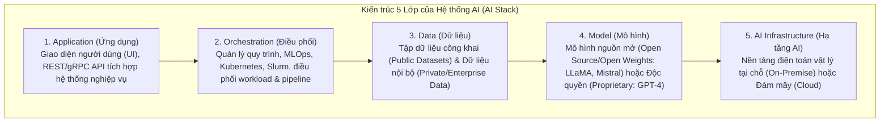
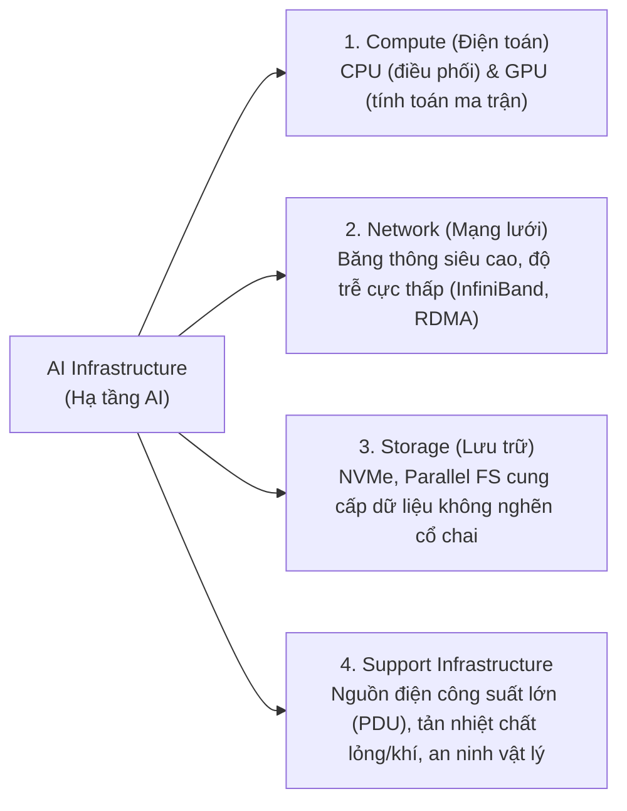
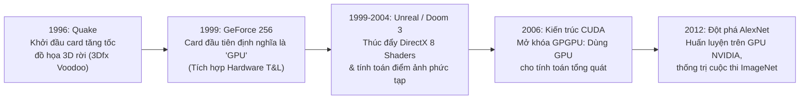
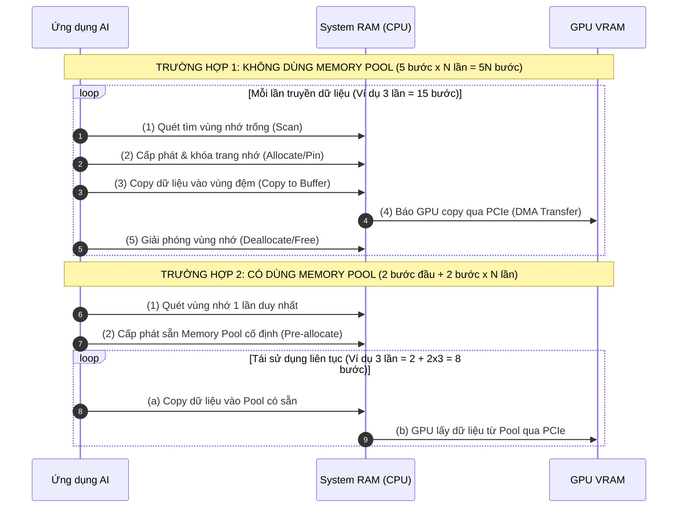
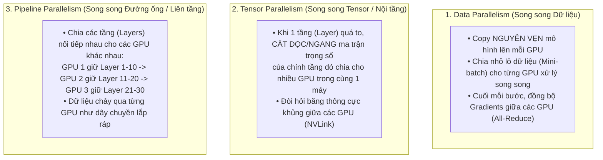
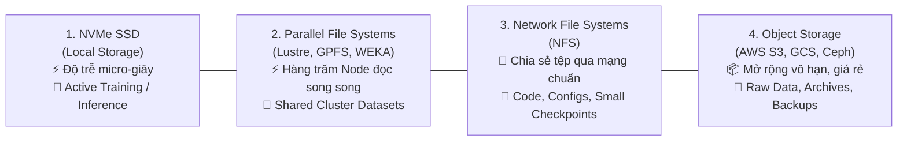

# Module 1: AI Infrastructure (Hạ tầng AI Chuyên dụng)

> [!IMPORTANT]
> **Trọng tâm ôn thi NCA-GENL ở Module 1:**
> Hiểu rõ tại sao hạ tầng Data Center truyền thống (Web/DB) không thể gánh được workload AI; nắm vững **5 lớp của AI Stack**, **4 trụ cột hạ tầng**, sự khác biệt bản chất giữa **CPU vs. GPU** (cùng sự phân hóa giữa **CUDA Cores vs. Tensor Cores**), cơ chế **Memory Pooling**, sự khác nhau giữa **NVLink/NVSwitch (Nội bộ Node)** và **InfiniBand + GPUDirect RDMA (Giữa các Node)**, **3 chiến lược huấn luyện song song (Data, Tensor, Pipeline Parallelism)**, **4 tầng lưu trữ (Storage Tiers)** và bài toán đánh đổi **Cloud (OpEx) vs. On-Premises (CapEx)**.

---

## 1. Tổng quan về Data Center dành riêng cho AI (AI-Centric Data Center)

### 1.1. Góc nhìn Developer: Data Center truyền thống vs. AI Data Center
Với một Developer làm Web/Backend thông thường, bạn quen với kiến trúc microservices: hàng nghìn request HTTP nhỏ lẻ, độc lập, truy vấn Database tuần tự (OLTP) và tốn nhiều thao tác rẽ nhánh logic (`if/else`).

Ngược lại, **AI-Centric Data Center** giải quyết một bài toán hoàn toàn khác:
* **Tính toán song song quy mô cực lớn (Massive Parallel Compute):** Thay vì xử lý từng request nhỏ riêng rẽ, hàng nghìn GPU cùng lúc nhân các ma trận tỷ tham số.
* **Lưu lượng Đông-Tây (East-West Traffic) khổng lồ giữa các Node:**
  * *Data Center truyền thống:* Lưu lượng chủ yếu là **Bắc-Nam (North-South Traffic)** — tức là từ Client ngoài Internet gọi vào Web Server rồi trả về.
  * *AI Data Center:* Lưu lượng chủ yếu là **Đông-Tây (East-West Traffic)** — hàng trăm máy chủ GPU bên trong phòng máy phải trao đổi, đồng bộ hóa hàng Gigabyte trọng số (gradients/weights) với nhau sau mỗi mili-giây!
* **Thông lượng I/O dữ liệu cực cao (High I/O Throughput):** Hệ thống lưu trữ phải "bơm" hàng Terabyte dữ liệu liên tục vào VRAM của GPU. Nếu ổ cứng hoặc mạng đọc chậm, dàn GPU triệu đô sẽ rơi vào trạng thái chờ rỗi (**GPU Starvation / I/O Bottleneck**).

### 1.2. Kiến trúc 5 lớp của AI Stack hoàn chỉnh
Từ tầng giao tiếp với người dùng cuối xuống tới phần cứng vật lý, hệ thống AI được chia thành 5 lớp chuẩn:

### 1.3. Bốn trụ cột cơ bản của Hạ tầng AI (4 Pillars of AI Infrastructure)
Để lớp thứ 5 (**AI Infrastructure**) vận hành trơn tru, nó bắt buộc phải đứng trên 4 trụ cột:

---

## 2. Lịch sử tiến hóa của GPU và Bước ngoặt sang AI

Tại sao chiếc card đồ họa dùng để chơi game lại trở thành "trái tim" của cuộc cách mạng Generative AI?

### Phân tích các cột mốc lịch sử (Hay hỏi trong đề thi):
1. **Giai đoạn Đồ họa 3D (1996 – 2004):**
   * **Quake (1996):** Đánh dấu sự khởi đầu của việc dùng card tăng tốc đồ họa 3D rời.
   * **NVIDIA GeForce 256 (1999):** Chiếc card đồ họa đầu tiên trên thế giới chính thức được NVIDIA định nghĩa là **"GPU" (Graphics Processing Unit)**, tích hợp sẵn phần cứng chuyển đổi tọa độ và ánh sáng (**Hardware T&L** - Transform and Lighting).
   * **Unreal Tournament & Quake III Arena (1999) / Doom 3 (2004):** Thúc đẩy đồ họa tả thực nhờ DirectX 8 Programmable Shaders và tính toán ma trận điểm ảnh (pixel) phức tạp.
2. **Bước ngoặt sang Machine Learning & Deep Learning:**
   * **Sự tương đồng toán học (The Core Idea):** Để dựng hình 3D (xoay vật thể, đổ bóng hàng triệu đa giác cùng lúc), GPU phải thực hiện hàng tỷ phép nhân ma trận ($A \times B$). Các nhà nghiên cứu nhận ra: **Mạng nơ-ron nhân tạo (Neural Networks) về bản chất toán học cũng chính là các phép nhân ma trận và tích vô hướng lặp đi lặp lại!**
   * **Khởi đầu tăng tốc – CUDA (2006):** Trước năm 2006, muốn dùng GPU tính toán toán học, lập trình viên phải "ngụy trang" dữ liệu thành các tọa độ màu sắc/texture đồ họa rất khổ sở. Năm 2006, NVIDIA ra mắt **CUDA (Compute Unified Device Architecture)**, cho phép dev dùng C/C++/Python điều khiển trực tiếp GPU cho các tác vụ tính toán tổng quát (**GPGPU** - General-Purpose computing on Graphics Processing Units).
   * **Đột phá lịch sử – AlexNet (2012):** Mô hình mạng nơ-ron tích chập (CNN) **AlexNet** (do Alex Krizhevsky, Ilya Sutskever và Geoffrey Hinton phát triển) được huấn luyện hoàn toàn trên GPU NVIDIA đã giành chiến thắng áp đảo tại cuộc thi thị giác máy tính **ImageNet 2012**, hạ tỷ lệ lỗi xuống mức kỷ lục và chính thức châm ngòi cho kỷ nguyên Deep Learning hiện đại.

---

## 3. So sánh chuyên sâu: CPU vs. GPU (Và CUDA Cores vs. Tensor Cores)

### 3.1. Phép ẩn dụ trực quan (Analogy kinh điển trong bài thi)
* **CPU giống như một Chuyên cơ riêng (Private Jet):**
  * Ít chỗ ngồi (ít nhân), nhưng khoang cực kỳ rộng rãi, sang trọng, linh hoạt.
  * Có thể cất cánh tức thì, bay tới bất kỳ sân bay nhỏ nào, xử lý các lịch trình thay đổi đột xuất (`if/else` phức tạp) cho một nhóm rất nhỏ khách VIP.
  * **Mục tiêu tối ưu:** **Độ trễ thấp (Low Latency)** cho từng tác vụ tuần tự đơn lẻ.
* **GPU giống như một Chuyến bay thương mại khổng lồ (Commercial Flight / Airbus A380):**
  * Hàng trăm/nghìn chỗ ngồi (hàng nghìn nhân), ghế đơn giản xếp san sát nhau, bay theo tuyến cố định.
  * Không linh hoạt bằng chuyên cơ riêng, nhưng có khả năng vận chuyển một lượng hành khách khổng lồ cùng một lúc với hiệu suất nhiên liệu trên mỗi đầu người cực kỳ tối ưu.
  * **Mục tiêu tối ưu:** **Thông lượng cao (High Throughput)** cho khối lượng dữ liệu song song khổng lồ.

```mermaid
flowchart TB
    subgraph CPU_Arch["Kiến trúc CPU (Low Latency - Xử lý Tuần tự / SISD & SIMD)"]
        direction LR
        Control_CPU["Bộ điều khiển lớn<br/>(Branch Prediction & Out-of-Order Execution)"]
        ALU_CPU["Ít nhân lớn nhưng cực mạnh<br/>(4 - 64 Cores, xung nhịp cao)"]
        Cache_CPU["Bộ nhớ đệm L1/L2/L3 cực lớn"]
        RAM_CPU["System RAM (DDR5 - Dung lượng lớn)"]
        Control_CPU --- ALU_CPU --- Cache_CPU --- RAM_CPU
    end

    subgraph GPU_Arch["Kiến trúc GPU (High Throughput - Xử lý Song song / SIMT)"]
        direction LR
        Control_GPU["Nhiều bộ điều khiển chia sẻ"]
        ALU_GPU["Hàng nghìn nhân tính toán<br/>(CUDA Cores + Tensor Cores)"]
        Cache_GPU["Cache L1/L2 nhỏ gọn"]
        VRAM_GPU["Băng thông bộ nhớ siêu rộng<br/>(HBM3 / HBM3e - Nhiều TB/s)"]
        Control_GPU --- ALU_GPU --- Cache_GPU --- VRAM_GPU
    end
```

### 3.2. Bảng đối chiếu chi tiết CPU vs. GPU
| Tiêu chí | CPU (Central Processing Unit) | GPU (Graphics Processing Unit) |
| :--- | :--- | :--- |
| **Phép ẩn dụ** | **Chuyên cơ riêng (Private Jet)** | **Máy bay thương mại (Commercial Flight)** |
| **Số lượng nhân (Cores)** | Ít (từ 4 đến 64 nhân lớn, cấu trúc phức tạp). | Rất nhiều (hàng nghìn đến hàng chục nghìn nhân tính toán đơn giản hơn). |
| **Tính linh hoạt (Flexibility)** | **Rất cao**, thiết kế đa mục đích (General-purpose), tập lệnh phức tạp. | **Ít linh hoạt hơn**, chuyên biệt cho phép toán song song đồng nhất (**SIMD / SIMT** - Single Instruction, Multiple Threads). |
| **Mục tiêu tối ưu (Focus)** | **Độ trễ thấp (Low Latency):** Hoàn thành 1 tác vụ nhanh nhất có thể. | **Thông lượng cao (High Throughput):** Xử lý lượng dữ liệu lớn nhất trong 1 đơn vị thời gian. |
| **Hiệu năng xử lý** | Tối ưu cho tác vụ tuần tự (Sequential), logic phức tạp, nhiều rẽ nhánh (`if/else`). | Tối ưu cho tác vụ lặp đi lặp lại trên mảng/ma trận dữ liệu khổng lồ. |
| **Bộ nhớ đệm & Băng thông** | Cache L1, L2, L3 lớn để giảm độ trễ truy xuất RAM. | Cache nhỏ hơn trên mỗi nhân, nhưng ưu tiên **băng thông bộ nhớ (HBM, GDDR)** cực rộng. |
| **Use Cases điển hình** | Chạy hệ điều hành (OS), Web server, Database OLTP, điều phối I/O. | Dựng hình 3D, **AI Training & Inference**, mô phỏng vật lý, xử lý dữ liệu lớn. |

### 3.3. Làm rõ chuyên sâu: CUDA Cores vs. Tensor Cores bên trong GPU NVIDIA
Trong đề thi NCA-GENL, bạn sẽ thấy nhắc đến cả **CUDA Cores** và **Tensor Cores**. Chúng khác nhau thế nào?
* **CUDA Cores (Nhân tính toán song song chuẩn):**
  * Thực hiện **1 phép tính số học vô hướng (scalar)** (như $a \times b + c$) trong mỗi chu kỳ xung nhịp (clock cycle).
  * Đa năng, dùng cho đồ họa 3D, tính toán vật lý, xử lý dữ liệu tổng quát.
* **Tensor Cores (Nhân chuyên dụng cho Deep Learning / Transformer - Ra mắt từ kiến trúc Volta):**
  * Thực hiện **phép nhân và cộng nguyên một khối ma trận con (Matrix Multiply-Accumulate: $\mathbf{D} = \mathbf{A} \times \mathbf{B} + \mathbf{C}$)** chỉ trong **1 chu kỳ xung nhịp duy nhất**!
  * Hỗ trợ tính toán **Độ chính xác hỗn hợp (Mixed Precision: `FP16`, `BF16`, `TF32`, `FP8`, `INT8`)** và **Transformer Engine** (trên GPU Hopper H100 & Blackwell B200), giúp tăng tốc độ huấn luyện và suy luận LLM nhanh gấp hàng chục lần so với chỉ dùng CUDA Cores thông thường.

---

### 3.4. Kỹ thuật Memory Pooling giữa CPU và GPU

Trong kiến trúc máy tính, CPU dùng **System RAM**, còn GPU dùng **VRAM** riêng biệt. Việc truyền dữ liệu qua lại giữa RAM và VRAM thông qua bus **PCIe** là một điểm nghẽn cổ chai (bottleneck) kinh điển.

* **Góc nhìn Developer:** Kỹ thuật **Memory Pooling** giống hệt như **Database Connection Pooling** hay **Thread Pooling** trong lập trình backend — thay vì mỗi lần gửi dữ liệu lại gọi hệ điều hành cấp phát (`malloc/cudaMallocHost`), khóa trang nhớ (pin memory) rồi giải phóng (`free`) rất tốn kém, ta khởi tạo sẵn một **Memory Pool cố định** và tái sử dụng liên tục!

---

## 4. Hạ tầng Mạng & Các Chiến lược Huấn luyện Song song (Distributed Training)

Khi một mô hình LLM có 70 tỷ hay 400 tỷ tham số, nó không thể nằm vừa trong VRAM của 1 chiếc GPU (ví dụ H100 có 80GB VRAM). Ta bắt buộc phải chia nhỏ công việc ra hàng chục, hàng trăm GPU.

### 4.1. Ba Chiến lược Song song hóa trong Huấn luyện AI (Multi-GPU Parallelism)
Đề thi NCA-GENL thường hỏi cách phân chia mô hình và dữ liệu qua nhiều GPU:

### 4.2. Phân biệt Kết nối Nội bộ Máy chủ (NVLink) vs. Kết nối Giữa các Máy chủ (InfiniBand)
Để 3 chiến lược song song trên không bị nghẽn mạng, NVIDIA sử dụng 2 tầng kết nối tốc độ cao:
1. **Bên trong cùng 1 máy chủ (Intra-node / Scale-up): NVLink & NVSwitch**
   * Thay vì để 8 chiếc GPU trong cùng một thùng máy DGX nói chuyện với nhau qua khe cắm PCIe chật hẹp, **NVLink** và chip chuyển mạch **NVSwitch** nối trực tiếp các GPU với nhau với băng thông lên tới **900 GB/s – 1.8 TB/s** (nhanh gấp 7–14 lần PCIe), tạo thành một bể bộ nhớ VRAM khổng lồ dùng chung.
2. **Giữa các máy chủ khác nhau trong cụm Cluster (Inter-node / Scale-out): InfiniBand & GPUDirect RDMA**
   * **Ẩn dụ Đường bộ (Ethernet) vs. Đường ray tàu cao tốc Shinkansen (InfiniBand):**
     * **Ethernet truyền thống:** Kiểm soát gói tin qua ngăn xếp TCP/IP của hệ điều hành gây **overhead CPU cao** và **độ trễ lớn**.
     * **InfiniBand:** Chuẩn mạng chuyên dụng cho HPC và AI Cluster với băng thông **400Gbps – 800Gbps/cổng**, không rớt gói tin (lossless).
   * **Công nghệ RDMA & GPUDirect RDMA:** Cho phép **GPU ở máy chủ A đọc/ghi trực tiếp vào VRAM của GPU ở máy chủ B** qua card mạng InfiniBand mà **không cần thông qua CPU hay System RAM**, giảm độ trễ xuống mức **micro-giây ($\mu s$)**.

```mermaid
flowchart TD
    subgraph Trad["Mạng Truyền thống (Không có GPUDirect RDMA)"]
        direction LR
        G1["GPU 1 VRAM<br/>(Node A)"] -->|Copy 1| R1["System RAM<br/>& CPU Kernel (Node A)"]
        R1 -->|Copy 2| NIC1["Card mạng NIC<br/>(Node A)"]
        NIC1 ==>|Mạng TCP/IP| NIC2["Card mạng NIC<br/>(Node B)"]
        NIC2 -->|Copy 3| R2["System RAM<br/>& CPU Kernel (Node B)"]
        R2 -->|Copy 4| G2["GPU 2 VRAM<br/>(Node B)"]
    end

    subgraph RDMA_Flow["Công nghệ InfiniBand + GPUDirect RDMA"]
        direction LR
        GA["GPU 1 VRAM<br/>(Node A)"] <==>|"Đọc/Ghi trực tiếp qua NIC & InfiniBand<br/>(Bỏ qua hoàn toàn CPU & System RAM)"| GB["GPU 2 VRAM<br/>(Node B)"]
    end
```

---

## 5. Hạ tầng Lưu trữ cho AI (Storage Infrastructure)

### 5.1. Bốn lớp lưu trữ chính trong Data Center AI
Từ nhanh nhất (nhưng đắt và dung lượng nhỏ) đến rẻ nhất (nhưng chậm hơn và dung lượng vô hạn):

| Lớp lưu trữ | Đặc tính kỹ thuật | Mục đích sử dụng chuẩn trong AI |
| :--- | :--- | :--- |
| **1. NVMe SSD (Local Storage)** | Gắn trực tiếp qua bus PCIe của từng máy chủ cục bộ; độ trễ micro-giây, IOPS cực đại nhưng dung lượng giới hạn theo máy. | Chứa **Hot Data** (dữ liệu đang nạp trực tiếp vào vòng lặp training) và chạy **Inference** tốc độ cao. |
| **2. Parallel File Systems (Lustre, IBM Spectrum Scale/GPFS, WEKA)** | Hệ thống tệp phân tán song song; chia nhỏ file ra nhiều ổ đĩa mạng, cho phép **hàng trăm node GPU đọc/ghi đồng thời** trên cùng một namespace mà không nghẽn. | Lưu trữ tập dữ liệu huấn luyện khổng lồ dùng chung cho toàn bộ cụm GPU Cluster. |
| **3. Network File Systems (NFS)** | Chia sẻ tệp qua mạng truyền thống (Client-Server); dễ cài đặt nhưng dễ nghẽn nếu hàng trăm node cùng đọc dữ liệu nặng. | Lưu trữ **mã nguồn (source code/scripts), file cấu hình (configs)**, tập dữ liệu nhỏ và checkpoint nhỏ. |
| **4. Object Storage (AWS S3, GCS, Ceph, MinIO)** | Lưu trữ đối tượng theo cơ chế Bucket (HTTP/REST API); dung lượng mở rộng gần như vô hạn, chi phí cực rẻ nhưng độ trễ cao. | Lưu trữ **Cold/Warm Data**: Dữ liệu thô chưa xử lý (Raw datasets), bản sao lưu (Backups), lịch sử Checkpoint dài hạn, logs. |

### 5.2. Kiến trúc lưu trữ phân tầng (Tiered Storage) & GPUDirect Storage (GDS)
* **Hot Data (Dữ liệu nóng):** Dữ liệu đang trực tiếp tham gia vào vòng lặp huấn luyện $\to$ Bắt buộc nằm trên **NVMe SSD** hoặc **Parallel File System**.
* **Công nghệ NVIDIA GPUDirect Storage (GDS):** Bình thường, để đọc 1 file từ ổ cứng NVMe vào GPU, CPU phải đọc file đó vào vùng đệm System RAM (CPU Bounce Buffer) rồi mới copy sang VRAM của GPU. **GPUDirect Storage (GDS)** mở một đường truyền **DMA (Direct Memory Access) thẳng từ ổ cứng NVMe/Parallel Storage vào thẳng VRAM của GPU**, giải phóng hoàn toàn CPU và tăng băng thông I/O lên gấp nhiều lần!
* **Warm / Cold Data (Dữ liệu ấm / lạnh):** Dữ liệu lịch sử, checkpoint của các epoch cũ, raw data chưa làm sạch $\to$ Đẩy về **Object Storage** để tối ưu hóa chi phí.

---

## 6. Phân tích: Điện toán Đám mây (Cloud) vs. Tại chỗ (On-Premises)

| Tiêu chí so sánh | Cloud Infrastructure (AWS, Azure, GCP, OCI) | On-Premise Infrastructure (DGX SuperPOD tại chỗ) |
| :--- | :--- | :--- |
| **Mô hình chi phí (Cost Model)** | **OpEx (Operating Expense - Chi phí vận hành):** Trả tiền theo mức sử dụng (Pay-as-you-go theo giờ/phút), không tốn vốn mua máy ban đầu. | **CapEx (Capital Expense - Chi phí đầu tư vốn):** Đầu tư ban đầu cực lớn (mua server, bản quyền, xây phòng lạnh, trạm biến áp). |
| **Khả năng mở rộng (Scalability)** | **Cực kỳ linh hoạt (Elastic):** Thuê thêm 100 GPU trong vài phút khi cần train, tắt đi ngay khi xong việc. | **Giới hạn cứng:** Phụ thuộc vào số lượng máy vật lý đã mua; muốn nâng cấp phải chờ đặt hàng và lắp đặt hàng tháng trời. |
| **Bảo mật & Chủ quyền dữ liệu (Data Sovereignty)** | Phụ thuộc vào chính sách bảo mật của nhà cung cấp Cloud (môi trường Multi-tenant dùng chung hạ tầng). | **Kiểm soát tuyệt đối 100%:** Dữ liệu nằm hoàn toàn bên trong tường lửa vật lý của doanh nghiệp, đáp ứng chuẩn pháp lý khắt khe nhất. |
| **Bảo trì & Vận hành (Maintenance)** | Nhà cung cấp Cloud lo toàn bộ việc thay ổ cứng hỏng, nâng cấp mạng, duy trì SLA. | Doanh nghiệp phải tự thuê đội ngũ kỹ sư Data Center trực 24/7 để vận hành, làm mát và sửa chữa phần cứng. |
| **Khi nào nên chọn?** | **Startup, R&D ban đầu**, dự án ngắn hạn, tải công việc biến động mạnh (Spiky workloads) hoặc cần thử nghiệm nhanh. | **Doanh nghiệp lớn, Ngân hàng, Y tế, Quốc phòng** có dữ liệu tối mật và tải công việc AI chạy liên tục 24/7 ổn định (tối ưu chi phí dài hạn). |

---

## 7. Bẫy đề thi NCA-GENL & Câu hỏi Thực chiến (Exam Traps & Mini Quiz)

> [!WARNING]
> **Các bẫy kinh điển trong đề thi Module 1:**
> 1. **Bẫy CPU vs. GPU & CUDA vs. Tensor Cores:**
>    * *Low Latency & Sequential Processing* $\to$ **CPU**.
>    * *High Throughput & Parallel Processing* $\to$ **GPU**.
>    * Nhân phần cứng chuyên dụng bên trong GPU NVIDIA để tăng tốc phép nhân ma trận Deep Learning/Transformer với độ chính xác hỗn hợp (`FP16`/`FP8`) $\to$ **Tensor Cores**.
> 2. **Bẫy GPUDirect RDMA vs. GPUDirect Storage (GDS) vs. NVLink:**
>    * Kết nối giữa các GPU **bên trong cùng 1 máy chủ** $\to$ **NVLink / NVSwitch**.
>    * Truyền dữ liệu trực tiếp giữa các GPU **ở các máy chủ khác nhau qua mạng** $\to$ **InfiniBand + GPUDirect RDMA**.
>    * Truyền dữ liệu trực tiếp từ **ổ cứng lưu trữ (NVMe/Storage) vào thẳng VRAM GPU** không qua CPU RAM $\to$ **GPUDirect Storage (GDS)**.
> 3. **Bẫy Storage Tiers:** Lưu *code, script, config* $\to$ **NFS**. Lưu *dữ liệu đang huấn luyện cho cụm hàng trăm node đọc song song* $\to$ **Parallel File System (Lustre/GPFS)**. Lưu *dữ liệu thô khổng lồ dài hạn giá rẻ* $\to$ **Object Storage (S3)**.

### Câu hỏi tự kiểm tra (Mini Quiz):
1. **Câu 1:** Một công ty khởi nghiệp AI muốn huấn luyện thử nghiệm một mô hình ngôn ngữ trong 2 tuần nhưng không có vốn đầu tư mua sắm máy chủ ban đầu. Lựa chọn hạ tầng nào là phù hợp nhất?
   * *Đáp án:* **Cloud Infrastructure (mô hình chi phí OpEx - Pay-as-you-go)** vì cho phép thuê GPU tức thì và giải phóng tài nguyên ngay sau khi hoàn tất thử nghiệm.
2. **Câu 2:** Khi huấn luyện một mô hình LLM khổng lồ mà kích thước của một tầng đơn lẻ (single layer) vượt quá dung lượng VRAM của 1 GPU, kỹ sư phải chia nhỏ ma trận trọng số của chính tầng đó ra nhiều GPU trong cùng một node. Kỹ thuật này gọi là gì?
   * *Đáp án:* **Tensor Parallelism (Song song hóa Tensor)**.
