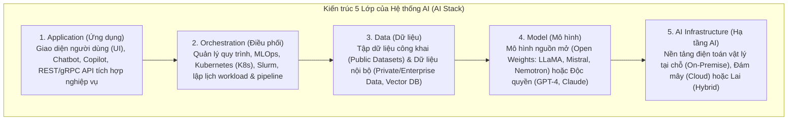
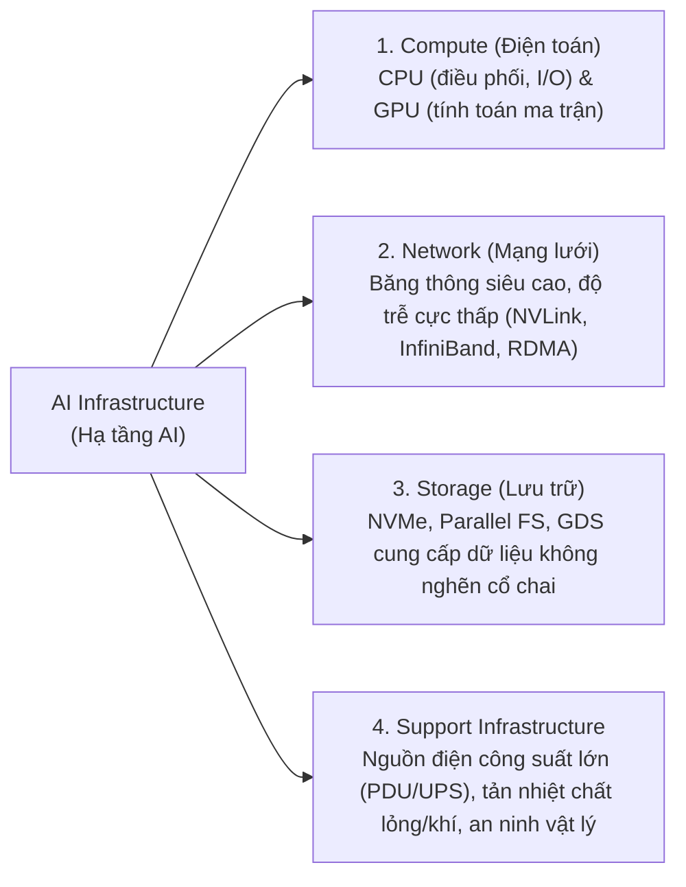
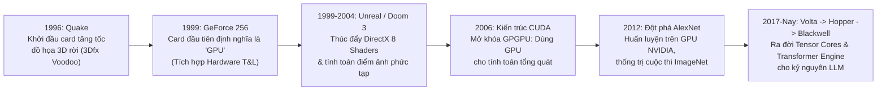
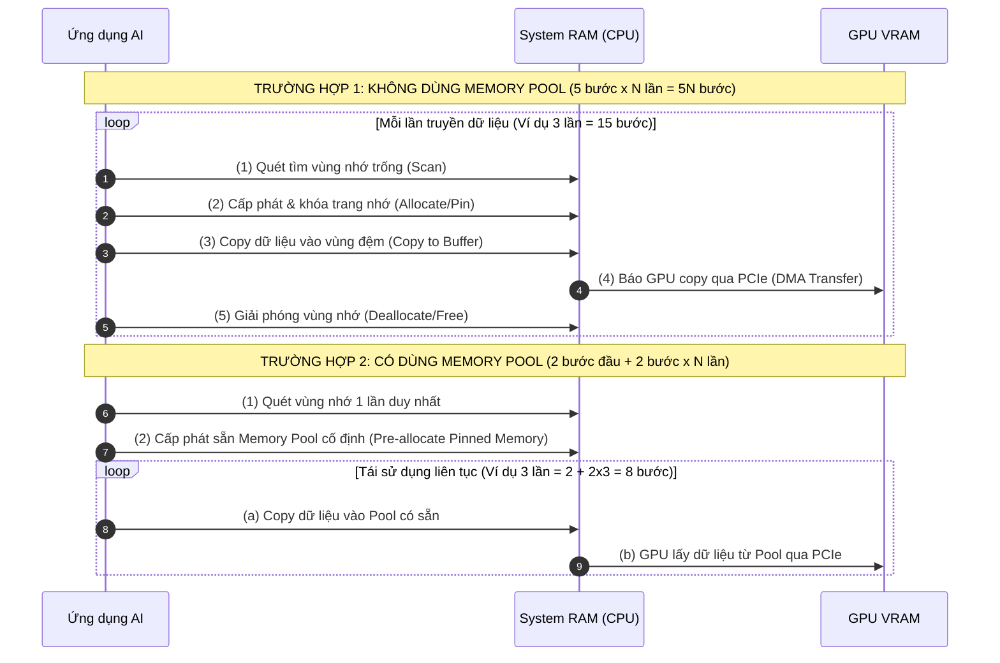
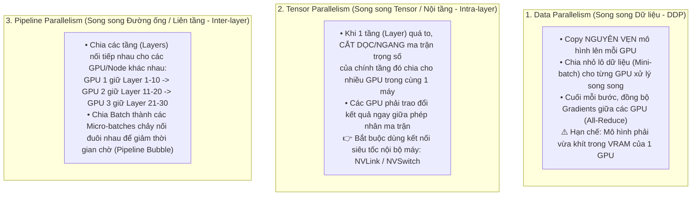
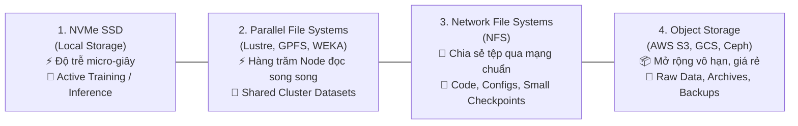

# Module 1: AI Infrastructure (Hạ tầng AI Chuyên dụng)

> [!IMPORTANT]
> **Trọng tâm ôn thi NCA-GENL ở Module 1:**
> Hiểu rõ tại sao hạ tầng Data Center truyền thống (Web/DB) không thể gánh được workload AI; nắm vững **5 lớp của AI Stack**, **4 trụ cột hạ tầng**, sự khác biệt bản chất giữa **CPU vs. GPU** (cùng kiến trúc **SMs, Warps, CUDA Cores vs. Tensor Cores** và các chuẩn số học **`FP32`, `TF32`, `FP16`, `BF16`, `FP8`, `INT8`**), cơ chế **Memory Pooling**, sự khác nhau giữa **NVLink/NVSwitch (Nội bộ Node)** và **InfiniBand / Spectrum-X + GPUDirect RDMA (Giữa các Node)**, **3D Parallelism (Data, Tensor, Pipeline Parallelism) + ZeRO + NCCL Collectives**, **4 tầng lưu trữ (Storage Tiers) + GPUDirect Storage (GDS)** và bài toán đánh đổi **Cloud (OpEx) vs. On-Premises (CapEx) vs. Hybrid**.

---

## 1. Tổng quan về Data Center dành riêng cho AI (AI-Centric Data Center)

### 1.1. Góc nhìn Developer: Data Center truyền thống vs. AI Data Center
Với một Developer làm Web/Backend thông thường, bạn quen với kiến trúc microservices: hàng nghìn request HTTP nhỏ lẻ, độc lập, truy vấn Database tuần tự (OLTP) và tốn nhiều thao tác rẽ nhánh logic (`if/else`).

Ngược lại, **AI-Centric Data Center (AI Factory)** giải quyết một bài toán hoàn toàn khác:
* **Tính toán song song quy mô cực lớn (Massive Parallel Compute):** Thay vì xử lý từng request nhỏ riêng rẽ, hàng nghìn GPU phải phối hợp nhịp nhàng như một siêu máy tính duy nhất để nhân các ma trận hàng trăm tỷ tham số.
* **Lưu lượng Đông-Tây (East-West Traffic) khổng lồ giữa các Node:**
  * *Data Center truyền thống:* Lưu lượng chủ yếu là **Bắc-Nam (North-South Traffic)** — tức là từ Client ngoài Internet gọi vào Web Server rồi trả về.
  * *AI Data Center:* Lưu lượng chủ yếu là **Đông-Tây (East-West Traffic)** — hàng trăm máy chủ GPU bên trong phòng máy phải trao đổi, đồng bộ hóa hàng chục Gigabyte trọng số và đạo hàm (gradients/weights/activations) với nhau sau mỗi mili-giây! Chỉ cần 1 card mạng hoặc 1 đường truyền bị trễ (straggler), toàn bộ hàng nghìn GPU khác phải đứng đợi.
* **Thông lượng I/O dữ liệu cực cao (High I/O Throughput):** Hệ thống lưu trữ phải "bơm" hàng Terabyte dữ liệu liên tục vào VRAM của GPU. Nếu ổ cứng hoặc mạng đọc chậm, dàn GPU triệu đô sẽ rơi vào trạng thái chờ rỗi (**GPU Starvation / I/O Bottleneck**).
* **Mật độ điện năng và Tản nhiệt cực hạn (Power & Cooling Density):**
  * *Rack truyền thống (CPU):* Tiêu thụ khoảng **5 – 15 kW/rack**, làm mát bằng điều hòa không khí (Air Cooling) thông thường.
  * *Rack AI hiện đại (DGX H100 / GB200 NVL72):* Tiêu thụ từ **40 kW đến hơn 120 kW/rack**! Ở mật độ này, quạt gió không thể tải nhiệt kịp mà bắt buộc phải dùng **Tản nhiệt chất lỏng trực tiếp lên chip (Direct-to-Chip Liquid Cooling)** hoặc tản nhiệt ngâm (Immersion Cooling) để tối ưu chỉ số hiệu quả sử dụng năng lượng (**PUE - Power Usage Effectiveness**).

| Tiêu chí so sánh | Data Center Truyền thống (General IT / Web) | AI Data Center (AI Factory / HPC) |
| :--- | :--- | :--- |
| **Đơn vị tính toán chính** | CPU đa nhân (Intel Xeon, AMD EPYC) | GPU tăng tốc (NVIDIA H100, B200) + CPU điều phối |
| **Đặc trưng tải công việc** | Hàng triệu tác vụ nhỏ, độc lập, bất đồng bộ | Một hoặc vài Job khổng lồ, phụ thuộc chặt chẽ, đồng bộ |
| **Hướng lưu lượng mạng chính** | **North-South** (Client $\leftrightarrow$ Server, TCP/IP) | **East-West** (GPU $\leftrightarrow$ GPU, RDMA không rớt gói) |
| **Yêu cầu độ trễ mạng** | Mili-giây ($ms$) là chấp nhận được | Micro-giây ($\mu s$), jitter cực thấp |
| **Mật độ điện & Làm mát** | $5 - 15\text{ kW/rack}$ (Làm mát bằng khí - Air Cooling) | $40 - 120+\text{ kW/rack}$ (Làm mát bằng chất lỏng - Liquid Cooling) |

### 1.2. Kiến trúc 5 lớp của AI Stack hoàn chỉnh
Từ tầng giao tiếp với người dùng cuối xuống tới phần cứng vật lý, hệ thống AI được chia thành 5 lớp chuẩn:

* **Làm rõ Lớp 2 (Orchestration) trong thực tế:**
  * **Slurm (Simple Linux Utility for Resource Management):** Trình quản lý workload và lập lịch hàng đợi (Batch Job Scheduler) tiêu chuẩn cho các cụm huấn luyện HPC và siêu máy tính AI lớn (như DGX SuperPOD). Khi cần chạy 1 job pre-training LLM kéo dài 2 tuần trên 512 GPU cùng lúc, kỹ sư dùng **Slurm**.
  * **Kubernetes (K8s) + NVIDIA GPU Operator:** Nền tảng điều phối container tiêu chuẩn cho các dịch vụ **Microservices, Inference Serving (Triton/NIM)** cần tự động co giãn (Auto-scaling), cân bằng tải (Load Balancing) và tự phục hồi (Self-healing) 24/7.

### 1.3. Bốn trụ cột cơ bản của Hạ tầng AI (4 Pillars of AI Infrastructure)
Để lớp thứ 5 (**AI Infrastructure**) vận hành trơn tru, nó bắt buộc phải đứng vững trên 4 trụ cột (chỉ cần 1 trụ cột yếu sẽ tạo thành điểm nghẽn cho cả hệ thống):

---

## 2. Lịch sử tiến hóa của GPU và Bước ngoặt sang AI

Tại sao chiếc card đồ họa dùng để chơi game lại trở thành "trái tim" của cuộc cách mạng Generative AI?

### Phân tích các cột mốc lịch sử (Hay hỏi trong đề thi):
1. **Giai đoạn Đồ họa 3D (1996 – 2004):**
   * **Quake (1996):** Đánh dấu sự khởi đầu của việc dùng card tăng tốc đồ họa 3D rời.
   * **NVIDIA GeForce 256 (1999):** Chiếc card đồ họa đầu tiên trên thế giới chính thức được NVIDIA định nghĩa là **"GPU" (Graphics Processing Unit)**, tích hợp sẵn phần cứng chuyển đổi tọa độ và ánh sáng (**Hardware T&L** - Transform and Lighting) trực tiếp trên chip thay vì bắt CPU tính.
   * **Unreal Tournament & Quake III Arena (1999) / Doom 3 (2004):** Thúc đẩy đồ họa tả thực nhờ DirectX 8 Programmable Pixel/Vertex Shaders, cho phép lập trình viên can thiệp vào từng điểm ảnh (pixel) bằng các phép toán vector/ma trận.
2. **Bước ngoặt sang Machine Learning & Deep Learning (2006 – Nay):**
   * **Sự tương đồng toán học (The Core Idea):** Để dựng hình 3D (xoay vật thể trong không gian 3 chiều, chiếu sáng, đổ bóng hàng triệu đa giác cùng lúc), GPU phải thực hiện hàng tỷ phép nhân ma trận ($A \times B$) và phép biến đổi tuyến tính. Các nhà nghiên cứu AI nhận ra: **Mạng nơ-ron nhân tạo (Neural Networks) về bản chất toán học cũng chính là các phép nhân ma trận ($\mathbf{Y} = \mathbf{W}\mathbf{X} + \mathbf{B}$) lặp đi lặp lại!**
   * **Khởi đầu tăng tốc – CUDA (2006):** Trước năm 2006, muốn dùng GPU tính toán toán học, lập trình viên phải "ngụy trang" dữ liệu số học thành các tọa độ màu sắc RGB và texture đồ họa (qua OpenGL/DirectX) cực kỳ khổ sở. Năm 2006, NVIDIA ra mắt **CUDA (Compute Unified Device Architecture)**, cho phép dev dùng C/C++/Fortran/Python điều khiển trực tiếp từng nhân GPU cho các tác vụ tính toán tổng quát (**GPGPU** - General-Purpose computing on Graphics Processing Units).
   * **Đột phá lịch sử – AlexNet (2012):** Mô hình mạng nơ-ron tích chập sâu (CNN) **AlexNet** (do Alex Krizhevsky, Ilya Sutskever và Geoffrey Hinton phát triển) được huấn luyện chỉ trên **2 chiếc GPU NVIDIA GTX 580** trong 6 ngày đã giành chiến thắng áp đảo tại cuộc thi thị giác máy tính **ImageNet (ILSVRC 2012)**, giảm tỷ lệ lỗi Top-5 từ 26% xuống 15.3%, chính thức châm ngòi cho sự bùng nổ của kỷ nguyên Deep Learning hiện đại.
   * **Kỷ nguyên AI chuyên biệt (2017 – Nay):** Từ kiến trúc **Volta (V100 - 2017)**, NVIDIA đưa **Tensor Cores** vào GPU; tiếp nối bằng **Ampere (A100 - 2020)** với chuẩn `BF16`/`TF32` và *Multi-Instance GPU (MIG)*; **Hopper (H100 - 2022)** với *Transformer Engine (`FP8`)*; và **Blackwell (B200 - 2024)** với chuẩn `FP4`/`FP6` cho các mô hình nghìn tỷ tham số.

---

## 3. So sánh chuyên sâu: CPU vs. GPU (Vi kiến trúc, Nhân tính toán & Độ chính xác Số học)

### 3.1. Phép ẩn dụ trực quan (Analogy kinh điển trong bài thi)
* **CPU giống như một Chuyên cơ riêng (Private Jet) hoặc Xe đua F1:**
  * Ít chỗ ngồi (ít nhân: 8 – 64 nhân), nhưng khoang cực kỳ rộng rãi, sang trọng, linh hoạt, tốc độ phản ứng từng pha xử lý đơn lẻ cực nhanh.
  * Có thể cất cánh tức thì, bay tới bất kỳ sân bay nhỏ nào, xử lý các lịch trình thay đổi đột xuất (`if/else` phức tạp, quản lý hệ điều hành, ngắt I/O) cho một nhóm rất nhỏ khách VIP.
  * **Mục tiêu tối ưu:** **Độ trễ thấp (Low Latency)** cho từng tác vụ tuần tự đơn lẻ (**SISD** - Single Instruction, Single Data).
* **GPU giống như một Chuyến bay thương mại khổng lồ (Airbus A380) hoặc Đoàn tàu cao tốc nhiều toa:**
  * Hàng nghìn chỗ ngồi (hàng nghìn nhân tính toán), ghế đơn giản xếp san sát nhau, bay theo tuyến cố định.
  * Không linh hoạt bằng chuyên cơ riêng khi chỉ chở 1 người, nhưng có khả năng vận chuyển hàng nghìn hành khách cùng một lúc với hiệu suất nhiên liệu trên mỗi đầu người cực kỳ tối ưu.
  * **Mục tiêu tối ưu:** **Thông lượng cao (High Throughput)** cho khối lượng dữ liệu song song khổng lồ (**SIMT** - Single Instruction, Multiple Threads).

```mermaid
flowchart TB
    subgraph CPU_Arch["Kiến trúc CPU (Low Latency - Xử lý Tuần tự / SISD)"]
        direction LR
        Control_CPU["Bộ điều khiển lớn<br/>(Branch Prediction & Out-of-Order Execution)"]
        ALU_CPU["Ít nhân lớn nhưng cực mạnh<br/>(4 - 64 Cores, xung nhịp cao)"]
        Cache_CPU["Bộ nhớ đệm L1/L2/L3 cực lớn<br/>(Giảm độ trễ truy xuất)"]
        RAM_CPU["System RAM (DDR5 - Dung lượng lớn,<br/>Băng thông ~100-400 GB/s)"]
        Control_CPU --- ALU_CPU --- Cache_CPU --- RAM_CPU
    end

    subgraph GPU_Arch["Kiến trúc GPU (High Throughput - Xử lý Song song / SIMT)"]
        direction LR
        Control_GPU["Hàng trăm cụm SM<br/>(Streaming Multiprocessors)"]
        ALU_GPU["Hàng chục nghìn nhân<br/>(CUDA Cores + Tensor Cores)"]
        Cache_GPU["SRAM / L1 / Shared Memory<br/>tốc độ siêu cao trên mỗi SM"]
        VRAM_GPU["Bộ nhớ HBM3 / HBM3e<br/>(Băng thông siêu rộng: 3 - 8 TB/s!)"]
        Control_GPU --- ALU_GPU --- Cache_GPU --- VRAM_GPU
    end
```

### 3.2. Bảng đối chiếu chi tiết CPU vs. GPU
| Tiêu chí | CPU (Central Processing Unit) | GPU (Graphics Processing Unit) |
| :--- | :--- | :--- |
| **Phép ẩn dụ** | **Chuyên cơ riêng (Private Jet)** | **Máy bay thương mại (Commercial Flight)** |
| **Số lượng nhân (Cores)** | Ít (từ 4 đến 128 nhân lớn, cấu trúc phức tạp). | Rất nhiều (hàng nghìn đến hàng chục nghìn nhân tính toán tinh gọn). |
| **Tính linh hoạt (Flexibility)** | **Rất cao**, thiết kế đa mục đích (General-purpose), tập lệnh phức tạp, rẽ nhánh mạnh. | **Ít linh hoạt hơn**, chuyên biệt cho phép toán song song đồng nhất (**SIMD / SIMT** - Single Instruction, Multiple Threads). |
| **Mục tiêu tối ưu (Focus)** | **Độ trễ thấp (Low Latency):** Hoàn thành 1 tác vụ tuần tự nhanh nhất có thể. | **Thông lượng cao (High Throughput):** Xử lý lượng dữ liệu lớn nhất trong 1 đơn vị thời gian. |
| **Hiệu năng xử lý** | Tối ưu cho tác vụ tuần tự (Sequential), logic phức tạp, nhiều rẽ nhánh (`if/else`). | Tối ưu cho tác vụ lặp đi lặp lại trên mảng/ma trận dữ liệu khổng lồ (Matrix Multiplication). |
| **Bộ nhớ đệm & Băng thông** | Cache L1, L2, L3 lớn để giảm độ trễ truy xuất RAM; dùng RAM DDR4/DDR5 (~100–400 GB/s). | Cache nhỏ hơn trên mỗi nhân, nhưng trang bị bộ nhớ xếp chồng **HBM (High Bandwidth Memory)** băng thông lên tới **3 TB/s – 8 TB/s**. |
| **Vai trò trong hệ thống AI** | Khởi tạo tiến trình, đọc/giải nén dữ liệu từ đĩa, chuẩn bị Batch, điều phối mạng, gửi lệnh (Kernel Launch) xuống GPU. | Thực thi Forward Pass, tính Loss, Backpropagation, nhân ma trận Attention và sinh token trong LLM. |

### 3.3. Giải phẫu bên trong GPU NVIDIA: SM, Warp, CUDA Cores vs. Tensor Cores
Để hiểu sâu các câu hỏi về phần cứng GPU trong đề thi NCA-GENL, bạn cần nắm rõ cấu trúc phân cấp bên trong một GPU NVIDIA:
1. **SM (Streaming Multiprocessor):** Là khối xây dựng nền tảng của GPU. Một chiếc GPU H100 có hơn 100 cụm SM. Mỗi cụm SM chứa bộ lập lịch lệnh, bộ nhớ đệm **L1 Cache / Shared Memory (SRAM)** siêu tốc, cùng hàng trăm **CUDA Cores** và nhiều **Tensor Cores**.
2. **Warp (Đơn vị lập lịch 32 luồng):** GPU thực thi các luồng (threads) theo từng nhóm **32 threads gọi là 1 Warp** chạy cùng một câu lệnh tại cùng một thời điểm (**SIMT**).
3. **Sự khác biệt cốt lõi giữa CUDA Cores và Tensor Cores:**

| Đặc điểm | CUDA Cores (Nhân tính toán chuẩn) | Tensor Cores (Nhân ma trận chuyên dụng cho AI) |
| :--- | :--- | :--- |
| **Cơ chế toán học trên mỗi xung nhịp (Clock Cycle)** | Thực hiện **1 phép tính số học vô hướng (Scalar FMA)**: $d = a \times b + c$ trên từng cặp số đơn lẻ. | Thực hiện **phép nhân và cộng nguyên một khối ma trận con (Matrix Multiply-Accumulate - MMA)**: $$\mathbf{D} = \mathbf{A} \times \mathbf{B} + \mathbf{C}$$ (ví dụ ma trận $4 \times 4$ hoặc $16 \times 16$) chỉ trong **1 chu kỳ xung nhịp**! |
| **Tốc độ cho Deep Learning** | Chuẩn (Baseline $1\times$). | Nhanh gấp **8x đến 32x** so với CUDA Cores khi chạy mạng nơ-ron và Transformer. |
| **Độ chính xác hỗ trợ** | `FP32`, `FP64`, `INT32`. | Hỗ trợ **Mixed Precision (Độ chính xác hỗn hợp)**: `TF32`, `FP16`, `BF16`, `FP8` (Transformer Engine), `INT8`, `INT4`. |
| **Ứng dụng chính** | Đồ họa 3D, Ray Tracing phụ trợ, mô phỏng vật lý, các phép toán element-wise (như ReLU, LayerNorm, Softmax). | Các lớp **Linear / Fully Connected, Self-Attention ($Q \times K^T$), Convolution** trong Deep Learning và LLM. |

### 3.4. Các Chuẩn Độ chính xác Số học (Numerical Precisions) trong Huấn luyện & Suy luận AI
Một câu hỏi rất phổ biến trong kỳ thi là sự khác biệt giữa các định dạng số dấu phẩy động (`FP32`, `TF32`, `FP16`, `BF16`, `FP8`) và số nguyên (`INT8`, `INT4`):

| Định dạng | Số Bit | Cấu trúc Bit (Sign - Exponent - Mantissa) | Đặc điểm kỹ thuật & Khi nào sử dụng? |
| :--- | :---: | :---: | :--- |
| **`FP32` (Single Precision)** | 32-bit | $1\text{ (Dấu)} + 8\text{ (Mũ)} + 23\text{ (Định trị)}$ | Độ chính xác chuẩn truyền thống (4 bytes/tham số). Rất chính xác nhưng tốn VRAM và băng thông bộ nhớ. |
| **`TF32` (TensorFloat-32)** | 19-bit | $1\text{ (Dấu)} + 8\text{ (Mũ)} + 10\text{ (Định trị)}$ | Định dạng đặc biệt trên Tensor Cores của NVIDIA (từ Ampere A100): giữ **miền giá trị (8-bit mũ) giống hệt FP32** kết hợp độ chính xác của FP16, tự động tăng tốc phép nhân ma trận FP32 lên gấp nhiều lần mà không cần sửa code! |
| **`FP16` (Half Precision)** | 16-bit | $1\text{ (Dấu)} + 5\text{ (Mũ)} + 10\text{ (Định trị)}$ | Giảm 50% VRAM (2 bytes/tham số). Tuy nhiên vì chỉ có **5-bit số mũ** nên miền giá trị hẹp ($\pm 65,504$), dễ bị tràn số (**Overflow/Underflow**) khi tính Gradient, cần dùng kèm kỹ thuật **Loss Scaling**. |
| **`BF16` (Bfloat16 - Brain Float)** | 16-bit | $1\text{ (Dấu)} + \mathbf{8\text{ (Mũ)}} + 7\text{ (Định trị)}$ | **Chuẩn VÀNG để Pre-train và Fine-tune LLM hiện nay!** Giữ nguyên **8-bit phần mũ giống hệt `FP32`** nên dải động (Dynamic Range) cực rộng, **không bao giờ sợ tràn số (Overflow)** khi huấn luyện mạng sâu, dù phần lẻ ít bit hơn FP16. |
| **`FP8` (8-bit Floating Point)** | 8-bit | `E4M3` (4 mũ, 3 lẻ) hoặc `E5M2` (5 mũ, 2 lẻ) | Được quản lý tự động bởi **Transformer Engine** trên GPU **Hopper (H100)** và **Blackwell (B200)**: dùng `E4M3` (chính xác hơn) cho Forward Pass/Inference và `E5M2` (dải rộng hơn) cho Backward Gradients, tăng tốc gấp đôi so với 16-bit! |
| **`INT8` / `INT4` (Integer)** | 8 / 4-bit | Số nguyên lượng tử hóa | Chuyên dùng cho **Suy luận (Inference Quantization - PTQ/AWQ/GPTQ)** hoặc nén mô hình gốc trong **QLoRA (`NF4`)**, giúp giảm 4x–8x dung lượng VRAM so với FP32. |

> [!TIP]
> **Công thức tính nhẩm nhanh dung lượng VRAM cho Trọng số LLM (Rất hữu ích cho Developer & Phòng thi):**
> * Ở chuẩn **`FP32` (4 bytes/param):** Mô hình $N$ tỷ tham số cần $\approx \mathbf{4N}\text{ GB VRAM}$. (VD: 7B cần 28GB).
> * Ở chuẩn **`FP16` / `BF16` (2 bytes/param):** Mô hình $N$ tỷ tham số cần $\approx \mathbf{2N}\text{ GB VRAM}$. (VD: 7B cần ~14GB; 70B cần ~140GB $\to$ phải dùng ít nhất 2 GPU H100 80GB).
> * Ở chuẩn **`FP8` / `INT8` (1 byte/param):** Mô hình $N$ tỷ tham số cần $\approx \mathbf{1N}\text{ GB VRAM}$. (VD: 70B cần ~70GB $\to$ vừa khít 1 GPU H100 80GB!).
> * Ở chuẩn **`INT4` / `NF4` (0.5 byte/param):** Mô hình $N$ tỷ tham số cần $\approx \mathbf{0.5N}\text{ GB VRAM}$. (VD: 70B chỉ cần ~35GB VRAM!).
> *(Lưu ý: Khi chạy **Inference** thực tế, ngoài trọng số mô hình còn phải cộng thêm khoảng 15–20% VRAM cho **KV Cache** và Activations; còn khi **Full Fine-Tuning**, tổng VRAM cần gấp **3 đến 4 lần** trọng số vì phải lưu thêm Gradients và trạng thái Optimizer Adam!)*

---

### 3.5. Kỹ thuật Memory Pooling giữa CPU và GPU

Trong kiến trúc máy tính, CPU dùng **System RAM**, còn GPU dùng **VRAM** riêng biệt. Việc truyền dữ liệu qua lại giữa RAM và VRAM thông qua bus **PCIe** là một điểm nghẽn cổ chai (bottleneck) kinh điển.

* **Góc nhìn Developer:** Để truyền dữ liệu từ System RAM sang GPU VRAM bằng cơ chế **DMA (Direct Memory Access)**, hệ điều hành không thể đọc trực tiếp từ bộ nhớ ảo phân trang thông thường (Pageable Memory - có thể bị swap ra đĩa cứng bất cứ lúc nào), mà bắt buộc phải cấp phát một vùng nhớ vật lý cố định không bị swap gọi là **Pinned Memory (Page-Locked Memory)**.
* Tuy nhiên, thao tác gọi hệ điều hành cấp phát và khóa trang nhớ (`cudaMallocHost` / `pin_memory`) rồi lại giải phóng (`cudaFreeHost`) tốn rất nhiều chu kỳ CPU. Kỹ thuật **Memory Pooling** giống hệt như **Database Connection Pooling** trong lập trình backend — ta khởi tạo và khóa sẵn một **Memory Pool cố định** một lần duy nhất lúc khởi động ứng dụng và tái sử dụng liên tục!

---

## 4. Hạ tầng Mạng & Các Chiến lược Huấn luyện Song song (Distributed Training)

Khi một mô hình LLM có 70 tỷ hay 405 tỷ tham số, nó không thể nằm vừa trong VRAM của 1 chiếc GPU (ví dụ H100 có 80GB VRAM). Ta bắt buộc phải chia nhỏ công việc ra hàng chục, hàng trăm GPU (gọi là **3D Parallelism**).

### 4.1. Ba Chiến lược Song song hóa trong Huấn luyện AI (3D Parallelism) và ZeRO
Đề thi NCA-GENL thường hỏi cách phân chia mô hình và dữ liệu qua nhiều GPU:

| Chiến lược song song | Cắt cái gì? | Khi nào sử dụng? | Yêu cầu băng thông mạng |
| :--- | :--- | :--- | :--- |
| **1. Data Parallelism (DP / DDP)** | Cắt **Dữ liệu (Mini-batch)**; giữ nguyên bản sao mô hình trên mỗi GPU. | Mô hình nhỏ/vừa đủ nằm trong 1 GPU, muốn dùng nhiều GPU để đọc hết tập dữ liệu nhanh hơn. | Trung bình – Cao (Đồng bộ Gradient bằng `All-Reduce` ở cuối mỗi step). |
| **2. Tensor Parallelism (TP)** | Cắt **Ma trận trọng số bên trong cùng 1 Layer** (Intra-layer) ra nhiều mảnh. | Một tầng đơn lẻ hoặc mô hình quá lớn không vừa 1 GPU; dùng cho các GPU **trong cùng 1 Node** (thường TP = 2, 4, hoặc 8). | **Cực kỳ cao và độ trễ cực thấp** $\to$ Bắt buộc chạy qua **NVLink / NVSwitch**. |
| **3. Pipeline Parallelism (PP)** | Cắt **Các tầng (Layers) nối tiếp nhau** (Inter-layer) qua nhiều GPU/Node. | Mô hình cực lớn cần trải dài qua **nhiều máy chủ (Multi-node)** khác nhau. | Thấp hơn TP (chỉ truyền Activations của tầng biên qua mạng **InfiniBand**). |
| **4. ZeRO (Zero Redundancy Optimizer) / FSDP** | Phân mảnh (Shard) **Trạng thái Optimizer (Stage 1), Gradients (Stage 2) và Weights (Stage 3)** qua các GPU Data-Parallel. | Loại bỏ sự trùng lặp bộ nhớ của Data Parallelism truyền thống, giúp train mô hình lớn với hiệu suất sử dụng VRAM tối đa. | Cao (cần gọi `All-Gather` và `Reduce-Scatter` qua thư viện **NCCL**). |

* **Thư viện giao tiếp tập thể NVIDIA NCCL (NVIDIA Collective Communications Library):** Là thư viện phần mềm lõi của NVIDIA cung cấp các phép toán đồng bộ dữ liệu giữa nhiều GPU (`All-Reduce`, `Broadcast`, `Reduce`, `All-Gather`, `Reduce-Scatter`), tự động nhận diện cấu trúc topology của **NVLink, PCIe và InfiniBand** để đạt băng thông cao nhất.

### 4.2. Phân biệt Kết nối Nội bộ Máy chủ (NVLink) vs. Kết nối Giữa các Máy chủ (InfiniBand & Spectrum-X)
Để các chiến lược song song trên không bị nghẽn mạng, NVIDIA sử dụng 2 tầng kết nối tốc độ cao:
1. **Bên trong cùng 1 máy chủ (Intra-node / Scale-up): NVLink & NVSwitch**
   * Thay vì để 8 chiếc GPU trong cùng một thùng máy DGX nói chuyện với nhau qua khe cắm PCIe chật hẹp (PCIe Gen5 chỉ đạt ~128 GB/s hai chiều), **NVLink** và chip chuyển mạch **NVSwitch** nối trực tiếp mọi GPU với nhau theo cấu trúc All-to-All với băng thông lên tới **900 GB/s (trên Hopper H100)** và **1.8 TB/s (trên Blackwell B200)** — nhanh gấp 7 đến 14 lần PCIe, biến 8 GPU thành một "siêu GPU" với bể bộ nhớ VRAM dùng chung!
2. **Giữa các máy chủ khác nhau trong cụm Cluster (Inter-node / Scale-out): InfiniBand, Spectrum-X & GPUDirect RDMA**
   * **Ẩn dụ Đường bộ (Ethernet chuẩn) vs. Đường ray tàu cao tốc Shinkansen (InfiniBand):**
     * **Ethernet truyền thống (TCP/IP):** Thiết kế kiểu "Best-effort", kiểm soát gói tin qua ngăn xếp TCP/IP của hệ điều hành gây **overhead CPU cao**, **độ trễ lớn**, dễ xảy ra nghẽn cổ chai (packet drop) khi hàng trăm máy chủ bắn dữ liệu cùng một mili-giây (hiện tượng *Incast congestion*).
     * **NVIDIA Quantum InfiniBand:** Chuẩn mạng chuyên dụng cho HPC và AI Factory với băng thông **400Gbps (NDR) – 800Gbps (XDR)/cổng**, cơ chế kiểm soát luồng phần cứng đảm bảo **không rớt gói tin (Lossless network)**, định tuyến thích ứng (Adaptive Routing) và tính toán gộp dữ liệu ngay trên thiết bị chuyển mạch (**SHARP** - Scalable Hierarchical Aggregation and Reduction Protocol).
     * **NVIDIA Spectrum-X:** Nền tảng Ethernet được NVIDIA thiết kế lại chuyên biệt cho AI (kết hợp Switch Spectrum-4 và SmartNIC/SuperNIC **BlueField-3 DPU**), mang lại hiệu năng RoCE (RDMA over Converged Ethernet) tiệm cận InfiniBand cho các trung tâm dữ liệu chuẩn Ethernet.
   * **Công nghệ RDMA & GPUDirect RDMA:** Cho phép **GPU ở máy chủ A đọc/ghi trực tiếp vào VRAM của GPU ở máy chủ B** qua card mạng InfiniBand/RoCE mà **không cần thông qua CPU hay System RAM của cả hai máy**, giảm độ trễ xuống mức **micro-giây ($\mu s$)** và giải phóng CPU 100%.

```mermaid
flowchart TD
    subgraph Trad["Mạng Truyền thống (Không có GPUDirect RDMA - 4 lần Copy qua CPU/RAM)"]
        direction LR
        G1["GPU 1 VRAM<br/>(Node A)"] -->|Copy 1| R1["System RAM<br/>& CPU Kernel (Node A)"]
        R1 -->|Copy 2| NIC1["Card mạng NIC<br/>(Node A)"]
        NIC1 ==>|Mạng TCP/IP| NIC2["Card mạng NIC<br/>(Node B)"]
        NIC2 -->|Copy 3| R2["System RAM<br/>& CPU Kernel (Node B)"]
        R2 -->|Copy 4| G2["GPU 2 VRAM<br/>(Node B)"]
    end

    subgraph RDMA_Flow["Công nghệ InfiniBand + GPUDirect RDMA (Zero-Copy qua CPU)"]
        direction LR
        GA["GPU 1 VRAM<br/>(Node A)"] <==>|"Đọc/Ghi trực tiếp qua NIC & InfiniBand<br/>(Bỏ qua hoàn toàn CPU & System RAM)"| GB["GPU 2 VRAM<br/>(Node B)"]
    end
```

---

## 5. Hạ tầng Lưu trữ cho AI (Storage Infrastructure)

### 5.1. Bốn lớp lưu trữ chính trong Data Center AI
Từ nhanh nhất (nhưng đắt và dung lượng nhỏ) đến rẻ nhất (nhưng chậm hơn và dung lượng vô hạn):

| Lớp lưu trữ | Đặc tính kỹ thuật | Mục đích sử dụng chuẩn trong AI |
| :--- | :--- | :--- |
| **1. NVMe SSD (Local Storage)** | Gắn trực tiếp qua bus PCIe của từng máy chủ cục bộ; độ trễ micro-giây, IOPS cực đại nhưng dung lượng giới hạn theo từng máy. | Chứa **Hot Data** (dữ liệu đang nạp trực tiếp vào vòng lặp training), bộ nhớ đệm cục bộ (Local Scratch Cache) và chạy **Inference** tốc độ cao. |
| **2. Parallel File Systems (Lustre, IBM Storage Scale/GPFS, WEKA, BeeGFS)** | Hệ thống tệp phân tán song song; băm nhỏ (stripe) file ra hàng chục máy chủ lưu trữ, cho phép **hàng trăm node GPU đọc/ghi đồng thời** trên cùng một namespace mà không nghẽn. | Lưu trữ **tập dữ liệu huấn luyện khổng lồ dùng chung** cho toàn bộ cụm GPU Cluster và ghi **Checkpoints** của mô hình tỷ tham số trong vài giây. |
| **3. Network File Systems (NFS)** | Chia sẻ tệp qua mạng truyền thống theo mô hình Client-Server đơn lẻ; dễ cài đặt nhưng băng thông hạn chế, dễ nghẽn nếu hàng trăm node cùng đọc dữ liệu nặng. | Lưu trữ **mã nguồn (source code/scripts), thư viện môi trường, file cấu hình (configs)**, tập dữ liệu nhỏ. |
| **4. Object Storage (AWS S3, GCS, Azure Blob, Ceph, MinIO)** | Lưu trữ đối tượng phẳng theo cơ chế Bucket (giao tiếp qua HTTP/REST API); dung lượng mở rộng vô hạn (Exabytes), độ bền cao, chi phí cực rẻ nhưng độ trễ cao (mili-giây). | Lưu trữ **Cold/Warm Data**: Kho dữ liệu thô chưa xử lý (Raw Data Lake), bản sao lưu (Backups), lịch sử Checkpoint dài hạn, logs. |

### 5.2. Kiến trúc lưu trữ phân tầng (Tiered Storage), Định dạng File & GPUDirect Storage (GDS)
* **Hot Data (Dữ liệu nóng):** Dữ liệu đang trực tiếp tham gia vào vòng lặp huấn luyện $\to$ Bắt buộc nằm trên **NVMe SSD** hoặc **Parallel File System**.
* **Mẹo tối ưu I/O cho Developer AI:** Đọc hàng triệu file ảnh/text nhỏ lẻ (`small random I/O`) trên ổ cứng sẽ làm tụt hiệu năng nghiêm trọng vì overhead mở/đóng file (metadata operations). Thực tế sản xuất luôn đóng gói hàng triệu mẫu nhỏ thành các tệp tuần tự kích thước lớn (**Large Sequential Shards**) như **Apache Parquet, WebDataset (`.tar`), TFRecord, hoặc `.safetensors`** (hỗ trợ memory-map `mmap` nạp thẳng vào bộ nhớ cực nhanh).
* **Công nghệ NVIDIA GPUDirect Storage (GDS):**
  * *Không có GDS:* Để đọc 1 file từ ổ cứng NVMe hoặc Parallel FS vào GPU, CPU phải đọc file đó vào vùng đệm System RAM (**CPU Bounce Buffer**) rồi mới copy qua PCIe sang VRAM của GPU $\to$ Tốn băng thông RAM, tốn CPU và tăng độ trễ.
  * *Có GDS:* Mở một đường truyền **DMA (Direct Memory Access) thẳng từ ổ cứng NVMe / hệ thống lưu trữ mạng vào thẳng VRAM của GPU**, bỏ qua hoàn toàn CPU Bounce Buffer, giải phóng CPU và tăng băng thông đọc/ghi dữ liệu lên gấp 2–8 lần!
* **Warm / Cold Data (Dữ liệu ấm / lạnh):** Dữ liệu lịch sử, checkpoint của các epoch cũ, raw data chưa làm sạch $\to$ Đẩy về **Object Storage** để tối ưu hóa chi phí.

---

## 6. Phân tích Chiến lược Triển khai: Cloud (OpEx) vs. On-Premises (CapEx) vs. Hybrid

| Tiêu chí so sánh | Cloud Infrastructure (AWS, Azure, GCP, OCI, CoreWeave) | On-Premise Infrastructure (DGX SuperPOD tại chỗ) | Hybrid / Multi-Cloud (Mô hình Lai) |
| :--- | :--- | :--- | :--- |
| **Mô hình chi phí (Cost Model)** | **OpEx (Operating Expense - Chi phí vận hành):** Trả tiền theo mức sử dụng (Pay-as-you-go theo giờ/phút), không tốn vốn mua máy ban đầu. | **CapEx (Capital Expense - Chi phí đầu tư vốn):** Đầu tư ban đầu cực lớn (mua server, bản quyền, xây phòng lạnh, trạm biến áp). | Kết hợp cả **CapEx** (cho tải nền ổn định) và **OpEx** (thuê thêm Cloud khi tải tăng đột biến - **Cloud Bursting**). |
| **Khả năng mở rộng (Scalability)** | **Cực kỳ linh hoạt (Elastic):** Thuê thêm 100 GPU trong vài phút khi cần train, tắt đi ngay khi xong việc. | **Giới hạn cứng:** Phụ thuộc vào số lượng máy vật lý đã mua; muốn nâng cấp phải chờ đặt hàng và lắp đặt hàng tháng trời. | Linh hoạt: Chạy inference hàng ngày tại chỗ, khi cần pre-train mô hình lớn thì đẩy job lên Cloud. |
| **Bảo mật & Chủ quyền dữ liệu (Data Sovereignty)** | Phụ thuộc vào chính sách bảo mật của nhà cung cấp Cloud (cần dùng thêm *Confidential Computing* nếu dữ liệu nhạy cảm). | **Kiểm soát tuyệt đối 100%:** Dữ liệu nằm hoàn toàn bên trong tường lửa vật lý của doanh nghiệp (Air-gapped), đáp ứng chuẩn pháp lý khắt khe nhất. | Giữ dữ liệu nhạy cảm (PII, bệnh án, tài chính) ở On-Premise; xử lý dữ liệu công khai trên Cloud. |
| **Bảo trì & Vận hành (Maintenance)** | Nhà cung cấp Cloud lo toàn bộ việc thay phần cứng hỏng, nâng cấp mạng, duy trì SLA. | Doanh nghiệp phải tự thuê đội ngũ kỹ sư Data Center trực 24/7 để vận hành, làm mát và sửa chữa phần cứng. | Đòi hỏi công cụ quản trị đồng nhất (như Kubernetes, NVIDIA Base Command, NIM) để điều phối cả hai môi trường. |
| **Khi nào nên chọn?** | **Startup, R&D ban đầu**, dự án ngắn hạn, tải công việc biến động mạnh (Spiky workloads) hoặc cần thử nghiệm nhanh. | **Doanh nghiệp lớn, Ngân hàng, Y tế, Quốc phòng** có dữ liệu tối mật và tải công việc AI chạy liên tục 24/7 ổn định (tối ưu TCO sau 2-3 năm). | Doanh nghiệp vừa và lớn muốn cân bằng giữa bảo mật dữ liệu cốt lõi và sự linh hoạt mở rộng. |

---

## 7. Bẫy đề thi NCA-GENL & Câu hỏi Thực chiến (Exam Traps & Mini Quiz)

> [!WARNING]
> **Các bẫy kinh điển trong đề thi Module 1:**
> 1. **Bẫy CPU vs. GPU & CUDA vs. Tensor Cores:**
>    * *Low Latency & Sequential Processing (Xử lý tuần tự, logic rẽ nhánh)* $\to$ **CPU**.
>    * *High Throughput & Parallel Processing (Xử lý song song khối lượng lớn)* $\to$ **GPU**.
>    * Nhân phần cứng chuyên dụng bên trong GPU NVIDIA để tăng tốc phép nhân ma trận Deep Learning/Transformer với độ chính xác hỗn hợp (`FP16`/`BF16`/`FP8`) $\to$ **Tensor Cores**.
> 2. **Bẫy GPUDirect RDMA vs. GPUDirect Storage (GDS) vs. NVLink:**
>    * Kết nối siêu tốc giữa các GPU **bên trong cùng 1 máy chủ (Intra-node)** $\to$ **NVLink / NVSwitch**.
>    * Truyền dữ liệu trực tiếp giữa các GPU **ở các máy chủ khác nhau qua mạng (Inter-node)** không qua CPU $\to$ **InfiniBand + GPUDirect RDMA**.
>    * Truyền dữ liệu trực tiếp từ **ổ cứng lưu trữ (NVMe / Parallel Storage) vào thẳng VRAM GPU** không qua CPU Bounce Buffer $\to$ **GPUDirect Storage (GDS)**.
> 3. **Bẫy 3D Parallelism:**
>    * Copy nguyên mô hình lên mỗi GPU, chia nhỏ mini-batch dữ liệu $\to$ **Data Parallelism**.
>    * Cắt ma trận trọng số của **cùng 1 tầng (intra-layer)** ra nhiều GPU qua NVLink $\to$ **Tensor Parallelism**.
>    * Chia **các tầng nối tiếp nhau (inter-layer)** cho các GPU/Node khác nhau như dây chuyền $\to$ **Pipeline Parallelism**.
> 4. **Bẫy Storage Tiers:** Lưu *code, script, config* $\to$ **NFS**. Lưu *dữ liệu đang huấn luyện cho cụm hàng trăm node đọc song song* $\to$ **Parallel File System (Lustre/GPFS/WEKA)**. Lưu *dữ liệu thô khổng lồ dài hạn giá rẻ* $\to$ **Object Storage (S3)**.

### Câu hỏi tự kiểm tra (Mini Quiz):
1. **Câu 1:** Một công ty khởi nghiệp AI muốn huấn luyện thử nghiệm một mô hình ngôn ngữ trong 2 tuần nhưng không có vốn đầu tư mua sắm máy chủ ban đầu. Lựa chọn hạ tầng nào là phù hợp nhất?
   * *Đáp án:* **Cloud Infrastructure (mô hình chi phí OpEx - Pay-as-you-go)** vì cho phép thuê GPU tức thì mà không cần vốn đầu tư ban đầu (CapEx) và giải phóng tài nguyên ngay sau khi hoàn tất thử nghiệm.
2. **Câu 2:** Khi huấn luyện một mô hình LLM khổng lồ mà kích thước của một tầng đơn lẻ (single layer) vượt quá dung lượng VRAM của 1 GPU, kỹ sư phải chia nhỏ ma trận trọng số của chính tầng đó ra nhiều GPU trong cùng một node. Kỹ thuật này gọi là gì và cần kết nối phần cứng nào?
   * *Đáp án:* **Tensor Parallelism (Song song hóa Tensor)**, đòi hỏi kết nối băng thông cực cao nội bộ node là **NVLink / NVSwitch**.
3. **Câu 3:** Trong quá trình huấn luyện LLM trên cụm 64 máy chủ GPU, các GPU tampak thường xuyên rơi vào trạng thái chờ rỗi (GPU Starvation) do CPU bị quá tải khi phải đọc dữ liệu từ hệ thống tệp song song vào System RAM rồi mới chép sang VRAM. Công nghệ nào của NVIDIA giải quyết trực tiếp nút thắt này?
   * *Đáp án:* **NVIDIA GPUDirect Storage (GDS)** — tạo đường truyền DMA trực tiếp từ ổ cứng lưu trữ (NVMe/Parallel FS) vào thẳng VRAM của GPU mà bỏ qua hoàn toàn CPU và System RAM.
4. **Câu 4:** Tại sao định dạng số học **`BF16` (Bfloat16)** lại được ưa chuộng hơn **`FP16`** khi huấn luyện trước (Pre-training) các mô hình ngôn ngữ lớn?
   * *Đáp án:* Vì **`BF16` giữ nguyên 8-bit phần số mũ (Exponent) giống hệt như `FP32`**, mang lại dải động (Dynamic Range) cực rộng giúp ngăn chặn hiện tượng tràn số (Overflow/Underflow) của đạo hàm mà chỉ tốn một nửa dung lượng bộ nhớ so với `FP32`.
5. **Câu 5:** Một ngân hàng có quy định pháp lý nghiêm ngặt bắt buộc mọi dữ liệu giao dịch tài chính và hồ sơ khách hàng không bao giờ được rời khỏi trung tâm dữ liệu vật lý của ngân hàng, đồng thời hệ thống AI phát hiện gian lận của họ phải chạy liên tục 24/7 quanh năm. Họ nên chọn mô hình hạ tầng nào?
   * *Đáp án:* **On-Premise Infrastructure (Hạ tầng tại chỗ - CapEx)** để đảm bảo chủ quyền dữ liệu tuyệt đối (Data Sovereignty) và tối ưu chi phí dài hạn cho tải công việc chạy liên tục 24/7.
6. **Câu 6:** Trong trung tâm dữ liệu AI, lưu lượng mạng chủ yếu phát sinh từ việc hàng trăm máy chủ GPU liên tục đồng bộ hóa các vector đạo hàm (Gradients) với nhau thông qua thư viện NCCL. Loại lưu lượng mạng này được gọi là gì?
   * *Đáp án:* **East-West Traffic (Lưu lượng Đông-Tây)** giữa các máy chủ bên trong trung tâm dữ liệu (đối lập với North-South Traffic từ người dùng bên ngoài gọi vào).
