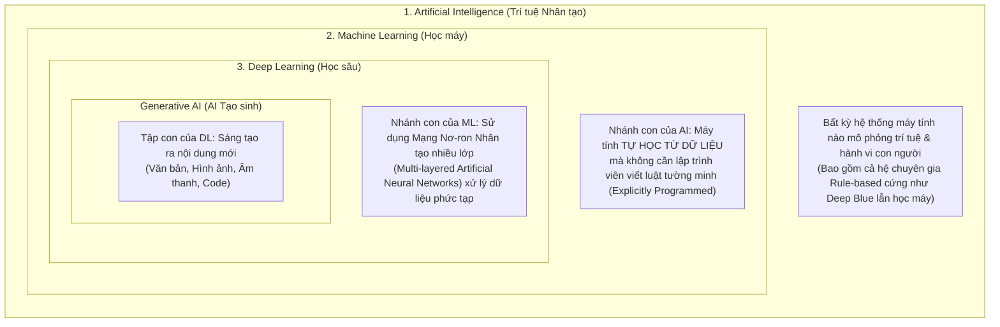
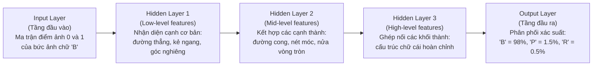
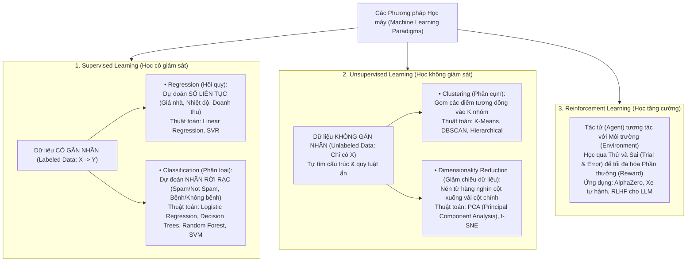
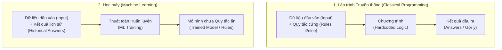
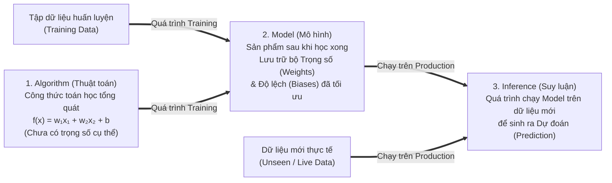
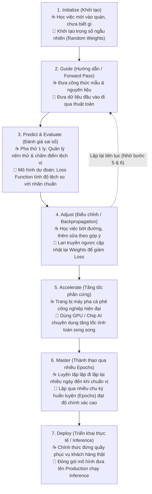

# Module 2: AI/ML Fundamentals (Nền tảng Trí tuệ Nhân tạo & Học máy)

> [!IMPORTANT]
> **Trọng tâm ôn thi NCA-GENL ở Module 2 (Thuộc Domain "Core ML & AI Knowledge - 30%"):**
> Phân biệt rõ mối quan hệ bao hàm **AI $\supset$ Machine Learning (ML) $\supset$ Deep Learning (DL)**; nắm vững **3 phương pháp học máy cốt lõi (Supervised, Unsupervised, Reinforcement Learning)** cùng các thuật toán kinh điển (**PCA** để giảm chiều, **K-Means** để phân cụm, **Regression vs. Classification**, **Bagging vs. Boosting**); hiểu cách các tầng ẩn (**Hidden Layers**) trích xuất đặc trưng từ thấp đến cao; nắm vững sự khác biệt giữa **Classical Programming vs. ML**, bộ ba khái niệm **Algorithm – Model – Inference**, và quy trình **7 bước huấn luyện mô hình** qua phép ẩn dụ Barista.

---

## 1. Bản chất của Trí tuệ Nhân tạo (Intelligence & AI)

* **Trí tuệ tự nhiên (Intelligence):** Là khả năng tiếp thu thông tin, hiểu biết sâu sắc và đúc kết kinh nghiệm từ những gì đã trải qua để đưa ra hành động thích hợp trong môi trường sống. Hầu hết sinh vật sống đều sở hữu trí tuệ ở các cấp độ khác nhau (con người, cá heo, tinh tinh, voi...).
* **Trí tuệ Nhân tạo (Artificial Intelligence - AI):** Là một nhánh rộng của Khoa học Máy tính nghiên cứu và xây dựng các hệ thống máy móc có khả năng thực hiện các nhiệm vụ vốn đòi hỏi trí tuệ của con người.
* **Ba năng lực cốt lõi của hệ thống AI (3 Core Capabilities):**
  1. **Discover (Khám phá):** Tự tìm ra các quy luật ẩn, thông tin và tri thức mới từ dữ liệu.
  2. **Infer (Suy luận/Phán đoán):** Đưa ra dự đoán hoặc phán đoán có cơ sở dựa trên dữ liệu mới hoặc dữ liệu chưa hoàn chỉnh.
  3. **Reason (Lập luận):** Suy luận logic nhân quả và đưa ra quyết định đánh giá tối ưu.
* **Ví dụ AI hàng ngày:** Bản đồ Google Maps định tuyến tránh kẹt xe, FaceID mở khóa điện thoại, tự động sửa lỗi chính tả (Autocorrect), thuật toán gợi ý video YouTube/TikTok hoặc sản phẩm Shopee/Amazon.

---

## 2. Phân biệt chuẩn xác: AI vs. Machine Learning vs. Deep Learning

### 2.1. Sơ đồ phân cấp mối quan hệ bao hàm
Trong đề thi NCA-GENL, bạn cần nhớ rõ: **Deep Learning là một tập con của Machine Learning, và Machine Learning là một tập con của Artificial Intelligence.**

### 2.2. Phép ẩn dụ Cờ vua (The Chess Analogy - Rất dễ nhớ!)
Hãy xem cách nhân loại dạy máy tính chơi cờ vua qua 3 thế hệ:

| Cấp độ | Cách tiếp cận trong bài toán Cờ vua | Ví dụ thực tế | Bản chất kỹ thuật |
| :--- | :--- | :--- | :--- |
| **AI (Rule-based AI)** | Lập trình viên và các kiện tướng ngồi viết sẵn hàng nghìn quy tắc cứng (`if/else`) và bảng điểm vị trí quân cờ vào code. | **IBM Deep Blue (1997)** | Dựa hoàn toàn vào luật định sẵn (Hardcoded rules) và vét cạn cây tìm kiếm (Minimax). Không tự học thêm được. |
| **ML (Machine Learning)** | Không viết luật chơi chi tiết nữa; nạp vào máy **hàng triệu biên bản ván cờ lịch sử** của các đại kiện tướng để máy tự thống kê và rút ra chiến thuật. | Các engine cờ học từ cơ sở dữ liệu ván đấu | Học quy luật thống kê từ dữ liệu lịch sử (Historical Data) của con người. |
| **DL (Deep Learning)** | Chỉ dạy máy luật đi quân cơ bản, sau đó cho mạng nơ-ron nhiều lớp **tự đấu với chính mình hàng triệu ván** từ con số 0, tự sáng tạo ra những nước cờ thần sầu mà con người chưa từng nghĩ tới. | **Google DeepMind AlphaZero** | Mạng nơ-ron sâu (Deep Neural Network) kết hợp học tăng cường, tự trích xuất đặc trưng chiến thuật ở cấp độ trừu tượng cao nhất. |

---

### 2.3. Cấu trúc Deep Learning hoạt động như thế nào?
Điểm làm nên chữ **"Deep" (Sâu)** trong Deep Learning chính là việc xếp chồng nhiều **Tầng ẩn (Hidden Layers)** giữa tầng đầu vào và tầng đầu ra. Mỗi tầng ẩn sẽ tự động trích xuất các đặc trưng (**Feature Extraction**) từ mức độ chi tiết thô sơ lên mức độ trừu tượng hoàn chỉnh.

Ví dụ bài toán: Nhận diện chữ cái viết tay `"B"` từ bức ảnh đen trắng:

> [!TIP]
> **Góc nhìn Developer:** Trong Machine Learning cổ điển (Traditional ML), kỹ sư phải tự làm bước **Feature Engineering** bằng tay (ví dụ tự viết code đo tỷ lệ chiều cao/chiều rộng của chữ). Trong **Deep Learning**, các tầng **Hidden Layers** tự động học cách trích xuất đặc trưng (**Automatic Feature Extraction**) hoàn toàn từ dữ liệu thô!

---

## 3. Ba Nhánh Học Máy Cốt Lõi (Supervised, Unsupervised & Reinforcement Learning)

Trong đề thi NCA-GENL (phần *Core Machine Learning - 30%*), bạn thường gặp câu hỏi phân loại bài toán và thuật toán vào đúng nhánh học máy:

### Làm rõ các thuật toán cổ điển hay xuất hiện trong câu hỏi trắc nghiệm:
1. **PCA (Principal Component Analysis - Phân tích Thành phần Chính):**
   * Thuộc nhánh **Unsupervised Learning (Giảm chiều dữ liệu - Dimensionality Reduction)**.
   * *Khi nào dùng?* Khi bảng dữ liệu có quá nhiều cột đặc trưng (ví dụ 1.000 features) gây chậm quá trình train và dễ bị học vẹt (Overfitting). **PCA** chiếu dữ liệu sang một không gian ít chiều hơn (ví dụ 20 cột **Principal Components**) sao cho **giữ lại được nhiều phương sai (variance / thông tin cốt lõi) nhất**, đồng thời loại bỏ nhiễu và các cột dư thừa tương quan nhau.
2. **K-Means Clustering (Phân cụm K-Means):**
   * Thuộc nhánh **Unsupervised Learning (Phân cụm)**.
   * *Khi nào dùng?* Khi bạn có danh sách 1 triệu khách hàng chưa gắn nhãn và muốn chia họ thành $K$ nhóm hành vi mua sắm khác nhau (Customer Segmentation). Thuật toán chọn $K$ tâm cụm (**Centroids**) và lặp đi lặp lại việc gom các điểm dữ liệu vào tâm gần nhất.
3. **Học Kết hợp (Ensemble Learning): Bagging vs. Boosting:**
   * **Bagging (Bootstrap Aggregating - Đại diện: `Random Forest`):** Huấn luyện nhiều cây quyết định **song song độc lập** trên các tập con dữ liệu ngẫu nhiên rồi lấy phiếu bầu đa số (Voting). Giúp **giảm phương sai (Reduce Variance) và chống Overfitting**.
   * **Boosting (Đại diện: `XGBoost`, `AdaBoost`, `Gradient Boosting`):** Huấn luyện các mô hình **nối tiếp tuần tự**, trong đó mô hình sau tập trung sửa những lỗi sai mà mô hình trước vừa mắc phải. Giúp **giảm độ chệch (Reduce Bias) và tăng độ chính xác cực cao trên dữ liệu dạng bảng**.

---

## 4. Case Study: Lập trình truyền thống vs. Machine Learning

### Bài toán kinh doanh:
Xây dựng hệ thống gợi ý sản phẩm (Recommendation System) cho sàn thương mại điện tử dựa trên lịch sử mua hàng và hồ sơ khách hàng.

* **Tiếp cận Lập trình truyền thống (Classical Programming):** Lập trình viên phải tự ngồi viết tay hàng nghìn quy tắc điều kiện (`if/else`). Khi quy mô dữ liệu lớn và hành vi người dùng thay đổi, các luật này nhanh chóng xung đột nhau, không thể bao quát hết trường hợp và cực kỳ tốn kém để bảo trì.
* **Tiếp cận Machine Learning:** Đưa lịch sử mua sắm, lượt click và giỏ hàng vào thuật toán ML để mô hình **tự động rút trích quy tắc ẩn từ dữ liệu**, tự thích ứng với hành vi theo mùa và phản hồi suy luận trong vài mili-giây.

---

## 5. Ba khái niệm cốt lõi: Algorithm, Model và Inference

Rất nhiều Developer mới làm quen với AI thường gọi lẫn lộn giữa "Thuật toán" và "Mô hình". Trong kỳ thi NCA-GENL, 3 khái niệm này được phân định cực kỳ rõ ràng:

| Khái niệm | Bản chất kỹ thuật | Góc nhìn Developer (Tương đương trong Code) |
| :--- | :--- | :--- |
| **1. Algorithm (Thuật toán)** | Là quy trình toán học hoặc công thức logic tổng quát (ví dụ: *Linear Regression, Decision Trees, K-Means*) dùng để tìm mối tương quan giữa các biến số: $$f(x) = w_1 x_1 + w_2 x_2 + \dots + b$$ | Giống như **Source Code của một Class** (chưa khởi tạo trạng thái, mới chỉ có cấu trúc hàm). |
| **2. Model (Mô hình)** | Là **kết quả (artifact)** thu được sau khi chạy Algorithm trên một tập dữ liệu cụ thể. Mô hình chính là tệp lưu trữ các **trọng số (weights $w$)** và **độ lệch (biases $b$)** đã được tối ưu hóa. | Giống như **Compiled Binary + Database Snapshot** (ví dụ file `.pt`, `.onnx`, `.safetensors`) chứa sẵn tri thức đã học. |
| **3. Inference (Suy luận)** | Là quá trình đưa **dữ liệu mới chưa từng thấy (unseen data)** vào Model đã huấn luyện xong để lấy kết quả dự đoán. *Training chỉ diễn ra định kỳ, nhưng Inference diễn ra hàng triệu lần mỗi ngày trên Production.* | Giống như việc gọi hàm **`model.predict(new_input)`** bên trong một REST API endpoint phục vụ user. |

---

## 6. Vòng đời Huấn luyện ML qua Phép ẩn dụ Đào tạo Barista (Barista Analogy)

Để nhớ trọn vẹn vòng lặp huấn luyện một mạng nơ-ron (Forward Pass $\to$ Loss $\to$ Backpropagation $\to$ Epochs $\to$ Inference), tài liệu chuẩn của NVIDIA sử dụng phép ẩn dụ **Đào tạo một nhân viên pha chế cà phê (Barista)**:

---

## 7. Bẫy đề thi NCA-GENL & Câu hỏi Thực chiến (Exam Traps & Mini Quiz)

> [!WARNING]
> **Các bẫy kinh điển trong đề thi Module 2:**
> 1. **Bẫy PCA vs. K-Means:**
>    * Muốn **giảm số lượng cột đặc trưng (Dimensionality Reduction)** mà vẫn giữ lại thông tin quan trọng nhất để tăng tốc độ train $\to$ Chọn **PCA (Principal Component Analysis)**.
>    * Muốn **chia dữ liệu không gắn nhãn thành các nhóm tương đồng (Clustering)** $\to$ Chọn **K-Means**.
> 2. **Bẫy Algorithm vs. Model:** Thành phần nào lưu trữ các trọng số (weights) và độ lệch (biases) đã được tối ưu sau khi huấn luyện trên dữ liệu? $\to$ Chọn **Model** (không chọn Algorithm).
> 3. **Bẫy Loss Function vs. Backpropagation:** **Loss Function** chỉ làm nhiệm vụ *đo lường xem mô hình dự đoán sai bao nhiêu*, còn **Backpropagation** mới là cơ chế *lan truyền ngược sai số để cập nhật trọng số*.

### Câu hỏi tự kiểm tra (Mini Quiz):
1. **Câu 1:** Một nhà khoa học dữ liệu làm việc với tập dữ liệu gồm 500 biến đặc trưng (features) không gắn nhãn và muốn nén xuống còn 30 biến quan trọng nhất để trực quan hóa và giảm chi phí huấn luyện mà ít mất mát thông tin nhất. Thuật toán nào nên được sử dụng?
   * *Đáp án:* **PCA (Principal Component Analysis)**.
2. **Câu 2:** Trong mạng nơ-ron sâu (Deep Neural Network) nhận diện khuôn mặt, tầng ẩn đầu tiên (First Hidden Layer) thường đảm nhận vai trò gì?
   * *Đáp án:* Trích xuất các **đặc trưng cấp thấp (Low-level features)** như các cạnh, đường viền sáng tối, góc nghiêng cơ bản của bức ảnh.
