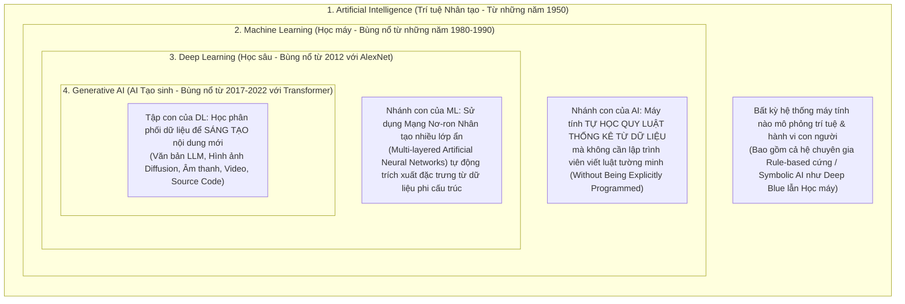
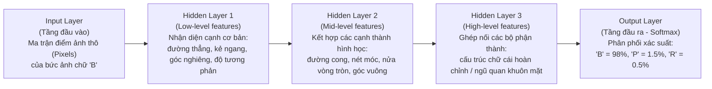
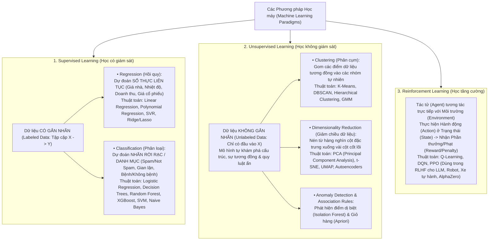
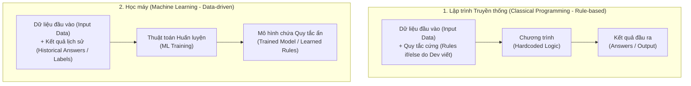
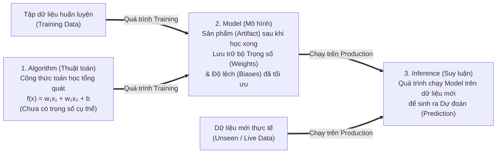
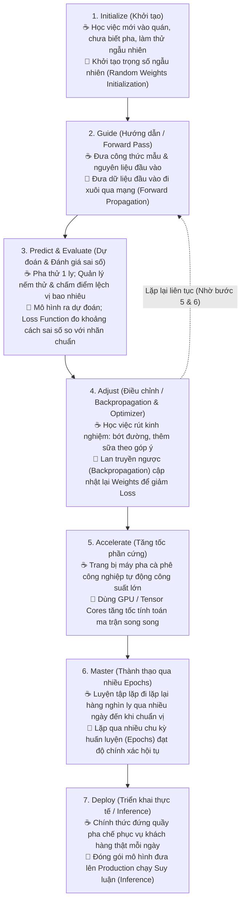

# Module 2: AI/ML Fundamentals (Nền tảng Trí tuệ Nhân tạo & Học máy)

> [!IMPORTANT]
> **Trọng tâm ôn thi NCA-GENL ở Module 2 (Thuộc Domain "Core ML & AI Knowledge - 30%"):**
> Phân biệt rõ mối quan hệ bao hàm **AI $\supset$ Machine Learning (ML) $\supset$ Deep Learning (DL) $\supset$ Generative AI**; nắm vững **3 phương pháp học máy cốt lõi (Supervised, Unsupervised, Reinforcement Learning)** cùng các thuật toán kinh điển (**PCA** để giảm chiều, **K-Means / DBSCAN** để phân cụm, **Linear/Logistic Regression, SVM, Decision Trees**, **Bagging vs. Boosting**); hiểu sự đánh đổi **Bias-Variance Tradeoff & Regularization (`L1` vs. `L2`)**; hiểu cách các tầng ẩn (**Hidden Layers**) tự động trích xuất đặc trưng từ thấp đến cao; nắm vững sự khác biệt giữa **Classical Programming vs. ML**, bộ ba khái niệm **Algorithm – Model – Inference**, và quy trình **7 bước huấn luyện mô hình** qua phép ẩn dụ Barista.

---

## 1. Bản chất của Trí tuệ Nhân tạo (Intelligence & AI)

* **Trí tuệ tự nhiên (Intelligence):** Là khả năng tiếp thu thông tin, hiểu biết sâu sắc và đúc kết kinh nghiệm từ những gì đã trải qua để đưa ra hành động thích hợp trong môi trường sống. Hầu hết sinh vật sống đều sở hữu trí tuệ ở các cấp độ khác nhau (con người, cá heo, tinh tinh, voi...).
* **Trí tuệ Nhân tạo (Artificial Intelligence - AI):** Là một nhánh rộng của Khoa học Máy tính nghiên cứu và xây dựng các hệ thống máy móc có khả năng thực hiện các nhiệm vụ vốn đòi hỏi trí tuệ của con người (nhận thức thị giác, hiểu ngôn ngữ, giải quyết vấn đề, ra quyết định).
* **Ba năng lực cốt lõi của hệ thống AI (3 Core Capabilities):**
  1. **Discover (Khám phá):** Tự tìm ra các quy luật ẩn (hidden patterns), mối tương quan, thông tin và tri thức mới từ kho dữ liệu thô khổng lồ.
  2. **Infer (Suy luận/Phán đoán):** Đưa ra dự đoán hoặc phán đoán có cơ sở xác suất dựa trên dữ liệu mới hoặc dữ liệu chưa hoàn chỉnh.
  3. **Reason (Lập luận):** Suy luận logic nhân quả, kết nối nhiều sự kiện và đưa ra quyết định đánh giá tối ưu để đạt mục tiêu.
* **Phân loại AI theo phạm vi năng lực:**
  * **ANI (Artificial Narrow Intelligence - AI Hẹp / Yếu):** AI chuyên biệt chỉ giải quyết xuất sắc một hoặc một nhóm nhiệm vụ cụ thể (ví dụ: nhận diện khuôn mặt FaceID, phân loại Spam, chơi cờ vua, dịch thuật). Toàn bộ các hệ thống AI hiện nay (kể cả LLM) về mặt kỹ thuật vẫn đang tiến hóa từ ANI lên đa nhiệm.
  * **AGI (Artificial General Intelligence - AI Tổng quát / Mạnh):** Hệ thống AI giả định có khả năng tư duy, tự học và thích ứng với bất kỳ nhiệm vụ trí tuệ nào ngang bằng với con người.

---

## 2. Phân biệt chuẩn xác: AI vs. Machine Learning vs. Deep Learning

### 2.1. Sơ đồ phân cấp mối quan hệ bao hàm
Trong đề thi NCA-GENL, bạn cần nhớ rõ: **Generative AI là tập con của Deep Learning, Deep Learning là tập con của Machine Learning, và Machine Learning là tập con của Artificial Intelligence.**



### 2.2. Phép ẩn dụ Cờ vua (The Chess Analogy - Rất dễ nhớ!)
Hãy xem cách nhân loại dạy máy tính chơi cờ vua qua 3 thế hệ để thấy rõ sự tiến hóa từ Rule-based AI $\to$ ML $\to$ DL:

| Cấp độ | Cách tiếp cận trong bài toán Cờ vua | Ví dụ thực tế | Bản chất kỹ thuật |
| :--- | :--- | :--- | :--- |
| **AI (Rule-based / Symbolic AI)** | Lập trình viên và các kiện tướng ngồi viết sẵn hàng nghìn quy tắc cứng (`if/else`) và bảng điểm vị trí từng quân cờ vào code. | **IBM Deep Blue (1997)** (Đánh bại Garry Kasparov) | Dựa hoàn toàn vào luật định sẵn (**Hardcoded rules / Heuristics**) và vét cạn cây tìm kiếm (Minimax + Alpha-Beta Pruning). Không tự học thêm được từ kinh nghiệm. |
| **ML (Machine Learning)** | Không viết luật chiến thuật chi tiết nữa; nạp vào máy **hàng triệu biên bản ván cờ lịch sử** của các đại kiện tướng để máy tự thống kê xác suất thắng của từng thế cờ. | Các engine cờ học từ cơ sở dữ liệu ván đấu | Học quy luật thống kê từ dữ liệu lịch sử (**Historical Data**); tuy nhiên kỹ sư vẫn phải định nghĩa các đặc trưng (**Hand-crafted Features**) của bàn cờ. |
| **DL (Deep Learning)** | Chỉ dạy máy luật đi quân cơ bản, sau đó cho mạng nơ-ron nhiều lớp **tự đấu với chính mình hàng triệu ván (Self-play)** từ con số 0, tự sáng tạo ra những nước cờ thần sầu mà con người chưa từng nghĩ tới. | **Google DeepMind AlphaZero (2017)** | Mạng nơ-ron sâu (**Deep Neural Network**) kết hợp học tăng cường, tự trích xuất đặc trưng chiến thuật ở cấp độ trừu tượng cao nhất mà không cần dữ liệu con người. |

---

### 2.3. Cấu trúc Deep Learning hoạt động như thế nào? (Automatic Feature Extraction)
Điểm làm nên chữ **"Deep" (Sâu)** trong Deep Learning chính là việc xếp chồng nhiều **Tầng ẩn (Hidden Layers)** giữa tầng đầu vào (Input Layer) và tầng đầu ra (Output Layer). Mỗi tầng ẩn sẽ tự động trích xuất các đặc trưng (**Hierarchical Feature Extraction**) từ mức độ chi tiết thô sơ lên mức độ trừu tượng hoàn chỉnh.

Ví dụ bài toán: Nhận diện chữ cái viết tay `"B"` hoặc khuôn mặt từ bức ảnh điểm ảnh (Pixels):



> [!TIP]
> **Sự khác biệt sống còn giữa Traditional ML và Deep Learning (Hay hỏi trong đề thi):**
> * **Traditional ML (Học máy cổ điển - Scikit-learn):** Bắt buộc phải có con người làm bước **Manual Feature Engineering** (Kỹ sư phải tự suy nghĩ và viết code trích xuất đặc trưng: ví dụ muốn phân loại ảnh xe hơi thì phải tự viết thuật toán tìm hình tròn của bánh xe, đo tỷ lệ khung xe rồi mới đưa vào SVM/Random Forest). Rất mạnh trên **dữ liệu dạng bảng có cấu trúc (Structured / Tabular Data)** nhưng yếu trên dữ liệu phi cấu trúc.
> * **Deep Learning (Học sâu - PyTorch/TensorFlow):** Thực hiện **Automatic Feature Extraction (End-to-End Representation Learning)** — bạn chỉ cần ném thẳng bức ảnh thô, file âm thanh thô hoặc câu văn bản thô vào mạng nơ-ron, các tầng **Hidden Layers** sẽ tự động học cách trích xuất đặc trưng tối ưu nhất! Cực kỳ thống trị trên **dữ liệu phi cấu trúc (Unstructured Data: Text, Image, Audio, Video)**.

---

## 3. Ba Nhánh Học Máy Cốt Lõi (Supervised, Unsupervised & Reinforcement Learning)

Trong đề thi NCA-GENL (phần *Core Machine Learning - 30%*), bạn thường xuyên gặp câu hỏi phân loại bài toán thực tế và thuật toán vào đúng nhánh học máy:



### 3.1. Chi tiết các Thuật toán Học Có Giám Sát (Supervised Learning) cần nhớ:
1. **Linear Regression (Hồi quy tuyến tính) $\to$ Bài toán Regression:**
   * Tìm một đường thẳng (hoặc siêu phẳng) $\hat{y} = w_1 x_1 + w_2 x_2 + \dots + b$ khớp nhất với các điểm dữ liệu để dự đoán một **con số liên tục** (ví dụ: dự đoán giá nhà từ diện tích và số phòng ngủ), tối ưu bằng cách cực tiểu hóa hàm mất mát **MSE (Mean Squared Error)**.
2. **Logistic Regression (Hồi quy Logistic) $\to$ Bài toán Classification (Cẩn thận bẫy tên gọi!):**
   * **CẢNH BÁO BẪY ĐỀ THI:** Dù trong tên có chữ *"Regression"*, nhưng **Logistic Regression là thuật toán PHÂN LOẠI (Classification)** chứ không phải hồi quy! Nó đưa tổng tuyến tính qua hàm **Sigmoid** $\sigma(z) = \frac{1}{1+e^{-z}}$ để ép đầu ra thành xác suất thuộc về một lớp từ $0$ đến $1$ (ví dụ: xác suất khách hàng rời bỏ dịch vụ Churn = 85%).
3. **Support Vector Machines (SVM - Máy Vector Hỗ trợ):**
   * Tìm siêu phẳng phân cách (Decision Boundary) sao cho **khoảng cách lề (Margin)** giữa hai lớp dữ liệu là rộng nhất. Sử dụng **Kernel Trick (RBF, Polynomial)** để chiếu dữ liệu không phân tách tuyến tính lên không gian chiều cao hơn nhằm phân loại dễ dàng.
4. **Decision Trees (Cây quyết định) & Học Kết hợp (Ensemble Learning: Bagging vs. Boosting):**
   * Một cây quyết định đơn lẻ dễ hiểu nhưng rất dễ bị học vẹt (**Overfitting**). Để khắc phục, người ta kết hợp hàng trăm cây quyết định lại (**Ensemble Learning**) theo 2 chiến lược đối lập nhau:

| Tiêu chí | Bagging (Bootstrap Aggregating) | Boosting (Tăng cường tuần tự) |
| :--- | :--- | :--- |
| **Thuật toán đại diện** | **`Random Forest` (Rừng ngẫu nhiên)** | **`XGBoost`, `LightGBM`, `CatBoost`, `AdaBoost`, `Gradient Boosting`** |
| **Cách huấn luyện các cây** | Huấn luyện hàng trăm cây quyết định **SONG SONG và ĐỘC LẬP** trên các tập con dữ liệu lấy mẫu ngẫu nhiên có hoàn lại (Bootstrap samples). | Huấn luyện các cây quyết định **NỐI TIẾP TUẦN TỰ**, trong đó cây đứng sau tập trung đánh trọng số cao hơn để **sửa những lỗi sai mà cây đứng trước vừa đoán trật**! |
| **Cách tổng hợp kết quả** | Bỏ phiếu đa số (**Majority Voting** cho phân loại) hoặc lấy trung bình cộng (cho hồi quy). | Cộng có trọng số (Weighted Sum) dự đoán của tất cả các cây theo tốc độ học (Learning rate). |
| **Mục tiêu toán học** | **Giảm Phương sai (Reduce Variance) $\to$ Chống Overfitting cực tốt!** | **Giảm Độ chệch (Reduce Bias) $\to$ Đạt độ chính xác đỉnh cao trên dữ liệu dạng bảng!** |

---

### 3.2. Chi tiết các Thuật toán Học Không Giám Sát (Unsupervised Learning) hay ra thi:
1. **PCA (Principal Component Analysis - Phân tích Thành phần Chính):**
   * Thuộc nhánh **Unsupervised Learning (Giảm chiều dữ liệu - Dimensionality Reduction)**.
   * *Bản chất toán học:* Khi bảng dữ liệu có quá nhiều cột đặc trưng (ví dụ $1.000$ features) gây ra **Lời nguyền chiều dữ liệu (Curse of Dimensionality)** làm chậm quá trình train và tốn bộ nhớ, **PCA** tính toán các Vector riêng (Eigenvectors) của ma trận hiệp phương sai để xoay và chiếu dữ liệu sang một hệ trục tọa độ mới gồm ít trục trực giao hơn (ví dụ 20 cột **Principal Components**: $PC_1, PC_2, \dots, PC_{20}$).
   * *Ưu điểm vàng:* Giữ lại được **tối đa lượng thông tin / phương sai (Maximum Explained Variance)** của dữ liệu gốc, đồng thời loại bỏ nhiễu và khử hoàn toàn hiện tượng đa cộng tuyến (các cột dư thừa tương quan nhau).
2. **t-SNE & UMAP:**
   * Các thuật toán giảm chiều **phi tuyến tính (Non-linear Dimensionality Reduction)** chuyên dùng để **trực quan hóa (Visualization)** các Vector Embedding 4096 chiều của LLM xuống biểu đồ 2D hoặc 3D để con người nhìn thấy các cụm từ vựng trên màn hình.
3. **K-Means Clustering vs. DBSCAN (Phân cụm dữ liệu):**
   * **K-Means:** Bạn phải chỉ định trước số lượng cụm $K$ (chọn $K$ tối ưu bằng phương pháp **Elbow Method** hoặc **Silhouette Score**). Thuật toán khởi tạo $K$ tâm cụm (**Centroids**), gán mỗi điểm dữ liệu vào tâm gần nhất theo khoảng cách Euclid, rồi cập nhật lại tọa độ tâm cho đến khi hội tụ. *Ứng dụng:* Phân khúc khách hàng (Customer Segmentation), nén màu ảnh.
   * **DBSCAN (Density-Based Spatial Clustering):** Phân cụm dựa trên **mật độ điểm dữ liệu** mà **không cần biết trước số cụm $K$**, có khả năng tìm ra các cụm có hình thù uốn lượn bất kỳ và tự động phát hiện các điểm nhiễu ngoại lai (**Outliers / Noise**).

---

### 3.3. Sự đánh đổi Bias-Variance (Bias-Variance Tradeoff) & Regularization (`L1` vs. `L2`)
Để mô hình học máy hoạt động tốt trên dữ liệu thực tế (Generalization), kỹ sư phải cân bằng giữa hai nguồn sai số:
* **Bias (Độ chệch):** Sai số do giả định của mô hình quá đơn giản (ví dụ dùng đường thẳng bậc 1 để khớp dữ liệu hình sin phức tạp). **High Bias $\to$ Underfitting (Học chưa tới / Đều sai trên cả tập Train và Test)**.
* **Variance (Phương sai):** Độ nhạy cảm thái quá của mô hình với những biến động nhỏ/nhiễu trong tập dữ liệu huấn luyện. **High Variance $\to$ Overfitting (Học vẹt / Đúng 99.9% trên tập Train nhưng đoán sai bét trên tập Test)**.
* **Kỹ thuật Điều chuẩn (Regularization - Cộng thêm thành phần phạt vào Loss Function để chống Overfitting):**
  * **L1 Regularization (Lasso):** Cộng thêm tổng trị tuyệt đối trọng số $\lambda \sum |w_i|$ vào hàm Loss. Có tính chất đặc biệt là **ép các trọng số của những đặc trưng kém quan trọng về đúng bằng $0$** $\to$ Giúp tạo mô hình thưa (**Sparse Model**) và tự động **chọn lọc đặc trưng (Feature Selection)**.
  * **L2 Regularization (Ridge / Weight Decay trong Deep Learning):** Cộng thêm tổng bình phương trọng số $\lambda \sum w_i^2$ vào hàm Loss. Ép tất cả các trọng số phải nhỏ và phân bố đều, ngăn không cho một vài trọng số phình quá to chi phối mô hình (đây chính là chữ **W** trong thuật toán tối ưu **AdamW** dùng cho mọi LLM!).

---

## 4. Case Study: Lập trình truyền thống vs. Machine Learning

### Bài toán kinh doanh:
Xây dựng hệ thống gợi ý sản phẩm (Recommendation System) hoặc phát hiện gian lận thẻ tín dụng cho sàn thương mại điện tử dựa trên lịch sử mua hàng và hồ sơ khách hàng.



* **Tiếp cận Lập trình truyền thống (Classical Programming):** Lập trình viên phải tự ngồi viết tay hàng nghìn quy tắc điều kiện (`if/else`). Khi quy mô dữ liệu lớn và hành vi kẻ gian/người dùng thay đổi theo từng ngày, các luật này nhanh chóng xung đột nhau, không thể bao quát hết trường hợp biên và cực kỳ tốn kém để bảo trì.
* **Tiếp cận Machine Learning:** Đưa lịch sử mua sắm, lượt click và giỏ hàng (`Input Data + Historical Answers`) vào thuật toán ML để máy **tự động rút trích ra Mô hình chứa các quy tắc ẩn (`Trained Model`)**, tự thích ứng với hành vi theo mùa và phản hồi suy luận trong vài mili-giây.

---

## 5. Ba khái niệm cốt lõi: Algorithm, Model và Inference

Rất nhiều Developer mới làm quen với AI thường gọi lẫn lộn giữa "Thuật toán" và "Mô hình". Trong kỳ thi NCA-GENL, 3 khái niệm này được phân định cực kỳ rõ ràng:



| Khái niệm | Bản chất kỹ thuật | Góc nhìn Developer (Tương đương trong Code) |
| :--- | :--- | :--- |
| **1. Algorithm (Thuật toán)** | Là quy trình toán học hoặc công thức logic tổng quát (ví dụ: *Linear Regression, Decision Trees, K-Means, Backpropagation*) dùng để tìm mối tương quan giữa các biến số: $$f(x) = w_1 x_1 + w_2 x_2 + \dots + b$$ | Giống như **Source Code định nghĩa một Class trống** (chưa khởi tạo trạng thái, mới chỉ có cấu trúc hàm và công thức học). |
| **2. Model (Mô hình)** | Là **kết quả (artifact)** thu được sau khi chạy Algorithm trên một tập dữ liệu huấn luyện cụ thể. Mô hình chính là cấu trúc mạng kèm tệp lưu trữ các **trọng số (weights $w$)** và **độ lệch (biases $b$)** đã được tối ưu hóa. | Giống như **Compiled Binary + Serialized State Object** (ví dụ file `.pt`, `.onnx`, `.safetensors`, `.pkl`) chứa sẵn tri thức đã học. |
| **3. Inference (Suy luận)** | Là quá trình đưa **dữ liệu mới chưa từng thấy (unseen/live data)** vào Model đã huấn luyện xong để lấy kết quả dự đoán (chỉ chạy Forward Pass, không tính Backpropagation). *Training chỉ diễn ra định kỳ, nhưng Inference diễn ra hàng triệu lần mỗi ngày trên Production.* | Giống như việc nạp file model vào RAM/VRAM rồi gọi hàm **`model.predict(new_input)`** bên trong một REST API endpoint phục vụ user. |

### Minh họa bằng Code Python (`scikit-learn`) cho Developer:
```python
from sklearn.ensemble import RandomForestClassifier
import joblib

# 1. ALGORITHM: Khởi tạo thuật toán tổng quát (chưa học dữ liệu, chưa có trọng số)
algorithm = RandomForestClassifier(n_estimators=100, random_state=42)

# 2. TRAINING -> MODEL: Huấn luyện thuật toán trên dữ liệu (X_train, y_train) để tạo ra Model đã học
trained_model = algorithm.fit(X_train, y_train)
joblib.dump(trained_model, "fraud_detection_model.pkl") # Lưu Artifact của Model ra ổ cứng

# 3. INFERENCE: Nạp Model lên Production và dự đoán trên dữ liệu giao dịch mới (new_transaction)
production_model = joblib.load("fraud_detection_model.pkl")
prediction = production_model.predict(new_transaction) # Quá trình Inference!
```

---

## 6. Vòng đời Huấn luyện ML qua Phép ẩn dụ Đào tạo Barista (Barista Analogy)

Để nhớ trọn vẹn vòng lặp huấn luyện một mạng nơ-ron (Forward Pass $\to$ Loss $\to$ Backpropagation $\to$ GPU Acceleration $\to$ Epochs $\to$ Inference), tài liệu chuẩn của NVIDIA sử dụng phép ẩn dụ **Đào tạo một nhân viên pha chế cà phê (Barista)**:



---

## 7. Bẫy đề thi NCA-GENL & Câu hỏi Thực chiến (Exam Traps & Mini Quiz)

> [!WARNING]
> **Các bẫy kinh điển trong đề thi Module 2:**
> 1. **Bẫy PCA vs. K-Means:**
>    * Muốn **giảm số lượng cột đặc trưng (Dimensionality Reduction)** mà vẫn giữ lại phương sai/thông tin quan trọng nhất để tăng tốc độ train $\to$ Chọn **PCA (Principal Component Analysis)**.
>    * Muốn **chia dữ liệu không gắn nhãn thành các nhóm tương đồng (Clustering)** $\to$ Chọn **K-Means** hoặc **DBSCAN**.
> 2. **Bẫy Logistic Regression:** Dù tên có chữ "Regression", nhưng **Logistic Regression** dùng hàm Sigmoid để giải bài toán **Classification (Phân loại nhị phân)**, KHÔNG phải bài toán Hồi quy số liên tục!
> 3. **Bẫy Bagging vs. Boosting:** Huấn luyện nhiều cây quyết định **song song độc lập** để giảm phương sai (Variance) $\to$ **Bagging (`Random Forest`)**. Huấn luyện các cây **nối tiếp tuần tự**, cây sau sửa lỗi cho cây trước để giảm độ chệch (Bias) $\to$ **Boosting (`XGBoost` / `Gradient Boosting`)**.
> 4. **Bẫy Algorithm vs. Model vs. Inference:** Thành phần lưu trữ các trọng số (weights) và độ lệch (biases) đã được tối ưu sau khi huấn luyện $\to$ **Model**. Quá trình áp dụng Model đó lên dữ liệu thực tế mới để lấy dự đoán $\to$ **Inference**.

### Câu hỏi tự kiểm tra (Mini Quiz):
1. **Câu 1:** Một nhà khoa học dữ liệu làm việc với tập dữ liệu gồm 500 biến đặc trưng (features) không gắn nhãn và muốn nén xuống còn 30 biến quan trọng nhất để trực quan hóa và giảm chi phí huấn luyện mà ít mất mát thông tin nhất. Thuật toán nào nên được sử dụng?
   * *Đáp án:* **PCA (Principal Component Analysis)**.
2. **Câu 2:** Trong mạng nơ-ron sâu (Deep Neural Network) nhận diện khuôn mặt, tầng ẩn đầu tiên (First Hidden Layer) thường đảm nhận vai trò gì, và điều này khác gì với Machine Learning cổ điển?
   * *Đáp án:* Tầng ẩn đầu tiên tự động trích xuất các **đặc trưng cấp thấp (Low-level features)** như các cạnh, đường viền sáng tối, góc nghiêng cơ bản của bức ảnh. Điểm khác biệt là Deep Learning tự động hóa hoàn toàn việc trích xuất đặc trưng (**Automatic Feature Extraction**), trong khi ML cổ điển đòi hỏi con người phải tự thiết kế đặc trưng bằng tay (**Manual Feature Engineering**).
3. **Câu 3:** Một kỹ sư muốn xây dựng mô hình dự đoán chính xác giá bán của một căn hộ (ví dụ: $\$245,000$) dựa trên diện tích, số phòng ngủ và khoảng cách tới trung tâm. Đây là loại bài toán gì và thuộc nhánh học máy nào?
   * *Đáp án:* Bài toán **Hồi quy (Regression)** thuộc nhánh **Học có giám sát (Supervised Learning)** vì đầu ra là một giá trị số liên tục và dữ liệu huấn luyện có sẵn nhãn giá bán lịch sử.
4. **Câu 4:** Sự khác biệt cốt lõi trong cách huấn luyện các cây quyết định giữa thuật toán **Random Forest (Bagging)** và **XGBoost (Boosting)** là gì?
   * *Đáp án:* **Random Forest (Bagging)** huấn luyện nhiều cây quyết định **song song và độc lập** trên các tập con dữ liệu ngẫu nhiên rồi lấy biểu quyết đa số (giúp giảm Variance/Overfitting); trong khi **XGBoost (Boosting)** huấn luyện các cây **tuần tự nối tiếp nhau**, trong đó mỗi cây mới tập trung sửa các lỗi dự đoán sai của các cây trước đó (giúp giảm Bias).
5. **Câu 5:** Trong quá trình huấn luyện mô hình ngôn ngữ lớn ở giai đoạn căn chỉnh (Alignment - RLHF), mô hình sinh ra câu trả lời, nhận điểm số đánh giá (Reward) từ mô hình phần thưởng và tự điều chỉnh chính sách (Policy) để tối đa hóa tổng điểm thưởng. Cơ chế này thuộc nhánh học máy nào?
   * *Đáp án:* **Reinforcement Learning (Học tăng cường)**.
6. **Câu 6:** Nếu một mô hình học máy có sai số rất thấp trên tập dữ liệu huấn luyện (Training Set) nhưng lại có sai số rất cao khi chạy thử trên tập dữ liệu kiểm tra (Test Set), mô hình đó đang gặp hiện tượng gì và có đặc trưng Bias/Variance như thế nào?
   * *Đáp án:* Hiện tượng **Overfitting (Quá khớp / Học vẹt)**, đặc trưng bởi **Low Bias (Độ chệch thấp)** nhưng **High Variance (Phương sai cao)**.
