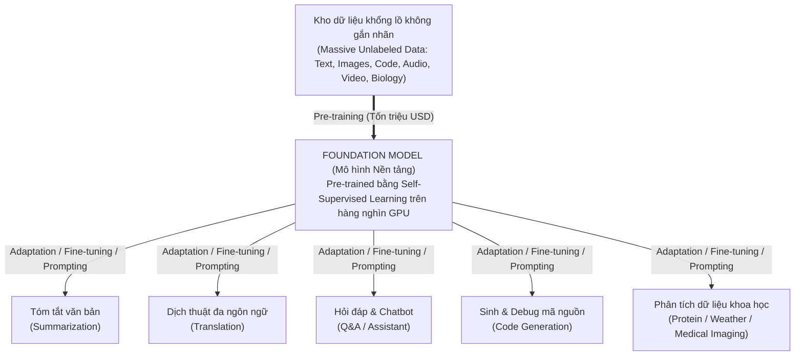
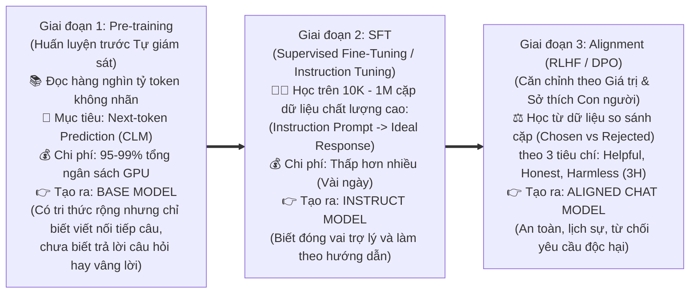
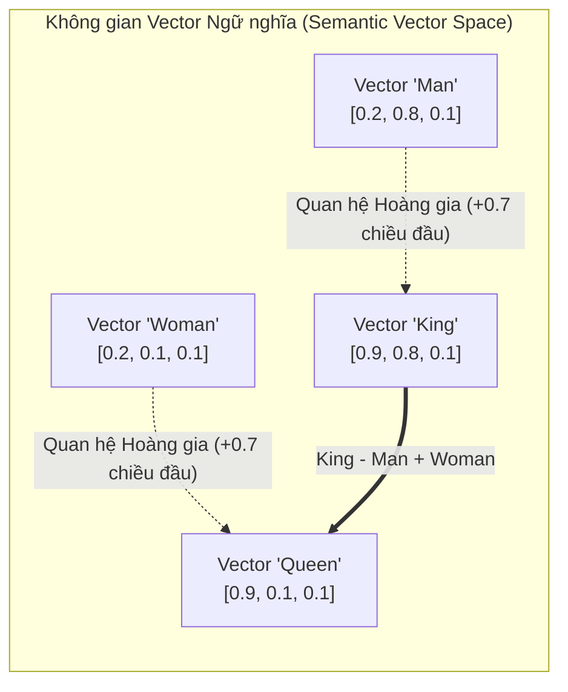
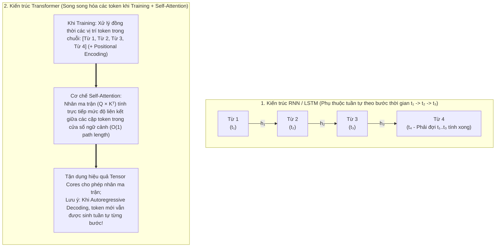

# Module 3: Generative AI & Large Language Models (AI Tạo sinh & Mô hình Ngôn ngữ Lớn)

> [!IMPORTANT]
> **Trọng tâm ôn thi NCA-GENL ở Module 3:**
> Nắm vững sự khác biệt toán học và bản chất giữa **Discriminative AI ($P(Y \mid X)$) vs. Generative AI ($P(X)$ / $P(X, Y)$)**; so sánh **4 họ mô hình tạo sinh (GANs, VAEs, Diffusion, Autoregressive Transformers)**; **3 động lực bùng nổ (Tipping Point)**; khái niệm **Foundation Models (FM)** (huấn luyện bằng **Self-Supervised Learning** trên dữ liệu không nhãn), **Định luật Mở rộng (Chinchilla Scaling Laws)**, **Năng lực Trỗi dậy (Emergent Abilities)** và tính đa phương thức (**Multimodal**); quy trình **3 giai đoạn huấn luyện LLM hiện đại (Pre-training $\to$ SFT $\to$ RLHF / DPO / RLAIF)**; và con đường tiến hóa NLP từ **One-Hot / TF-IDF $\to$ Word2Vec (CBOW & Skip-gram) / GloVe $\to$ RNN/LSTM $\to$ Transformer**.

---

## 1. Bản chất của Generative AI (AI Tạo sinh)

### 1.1. Phân biệt Mô hình Phân biệt (Discriminative AI) vs. Mô hình Tạo sinh (Generative AI)
Trong đề thi NCA-GENL, câu hỏi thường yêu cầu phân biệt sự khác nhau về bản chất toán học và đầu ra giữa mô hình ML/DL truyền thống (Discriminative) và Generative AI:

* **Discriminative AI (Mô hình Phân biệt / Dự đoán):**
  * *Bản chất toán học:* Học **ranh giới quyết định (Decision Boundary)** phân chia giữa các lớp dữ liệu sẵn có, tức là tính xác suất có điều kiện $P(Y \mid X)$ (biết đặc trưng đầu vào $X$, dự đoán nhãn $Y$).
  * *Ví dụ:* Nhìn bức ảnh đoán xem đó là `"Chó"` hay `"Mèo"` (CNN ResNet); đọc email đoán xem là `"Spam"` hay `"Không Spam"` (BERT / Logistic Regression); dự đoán giá cổ phiếu ngày mai. Mô hình này chỉ biết phân loại hoặc chấm điểm chứ **không thể tự vẽ ra một bức ảnh con mèo mới**.
* **Generative AI (Mô hình Tạo sinh):**
  * *Bản chất toán học:* Học **phân phối xác suất nội tại của toàn bộ tập dữ liệu** $P(X)$ (hoặc phân phối đồng thời $P(X, Y)$), từ đó có khả năng lấy mẫu (Sample) từ phân phối đã học để **sáng tạo ra dữ liệu hoàn toàn mới và nguyên bản (Synthetic / Original Content)** mang đầy đủ đặc trưng của dữ liệu thật nhưng chưa từng tồn tại trước đó.

```mermaid
flowchart TD
    subgraph TradML["1. Traditional ML (Discriminative - Học máy cổ điển)"]
        direction LR
        I1["Đầu vào Đơn giản<br/>(Dữ liệu dạng bảng: Tuổi, Thu nhập)"] --> M1["Mô hình ML<br/>(XGBoost / Logistic / SVM)"] --> O1["Đầu ra Đơn giản<br/>(Nhãn: Duyệt vay / Từ chối)"]
    end

    subgraph TradDL["2. Traditional Deep Learning (Discriminative DL)"]
        direction LR
        I2["Đầu vào Phức tạp<br/>(Bức ảnh triệu điểm ảnh / File Audio)"] --> M2["Mô hình DL<br/>(CNN - ResNet / YOLO)"] --> O2["Đầu ra Đơn giản<br/>(Nhãn: 'Con mèo' - 99%)"]
    end

    subgraph GenAI_Flow["3. Generative AI (AI Tạo sinh)"]
        direction LR
        I3["Đầu vào Phức tạp<br/>(Prompt văn bản, hình ảnh, âm thanh)"] --> M3["Mô hình GenAI<br/>(Transformer / Diffusion)"] --> O3["Đầu ra Phức tạp & Nguyên bản<br/>(Bài luận văn, Source Code, Tranh nghệ thuật 4K, Video)"]
    end
```

### 1.2. So sánh 4 Họ Kiến trúc Mô hình Tạo sinh Cốt lõi (Generative Model Families)
Trước và song song với Transformer, giới nghiên cứu đã phát triển nhiều kiến trúc Generative AI khác nhau mà đề thi thường nhắc tới:

| Họ Mô hình Tạo sinh | Cơ chế Hoạt động Cốt lõi | Ưu điểm & Nhược điểm | Ứng dụng Tiêu biểu |
| :--- | :--- | :--- | :--- |
| **1. GANs (Generative Adversarial Networks - 2014)** | Gồm 2 mạng đấu kháng nhau như trò chơi mèo vờn chuột: • **Generator (Kẻ làm tiền giả):** Cố sinh ra ảnh giả giống thật nhất. • **Discriminator (Cảnh sát):** Cố phân biệt ảnh thật hay ảnh giả. | • *Ưu:* Sinh ảnh rất nhanh và sắc nét. • *Nhược:* Rất khó huấn luyện ổn định, dễ bị sụp đổ chế độ (**Mode Collapse** - chỉ sinh đi sinh lại một vài mẫu giống nhau). | Tạo khuôn mặt người ảo (StyleGAN), nâng cấp độ phân giải ảnh (Super-Resolution), Deepfake thế hệ đầu. |
| **2. VAEs (Variational Autoencoders)** | Gồm **Encoder** nén dữ liệu vào một **Không gian tiềm ẩn (Latent Space)** tuân theo phân phối chuẩn Gaussian, và **Decoder** tái tạo lại dữ liệu từ vector tiềm ẩn đó. | • *Ưu:* Huấn luyện rất ổn định, không gian Latent liên tục và dễ nội suy. • *Nhược:* Ảnh sinh ra trực tiếp thường hơi mờ (blurry). | Nén ảnh vào không gian Latent (thành phần cốt lõi bên trong **Stable Diffusion**), phát hiện bất thường. |
| **3. Diffusion Models (Mô hình Khuếch tán)** | Học cách đảo ngược quá trình thêm nhiễu: bắt đầu từ màn hình nhiễu Gaussian trắng xóa và **khử nhiễu từng bước (Iterative Denoising)** theo hướng dẫn của Prompt. | • *Ưu:* Chất lượng hình ảnh/video nghệ thuật cực cao, đa dạng, không bị Mode Collapse. • *Nhược:* Tốc độ suy luận chậm hơn do phải lặp nhiều bước khử nhiễu. | **Stable Diffusion, Midjourney, DALL-E 3, OpenAI Sora, NVIDIA Edify / Picasso**. |
| **4. Autoregressive Transformers (Tự hồi quy)** | Mô hình hóa xác suất chuỗi bằng cách dự đoán phần tử (token) tiếp theo dựa trên toàn bộ các token đã sinh ra trước đó: $$P(w_1, \dots, w_T) = \prod_{t=1}^T P(w_t \mid w_{<t})$$ | • *Ưu:* Huấn luyện song song cực tốt trên GPU, mở rộng quy mô lên hàng nghìn tỷ tham số, suy luận logic xuất sắc. • *Nhược:* Sinh token tuần tự lúc Inference, chi phí Attention bậc hai $O(N^2)$ theo chiều dài chuỗi. | **GPT-4, LLaMA-3, Claude 3.5, Mistral, NVIDIA Nemotron**. |

---

### 1.3. Tốc độ chấp nhận kỷ lục & Ba động lực bùng nổ (3 Pillars of the Tipping Point)
* **Kỷ lục lịch sử:** ChatGPT chỉ mất đúng **2 tháng** để cán mốc **100 triệu người dùng**, bỏ xa TikTok (9 tháng), Instagram (2.5 năm) và Netflix (10 năm).
* **Ba động lực cốt lõi hội tụ tạo nên điểm bùng phát (Tipping Point):**
  1. **Massive Amounts of Data:** Lượng dữ liệu số hóa khổng lồ tích lũy từ Internet suốt nhiều thập kỷ (văn bản Common Crawl, Wikipedia, sách báo, hình ảnh, video, mã nguồn mở GitHub).
  2. **Cloud Computing & Hyperscale Data Centers:** Năng lực điện toán đám mây quy mô lớn giúp việc kết nối hàng chục nghìn GPU thành một siêu máy tính huấn luyện trở nên khả thi.
  3. **AI Accelerators & Transformer Architecture:** Đột phá kép về phần cứng chip tăng tốc AI (GPU NVIDIA với Tensor Cores, NVLink) và kiến trúc thuật toán **Transformer (2017)** (loại bỏ nút thắt tuần tự của RNN trong quá trình huấn luyện, cho phép song song hóa hiệu quả trên các vị trí token).

---

## 2. Mô hình Nền tảng (Foundation Models - FM) & Định luật Mở rộng (Scaling Laws)

Khái niệm **Foundation Model** được định nghĩa và phổ biến bởi Viện HAI thuộc Đại học Stanford (2021):

* **Định nghĩa chuẩn:** Là mô hình học sâu quy mô cực lớn (hàng tỷ đến hàng nghìn tỷ tham số) được **huấn luyện trước (Pre-trained)** trên tập dữ liệu khổng lồ, đa dạng và **không gắn nhãn (Massive Unlabeled Data)** thông qua phương pháp **Học tự giám sát (Self-Supervised Learning - SSL)**.
  * *Làm rõ cơ chế Self-Supervised Learning cho Developer:* Tại sao dữ liệu không có nhãn do con người gán mà mô hình vẫn tính được hàm Loss để học? Vì thuật toán **tự động rút trích nhãn giám sát từ chính cấu trúc của dữ liệu thô**!
    * *Trong Ngôn ngữ (Autoregressive / Masked):* Lấy câu văn *"Trời hôm nay rất đẹp"* trên Internet, che chữ *"đẹp"* đi (`"Trời hôm nay rất ___"`), bắt mô hình đoán chữ tiếp theo rồi đối chiếu trực tiếp với chữ *"đẹp"* có sẵn trong văn bản gốc để tính Cross-Entropy Loss.
    * *Trong Thị giác (Contrastive / Masked Autoencoders):* Che 75% các ô vuông (patches) của một bức ảnh và bắt mô hình vẽ lại phần bị che.
    * Nhờ **Self-Supervised Learning**, nhân loại đã phá bỏ được rào cản tốn kém nhất của Supervised Learning truyền thống (thuê con người ngồi gắn nhãn từng mẫu), cho phép nạp hàng chục nghìn tỷ từ vựng trên toàn bộ Internet vào huấn luyện!
* **Tính đa năng (Versatility / Homogenization - One Model, Many Tasks):** Khác với mô hình ML truyền thống (Narrow AI - mỗi tác vụ phải huấn luyện 1 mô hình riêng từ đầu), một Foundation Model đóng vai trò như "nền móng chung", có thể thích ứng (**Adapt / Prompt / Fine-tune**) cho hàng trăm tác vụ hạ nguồn (**Downstream Tasks**) khác nhau.

### 2.1. Định luật Mở rộng (Scaling Laws) & Năng lực Trỗi dậy (Emergent Abilities)
1. **Định luật Mở rộng (Neural Scaling Laws - Kaplan et al. & Chinchilla Scaling Laws - Hoffmann et al.):**
   * Phát hiện thực nghiệm quan trọng: Sai số (Cross-Entropy Loss) của mô hình ngôn ngữ giảm đều đặn theo hàm mũ (Power-law) khi ta tăng đồng thời **3 yếu tố**:
     1. **Kích thước mô hình ($N$ - Số lượng tham số Parameters)**.
     2. **Kích thước tập dữ liệu huấn luyện ($D$ - Số lượng Tokens)**.
     3. **Ngân sách tính toán ($C$ - Compute FLOPs)**.
   * **Định luật Chinchilla (Compute-Optimal Scaling):** Chỉ ra rằng thay vì chỉ chạy đua làm mô hình thật to mà học ít dữ liệu, để tối ưu hóa hiệu năng trên mỗi đồng chi phí GPU, khi tăng gấp đôi số lượng tham số mô hình ($N$), ta cũng phải tăng gấp đôi lượng dữ liệu huấn luyện ($D$), với tỷ lệ vàng xấp xỉ **$D \approx 20 \times N$** (ví dụ mô hình 70B tham số cần tối thiểu $\sim 1.4\text{ nghìn tỷ tokens}$, và ngày nay như LLaMA-3 8B/70B được train tới **15 nghìn tỷ tokens** để tối ưu hóa suy luận!).
2. **Năng lực Trỗi dậy (Emergent Abilities):**
   * Là những kỹ năng phức tạp **không hề xuất hiện ở các mô hình nhỏ** (ví dụ dưới 1B tham số), nhưng đột nhiên xuất hiện mạnh mẽ khi quy mô mô hình vượt qua một ngưỡng tới hạn (ví dụ $10\text{B} - 100\text{B}$ tham số):
     * **In-Context Learning (Few-shot learning):** Học cách làm một nhiệm vụ mới toanh chỉ qua vài ví dụ ngay trong Prompt mà không cần cập nhật trọng số.
     * **Multi-step Arithmetic & Chain-of-Thought Reasoning:** Giải toán đố nhiều bước, lập luận logic nhân quả, viết code phức tạp.

### 2.2. Đa phương thức (Multimodal Foundation Models)
Một Foundation Model hiện đại không chỉ giới hạn ở chữ viết mà có thể xử lý, căn chỉnh không gian biểu diễn (Shared Embedding Space) và chuyển đổi qua lại nhiều định dạng dữ liệu (**Modalities**) cùng lúc:
* **Text** (Văn bản, Code) $\leftrightarrow$ **Vision** (Hình ảnh, Video - *VLMs như GPT-4o, LLaVA, NVIDIA VILA*) $\leftrightarrow$ **Audio** (Giọng nói, Âm nhạc) $\leftrightarrow$ **3D / Robotics / Physical AI** (**NVIDIA Cosmos**) $\leftrightarrow$ **Scientific Data** (Cấu trúc Protein/DNA với **NVIDIA BioNeMo**, dự báo khí hậu toàn cầu với **NVIDIA Earth-2 / FourCastNet**).

---

## 3. Mô hình Ngôn ngữ Lớn (LLM) & Quy trình Huấn luyện 3 Giai đoạn

* **Định nghĩa:** **LLM (Large Language Model)** là một loại **Foundation Model chuyên sâu về ngôn ngữ**, được thiết kế để hiểu, xử lý và sinh ra văn bản tự nhiên (hoặc mã nguồn) bằng cách học phân phối xác suất của ngôn ngữ trên hàng nghìn tỷ token.
* **Công thức tạo nên một LLM xuất sắc:**
  $$\text{LLM Xuất Sắc} = \text{Dữ liệu Sạch \& Đa Dạng} + \text{Kiến trúc Co giãn (Transformer)} + \text{Quy trình Huấn luyện \& Căn chỉnh Đa tầng}$$

### Làm rõ Quy trình Huấn luyện 3 Giai đoạn của LLM hiện đại (Pre-training $\to$ SFT $\to$ Alignment):
Đây là phần kiến thức rất quan trọng trong đề thi NCA-GENL để hiểu sự khác biệt giữa **Base Model**, **Instruct Model** và **Aligned Chat Model**:

* **Ví dụ thực tế phân biệt hành vi của Base Model vs. Instruct/Chat Model:**
  * Nếu bạn đưa Prompt: *"Thủ đô của nước Pháp là gì?"*
  * **Base Model (chỉ mới qua Giai đoạn 1):** Vì nó chỉ học hoàn thành văn bản giống trên mạng, nó có thể viết tiếp: *"Thủ đô của nước Đức là gì? Thủ đô của nước Ý là gì? (Trích đề thi Địa lý lớp 7)..."*!
  * **Instruct / Aligned Model (đã qua Giai đoạn 2 & 3):** Hiểu đây là một câu hỏi chỉ thị và trả lời ngay: *"Thủ đô của nước Pháp là Paris."*

### Phân biệt chuyên sâu ở Giai đoạn 3: RLHF (PPO) vs. DPO vs. RLAIF
Trong đề thi NCA-GENL, bạn cần nắm rõ cách thức các kỹ sư căn chỉnh (Align) mô hình:

| Phương pháp Căn chỉnh | Quy trình Kỹ thuật | Ưu điểm & Đặc điểm Nhận diện trong Đề thi |
| :--- | :--- | :--- |
| **1. RLHF (Reinforcement Learning from Human Feedback)** | Quy trình 2 pha phức tạp: • **Pha A:** Cho LLM sinh nhiều câu trả lời cho cùng 1 prompt; con người xếp hạng ($A > B > C$) để huấn luyện một **Mô hình Phần thưởng riêng biệt (Reward Model - RM)**. • **Pha B:** Dùng thuật toán học tăng cường **PPO (Proximal Policy Optimization)** để tối ưu LLM sao cho đạt điểm thưởng cao nhất từ RM (kèm hàm phạt **KL-Divergence** để LLM không bị biến dạng quá xa so với bản SFT). | Hiệu quả cao, tạo nên thành công của ChatGPT/GPT-4, nhưng **tốn rất nhiều VRAM** (phải nạp cùng lúc 4 mô hình vào bộ nhớ: Actor, Critic, Reference, Reward Model) và quá trình RL dễ mất ổn định. |
| **2. DPO (Direct Preference Optimization)** | **Bỏ qua hoàn toàn việc huấn luyện Reward Model và không cần vòng lặp Reinforcement Learning (PPO)!** Dùng biến đổi toán học để tối ưu trực tiếp trọng số của LLM bằng hàm mất mát phân loại (Binary Cross-Entropy Loss) ngay trên tập dữ liệu cặp **(Câu trả lời được chọn `Chosen` vs. Câu trả lời bị loại `Rejected`)**. | **Đơn giản, cực kỳ ổn định, nhẹ VRAM và huấn luyện nhanh hơn RLHF rất nhiều!** Được dùng phổ biến để căn chỉnh LLaMA-3, Mistral, Zephyr. |
| **3. RLAIF (RL from AI Feedback)** | Thay vì thuê con người chấm điểm từng cặp câu trả lời tốn kém, sử dụng một **LLM khổng lồ thông minh hơn (như GPT-4 hoặc Nemotron-4 340B Reward)** làm giám khảo chấm điểm phản hồi tự động. | Mở rộng quy mô căn chỉnh lên hàng triệu mẫu với chi phí thấp và tốc độ nhanh. |

---

## 4. Con đường tiến hóa kỹ thuật NLP: Từ One-Hot / TF-IDF $\to$ Word Embedding $\to$ RNN $\to$ Transformer

Để hiểu tại sao kiến trúc Transformer lại vĩ đại, đề thi yêu cầu bạn nắm rõ từng bậc thang tiến hóa của cách máy tính biểu diễn ngôn ngữ:

### 4.1. Bậc 0: Biểu diễn Rời rạc Cổ điển (One-Hot Encoding, Bag-of-Words & TF-IDF)
Trước khi có mạng nơ-ron nhúng từ, máy tính biến chữ thành số như thế nào?
1. **One-Hot Encoding:** Nếu từ điển có $50.000$ từ, mỗi từ là một vector dài $50.000$ phần tử toàn số `0`, chỉ có duy nhất một số `1` tại vị trí index của từ đó.
   * *2 Nhược điểm chí mạng:* Vector quá dài và thưa (**Sparse & High-dimensional**); tích vô hướng giữa mọi cặp từ khác nhau đều bằng `0` ($\overrightarrow{\text{Chó}} \cdot \overrightarrow{\text{Mèo}} = 0$ và $\overrightarrow{\text{Chó}} \cdot \overrightarrow{\text{Tủ lạnh}} = 0$) $\to$ **Hoàn toàn không biết hai từ nào có nghĩa gần nhau!**
2. **Bag-of-Words (BoW) & TF-IDF (Term Frequency – Inverse Document Frequency):**
   * Đếm tần suất xuất hiện của từ trong văn bản (**TF**), nhân với độ hiếm của từ đó trên toàn bộ kho tài liệu (**IDF** = phạt nặng những từ dừng xuất hiện ở mọi nơi như *"the", "is", "của", "và"*, tôn vinh những từ khóa đặc trưng hiếm gặp).
   * *Hạn chế:* Làm mất hoàn toàn thứ tự từ trong câu và không hiểu được từ đồng nghĩa.

---

### 4.2. Bậc 1: Static Word Embeddings (Nhúng từ tĩnh) & Hai kiến trúc của Word2Vec (2013)
* **Word Embedding là gì?** Là kỹ thuật ánh xạ mỗi từ vựng thành một **Vector số thực dày đặc có số chiều cố định nhỏ gọn** (**Dense Vector**, thường từ `100` đến `4096` chiều, ví dụ `[0.12, -0.85, 0.44, ...]`).
* **Bảo toàn ngữ nghĩa (Semantic Preservation - Distributional Hypothesis):** *"Bạn sẽ biết ý nghĩa của một từ thông qua những từ hay đi kèm với nó"*. Các từ có ý nghĩa tương tự hoặc xuất hiện trong ngữ cảnh giống nhau sẽ tự động tụ lại gần nhau trong không gian vector (khoảng cách Cosine giữa `"Chó"` và `"Mèo"` rất gần nhau, cách xa `"Máy bay"`).
* **Tính chất đại số tuyến tính trên ngữ nghĩa (Vector Arithmetic):**
  $$\overrightarrow{\text{King}} - \overrightarrow{\text{Man}} + \overrightarrow{\text{Woman}} \approx \overrightarrow{\text{Queen}}$$
  $$\overrightarrow{\text{Paris}} - \overrightarrow{\text{France}} + \overrightarrow{\text{Germany}} \approx \overrightarrow{\text{Berlin}}$$
* **Thuật toán Word2Vec (Mikolov et al. - Google, 2013):** Sử dụng mạng nơ-ron nông 2 lớp học tự giám sát qua 2 kiến trúc đối ngược nhau (Cần phân biệt rõ trong đề thi!):
  1. **CBOW (Continuous Bag of Words):** Lấy **các từ ngữ cảnh xung quanh (Surrounding Context Words)** làm đầu vào để dự đoán **1 từ bị khuyết ở chính giữa (Target Center Word)**. (Ví dụ: Đầu vào `["Con", "ngồi", "trên", "thảm"]` $\to$ Đoán từ giữa `"mèo"`). *Đặc điểm:* Huấn luyện nhanh hơn, biểu diễn rất tốt các từ phổ biến.
  2. **Skip-gram:** Lấy **1 từ đích ở chính giữa (Center Word)** làm đầu vào để dự đoán **các từ ngữ cảnh xung quanh nó** trong một cửa sổ trượt. (Ví dụ: Đầu vào `"mèo"` $\to$ Đoán `"Con"`, `"ngồi"`, `"trên"`, `"thảm"`). *Đặc điểm:* Huấn luyện chậm hơn một chút nhưng biểu diễn các **từ hiếm (Rare words)** chính xác hơn nhiều so với CBOW!
* *(Bên cạnh Word2Vec còn có **GloVe** dựa trên ma trận đồng xuất hiện toàn cục và **FastText** tách từ thành các mảnh ký tự n-gram để xử lý từ viết sai chính tả).*

---

### 4.3. Bậc 2: Hạn chế của Embedding tĩnh & Sự ra đời của Mạng hồi quy (RNN / LSTM / GRU)
1. **Hạn chế của Static Word Embedding (Word2Vec/GloVe) – Bài toán Từ đa nghĩa (Polysemy):**
   * Trong Word2Vec, mỗi từ trong từ điển chỉ được gán đúng **1 vector cố định duy nhất (Static Embedding)** bất chấp ngữ cảnh!
   * Ví dụ: Từ **`"bank"`** trong câu *"I deposited money in the **bank**"* (Ngân hàng) và *"I sat by the river **bank**"* (Bờ sông), hoặc từ **`"apple"`** (quả táo vs. hãng Apple) bị ép dùng chung 1 vector giống hệt nhau! Hơn nữa, nó không xử lý được cấu trúc câu dài.
2. **Recurrent Neural Networks (RNN) & LSTM (Long Short-Term Memory):**
   * Để xử lý chuỗi văn bản theo thứ tự thời gian, **RNN** đưa từng từ vào mạng lần lượt từ trái sang phải ($t_1 \to t_2 \to t_3 \dots$) và duy trì một vector **Trạng thái ẩn (Hidden State $h_t$)** đóng vai trò làm "bộ nhớ ngắn hạn" truyền từ bước trước sang bước sau: $h_t = f(W \cdot h_{t-1} + U \cdot x_t)$.
   * **LSTM** và **GRU** cải tiến RNN bằng cách thêm các cổng điều khiển (**Forget Gate, Input Gate, Output Gate**) và đường truyền **Cell State** để giữ thông tin lâu hơn một chút.
   * **HAI HẠN CHẾ LỚN CỦA RNN / LSTM (Khái niệm đáng ôn theo Blueprint):**
     * **Thứ nhất – Nút thắt xử lý tuần tự (Sequential Bottleneck $\to$ Khó song song hóa theo chiều dài chuỗi khi huấn luyện):** Để tính được trạng thái ẩn $h_t$ của từ thứ $100$, mạng RNN phải đợi tính xong từ thứ $1, 2, \dots, 99$. Sự phụ thuộc tuần tự theo bước thời gian này hạn chế khả năng tính toán đồng thời các vị trí token trong cùng một chuỗi trên GPU khi huấn luyện!
     * **Thứ hai – Khó khăn với phụ thuộc tầm xa & Triệt tiêu đạo hàm theo thời gian (Long-Range Dependencies & Vanishing Gradients through Time):** Khi chuỗi văn bản dài, thông tin từ những từ ở đầu câu dễ bị suy giảm qua nhiều bước truyền trạng thái liên tiếp (BPTT), khiến mô hình khó giữ được ngữ cảnh xa.

---

### 4.4. Bậc 3: Cuộc cách mạng Transformer (2017) – Song song hóa theo vị trí token khi huấn luyện với Self-Attention
Kiến trúc **Transformer** thay thế cơ chế truyền trạng thái tuần tự của RNN bằng cơ chế **Self-Attention (Tự chú ý)** kết hợp **Contextualized Embeddings** (mỗi từ có một vector biểu diễn phụ thuộc ngữ cảnh của câu):

> **Lưu ý kỹ thuật quan trọng:** Transformer có khả năng **song song hóa tốt trên các vị trí token trong quá trình huấn luyện** (do toàn bộ chuỗi huấn luyện đã biết trước) so với RNN truyền thống. Tuy nhiên, với mô hình sinh văn bản **autoregressive** (như GPT, LLaMA), **quá trình decoding lúc suy luận thường tạo token tuần tự từng bước một**, dù các phép toán ma trận bên trong mỗi bước và trên nhiều request (batching) có thể được song song hóa trên GPU. Hiệu suất sử dụng GPU/Tensor Cores thực tế phụ thuộc vào workload, batch size, độ dài chuỗi, kernels (như FlashAttention) và giới hạn băng thông bộ nhớ (memory-bandwidth bound ở pha decode).

---

## 5. Lưu ý Ôn tập & Câu hỏi Luyện tập Minh họa (Review Notes & Practice Quiz)

> [!WARNING]
> **Các điểm cần lưu ý ở Module 3:**
> 1. **So sánh RNN vs. Transformer:** Tại sao Transformer huấn luyện hiệu quả hơn RNN trên GPU? $\to$ Vì trong quá trình huấn luyện, Transformer **loại bỏ sự phụ thuộc tuần tự theo bước thời gian giữa các vị trí token** của RNN, cho phép tính toán trên toàn bộ chuỗi huấn luyện **song song (in parallel)** và nắm bắt phụ thuộc tầm xa trực tiếp qua **Self-Attention**. (Lưu ý: lúc suy luận autoregressive, việc sinh từng token đầu ra vẫn diễn ra tuần tự).
> 2. **Bẫy CBOW vs. Skip-gram (Word2Vec):** Dùng các từ xung quanh đoán 1 từ ở giữa $\to$ **CBOW**. Dùng 1 từ ở giữa đoán các từ ngữ cảnh xung quanh $\to$ **Skip-gram**.
> 3. **Bẫy RLHF vs. DPO:** Phương pháp căn chỉnh (Alignment) nào giúp tinh chỉnh LLM theo sở thích con người một cách trực tiếp trên các cặp dữ liệu ưu tiên mà **không cần huấn luyện một mô hình phần thưởng (Reward Model) riêng biệt và không cần PPO**? $\to$ Chọn **DPO (Direct Preference Optimization)**.
> 4. **Bẫy Foundation Model:** Foundation Model được huấn luyện ban đầu (Pre-trained) bằng phương pháp nào? $\to$ **Self-supervised learning trên tập dữ liệu khổng lồ không gắn nhãn (Massive unlabeled data)**.

### Câu hỏi tự kiểm tra (Mini Quiz):
1. **Câu 1:** Trong quá trình hoàn thiện một mô hình LLM, giai đoạn nào sử dụng phản hồi đánh giá của con người để điều chỉnh mô hình sao cho câu trả lời trở nên an toàn, hữu ích và không độc hại?
   * *Đáp án:* Giai đoạn **Alignment (Căn chỉnh)** sử dụng **RLHF (Reinforcement Learning from Human Feedback)** hoặc **DPO (Direct Preference Optimization)**.
2. **Câu 2:** Đâu là sự khác biệt cơ bản giữa mô hình Discriminative AI (như phân loại ảnh) và mô hình Generative AI?
   * *Đáp án:* Discriminative AI học ranh giới phân loại $P(Y \mid X)$ để trả về nhãn dự đoán cho dữ liệu có sẵn, trong khi Generative AI học phân phối xác suất của dữ liệu $P(X)$ để **sáng tạo ra nội dung mới và nguyên bản**.
3. **Câu 3:** Trong hai kiến trúc của thuật toán nhúng từ **Word2Vec**, kiến trúc nào nhận đầu vào là một từ đích duy nhất ở vị trí trung tâm và cố gắng dự đoán các từ ngữ cảnh xung quanh nó (đặc biệt hiệu quả cho các từ hiếm)?
   * *Đáp án:* **Skip-gram** (ngược lại với CBOW dùng các từ xung quanh để đoán từ trung tâm).
4. **Câu 4:** Một nhóm nghiên cứu muốn huấn luyện trước (Pre-train) một Foundation Model từ hàng tỷ trang văn bản thu thập trên Internet nhưng không có kinh phí thuê người gắn nhãn cho từng câu. Phương pháp học máy nào cho phép mô hình tự che đi các từ trong câu hoặc tự lấy từ tiếp theo làm nhãn mục tiêu để học?
   * *Đáp án:* **Self-Supervised Learning (Học tự giám sát)**.
5. **Câu 5:** Tại sao biểu diễn từ bằng **Static Word Embeddings (như Word2Vec)** lại gặp khó khăn khi xử lý câu văn: *"He went to the **bank** to deposit cash after walking along the river **bank**"*?
   * *Đáp án:* Vì Word2Vec chỉ gán một **vector tĩnh cố định duy nhất** cho từ `"bank"` bất kể ngữ cảnh, nên không thể phân biệt được hai nghĩa hoàn toàn khác nhau ("ngân hàng" và "bờ sông") của từ đa nghĩa (Polysemy) này — vấn đề mà **Contextualized Embeddings** trong Transformer giải quyết triệt để.
6. **Câu 6:** Theo **Định luật Mở rộng Chinchilla (Chinchilla Scaling Laws)**, để tối ưu hóa hiệu năng của một mô hình ngôn ngữ lớn trong một ngân sách tính toán cố định, khi tăng gấp đôi số lượng tham số của mô hình ($N$), kỹ sư cần làm gì với lượng dữ liệu huấn luyện ($D$)?
   * *Đáp án:* Cần **tăng gấp đôi lượng dữ liệu huấn luyện (số lượng tokens $D$)** theo tỷ lệ cân bằng (xấp xỉ ~20 tokens cho mỗi tham số) thay vì chỉ tăng kích thước mô hình.
