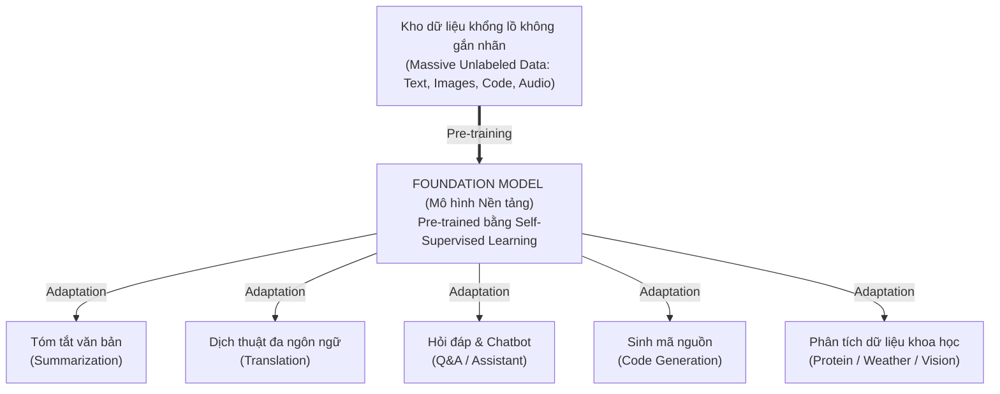
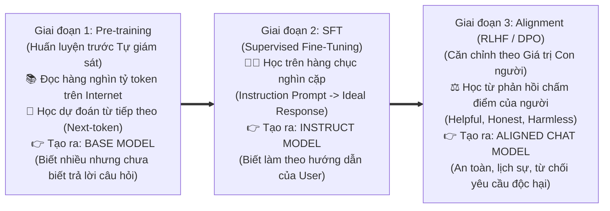
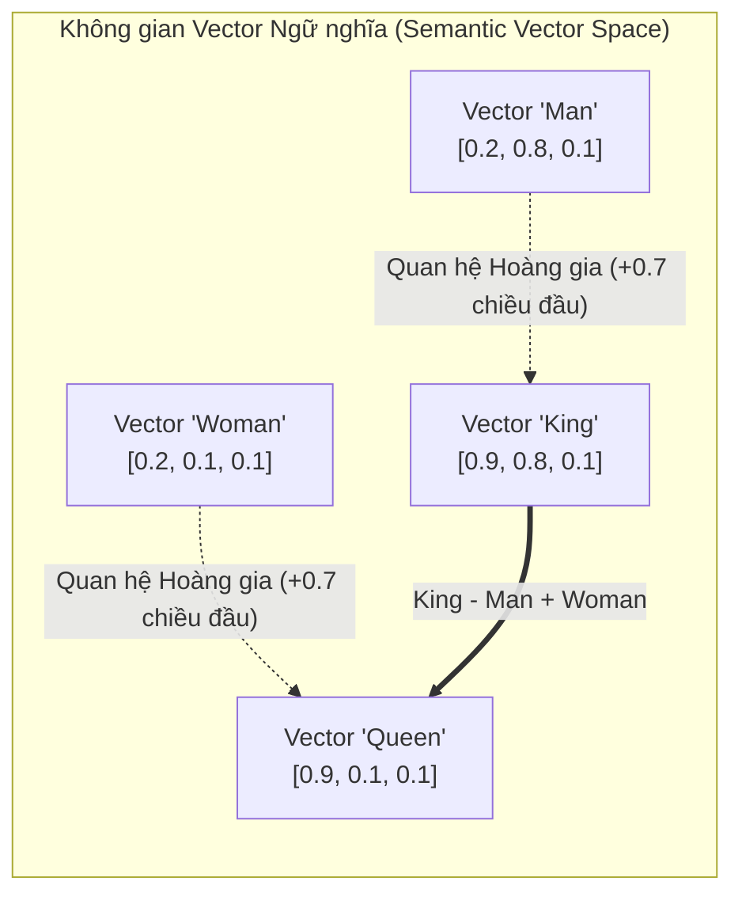
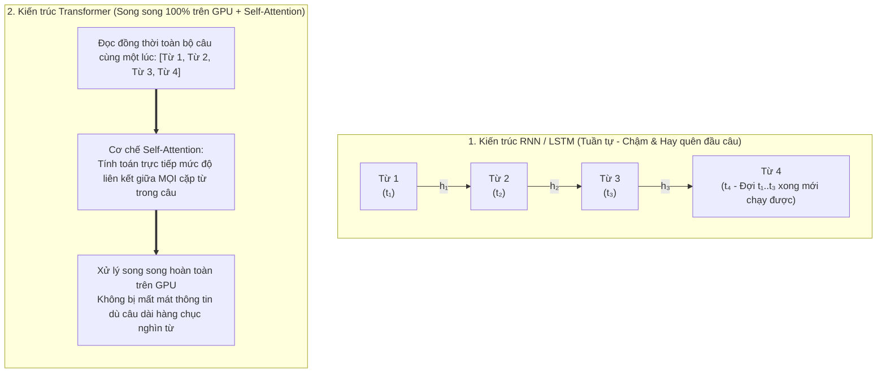

# Module 3: Generative AI & Large Language Models (AI Tạo sinh & Mô hình Ngôn ngữ Lớn)

> [!IMPORTANT]
> **Trọng tâm ôn thi NCA-GENL ở Module 3:**
> Nắm vững sự khác biệt toán học và bản chất giữa **Discriminative AI vs. Generative AI**; **3 động lực bùng nổ (Tipping Point)**; khái niệm **Foundation Models (FM)** (huấn luyện bằng **Self-Supervised Learning** trên dữ liệu không nhãn) và tính đa phương thức (**Multimodal**); quy trình **3 giai đoạn huấn luyện LLM hiện đại (Pre-training $\to$ SFT $\to$ RLHF / DPO)**; và con đường tiến hóa từ **Word Embedding (Word2Vec: CBOW & Skip-gram)** $\to$ **RNN/LSTM** (cùng 2 hạn chế chí mạng của nó) $\to$ **Transformer**.

---

## 1. Bản chất của Generative AI (AI Tạo sinh)

### 1.1. Phân biệt Mô hình Phân biệt (Discriminative AI) vs. Mô hình Tạo sinh (Generative AI)
Trong đề thi NCA-GENL, câu hỏi thường yêu cầu phân biệt sự khác nhau về bản chất giữa mô hình ML/DL truyền thống (Discriminative) và Generative AI:

* **Discriminative AI (Mô hình Phân biệt / Dự đoán):**
  * *Bản chất toán học:* Học **ranh giới quyết định (decision boundary)** giữa các lớp dữ liệu sẵn có, tức là tính xác suất có điều kiện $P(Y \mid X)$ (biết đầu vào $X$, đoán nhãn $Y$).
  * *Ví dụ:* Nhìn ảnh đoán xem đó là `"Chó"` hay `"Mèo"`; đọc email đoán xem là `"Spam"` hay `"Không Spam"`. Mô hình này **không thể tự vẽ ra một bức ảnh con mèo mới**.
* **Generative AI (Mô hình Tạo sinh):**
  * *Bản chất toán học:* Học **phân phối xác suất nội tại của toàn bộ dữ liệu** $P(X)$ hoặc $P(X, Y)$, từ đó có khả năng lấy mẫu (sample) để **sáng tạo ra dữ liệu hoàn toàn mới và nguyên bản (original content)** giống như dữ liệu thật nhưng chưa từng tồn tại trước đó.

```mermaid
flowchart TD
    subgraph TradML["1. Traditional ML (Discriminative - Học máy cổ điển)"]
        direction LR
        I1["Đầu vào Đơn giản<br/>(Dữ liệu dạng bảng: Tuổi, Thu nhập)"] --> M1["Mô hình ML<br/>(XGBoost / Logistic)"] --> O1["Đầu ra Đơn giản<br/>(Nhãn: Duyệt vay / Từ chối)"]
    end

    subgraph TradDL["2. Traditional Deep Learning (Discriminative DL)"]
        direction LR
        I2["Đầu vào Phức tạp<br/>(Bức ảnh triệu điểm ảnh)"] --> M2["Mô hình DL<br/>(CNN - ResNet)"] --> O2["Đầu ra Đơn giản<br/>(Nhãn: 'Con mèo' - 99%)"]
    end

    subgraph GenAI_Flow["3. Generative AI (AI Tạo sinh)"]
        direction LR
        I3["Đầu vào Phức tạp<br/>(Prompt văn bản, hình ảnh, âm thanh)"] --> M3["Mô hình GenAI<br/>(Transformer / Diffusion)"] --> O3["Đầu ra Phức tạp & Nguyên bản<br/>(Bài luận văn, Source Code, Tranh nghệ thuật 4K)"]
    end
```

### 1.2. Tốc độ chấp nhận kỷ lục & Ba động lực bùng nổ (3 Pillars of the Tipping Point)
* **Kỷ lục lịch sử:** ChatGPT chỉ mất đúng **2 tháng** để cán mốc **100 triệu người dùng**, bỏ xa TikTok (9 tháng), Instagram (2.5 năm) và Netflix (10 năm).
* **Ba động lực cốt lõi tạo nên điểm bùng phát (Tipping Point - Hay hỏi thi):**
  1. **Massive Amounts of Data:** Lượng dữ liệu số hóa khổng lồ tích lũy từ Internet suốt nhiều thập kỷ (văn bản, hình ảnh, video, mã nguồn mở).
  2. **Cloud Computing:** Năng lực điện toán đám mây quy mô lớn giúp việc tiếp cận các cụm siêu máy tính trở nên khả thi.
  3. **AI Accelerators & Transformer Architecture:** Đột phá kép về phần cứng chip tăng tốc AI (GPU NVIDIA với Tensor Cores) và kiến trúc thuật toán **Transformer** (cho phép huấn luyện song song).

---

## 2. Mô hình Nền tảng (Foundation Models - FM)

Khái niệm **Foundation Model** được định nghĩa và phổ biến bởi Viện HAI thuộc Đại học Stanford:

* **Định nghĩa chuẩn:** Là mô hình học máy quy mô lớn được **huấn luyện trước (Pre-trained)** trên tập dữ liệu khổng lồ **không gắn nhãn (unlabeled data)** thông qua phương pháp **học tự giám sát (Self-supervised learning)**.
  * *Làm rõ cơ chế Self-Supervised Learning cho Developer:* Tại sao dữ liệu không có nhãn mà mô hình vẫn học được? Vì mô hình **tự sinh ra nhãn từ chính dữ liệu thô**! Ví dụ: Lấy câu văn *"Trời hôm nay rất đẹp"* trên Wikipedia, tự che chữ *"đẹp"* đi (`"Trời hôm nay rất [MASK]"`), bắt mô hình đoán chữ bị che rồi tự chấm điểm với chữ *"đẹp"* trong câu gốc. Nhờ vậy, nhân loại có thể đưa hàng nghìn tỷ câu văn trên Internet vào huấn luyện mà không tốn một đồng thuê người gắn nhãn!
* **Tính đa năng (Versatility - One Model, Many Tasks):** Khác với mô hình ML truyền thống (Narrow AI - mỗi mô hình chỉ làm 1 việc hẹp), Foundation Model đóng vai trò như một "bộ não nền tảng tổng quát", có thể thích ứng (**Adapt / Fine-tune / Prompt**) để giải quyết hàng chục tác vụ hạ nguồn (Downstream tasks) khác nhau.

### Đa phương thức (Multimodal Foundation Models)
Một Foundation Model hiện đại có thể xử lý, liên kết và chuyển đổi qua lại nhiều định dạng dữ liệu (**Modalities**) cùng lúc:
* **Text** (Văn bản, Code) $\leftrightarrow$ **Vision** (Hình ảnh, Video) $\leftrightarrow$ **Audio** (Giọng nói, Âm thanh) $\leftrightarrow$ **Scientific Data** (Cấu trúc Protein/DNA, phân tử hóa học, dự báo thời tiết).

---

## 3. Mô hình Ngôn ngữ Lớn (LLM) & Quy trình Huấn luyện 3 Giai đoạn

* **Định nghĩa:** **LLM (Large Language Model)** là một loại **Foundation Model chuyên sâu về ngôn ngữ**, được thiết kế để hiểu, xử lý và sinh ra văn bản tự nhiên bằng cách học các quy luật xác suất ngữ pháp, ngữ nghĩa và tri thức từ hàng nghìn tỷ từ ngữ (trillions of tokens).
* **Công thức tạo nên một LLM xuất sắc:**
  $$\text{LLM Xuất Sắc} = \text{Dữ liệu Chất Lượng Cao} + \text{Kiến trúc Ổn định \& Co giãn (Transformer)} + \text{Mục tiêu Huấn luyện Đa tầng}$$

### Làm rõ Quy trình Huấn luyện Đa tầng của LLM (Pre-training $\to$ SFT $\to$ RLHF / DPO):
Đây là phần kiến thức rất quan trọng trong đề thi NCA-GENL để hiểu tại sao một mô hình như GPT-4 hay LLaMA-3-Instruct lại biết vâng lời con người:

* **Phân biệt RLHF vs. DPO ở Giai đoạn 3 (Câu hỏi nâng cao trong đề thi):**
  * **RLHF (Reinforcement Learning from Human Feedback):** Quy trình 2 bước phức tạp — Bước 1: Con người chấm điểm xếp hạng các câu trả lời của LLM để huấn luyện một **Mô hình Phần thưởng riêng biệt (Reward Model)**; Bước 2: Dùng thuật toán học tăng cường (**PPO** - Proximal Policy Optimization) để tinh chỉnh LLM sao cho đạt điểm cao nhất từ Reward Model.
  * **DPO (Direct Preference Optimization):** Phương pháp hiện đại, đơn giản và ổn định hơn RLHF — **Bỏ qua hoàn toàn việc huấn luyện Reward Model riêng biệt**, mà dùng hàm mất mát (Binary Cross-Entropy Loss) tối ưu trực tiếp trọng số của LLM trên tập dữ liệu gồm các cặp câu trả lời *(Được con người thích - Chosen vs. Bị chê - Rejected)*.

---

## 4. Con đường tiến hóa kỹ thuật: Từ Word Embedding đến Transformer

### 4.1. Bước 1: Word Embedding (Nhúng từ) & Hai kiến trúc của Word2Vec
* **Word Embedding là gì?** Là kỹ thuật ánh xạ mỗi từ vựng thành một **Vector số thực nhiều chiều** (Dense Vector, thường từ 300 đến 4096 chiều).
* **Bảo toàn ngữ nghĩa (Semantic Preservation):** Các từ có ý nghĩa tương tự hoặc xuất hiện trong ngữ cảnh tương đồng sẽ nằm gần nhau trong không gian vector (khoảng cách giữa `"Chó"` và `"Mèo"` gần hơn nhiều so với `"Chó"` và `"Xe buýt"`).
* **Tính chất đại số ngữ nghĩa (Vector Arithmetic):**
  $$\overrightarrow{\text{King}} - \overrightarrow{\text{Man}} + \overrightarrow{\text{Woman}} \approx \overrightarrow{\text{Queen}}$$
  $$\overrightarrow{\text{Paris}} - \overrightarrow{\text{France}} + \overrightarrow{\text{Germany}} \approx \overrightarrow{\text{Berlin}}$$
* **Thuật toán Word2Vec (Google, 2013):** Gồm 2 kiến trúc mạng nơ-ron nông 2 lớp ngược chiều nhau:
  1. **CBOW (Continuous Bag of Words):** Nhìn vào **các từ ngữ cảnh xung quanh** để đoán **1 từ bị khuyết ở chính giữa** (Ví dụ: Cho `"Con ___ ngồi trên tấm thảm"` $\to$ Đoán `"mèo"`). Chạy nhanh, tốt cho các từ phổ biến.
  2. **Skip-gram:** Nhìn vào **1 từ đích ở chính giữa** để dự đoán **các từ ngữ cảnh xung quanh nó** (Ví dụ: Cho từ `"mèo"` $\to$ Đoán `"Con"`, `"ngồi"`, `"thảm"`). Biểu diễn các từ hiếm (rare words) tốt hơn CBOW.

---

### 4.2. Bước 2: Từ Word Embedding đơn giản đến Mạng hồi quy (RNN / LSTM)
1. **Dự đoán với Word Embedding tĩnh đơn giản:**
   * Mỗi từ chỉ có đúng **1 vector cố định duy nhất** bất kể ngữ cảnh (ví dụ từ *"apple"* trong *"eat an apple"* và *"Apple released a new iPhone"* bị gán cùng một vector!), và chỉ nhìn từ đứng sát trước đó $\to$ Không hiểu được ngữ cảnh câu dài.
2. **Recurrent Neural Networks (RNN / LSTM):**
   * Bổ sung **Trạng thái ẩn (Hidden State $h_t$)** làm "bộ nhớ" truyền tuần tự từ từ đầu tiên đến từ cuối cùng ($t_1 \to t_2 \to t_3 \dots$).
   * **Hai hạn chế chí mạng của RNN/LSTM (Câu hỏi tủ trong đề thi NCA-GENL!):**
     * **Thứ nhất – Nút thắt xử lý tuần tự (Sequential Bottleneck):** Để tính từ thứ $t$, bắt buộc phải đợi tính xong từ thứ $t-1$. Do đó **không thể tính toán song song (parallelize) trên GPU**, khiến thời gian huấn luyện tập dữ liệu lớn cực kỳ chậm.
     * **Thứ hai – Quên ngữ cảnh dài (Long-term Dependency & Vanishing Gradient):** Khi câu văn dài, thông tin từ những từ ở đầu câu bị phai nhạt dần (triệt tiêu đạo hàm) trước khi truyền tới cuối câu.

---

### 4.3. Bước 3: Cuộc cách mạng Transformer (2017)
Kiến trúc **Transformer** đập bỏ hoàn toàn cơ chế đọc từng từ tuần tự của RNN:

---

## 5. Bẫy đề thi NCA-GENL & Câu hỏi Thực chiến (Exam Traps & Mini Quiz)

> [!WARNING]
> **Các bẫy kinh điển trong đề thi Module 3:**
> 1. **Bẫy RNN vs. Transformer:** Tại sao Transformer huấn luyện nhanh hơn RNN vượt trội trên GPU? $\to$ Vì Transformer loại bỏ sự phụ thuộc tuần tự (sequential dependency) của RNN và xử lý toàn bộ các token trong chuỗi **song song (in parallel)** thông qua cơ chế **Self-Attention**.
> 2. **Bẫy RLHF vs. DPO:** Phương pháp căn chỉnh (Alignment) nào giúp tinh chỉnh LLM theo sở thích con người một cách trực tiếp mà **không cần huấn luyện một mô hình phần thưởng (Reward Model) riêng biệt**? $\to$ Chọn **DPO (Direct Preference Optimization)**.
> 3. **Bẫy Foundation Model:** Foundation Model được huấn luyện ban đầu (Pre-trained) bằng phương pháp nào? $\to$ **Self-supervised learning trên tập dữ liệu khổng lồ không gắn nhãn (Unlabeled data)**.

### Câu hỏi tự kiểm tra (Mini Quiz):
1. **Câu 1:** Trong quá trình hoàn thiện một mô hình LLM, giai đoạn nào sử dụng phản hồi đánh giá của con người để điều chỉnh mô hình sao cho câu trả lời trở nên an toàn, hữu ích và không độc hại?
   * *Đáp án:* **RLHF (Reinforcement Learning from Human Feedback)** hoặc **DPO (Direct Preference Optimization)**.
2. **Câu 2:** Đâu là sự khác biệt cơ bản giữa mô hình Discriminative AI (như phân loại ảnh) và mô hình Generative AI?
   * *Đáp án:* Discriminative AI học ranh giới phân loại để trả về nhãn dự đoán cho dữ liệu có sẵn, trong khi Generative AI học phân phối của dữ liệu để **sáng tạo ra nội dung mới và nguyên bản**.
