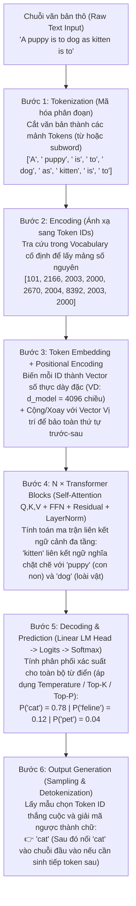
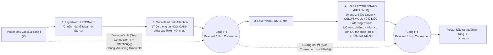
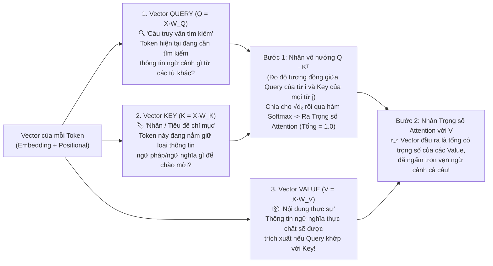
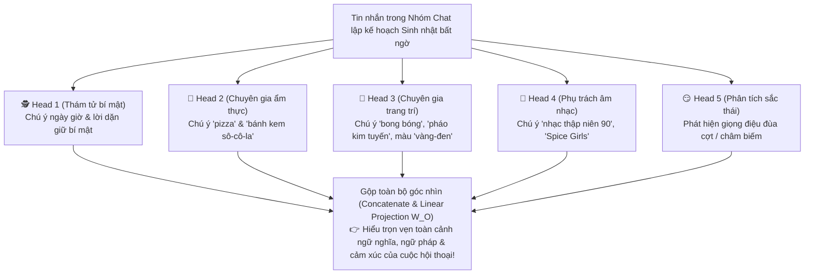
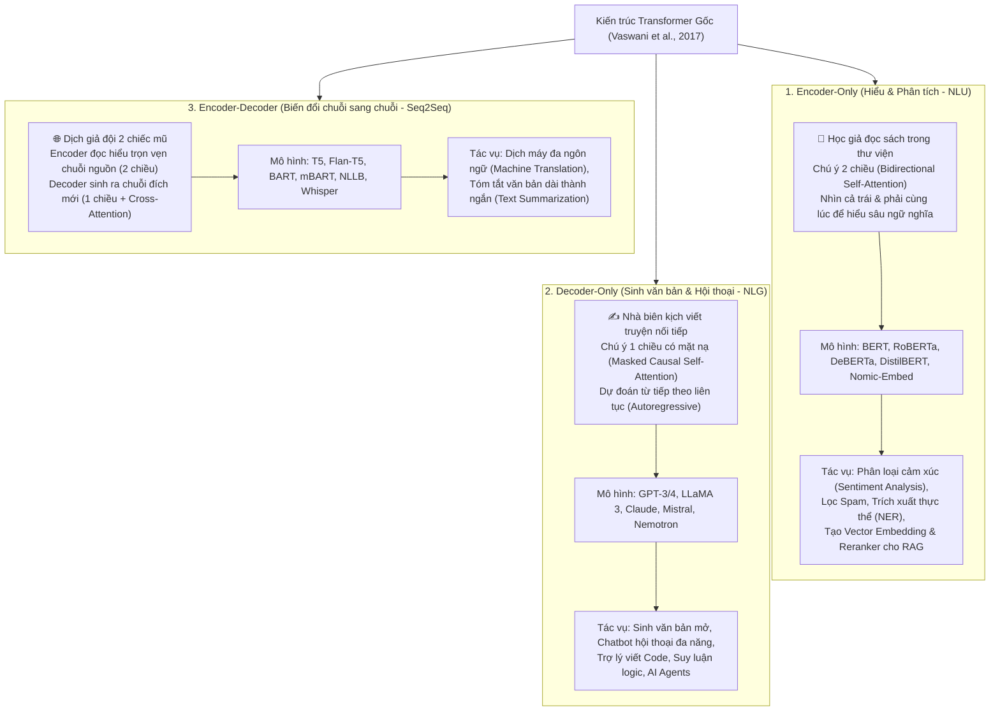

# Module 4: Transformer Architecture (Kiến trúc Transformer Chuyên sâu)

> [!IMPORTANT]
> **Trọng tâm ôn thi NCA-GENL ở Module 4 (Chiếm tỷ trọng câu hỏi rất cao!):**
> Thuộc lòng bài báo lịch sử **"Attention Is All You Need" (2017)**; nắm chắc **6 bước trong Pipeline xử lý đầu-cuối của Transformer** và giải phẫu bên trong 1 khối Transformer (**LayerNorm, Residual Connections, FFN/MLP**); hiểu sâu lý do dùng **Subword Tokenization (BPE, WordPiece, SentencePiece)**, **Positional Encoding (Sinusoidal & RoPE)**, bản chất toán học của **Self-Attention ($Q, K, V$), Masked Causal Attention, Cross-Attention** và sự tiến hóa **MHA $\to$ MQA $\to$ GQA + KV Cache + FlashAttention**; nắm rõ **các chiến lược và tham số điều khiển sinh văn bản (Greedy, Beam Search, Temperature, Top-K, Top-P)**; và đặc biệt là bảng phân loại **3 biến thể kiến trúc (Encoder-only vs. Decoder-only vs. Encoder-Decoder)** cùng kiến trúc **MoE (Mixture of Experts)**.

---

## 1. Nguồn gốc lịch sử và Tầm ảnh hưởng

* **Tháng 6 năm 2017:** Nhóm 8 nhà nghiên cứu tại Google Brain và Google Research (Ashish Vaswani et al.) công bố bài báo khoa học kinh điển mang tên **"Attention Is All You Need"** tại hội nghị NeurIPS.
* **Ý nghĩa của tên bài báo:** Trước năm 2017, giới AI mặc định rằng để dịch máy hay xử lý chuỗi ngôn ngữ, bắt buộc phải dùng mạng hồi quy (**RNN / LSTM / GRU**) hoặc mạng tích chập (CNN) làm khung xương chính, còn cơ chế Attention (như Bahdanau/Luong Attention) chỉ là linh kiện phụ trợ gắn thêm vào RNN. Bài báo này đưa ra tuyên bố táo bạo: *Hãy vứt bỏ hoàn toàn cấu trúc tuần tự của RNN đi, chỉ cần cơ chế Self-Attention là đủ để xây dựng một mô hình ngôn ngữ vừa nhanh hơn gấp chục lần trên GPU vừa thông minh hơn vượt trội!*
* **Tầm ảnh hưởng:** Khai sinh ra kiến trúc **Transformer** (chính là chữ **T** trong **GPT** - *Generative Pre-trained Transformer* và **BERT** - *Bidirectional Encoder Representations from Transformers*), trở thành động cơ cốt lõi đằng sau toàn bộ cuộc cách mạng Generative AI ngày nay (từ ngôn ngữ, lập trình, sinh học phân tử đến cả thị giác máy tính **ViT** và video **DiT**).

---

## 2. Quy trình xử lý đầu-cuối của Transformer (End-to-End Pipeline) & Giải phẫu Khối Transformer

### 2.1. Hành trình 6 bước của một Prompt đi qua Transformer
Hãy theo dõi hành trình của một câu đố ngôn ngữ từ lúc người dùng gõ vào bàn phím cho đến khi mô hình sinh ra câu trả lời:
**Input Prompt:** `"A puppy is to dog as kitten is to..."`

### 2.2. Giải phẫu bên trong 1 Khối Transformer Tiêu chuẩn (Inside a Transformer Block)
Một mô hình như LLaMA-3 8B xếp chồng $N = 32$ khối Transformer giống hệt nhau (LLaMA-3 70B xếp chồng $80$ khối). Bên trong **mỗi khối (1 Layer)** gồm **2 tầng con (Sub-layers)** cực kỳ quan trọng mà đề thi thường hỏi:

> [!TIP]
> **Góc nhìn Kiến trúc cho Developer:**
> * **Khối Self-Attention:** Đóng vai trò là **"Bộ phận Giao tiếp (Communication)"** — giúp các token khác nhau trong câu nhìn thấy nhau và trao đổi thông tin ngữ cảnh.
> * **Khối Feed-Forward Network (FFN / Position-wise MLP):** Đóng vai trò là **"Bộ phận Suy nghĩ & Kho lưu trữ Tri thức (Computation & Factual Memory)"** — sau khi mỗi token đã thu thập xong ngữ cảnh từ Attention, nó đi qua mạng FFN (chiếm tới ~2/3 tổng số tham số của mô hình!) để biến đổi phi tuyến và truy xuất tri thức đã học.

---

## 3. Giải phẫu 5 Thành phần Kỹ thuật Cốt lõi của Transformer

### 3.1. Subword Tokenization (Mã hóa từ con)
Khi thiết kế bộ Tokenizer (Bước 1), tại sao các kỹ sư không cắt theo từng từ nguyên vẹn (Whole-word) hoặc cắt theo từng chữ cái đơn lẻ (Character-level)?

| Phương pháp Tokenization | Cách cắt chuỗi | Nhược điểm chí mạng |
| :--- | :--- | :--- |
| **1. Whole-word (Từ nguyên vẹn)** | Cắt theo khoảng trắng: `["unbelievable", "dogs"]` | • Từ điển phình to hàng triệu từ (do chia động từ, số nhiều, từ ghép). • Gặp từ mới, tên riêng hoặc từ gõ sai chính tả là dính lỗi **OOV (Out-of-Vocabulary)** $\to$ biến thành token mù `<UNK>`. |
| **2. Character-level (Từng chữ cái)** | Cắt từng ký tự: `['u', 'n', 'b', 'e', ...]` | • Từ điển siêu nhỏ (vài trăm ký tự), không bị OOV. • Nhưng **bản thân chữ cái `'u'` không mang ngữ nghĩa**, và chuỗi token bị kéo dài gấp 5–7 lần làm nổ tung chi phí tính toán Attention! |
| **3. Subword Tokenization (Mã hóa từ con - CHUẨN HIỆN ĐẠI)** | Giữ nguyên từ phổ biến (`"dog"`), chỉ tách từ hiếm/phức tạp thành **Tiền tố + Gốc từ + Hậu tố** | **Điểm cân bằng hoàn hảo (Sweet Spot):** Từ điển gọn nhẹ (32K – 128K tokens), giữ trọn vẹn ngữ nghĩa gốc từ và **không bao giờ bị lỗi OOV**! |

* **Ví dụ kinh điển về Subword Tokenization:** Ba từ `unbelievable`, `unbreakable`, `unlikeable` không cần lưu thành 3 mục từ riêng biệt mà được lắp ghép từ 5 mảnh subword có nghĩa:
  $$\text{\texttt{un}} + \{\text{\texttt{believ}}, \text{\texttt{break}}, \text{\texttt{like}}\} + \text{\texttt{able}}$$
* **Quy tắc ước lượng nhanh cho Developer:** Trong tiếng Anh, trung bình **$1\text{ token} \approx 0.75\text{ từ (words)} \approx 4\text{ ký tự}$** (tức là $100\text{ tokens} \approx 75\text{ từ}$).
* **3 Thuật toán Subword Tokenizer tiêu chuẩn cần nhớ tên trong đề thi:**
  1. **BPE (Byte-Pair Encoding):** Bắt đầu từ các ký tự đơn lẻ, lặp đi lặp lại việc gộp cặp ký tự xuất hiện cùng nhau nhiều nhất thành token mới (Dùng trong **GPT-2/3/4 (`tiktoken`), LLaMA-3, RoBERTa**).
  2. **WordPiece:** Tương tự BPE nhưng chọn cặp gộp dựa trên việc tối đa hóa xác suất hợp lý (Likelihood) của dữ liệu huấn luyện, đánh dấu mảnh từ con bằng ký hiệu `##` như `play`, `##ing` (Dùng trong **BERT, DistilBERT**).
  3. **SentencePiece / Unigram:** Coi khoảng trắng cũng là một ký tự thông thường (`_`), không phụ thuộc vào việc ngôn ngữ có dùng dấu cách hay không (rất mạnh cho tiếng Nhật, Trung, Đa ngôn ngữ; dùng trong **T5, XLNet, LLaMA-1/2, Mistral**).

---

### 3.2. Positional Encoding (Mã hóa vị trí)
* **Vấn đề kỹ thuật:** Vì Transformer nạp toàn bộ các từ trong câu vào GPU **cùng một lúc (song song)** thay vì đọc lần lượt từ trái sang phải như RNN, nên bản thân phép toán nhân ma trận trong Self-Attention có tính chất **bất biến với hoán vị (Permutation Invariant — tức là "mù vị trí")**. Nếu không có thông tin vị trí, mô hình sẽ nhìn câu văn như một "túi chứa từ" hỗn loạn (**Bag of Words**) và coi 2 câu hoàn toàn trái ngược nhau sau đây là giống hệt nhau:
  * Câu 1: *"The **cat** chased the **dog**."* (Mèo đuổi chó)
  * Câu 2: *"The **dog** chased the **cat**."* (Chó đuổi mèo)
* **Giải pháp – Positional Encoding:**
  * Trước khi đưa vào tầng Transformer đầu tiên, thông tin tọa độ vị trí thứ $1, 2, 3, \dots, n$ của từng token được tiêm trực tiếp vào Vector Embedding.
  * **Các phương pháp Positional Encoding chính:**
    1. **Sinusoidal Positional Encoding (Bài báo Transformer gốc 2017):** Cộng trực tiếp một vector tạo bởi các hàm lượng giác $\sin$ và $\cos$ có tần số sóng khác nhau vào Word Embedding: $\text{Input} = \text{WordEmbedding}(x) + \text{PositionalEncoding}(pos)$.
    2. **RoPE (Rotary Position Embedding - Chuẩn hiện đại trên LLaMA, Mistral, Nemotron):** Thay vì cộng vector vị trí, **RoPE xoay (rotate) trực tiếp vector Query ($Q$) và Key ($K$) một góc tỷ lệ với vị trí của chúng trong mặt phẳng phức**, giúp Attention tự nhiên phụ thuộc vào **khoảng cách tương đối (Relative Distance)** giữa hai từ và mở rộng cửa sổ ngữ cảnh (Context Window) lên tới 128K – 1M tokens dễ dàng!

---

### 3.3. Cơ chế Self-Attention (Tự chú ý) và Bộ ba Vector Query ($Q$), Key ($K$), Value ($V$)
* **Phép ẩn dụ:** Self-Attention hoạt động giống như một **chiếc bút dạ quang thần kỳ (Magical Highlighter)** rà soát toàn bộ câu văn ngay lập tức. Khi xử lý đại từ `"it"` trong hai câu kinh điển sau:
  * Câu A: *"The **animal** didn't cross the street because **it** was too **tired**."* $\to$ Điểm Attention của `"it"` tập trung mạnh nhất vào **`"animal"`** (vì con vật mới biết mệt!).
  * Câu B: *"The animal didn't cross the **street** because **it** was too **wide**."* $\to$ Điểm Attention của `"it"` tự động chuyển sang tập trung mạnh nhất vào **`"street"`** (vì con đường mới rộng!).

#### Giải mã Toán học $Q, K, V$ theo góc nhìn Developer (Rất hay hỏi trong đề thi!):
Để tính toán sự liên kết giữa các từ, mỗi vector đầu vào $X$ của một token sẽ được nhân với 3 ma trận trọng số học được ($W_Q, W_K, W_V$) để sinh ra **3 vector đóng 3 vai trò khác nhau** (giống hệt như khi bạn tìm kiếm video trên YouTube hoặc truy vấn Hash Map / Database):

* **Công thức Scaled Dot-Product Attention kinh điển (Cần hiểu từng thành phần):**
  $$\text{Attention}(Q, K, V) = \text{softmax}\left(\frac{QK^T}{\sqrt{d_k}}\right)V$$
  1. **$QK^T$ (MatMul 1):** Nhân tích vô hướng giữa vector Query của từng từ với vector Key của tất cả các từ trong câu để tạo ra **Ma trận Điểm Tương đồng (Attention Scores Matrix)** kích thước $N \times N$ (với $N$ là số lượng token trong chuỗi).
  2. **Chia cho $\sqrt{d_k}$ (Scale):** Tại sao phải chia cho căn bậc hai số chiều của vector Key? Vì khi số chiều $d_k$ lớn (ví dụ $d_k = 64$ hay $128$), tổng tích vô hướng $QK^T$ sẽ có phương sai rất lớn, đẩy hàm $\text{softmax}$ vào vùng bão hòa cực đoan (một số bằng $1$, các số khác bằng $0$), làm đạo hàm tiến về $0$ (**Vanishing Gradients**). Chia cho $\sqrt{d_k}$ giúp giữ phương sai bằng $1$ để đạo hàm luôn mượt mà!
  3. **$\text{softmax}(\cdot)$:** Chuyển hóa điểm số thô thành phân phối xác suất (**Attention Weights**) nằm trong khoảng $[0, 1]$ và tổng trên mỗi hàng bằng đúng $1.0$.
  4. **Nhân với $V$ (MatMul 2):** Nhân ma trận trọng số xác suất vừa tìm được với ma trận **Value ($V$)** để gom thông tin ngữ nghĩa về cho từng token.

### 3.4. Phân biệt 3 Cơ chế Attention: Bidirectional Self-Attention vs. Masked Causal Attention vs. Cross-Attention
Đề thi rất hay hỏi sự khác nhau về cách hoạt động của Attention trong Encoder và Decoder:
1. **Bidirectional Self-Attention (Dùng trong khối Encoder như BERT):** Mọi token ở vị trí $i$ được phép nhìn thấy **toàn bộ các token ở cả phía trước ($< i$) và phía sau ($> i$)** trong câu.
2. **Masked / Causal Self-Attention (Dùng trong khối Decoder như GPT, LLaMA):** Vì nhiệm vụ của Decoder là dự đoán từ tiếp theo nên khi đang ở vị trí thứ $i$, nó **tuyệt đối không được phép "ăn gian" nhìn trộm các từ ở tương lai ($> i$)**. Kỹ thuật thực hiện: Cộng một ma trận mặt nạ tam giác trên chứa giá trị **$-\infty$ (Negative Infinity Mask)** vào $QK^T$ trước khi qua hàm Softmax (vì $e^{-\infty} = 0$), ép toàn bộ trọng số chú ý về tương lai bằng $0$!
3. **Cross-Attention (Encoder-Decoder Attention - Dùng trong mô hình Seq2Seq như T5, BART hoặc tiêm Text Prompt vào U-Net của Stable Diffusion):**
   * Vector **Query ($Q$)** được lấy từ **khối Decoder** (hoặc ảnh đang khử nhiễu).
   * Còn vector **Key ($K$)** và **Value ($V$)** được lấy từ đầu ra của **khối Encoder** (hoặc văn bản gốc)! Giúp Decoder vừa viết câu dịch vừa đối chiếu sang toàn bộ câu gốc ở Encoder.

---

### 3.5. Multi-Head Attention (MHA), KV Cache, GQA và FlashAttention
* **Multi-Head Attention (MHA - Chú ý đa đầu):**
  Một câu văn tự nhiên luôn chứa đựng nhiều tầng thông tin cùng lúc (ngữ pháp chủ-vị, quan hệ sở hữu, thời gian, cảm xúc). Thay vì chỉ tính Attention 1 lần trên toàn bộ số chiều, **Multi-Head Attention** chia nhỏ vector thành $h$ "đầu chú ý" (**Attention Heads**, ví dụ 32 heads) chạy song song và độc lập với nhau trên các không gian con khác nhau, sau đó nối (`Concat`) lại:

* **Tối ưu hóa Attention trong LLM hiện đại (Kiến thức sát sườn với TensorRT-LLM ở Module 8):**
  1. **KV Cache (Bộ nhớ đệm Key-Value lúc Inference):** Khi mô hình Decoder sinh token thứ $100$, các vector Key ($K$) và Value ($V$) của $99$ token trước đó hoàn toàn không thay đổi. Thay vì tính lại từ đầu cho cả $99$ token cũ, hệ thống lưu sẵn $K$ và $V$ của các token đã qua vào VRAM gọi là **KV Cache** $\to$ Giúp tăng tốc độ sinh token lên hàng chục lần!
  2. **MHA $\to$ MQA (Multi-Query) $\to$ GQA (Grouped-Query Attention):** Khi chuỗi dài (ví dụ 128K tokens), bộ nhớ **KV Cache** phình to chiếm hết VRAM. **GQA** (dùng trong **LLaMA-3, Mistral, Nemotron**) cho phép một nhóm nhiều đầu Query (ví dụ 8 Query heads) dùng chung 1 đầu Key và 1 đầu Value, giúp **giảm kích thước KV Cache đi 4–8 lần** mà vẫn giữ nguyên độ thông minh như MHA!
  3. **FlashAttention:** Thuật toán chia nhỏ (Tiling) ma trận $Q, K, V$ để tính toán trọn vẹn ngay bên trong bộ nhớ đệm siêu tốc **SRAM (Shared Memory)** trên chip GPU mà không cần ghi ma trận trung gian $N \times N$ ra bộ nhớ HBM chậm hơn, giúp tăng tốc độ huấn luyện và suy luận lên gấp nhiều lần.

---

### 3.6. Chiến lược Giải mã & Các Tham số Điều khiển Sinh văn bản (Decoding & Sampling Parameters)
Ở Bước 5 của Pipeline, sau khi lớp Softmax tính ra xác suất cho toàn bộ từ điển, làm sao mô hình chọn ra từ tiếp theo?
* **Các chiến lược chọn từ cơ bản:**
  * **Greedy Decoding (Giải mã tham lam):** Luôn chọn đúng 1 token có xác suất cao nhất ở mỗi bước ($\arg\max P(w_t)$). Nhanh, nhất quán nhưng dễ bị lặp câu từ máy móc.
  * **Beam Search (Tìm kiếm chùm):** Duy trì đồng thời $B$ chuỗi ứng viên (Beams) tốt nhất ở mỗi bước rồi chọn chuỗi có tổng xác suất cả câu cao nhất (Rất hay dùng trong dịch máy hoặc tóm tắt cố định).
  * **Stochastic Sampling (Lấy mẫu ngẫu nhiên có kiểm soát):** Điều khiển qua **3 siêu tham số suy luận (`Temperature`, `Top-K`, `Top-P`)** dưới đây:

| Tham số | Bản chất Toán học & Cơ chế | Khi giá trị THẤP | Khi giá trị CAO |
| :--- | :--- | :--- | :--- |
| **1. Temperature ($T$)** | Chia điểm thô (logits $z_i$) cho $T$ trước khi đưa vào hàm Softmax: $$P_i = \frac{\exp(z_i / T)}{\sum \exp(z_j / T)}$$ Điều chỉnh "độ nhọn" hay "độ phẳng" của phân phối xác suất. | **$T \to 0$ (VD: $0.0 - 0.2$):** Làm nhọn phân phối; từ có xác suất cao nhất chiếm gần 100% (khi $T=0$ tương đương Greedy Decoding). Đầu ra **chính xác, nhất quán, có tính quyết định (Deterministic)** $\to$ *Dùng cho sinh Code, SQL, trích xuất JSON, Toán học, Hỏi đáp RAG*. | **$T \ge 0.8 - 1.2$:** Làm phẳng phân phối; các từ xác suất thấp hơn cũng có cơ hội được chọn. Đầu ra **đa dạng, sáng tạo bay bổng** nhưng nếu quá cao ($T > 1.5$) sẽ sinh văn bản lộn xộn và ảo giác $\to$ *Dùng cho viết thơ, sáng tác truyện, Brainstorming*. |
| **2. Top-K Sampling** | Cắt cứng theo **số lượng ứng viên**: Sắp xếp các token theo xác suất giảm dần, chỉ giữ lại đúng **$K$ token đứng đầu**, loại bỏ toàn bộ phần đuôi còn lại rồi chuẩn hóa lại xác suất để lấy mẫu. | **$K = 1$:** Chính là Greedy Decoding (chỉ lấy 1 từ cao điểm nhất). | **$K = 40$ hoặc $50$:** Cho phép chọn trong 40–50 từ hợp lý nhất, cắt bỏ phần đuôi dài (long tail) chứa các từ hoàn toàn vô nghĩa. *(Hạn chế: $K$ cố định nên không thích ứng được khi phân phối quá nhọn hoặc quá phẳng).* |
| **3. Top-P (Nucleus Sampling)** | Cắt động theo **tổng xác suất tích lũy (Cumulative Probability)**: Sắp xếp các từ từ cao xuống thấp và cộng dồn xác suất cho đến khi chạm ngưỡng $P$ thì dừng lại (tập hạt nhân - Nucleus). | **$P = 0.1$ (10%):** Chỉ xét nhóm hạt nhân cực nhỏ các từ chắc chắn nhất. | **$P = 0.90$ (90%):** Tự động co giãn thông minh số lượng từ ứng viên — nếu mô hình rất chắc chắn (`P("cat") = 0.92`), tập ứng viên tự thu hẹp chỉ còn 1 từ; nếu câu mở có nhiều hướng đi, nó tự mở rộng ra 50 từ để giữ sự tự nhiên! |

*(Ngoài ra còn có **Frequency Penalty** phạt các từ đã xuất hiện nhiều lần để chống lặp từ, và **Presence Penalty** khuyến khích mô hình chuyển sang chủ đề mới).*

---

## 4. Phân loại 3 Biến thể Kiến trúc Transformer & Mô hình Mixture of Experts (MoE)

### 4.1. Ba biến thể kiến trúc Transformer (CỰC KỲ QUAN TRỌNG!)
Từ bài báo Transformer gốc năm 2017 (vốn gồm cả khối Encoder bên trái và khối Decoder bên phải để dịch máy), giới công nghệ đã tách và phát triển thành **3 nhánh kiến trúc chuyên biệt**:

### Bảng so sánh tổng hợp 3 biến thể Transformer (Học thuộc lòng trước khi thi!)
| Loại kiến trúc | Ẩn dụ thực tế | Cơ chế Huấn luyện & Attention cốt lõi | Mô hình tiêu biểu | Tác vụ tối ưu nhất (Use Cases) |
| :--- | :--- | :--- | :--- | :--- |
| **1. Encoder-only (Autoencoding)** | **Học giả thông thái ngồi thư viện:** Đọc hết cả cuốn sách một cách im lặng, ghi nhớ sâu sắc toàn bộ ngữ cảnh trước-sau, sẵn sàng trả lời câu hỏi phân tích. | **Masked Language Modeling (MLM) + Bidirectional Attention:** Che ngẫu nhiên ~15% từ trong câu (`[MASK]`) và nhìn ngữ cảnh từ **cả 2 phía trái và phải** cùng lúc để đoán từ bị che. | **BERT**, RoBERTa, DeBERTa, ELECTRA, DistilBERT | **Hiểu ngôn ngữ (NLU):** Phân loại cảm xúc (Sentiment Analysis), lọc email Spam, trích xuất thực thể (**NER**), tạo Vector Embedding cho Semantic Search/RAG. |
| **2. Decoder-only (Autoregressive)** | **Nhà biên kịch / Kể chuyện tài ba:** Nhận một ý tưởng ngắn ban đầu (Prompt), sau đó viết nối tiếp từng từ, từng câu trôi chảy, câu sau dựa vào câu trước. | **Causal Language Modeling (CLM) + Masked Causal Attention:** Chỉ nhìn vào các từ đã xuất hiện **phía trước (bên trái)** để dự đoán từ tiếp theo (che tương lai). | **GPT-3/4**, **LLaMA 3**, Claude, Mistral, **NVIDIA Nemotron** | **Sinh ngôn ngữ (NLG):** Sinh văn bản mở, Chatbot hội thoại đa năng, trợ lý lập trình viết code, suy luận đa bước. |
| **3. Encoder-Decoder (Seq2Seq)** | **Người dịch thuật mang hai chiếc mũ:** Buổi sáng đội mũ học giả đọc hiểu trọn vẹn văn bản tiếng Pháp (**Encode**), buổi chiều đội mũ nhà văn chấp bút viết bản dịch tiếng Anh (**Decode**). | **Sequence-to-Sequence + Cross-Attention:** Khối Encoder nén toàn bộ chuỗi đầu vào thành biểu diễn ngữ cảnh; khối Decoder sinh ra chuỗi đầu ra mới tương ứng. | **T5**, **Flan-T5**, **BART**, NLLB | **Biến đổi chuỗi sang chuỗi:** Dịch máy giữa các ngôn ngữ (**Machine Translation**), tóm tắt văn bản dài thành đoạn ngắn (**Summarization**). |

### 4.2. Kiến trúc Chuyên gia Hỗn hợp: Mixture of Experts (MoE)
Các mô hình lớn hiện đại (như **Mixtral 8x7B, DeepSeek-V3, GPT-4, DBRX**) sử dụng kiến trúc biến thể **Sparse Mixture of Experts (MoE)**:
* Thay vì dùng 1 khối mạng Feed-Forward (FFN) khổng lồ duy nhất mà mọi token đều phải chạy qua 100% tham số (**Dense Model**), tầng MoE được chia thành nhiều mạng FFN con gọi là các **Chuyên gia (Experts)** (ví dụ 8 chuyên gia: chuyên gia Toán, chuyên gia Code, chuyên gia Văn học...) đứng sau một **Mạng Định tuyến (Router / Gating Network)**.
* Khi một token đi tới, **Router** chỉ chọn kích hoạt **Top-K chuyên gia phù hợp nhất (ví dụ $K = 2$ trên 8 chuyên gia)** để xử lý token đó!
* **Lợi ích vàng:** Mô hình có tổng dung lượng tri thức của một mô hình rất lớn (ví dụ Mixtral 8x7B có tổng cộng **47B tham số**), nhưng tốc độ suy luận và chi phí tính toán FLOPs trên mỗi token lại nhẹ và nhanh ngang ngửa một mô hình nhỏ (**chỉ kích hoạt ~13B Active Parameters**)! *(Lưu ý: Dù chỉ kích hoạt 13B tham số lúc tính toán, nhưng toàn bộ 47B tham số vẫn phải được nạp sẵn vào VRAM).*

---

## 5. Bẫy đề thi NCA-GENL & Câu hỏi Thực chiến (Exam Traps & Mini Quiz)

> [!WARNING]
> **Các bẫy kinh điển trong đề thi Module 4:**
> 1. **Bẫy chọn kiến trúc:**
>    * *Phân tích cảm xúc (Sentiment Analysis)*, *Trích xuất thực thể (NER)*, *Tạo Vector Embedding* $\to$ Chọn **Encoder-only (BERT)**.
>    * *Xây dựng Chatbot đối thoại, sinh văn bản mở, viết code* $\to$ Chọn **Decoder-only (GPT / LLaMA)**.
>    * *Dịch tài liệu đa ngôn ngữ (Translation)* hoặc *Tóm tắt văn bản (Summarization)* $\to$ Chọn **Encoder-Decoder (T5 / BART)**.
> 2. **Bẫy Temperature & Top-P:**
>    * Muốn LLM sinh code Python/SQL chuẩn xác, trích xuất dữ liệu nhất quán không bịa đặt ngẫu nhiên $\to$ Chỉnh **Temperature thấp ($T \approx 0$)**.
>    * Phương pháp lấy mẫu nào giới hạn động tập từ ứng viên dựa trên **tổng xác suất tích lũy (cumulative probability threshold)**? $\to$ Chọn **Top-P (Nucleus Sampling)**.
>    * Phương pháp lấy mẫu nào cắt cứng đúng **$K$ từ có xác suất cao nhất**? $\to$ Chọn **Top-K Sampling**.
> 3. **Bẫy Query, Key, Value ($Q, K, V$):** Trong cơ chế Self-Attention, điểm số chú ý (Attention Weight) giữa hai từ được tính bằng tích vô hướng chuẩn hóa giữa hai vector nào trước khi nhân với Value ($V$)? $\to$ Giữa **Query ($Q$) và Key ($K$)** chia cho $\sqrt{d_k}$.

### Câu hỏi tự kiểm tra (Mini Quiz):
1. **Câu 1:** Một lập trình viên đang tích hợp LLM để tự động chuyển đổi câu hỏi tiếng Việt của nhân viên thành câu lệnh truy vấn SQL chạy trên cơ sở dữ liệu kế toán. Để đảm bảo kết quả sinh ra luôn ổn định, chính xác và không có tính ngẫu nhiên, tham số `Temperature` nên được cấu hình như thế nào?
   * *Đáp án:* Đặt **Temperature ở mức rất thấp (bằng `0` hoặc gần `0`, ví dụ `0.1`)** để làm nhọn phân phối xác suất, buộc mô hình luôn ưu tiên chọn các token có xác suất cao nhất (Deterministic output).
2. **Câu 2:** Nếu loại bỏ hoàn toàn bước **Positional Encoding** khỏi kiến trúc Transformer, mô hình sẽ gặp phải vấn đề gì?
   * *Đáp án:* Mô hình sẽ **không thể phân biệt được thứ tự vị trí của các từ trong câu** (coi câu văn như một tập hợp từ không thứ tự - Bag of Words), dẫn đến hiểu sai hoàn toàn ngữ nghĩa khi đổi chỗ chủ ngữ và tân ngữ.
3. **Câu 3:** Tại sao các bộ Tokenizer hiện đại của LLM (như BPE hoặc WordPiece) lại sử dụng phương pháp **Subword Tokenization** thay vì Whole-word Tokenization?
   * *Đáp án:* Để giữ kích thước bộ từ điển (Vocabulary) nhỏ gọn trong khi vẫn **xử lý được các từ hiếm, từ ghép phức tạp hoặc từ mới chưa từng gặp mà không bị lỗi Out-of-Vocabulary (OOV)** thông qua việc ghép các mảnh tiền tố, gốc từ và hậu tố.
4. **Câu 4:** Một công ty truyền thông muốn xây dựng một công cụ tự động phân loại hàng triệu bình luận của độc giả thành 3 nhãn: *Tích cực, Tiêu cực, Trung lập* (Sentiment Analysis), đồng thời trích xuất tên các nhân vật và địa danh được nhắc đến trong bài báo (NER). Biến thể kiến trúc Transformer nào là phù hợp và hiệu quả nhất?
   * *Đáp án:* **Encoder-only (như BERT, RoBERTa)** vì cơ chế Bidirectional Self-Attention đọc hiểu toàn bộ ngữ cảnh hai chiều trái-phải cùng lúc, tối ưu cho các bài toán hiểu và phân tích ngôn ngữ (NLU).
5. **Câu 5:** Trong công thức Scaled Dot-Product Attention $\text{softmax}\left(\frac{QK^T}{\sqrt{d_k}}\right)V$, tại sao tích vô hướng $QK^T$ lại phải được chia cho $\sqrt{d_k}$ trước khi đưa vào hàm Softmax?
   * *Đáp án:* Để **ngăn chặn tích vô hướng $QK^T$ phình quá lớn khi số chiều $d_k$ cao**, tránh đẩy hàm Softmax vào vùng bão hòa có đạo hàm cực nhỏ gây ra hiện tượng **triệt tiêu đạo hàm (Vanishing Gradients)**.
6. **Câu 6:** Một mô hình sử dụng kiến trúc **Mixture of Experts (MoE)** như Mixtral 8x7B có tổng cộng 47 tỷ tham số nhưng tốc độ suy luận lại nhanh tương đương một mô hình 13 tỷ tham số. Cơ chế nào giúp đạt được điều này?
   * *Đáp án:* Nhờ một **Mạng định tuyến (Router / Gating Network)** chỉ chọn kích hoạt một số ít chuyên gia (**Top-K Experts**, ví dụ 2 trên 8 mạng FFN) cho mỗi token thay vì bắt mọi token phải tính toán qua toàn bộ 100% tham số của mạng.
