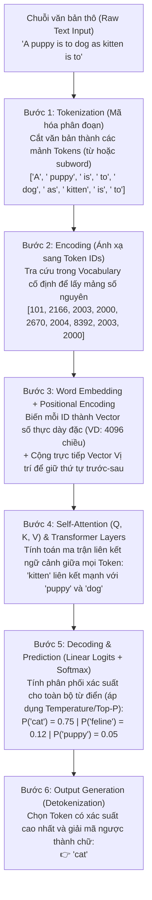
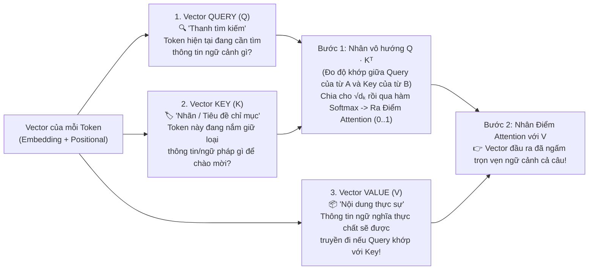
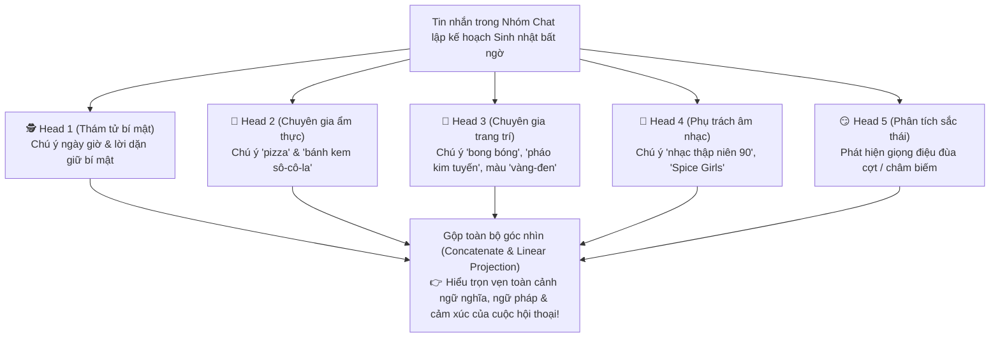
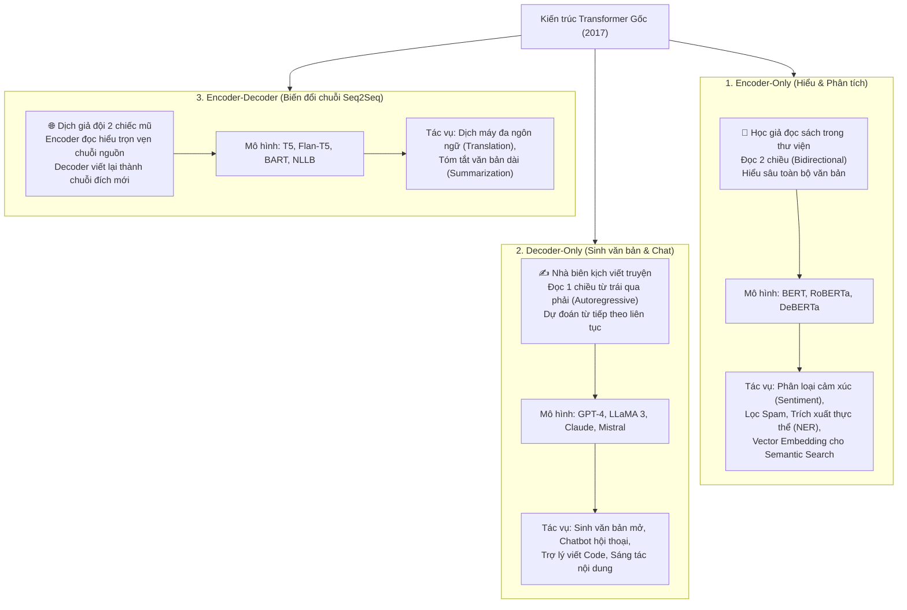

# Module 4: Transformer Architecture (Kiến trúc Transformer Chuyên sâu)

> [!IMPORTANT]
> **Trọng tâm ôn thi NCA-GENL ở Module 4 (Chiếm tỷ trọng câu hỏi rất cao!):**
> Thuộc lòng bài báo lịch sử **"Attention Is All You Need" (2017)**; nắm chắc **6 bước trong Pipeline xử lý đầu-cuối của Transformer**; hiểu sâu lý do dùng **Subword Tokenization (BPE)**, **Positional Encoding**, bản chất toán học của **Self-Attention thông qua 3 vector Query ($Q$), Key ($K$), Value ($V$)** và **Multi-Head Attention**; nắm rõ **các tham số điều khiển sinh văn bản (Temperature, Top-K, Top-P)**; và đặc biệt là bảng phân loại **3 biến thể kiến trúc (Encoder-only vs. Decoder-only vs. Encoder-Decoder)**.

---

## 1. Nguồn gốc lịch sử và Tầm ảnh hưởng

* **Tháng 6 năm 2017:** Nhóm nghiên cứu tại Google Brain và Google Research (Vaswani et al.) công bố bài báo khoa học kinh điển mang tên **"Attention Is All You Need"**.
* **Ý nghĩa của tên bài báo:** Trước năm 2017, người ta tin rằng bắt buộc phải dùng mạng hồi quy (RNN/LSTM) hoặc mạng tích chập (CNN) làm khung xương chính, còn cơ chế Attention chỉ là phần phụ trợ. Bài báo này tuyên bố: *Hãy vứt bỏ hoàn toàn RNN đi, chỉ cần cơ chế Attention là đủ để xây dựng một mô hình ngôn ngữ vượt trội hơn gấp bội!*
* **Tầm ảnh hưởng:** Khai sinh ra kiến trúc **Transformer** (chữ **T** trong **GPT** - *Generative Pre-trained Transformer* và **BERT** - *Bidirectional Encoder Representations from Transformers*), trở thành động cơ cốt lõi đằng sau toàn bộ cuộc cách mạng AI tạo sinh ngày nay.

---

## 2. Quy trình xử lý đầu-cuối của Transformer (End-to-End Pipeline)

Hãy theo dõi hành trình của một câu đố ngôn ngữ từ lúc người dùng gõ vào bàn phím cho đến khi mô hình sinh ra câu trả lời:
**Input Prompt:** `"A puppy is to dog as kitten is to..."`

---

## 3. Giải phẫu 5 thành phần kỹ thuật cốt lõi của Transformer

### 3.1. Subword Tokenization (Mã hóa từ con)
Khi thiết kế bộ Tokenizer (Bước 1), tại sao các kỹ sư không cắt theo từng từ nguyên vẹn (Whole-word) hoặc cắt theo từng chữ cái đơn lẻ (Character-level)?

* **Nếu dùng Whole-word Tokenization (Từng từ nguyên vẹn):**
  * Bảng từ điển (Vocabulary) sẽ phình to lên hàng triệu từ (do có các biến thể chia động từ, số nhiều, từ ghép).
  * Khi gặp một từ hiếm, từ viết sai chính tả hoặc từ mới xuất hiện, mô hình sẽ báo lỗi **OOV (Out-of-Vocabulary)** và biến thành token vô nghĩa `<UNK>` (Unknown).
* **Giải pháp tối ưu – Subword Tokenization (Mã hóa từ con):**
  * Những từ phổ biến (`"dog"`, `"cat"`) được giữ nguyên làm 1 token.
  * Những từ phức tạp hoặc ít gặp được tách thành **tiền tố (prefix) + gốc từ (root) + hậu tố (suffix)** có thể tái sử dụng linh hoạt!
  * *Ví dụ kinh điển:* Ba từ `unbelievable`, `unbreakable`, `unlikeable` không cần lưu thành 3 mục từ riêng biệt mà được lắp ghép từ 5 mảnh subword:
    $$\text{\texttt{un}} + \{\text{\texttt{believ}}, \text{\texttt{break}}, \text{\texttt{like}}\} + \text{\texttt{able}}$$
  * **Hiệu quả:** Thay vì phải lưu hàng trăm nghìn từ, bộ từ điển của LLM chỉ cần từ **32.000 đến 64.000 mảnh subword** (hoặc ~100.000 với GPT-4/LLaMA-3) là có thể biểu diễn mọi từ ngữ trên thế giới mà không bao giờ bị lỗi OOV!
  * **Các thuật toán Subword Tokenizer phổ biến cần nhớ tên:** **BPE (Byte Pair Encoding)**, **WordPiece**, **SentencePiece**.

---

### 3.2. Positional Encoding (Mã hóa vị trí)
* **Vấn đề kỹ thuật:** Vì Transformer nạp toàn bộ các từ trong câu vào GPU **cùng một lúc (song song)** thay vì đọc lần lượt từ trái sang phải như RNN, nên bản thân cơ chế Self-Attention hoàn toàn "mù vị trí". Nếu không có thông tin vị trí, mô hình sẽ nhìn câu văn như một "túi chứa từ" hỗn loạn (**Bag of Words**) và coi 2 câu hoàn toàn trái ngược nhau sau đây là giống hệt nhau:
  * Câu 1: *"The **cat** chased the **dog**."* (Mèo đuổi chó)
  * Câu 2: *"The **dog** chased the **cat**."* (Chó đuổi mèo)
* **Giải pháp – Positional Encoding:**
  * Trước khi đưa vào các tầng Transformer, một **Vector Vị trí (Positional Encoding vector)** (sử dụng hàm lượng giác $\sin/\cos$ với tần số khác nhau hoặc Rotary Position Embedding - RoPE) mang dấu ấn tọa độ toán học duy nhất của vị trí thứ $1, 2, 3 \dots$ được **cộng trực tiếp** vào Vector Word Embedding của từng từ.
  * Nhờ đó, mô hình biết chính xác từ nào đứng trước, từ nào đứng sau, ai là chủ ngữ thực hiện hành động và đại từ `"it"` ở vị trí số 7 đang thay thế cho danh từ nào ở vị trí số 2.

---

### 3.3. Cơ chế Self-Attention (Tự chú ý) và Bộ ba Vector Query ($Q$), Key ($K$), Value ($V$)
* **Phép ẩn dụ:** Self-Attention hoạt động giống như một **chiếc bút dạ quang thần kỳ (Magical Highlighter)** rà soát toàn bộ câu văn ngay lập tức. Khi xử lý từ `"it"` trong câu *"The animal didn't cross the street because **it** was too tired"*, cơ chế này tự động tính điểm chú ý để biết `"it"` đang trỏ vào `"animal"` chứ không phải `"street"`.

#### Giải mã Toán học $Q, K, V$ theo góc nhìn Developer (Rất hay hỏi trong đề thi!):
Để tính toán sự liên kết giữa các từ, mỗi vector đầu vào của một token sẽ được nhân với 3 ma trận trọng số học được ($W_Q, W_K, W_V$) để sinh ra **3 vector đóng 3 vai trò khác nhau** (giống hệt như khi bạn tìm kiếm video trên YouTube hoặc truy vấn Database):

* **Công thức Scaled Dot-Product Attention kinh điển:**
  $$\text{Attention}(Q, K, V) = \text{softmax}\left(\frac{QK^T}{\sqrt{d_k}}\right)V$$
  * *Tại sao phải chia cho $\sqrt{d_k}$ (căn bậc hai số chiều của vector Key)?* Vì khi số chiều $d_k$ lớn, tích vô hướng $QK^T$ sẽ phình rất to, đẩy hàm $\text{softmax}$ vào vùng bão hòa (nơi đạo hàm bằng $0$), gây ra hiện tượng **Vanishing Gradients**. Chia cho $\sqrt{d_k}$ giúp giữ giá trị ổn định!

---

### 3.4. Multi-Head Attention (Chú ý đa đầu)
Một câu văn tự nhiên luôn chứa đựng nhiều tầng thông tin cùng lúc (ngữ pháp, sở hữu, thời gian, cảm xúc). Thay vì chỉ tính Attention 1 lần, **Multi-Head Attention** chia nhỏ không gian thành nhiều "đầu chú ý" (**Attention Heads**) chạy song song và độc lập với nhau:

* **Quy mô số lượng Attention Heads trong thực tế:** BERT-Base (12 heads), LLaMA-3 8B (32 heads), GPT-3 175B (96 heads).

---

### 3.5. Các Tham số Điều khiển Sinh văn bản lúc Inference (Temperature, Top-K, Top-P)
Ở Bước 5 của Pipeline, sau khi lớp Softmax tính ra xác suất cho toàn bộ 50.000 từ trong từ điển, làm sao mô hình chọn ra từ tiếp theo? Là một Developer gọi API LLM, bạn điều khiển hành vi này qua **3 siêu tham số suy luận (Decoding / Sampling Parameters)**:

| Tham số | Bản chất Toán học & Cơ chế | Khi giá trị THẤP | Khi giá trị CAO |
| :--- | :--- | :--- | :--- |
| **1. Temperature ($T$)** | Chia điểm thô (logits) cho $T$ trước khi đưa vào hàm Softmax: $P_i = \frac{\exp(z_i / T)}{\sum \exp(z_j / T)}$. Điều chỉnh "độ nhọn" hay "độ phẳng" của phân phối xác suất. | **$T \to 0$ (VD: $0.0 - 0.2$):** Làm nhọn phân phối; từ có xác suất cao nhất chiếm gần 100%. Đầu ra **chính xác, nhất quán, ít bất ngờ (Deterministic)** $\to$ *Dùng cho sinh Code, SQL, trích xuất JSON, Toán học*. | **$T \ge 0.8 - 1.2$:** Làm phẳng phân phối; các từ xác suất thấp hơn cũng có cơ hội được chọn. Đầu ra **đa dạng, sáng tạo bay bổng** nhưng dễ sinh ảo giác $\to$ *Dùng cho viết thơ, sáng tác truyện, lên ý tưởng*. |
| **2. Top-K Sampling** | Cắt cứng danh sách ứng viên: Chỉ giữ lại đúng **$K$ token có xác suất cao nhất**, loại bỏ toàn bộ phần đuôi còn lại rồi mới lấy mẫu. | **$K = 1$ (Greedy Decoding):** Luôn chọn đúng 1 từ cao điểm nhất. An toàn nhưng dễ bị lặp từ nhàm chán. | **$K = 40$ hoặc $50$:** Cho phép chọn trong 40–50 từ hợp lý nhất, loại bỏ các từ hoàn toàn vô nghĩa ở cuối bảng từ điển. |
| **3. Top-P (Nucleus Sampling)** | Cắt động theo **tổng xác suất tích lũy (Cumulative Probability)**: Sắp xếp các từ từ cao xuống thấp và cộng dồn xác suất cho đến khi chạm ngưỡng $P$ thì dừng lại. | **$P = 0.1$:** Chỉ xét nhóm hạt nhân cực nhỏ các từ chắc chắn nhất. | **$P = 0.90$ (90%):** Tự động co giãn thông minh — nếu mô hình rất chắc chắn, chỉ 2-3 từ đã đủ 90%; nếu câu mở có nhiều hướng đi, nó tự mở rộng ra 50 từ để giữ sự tự nhiên! |

---

## 4. Phân loại 3 biến thể Kiến trúc Transformer (CỰC KỲ QUAN TRỌNG!)

Từ bài báo Transformer gốc năm 2017 (gồm cả khối Encoder và khối Decoder), giới công nghệ đã tách và phát triển thành **3 nhánh kiến trúc chuyên biệt**.

### Bảng so sánh tổng hợp 3 biến thể Transformer (Học thuộc lòng trước khi thi!)
| Loại kiến trúc | Ẩn dụ thực tế | Cơ chế hoạt động cốt lõi | Mô hình tiêu biểu | Tác vụ tối ưu nhất (Use Cases) |
| :--- | :--- | :--- | :--- | :--- |
| **1. Encoder-only** | **Học giả thông thái ngồi thư viện:** Đọc hết cả cuốn sách một cách im lặng, ghi nhớ sâu sắc toàn bộ ngữ cảnh trước-sau, sẵn sàng trả lời câu hỏi phân tích. | **Masked Language Modeling (MLM) / Bidirectional:** Che một số từ trong câu và nhìn ngữ cảnh từ **cả 2 phía trái và phải** cùng lúc để hiểu sâu ý nghĩa. | **BERT**, RoBERTa, DeBERTa, ELECTRA | **Hiểu ngôn ngữ (NLU):** Phân loại cảm xúc (Sentiment Analysis), lọc email Spam, trích xuất thực thể (**NER**), tạo Embedding cho tìm kiếm. |
| **2. Decoder-only** | **Nhà biên kịch / Kể chuyện tài ba:** Nhận một ý tưởng ngắn ban đầu (Prompt), sau đó viết nối tiếp từng từ, từng câu trôi chảy, câu sau dựa vào câu trước. | **Autoregressive (Tự hồi quy) / Causal Attention:** Chỉ nhìn vào các từ đã xuất hiện **phía trước (bên trái)** để dự đoán từ tiếp theo (che tương lai). | **GPT-3/4**, **LLaMA 3**, Claude, Mistral, Grok | **Sinh ngôn ngữ (NLG):** Sinh văn bản mở, Chatbot hội thoại đa năng, trợ lý lập trình viết code, sáng tác. |
| **3. Encoder-Decoder** | **Người dịch thuật mang hai chiếc mũ:** Buổi sáng đội mũ học giả đọc hiểu trọn vẹn văn bản tiếng Pháp (**Encode**), buổi chiều đội mũ nhà văn chấp bút viết bản dịch tiếng Anh (**Decode**). | **Sequence-to-Sequence (Seq2Seq):** Khối Encoder nén toàn bộ chuỗi đầu vào thành biểu diễn ngữ cảnh; khối Decoder sinh ra chuỗi đầu ra mới tương ứng. | **T5**, **Flan-T5**, **BART**, NLLB | **Biến đổi chuỗi sang chuỗi:** Dịch máy giữa các ngôn ngữ (**Machine Translation**), tóm tắt văn bản dài thành đoạn ngắn (**Summarization**). |

---

## 5. Bẫy đề thi NCA-GENL & Câu hỏi Thực chiến (Exam Traps & Mini Quiz)

> [!WARNING]
> **Các bẫy kinh điển trong đề thi Module 4:**
> 1. **Bẫy chọn kiến trúc:**
>    * *Phân tích cảm xúc (Sentiment Analysis)*, *Trích xuất thực thể (NER)*, *Tạo Vector Embedding* $\to$ Chọn **Encoder-only (BERT)**.
>    * *Xây dựng Chatbot đối thoại, sinh văn bản mở, viết code* $\to$ Chọn **Decoder-only (GPT / LLaMA)**.
>    * *Dịch tài liệu đa ngôn ngữ (Translation)* hoặc *Tóm tắt văn bản (Summarization)* $\to$ Chọn **Encoder-Decoder (T5 / BART)**.
> 2. **Bẫy Temperature & Top-P:**
>    * Muốn LLM sinh code Python/SQL chuẩn xác, không bịa đặt ngẫu nhiên $\to$ Chỉnh **Temperature thấp ($T \approx 0$)**.
>    * Phương pháp lấy mẫu nào giới hạn động tập từ ứng viên dựa trên **tổng xác suất tích lũy (cumulative probability threshold)**? $\to$ Chọn **Top-P (Nucleus Sampling)**.
> 3. **Bẫy Query, Key, Value ($Q, K, V$):** Trong cơ chế Self-Attention, điểm số chú ý (Attention Weight) giữa hai từ được tính bằng tích vô hướng chuẩn hóa giữa hai vector nào trước khi nhân với Value ($V$)? $\to$ Giữa **Query ($Q$) và Key ($K$)**.

### Câu hỏi tự kiểm tra (Mini Quiz):
1. **Câu 1:** Một lập trình viên đang tích hợp LLM để tự động chuyển đổi câu hỏi tiếng Việt của nhân viên thành câu lệnh truy vấn SQL chạy trên cơ sở dữ liệu kế toán. Để đảm bảo kết quả sinh ra luôn ổn định, chính xác và không có tính ngẫu nhiên, tham số `Temperature` nên được cấu hình như thế nào?
   * *Đáp án:* Đặt **Temperature ở mức rất thấp (bằng `0` hoặc gần `0`, ví dụ `0.1`)** để mô hình luôn ưu tiên chọn các token có xác suất cao nhất (Deterministic output).
2. **Câu 2:** Nếu loại bỏ hoàn toàn bước **Positional Encoding** khỏi kiến trúc Transformer, mô hình sẽ gặp phải vấn đề gì?
   * *Đáp án:* Mô hình sẽ **không thể phân biệt được thứ tự vị trí của các từ trong câu** (coi câu văn như một tập hợp từ không thứ tự - Bag of Words), dẫn đến hiểu sai hoàn toàn ngữ nghĩa khi đổi chỗ chủ ngữ và tân ngữ.
