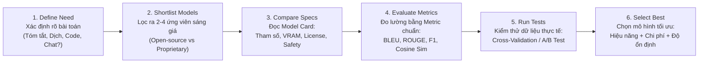
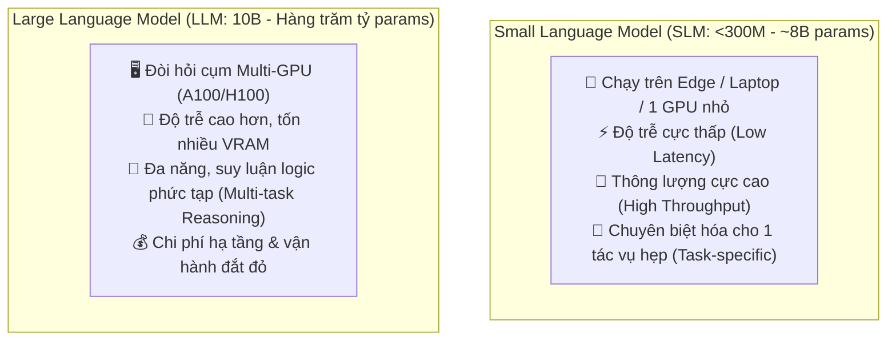
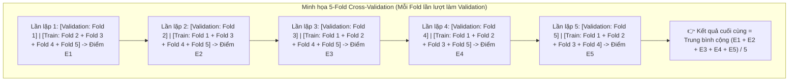

# Module 5: Model Selection (Phương pháp Đánh giá và Lựa chọn Mô hình)

> [!IMPORTANT]
> **Trọng tâm ôn thi NCA-GENL ở Module 5 (Thuộc Domain "Experimentation - 22%" & "Data Analysis - 14%"):**
> Nắm vững **Quy trình 6 bước lựa chọn Foundation Model**; bảng so sánh **SLM (Small Language Model) vs. LLM (Large Language Model)**; cấu trúc chuẩn của một **Model Card**; làm chủ **Ma trận Nhầm lẫn (Confusion Matrix: TP, TN, FP, FN)** và khi nào ưu tiên **Precision vs. Recall vs. F1-Score**; phân biệt chính xác 3 độ đo ngôn ngữ vàng (**BLEU** cho Dịch máy, **ROUGE** cho Tóm tắt, **Cosine Similarity** cho Tìm kiếm vector/RAG); và hai phương pháp kiểm thử **k-Fold Cross-Validation** vs. **A/B Testing**.

---

## 1. Khung quy trình 6 bước lựa chọn Foundation Model

Khi đứng trước hàng trăm nghìn mô hình trên Hugging Face hay các API thương mại (OpenAI, Anthropic, NVIDIA NIM), một kỹ sư AI chuyên nghiệp không chọn theo cảm tính mà tuân thủ **Quy trình 6 bước chuẩn**:

### Chi tiết từng bước:
1. **Define Need (Xác định nhu cầu nghiệp vụ):** Làm rõ bài toán cốt lõi cần giải quyết (Sinh văn bản, tóm tắt tài liệu, viết code, sinh ảnh hay dịch thuật), yêu cầu độ trễ tối đa bao nhiêu mili-giây và ngân sách bao nhiêu.
2. **Shortlist Model (Lập danh sách rút gọn):** Chọn ra từ **2 đến 4 mô hình ứng viên** sáng giá dựa trên uy tín cộng đồng, tài liệu hỗ trợ và hình thức cấp phép (Mã nguồn mở tự host như LLaMA/Mistral hay Độc quyền gọi qua API như GPT-4).
3. **Compare Specs (So sánh thông số kỹ thuật):** Đọc kỹ **Model Card** để đối chiếu số lượng tham số, chi phí vận hành, yêu cầu phần cứng GPU (VRAM), độ an toàn và rủi ro bản quyền thương mại.
4. **Evaluate Model (Đánh giá bằng độ đo kỹ thuật):** Chấm điểm tự động bằng các bộ chỉ số chuyên dụng tương ứng với từng bài toán (**BLEU** cho dịch thuật, **ROUGE** cho tóm tắt, **Cosine Similarity** cho tìm kiếm ngữ nghĩa, **F1-Score** cho phân loại).
5. **Run Tests (Thực nghiệm kiểm thử):** Chạy thử nghiệm trên chính tập dữ liệu thực tế của doanh nghiệp bằng **Cross-validation** (khi ít dữ liệu) hoặc **A/B Testing** (trên môi trường Production).
6. **Select Best (Chọn mô hình tối ưu nhất):** Ra quyết định dựa trên phương trình cân bằng:
   $$\text{Giá trị Tối ưu} = \text{Hiệu năng (Performance)} + \text{Chi phí (Cost)} + \text{Độ ổn định (Reliability)} + \text{Tính khả thi Triển khai}$$

---

## 2. So sánh chuyên sâu: Small Language Model (SLM) vs. Large Language Model (LLM)

> [!TIP]
> **Góc nhìn Developer:** Không phải bài toán nào cũng vác "đại bác" LLM 70B/400B ra bắn! Nếu bạn chỉ cần phân loại intent đơn giản hoặc chạy offline trên điện thoại/thiết bị IoT, một chiếc **SLM** nhỏ gọn sẽ rẻ hơn hàng chục lần và phản hồi trong chớp mắt.

### Bảng đối chiếu chi tiết SLM vs. LLM (Rất hay ra thi!)
| Tiêu chí | Small Language Model (SLM) | Large Language Model (LLM) |
| :--- | :--- | :--- |
| **Quy mô tham số (Parameters)** | Nhỏ: Dưới 300 triệu đến vài tỷ tham số (VD: *DistilBERT ~66M, Phi-3 3.8B, LLaMA-3 8B*). | Khổng lồ: Từ 10 tỷ đến hàng trăm/nghìn tỷ tham số (VD: *LLaMA-3 70B/405B, GPT-4, Claude 3.5*). |
| **Độ trễ (Latency)** | **Rất thấp**, phản hồi gần như tức thì (real-time). | **Cao hơn đáng kể** do khối lượng phép nhân ma trận đồ sộ. |
| **Thông lượng (Throughput)** | **Rất cao** (xử lý được nhiều token/giây trên cùng một phần cứng). | **Thấp hơn** (thường phải chia nhỏ mô hình qua nhiều GPU). |
| **Yêu cầu phần cứng** | Chạy mượt trên CPU, thiết bị biên (**Edge, Mobile, IoT**) hoặc 1 GPU phổ thông. | Đòi hỏi cụm máy chủ nhiều GPU cao cấp (**A100, H100**) với dung lượng VRAM cực lớn. |
| **Tính đa năng (Versatility)** | Thường chuyên biệt hóa cho **một tác vụ hẹp cụ thể (Task-specific)** sau khi fine-tune. | Giải quyết **đa tác vụ (General-purpose)**, suy luận logic phức tạp và làm theo hướng dẫn mở xuất sắc. |
| **Chi phí vận hành (Cost)** | Rẻ cho từng tác vụ đơn lẻ (nhưng có thể phức tạp nếu phải quản lý hàng chục SLM khác nhau). | Chi phí duy trì cụm server suy luận rất đắt đỏ, nhưng 1 mô hình phục vụ được nhiều phòng ban. |

---

## 3. Khái niệm Model Card (Hồ sơ Lý lịch Mô hình)

* **Model Card là gì?** Là tài liệu tiêu chuẩn kỹ thuật (thường chính là file `README.md` đi kèm mỗi repo mô hình trên **Hugging Face** hoặc **NVIDIA NGC**) cung cấp thông tin minh bạch, toàn diện và có thể kiểm chứng về mô hình AI đó.
* **6 mục bắt buộc phải có trong một Model Card tiêu chuẩn:**
  1. **Model Overview:** Tên mô hình, phiên bản, tổ chức phát triển, loại kiến trúc nơ-ron nền tảng và giấy phép bản quyền (License: Apache 2.0, MIT, hay Non-commercial).
  2. **Intended Use (Mục đích sử dụng):** Các bài toán được khuyến nghị sử dụng và các trường hợp **nghiêm cấm/không phù hợp (Out-of-scope / Misuse)** (VD: không dùng để chẩn đoán y khoa tự động).
  3. **Training Data:** Nguồn gốc dữ liệu huấn luyện, kích thước kho ngữ liệu (bao nhiêu tỷ token), ngôn ngữ hỗ trợ và mốc thời gian ngắt dữ liệu (Knowledge Cutoff).
  4. **Model Architecture:** Số lượng tầng (layers), kích thước chiều ẩn (hidden dimensions), số lượng attention heads, độ dài cửa sổ ngữ cảnh (Context Window).
  5. **Performance Metrics:** Bảng điểm đánh giá thực tế trên các bộ benchmark chuẩn (Accuracy, F1-score, MMLU, HumanEval, BLEU, ROUGE...).
  6. **Limitations & Bias (Hạn chế & Thiên vị):** Các điểm yếu đã biết, nguy cơ sinh ảo giác (hallucination) và các rủi ro thiên vị văn hóa/giới tính trong dữ liệu.

---

## 4. Các Độ đo Đánh giá Chuyên sâu (Evaluation Metrics - BẮT BUỘC THUỘC LÒNG!)

### 4.1. Bộ Độ đo cho Bài toán Phân loại: Confusion Matrix, Precision, Recall & F1-Score
Khi đánh giá mô hình phân loại (ví dụ: Phát hiện email Spam, Phát hiện giao dịch gian lận, Kiểm duyệt nội dung độc hại), ta lập **Ma trận Nhầm lẫn (Confusion Matrix)** gồm 4 ô:
* **TP (True Positive - Dương tính thật):** Thực tế là Spam, mô hình đoán đúng là Spam.
* **TN (True Negative - Âm tính thật):** Thực tế là Email thường, mô hình đoán đúng là Email thường.
* **FP (False Positive - Dương tính giả / Báo động giả - Lỗi loại I):** Thực tế là Email quan trọng của sếp, nhưng mô hình lại bắt nhầm vào hòm Spam!
* **FN (False Negative - Âm tính giả / Bỏ lọt tội phạm - Lỗi loại II):** Thực tế là Giao dịch lừa đảo (hoặc bệnh nhân mắc bệnh hiểm nghèo), nhưng mô hình lại bảo là Bình thường!

| Độ đo (Metric) | Công thức Toán học | Ý nghĩa trực quan & Khi nào phải ưu tiên? (Hay hỏi thi!) |
| :--- | :--- | :--- |
| **Accuracy (Độ chính xác tổng thể)** | $$\frac{TP + TN}{TP + TN + FP + FN}$$ | Tỷ lệ đoán đúng trên tổng số mẫu. **CẢNH BÁO BẪY:** Hoàn toàn vô dụng khi dữ liệu mất cân bằng (**Imbalanced Data**, VD: 99% bình thường, 1% gian lận $\to$ đoán bừa tất cả là bình thường cũng đạt Accuracy 99%!). |
| **Precision (Độ chuẩn xác)** | $$\frac{TP}{TP + FP}$$ | *"Trong tất cả những cái mô hình hô là Dương tính, có bao nhiêu % là đúng thật?"*  👉 **Ưu tiên khi chi phí của False Positive (Bắt nhầm) quá đắt:** Ví dụ **Lọc Email Spam** hoặc **Gợi ý video cho trẻ em** (thà sót vài tin rác còn hơn xóa nhầm email hợp đồng triệu đô của khách!). |
| **Recall (Độ phủ / Độ nhạy - Sensitivity)** | $$\frac{TP}{TP + FN}$$ | *"Trong tất cả các ca Dương tính thực tế ngoài đời, mô hình tóm được bao nhiêu %?"*  👉 **Ưu tiên khi chi phí của False Negative (Bỏ lọt) nguy hiểm chết người:** Ví dụ **Chẩn đoán ung thư**, **Phát hiện giao dịch gian lận ngân hàng**, **Lọc mã độc** (thà báo động nhầm để kiểm tra lại còn hơn bỏ sót kẻ gian/bệnh nhân!). |
| **F1-Score (Điểm cân bằng)** | $$2 \times \frac{\text{Precision} \times \text{Recall}}{\text{Precision} + \text{Recall}}$$ | Trung bình điều hòa (Harmonic Mean) giữa Precision và Recall.  👉 **Thước đo VÀNG bắt buộc dùng khi Tập dữ liệu mất cân bằng (Imbalanced Dataset)** và cần cân bằng cả hai loại lỗi FP và FN! |

---

### 4.2. Ba Độ đo cho Bài toán Ngôn ngữ & GenAI: BLEU, ROUGE, Cosine Similarity

```mermaid
flowchart TD
    Metrics["Ba Độ đo Đánh giá Ngôn ngữ & GenAI Cốt lõi"]
    
    subgraph M1["1. BLEU (Bilingual Evaluation Understudy)"]
        B1["🎯 Bài toán: DỊCH MÁY (Machine Translation)"]
        B2["🔍 Bản chất: Thiên về Độ chính xác (PRECISION-oriented)<br/>Đếm tỷ lệ cụm từ (n-grams) trong bản dịch AI<br/>trùng khớp chính xác với bản dịch mẫu của người"]
        B3["📏 Thang điểm: 0.0 đến 1.0 (Càng cao càng tốt)"]
        B1 --> B2 --> B3
    end

    subgraph M2["2. ROUGE (Recall-Oriented Understudy for Gisting Evaluation)"]
        R1["🎯 Bài toán: TÓM TẮT VĂN BẢN (Text Summarization)"]
        R2["🔍 Bản chất: Thiên về Độ bao phủ (RECALL-oriented)<br/>Kiểm tra bản tóm tắt của AI có nhặt đủ các ý chính<br/>xuất hiện trong bản tóm tắt chuẩn hay không"]
        R3["📏 Biến thể: ROUGE-1 (từ đơn), ROUGE-2 (cặp từ), ROUGE-L (chuỗi chung dài nhất)"]
        R1 --> R2 --> R3
    end

    subgraph M3["3. Cosine Similarity (Độ tương đồng Cosine)"]
        C1["🎯 Bài toán: TÌM KIẾM NGỮ NGHĨA (Semantic Search) & RAG"]
        C2["🔍 Bản chất: Đo góc giữa 2 Vector Embedding trong không gian đa chiều<br/>Đánh giá mức độ gần gũi về Ý NGHĨA chứ không đếm chữ bề mặt"]
        C3["📏 Thang điểm: -1.0 đến 1.0 (Văn bản thường từ 0 đến 1; 1 = Trùng khớp nghĩa)"]
        C1 --> C2 --> C3
    end

    Metrics --> M1 & M2 & M3
```

1. **BLEU (Bilingual Evaluation Understudy) $\to$ DỊCH MÁY (Translation):**
   * *Mẹo nhớ:* **B**ilingual (Song ngữ) = **Dịch thuật**!
   * *Bản chất:* **Precision-oriented**. Đếm xem câu máy dịch có bao nhiêu từ/cụm từ xuất hiện chuẩn xác trong bản dịch tham chiếu của con người. (Nhược điểm: Nếu máy dùng từ đồng nghĩa khác hoàn toàn từ trong đáp án mẫu, điểm BLEU vẫn bị phạt thấp).
2. **ROUGE (Recall-Oriented Understudy for Gisting Evaluation) $\to$ TÓM TẮT (Summarization):**
   * *Mẹo nhớ:* **R**ecall-Oriented ... for **Gisting** (Gist = Ý chính / Tóm tắt)!
   * *Bản chất:* **Recall-oriented**. Kiểm tra bài tóm tắt của AI có nhặt đủ các ý chính quan trọng trong văn bản gốc hay không (**ROUGE-1** đo từ đơn, **ROUGE-2** đo cặp từ, **ROUGE-L** đo chuỗi con chung dài nhất - Longest Common Subsequence).
3. **Cosine Similarity (Độ tương đồng Cosine) $\to$ TÌM KIẾM VECTOR & RAG:**
   * *Công thức toán học:*
     $$\text{Cosine Similarity}(\mathbf{A}, \mathbf{B}) = \cos(\theta) = \frac{\mathbf{A} \cdot \mathbf{B}}{\|\mathbf{A}\| \|\mathbf{B}\|}$$
   * Đo mức độ gần gũi về **ngữ nghĩa** giữa hai vector nhúng trong hệ thống **Semantic Search** và **RAG**.

---

## 5. Phương pháp Kiểm thử Thực tế: Cross-Validation vs. A/B Testing

### 5.1. k-Fold Cross-Validation (Kiểm định chéo k-Fold)
* **Khi nào sử dụng?** Khi doanh nghiệp có **tập dữ liệu giới hạn (limited dataset)** và muốn đánh giá khả năng tổng quát hóa của mô hình một cách đáng tin cậy nhất mà không bị lệch do cách chia Train/Test ngẫu nhiên.
* **Cách vận hành (Ví dụ 5-Fold Cross-Validation):** Chia tập dữ liệu thành $k = 5$ phần bằng nhau (Folds). Lặp 5 lần: mỗi lần lấy **1 Fold làm Validation** và **4 Folds còn lại làm Train**, sau đó lấy trung bình cộng kết quả của cả 5 lần.

### 5.2. A/B Testing trong môi trường Production
* Giải quyết bài toán đánh đổi **Explore (Khám phá mô hình mới)** vs. **Exploit (Khai thác mô hình cũ an toàn)**: Phân luồng ngẫu nhiên 50% người dùng thật vào **Model A (Hiện tại)** và 50% vào **Model B (Mới)** trong cùng điều kiện thời gian thực để đo lường chỉ số kinh doanh (CTR, tỷ lệ chuyển đổi, độ trễ) trước khi quyết định nâng cấp toàn bộ.

---

## 6. Bẫy đề thi NCA-GENL & Câu hỏi Thực chiến (Exam Traps & Mini Quiz)

> [!WARNING]
> **Các bẫy kinh điển trong đề thi Module 5:**
> 1. **Bẫy ghép cặp Metric Ngôn ngữ:**
>    * Dịch thuật (Machine Translation) $\leftrightarrow$ **BLEU** (Precision).
>    * Tóm tắt (Text Summarization) $\leftrightarrow$ **ROUGE** (Recall).
>    * Tìm kiếm vector / RAG (Semantic Search) $\leftrightarrow$ **Cosine Similarity**.
> 2. **Bẫy Imbalanced Data (Dữ liệu mất cân bằng):** Khi tập dữ liệu có 98% nhãn A và chỉ 2% nhãn B, độ đo **Accuracy** trở nên vô nghĩa. Phải chọn **F1-Score** (hoặc **Precision / Recall / ROC-AUC**).
> 3. **Bẫy Precision vs. Recall:** Không được phép bỏ sót ca bệnh/gian lận (sợ False Negative) $\to$ Ưu tiên **Recall**. Không được phép bắt nhầm email thường thành Spam (sợ False Positive) $\to$ Ưu tiên **Precision**.

### Câu hỏi tự kiểm tra (Mini Quiz):
1. **Câu 1:** Một ngân hàng huấn luyện mô hình phát hiện rửa tiền trên tập dữ liệu gồm 99.9% giao dịch hợp pháp và 0.1% giao dịch rửa tiền. Mô hình đạt Accuracy 99.9% nhưng không bắt được bất kỳ giao dịch rửa tiền nào trên thực tế. Độ đo nào nên được sử dụng thay cho Accuracy để đánh giá đúng hiệu quả của mô hình này?
   * *Đáp án:* **Recall** (để đo tỷ lệ bắt trúng giao dịch rửa tiền) kết hợp với **F1-Score** (để cân bằng trên tập dữ liệu mất cân bằng).
2. **Câu 2:** Một kỹ sư AI đang xây dựng hệ thống tự động tóm tắt các biên bản cuộc họp dài 10 trang thành 5 gạch đầu dòng ngắn gọn. Độ đo (Metric) nào phù hợp nhất để đánh giá chất lượng bản tóm tắt?
   * *Đáp án:* **ROUGE (Recall-Oriented Understudy for Gisting Evaluation)**.
