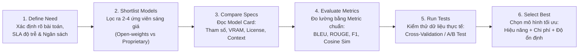
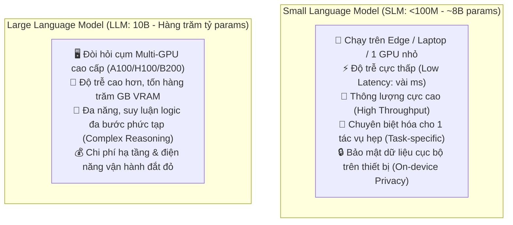
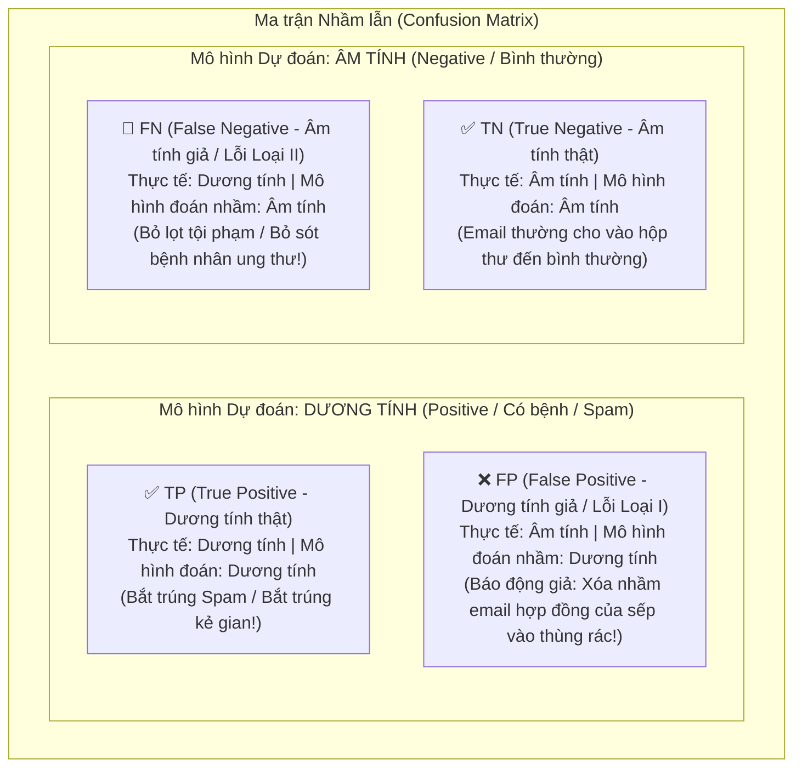
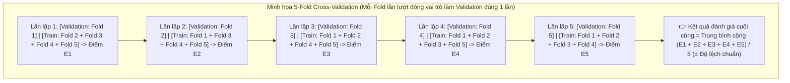

# Module 5: Model Selection (Phương pháp Đánh giá và Lựa chọn Mô hình)

> [!IMPORTANT]
> **Trọng tâm ôn thi NCA-GENL ở Module 5 (Thuộc Domain "Experimentation - 22%" & "Data Analysis - 14%"):**
> Nắm vững **Quy trình 6 bước lựa chọn Foundation Model**; bảng so sánh **SLM vs. LLM** và **Open-Weights vs. Proprietary Models**; các chỉ số hiệu năng suy luận thực tế (**TTFT, ITL/TPOT, Throughput**); cấu trúc chuẩn của một **Model Card** & các bộ **Benchmark chuẩn (MMLU, HumanEval, GSM8K, TruthfulQA)**; làm chủ **Ma trận Nhầm lẫn (Confusion Matrix: TP, TN, FP, FN)**, khi nào ưu tiên **Precision vs. Recall vs. F1-Score vs. ROC-AUC**, các độ đo Hồi quy (**MAE, MSE, RMSE, $R^2$**); phân biệt chính xác các độ đo ngôn ngữ vàng (**BLEU** cho Dịch máy, **ROUGE** cho Tóm tắt, **BERTScore**, **Cosine Similarity** cho RAG, **RAG Triad**); và các phương pháp kiểm thử **k-Fold Cross-Validation**, **A/B Testing**, **Canary Deployment**.

---

## 1. Khung quy trình 6 bước lựa chọn Foundation Model

Khi đứng trước hàng trăm nghìn mô hình trên Hugging Face hay các API thương mại (OpenAI, Anthropic, NVIDIA NIM), một kỹ sư AI chuyên nghiệp không chọn theo cảm tính mà tuân thủ **Quy trình 6 bước chuẩn**:

### Chi tiết từng bước:
1. **Define Need (Xác định nhu cầu nghiệp vụ & Ràng buộc kỹ thuật):**
   * Làm rõ bài toán cốt lõi cần giải quyết (Sinh văn bản, tóm tắt tài liệu, viết code, trích xuất thực thể, sinh ảnh hay dịch thuật).
   * Xác định rõ ràng buộc vận hành (**Non-functional requirements**): Yêu cầu độ trễ tối đa bao nhiêu mili-giây (**SLA Latency**), lượng truy cập đồng thời (Concurrency), yêu cầu bảo mật dữ liệu (có được gửi ra Cloud ngoài hay bắt buộc chạy On-premise), và ngân sách phần cứng/API.
2. **Shortlist Model (Lập danh sách rút gọn):**
   * Chọn ra từ **2 đến 4 mô hình ứng viên** sáng giá dựa trên bảng xếp hạng cộng đồng, tài liệu hỗ trợ và hình thức phân phối (**Open-Source / Open-Weights** tự host như *LLaMA-3, Mistral, NVIDIA Nemotron* hay **Proprietary / Closed-Source** gọi qua API như *GPT-4o, Claude 3.5*).
3. **Compare Specs (So sánh thông số kỹ thuật qua Model Card):**
   * Đọc kỹ **Model Card** để đối chiếu số lượng tham số, độ dài cửa sổ ngữ cảnh (**Context Window**), yêu cầu dung lượng bộ nhớ GPU (**VRAM**), ngôn ngữ hỗ trợ và đặc biệt là **Giấy phép bản quyền thương mại (License: Apache 2.0, MIT hay Non-commercial CC-BY-NC)**.
4. **Evaluate Model (Đánh giá bằng độ đo kỹ thuật):**
   * Chấm điểm tự động bằng các bộ chỉ số chuyên dụng tương ứng với từng bài toán (**BLEU** cho dịch thuật, **ROUGE** cho tóm tắt, **Cosine Similarity** cho tìm kiếm ngữ nghĩa, **F1-Score / ROC-AUC** cho phân loại, **Perplexity** cho mô hình ngôn ngữ).
5. **Run Tests (Thực nghiệm kiểm thử trên dữ liệu thật):**
   * Chạy thử nghiệm trên chính tập dữ liệu thực tế của doanh nghiệp (Golden Dataset) bằng **k-Fold Cross-Validation** (khi ít dữ liệu) hoặc **A/B Testing / Canary Rollout** (trên môi trường Production).
6. **Select Best (Chọn mô hình tối ưu nhất - The Golden Trade-off):**
   * Ra quyết định dựa trên phương trình cân bằng đa mục tiêu (chứ không chỉ chọn mô hình điểm cao nhất mà quá đắt/quá chậm):
     $$\text{Giá trị Tối ưu} = \text{Chất lượng (Accuracy)} + \text{Tốc độ (Latency/Throughput)} + \text{Chi phí (TCO)} + \text{Độ tin cậy \& Bảo mật}$$

---

## 2. So sánh chuyên sâu: SLM vs. LLM, Open-Weights vs. Proprietary & Các Chỉ số Tốc độ Suy luận

### 2.1. Small Language Model (SLM) vs. Large Language Model (LLM)
> [!TIP]
> **Góc nhìn Developer:** Không phải bài toán nào cũng vác "đại bác" LLM 70B/405B ra bắn! Nếu bạn chỉ cần phân loại ý định (Intent classification), trích xuất JSON đơn giản, kiểm duyệt nội dung hoặc chạy offline trên điện thoại/thiết bị IoT/xe tự hành, một chiếc **SLM** nhỏ gọn sẽ rẻ hơn hàng chục lần và phản hồi trong vài mili-giây.

| Tiêu chí | Small Language Model (SLM) | Large Language Model (LLM) |
| :--- | :--- | :--- |
| **Quy mô tham số (Parameters)** | Nhỏ: Dưới 100 triệu đến ~8 tỷ tham số (VD: *BERT ~110M, DistilBERT ~66M, Phi-3 Mini 3.8B, Mistral 7B, LLaMA-3 8B, Nemotron-Mini 4B*). | Khổng lồ: Từ 13 tỷ đến hàng trăm/nghìn tỷ tham số (VD: *LLaMA-3 70B/405B, Nemotron-4 340B, GPT-4, Claude 3.5*). |
| **Độ trễ (Latency)** | **Rất thấp**, phản hồi tức thì (real-time, lý tưởng cho Voice Assistant, Game NPC, Autocomplete). | **Cao hơn đáng kể** do khối lượng phép nhân ma trận đồ sộ qua hàng chục tầng. |
| **Thông lượng (Throughput)** | **Rất cao** (xử lý hàng nghìn tokens/giây trên cùng một phần cứng). | **Thấp hơn** (thường phải chia nhỏ mô hình qua nhiều GPU bằng Tensor Parallelism). |
| **Yêu cầu phần cứng** | Chạy mượt trên CPU, NPU, thiết bị biên (**Edge, Mobile, IoT, Jetson**) hoặc 1 GPU phổ thông. | Đòi hỏi cụm máy chủ nhiều GPU Data Center (**A100, H100, B200**) với dung lượng VRAM cực lớn. |
| **Tính đa năng (Versatility)** | Thường chuyên biệt hóa cho **một tác vụ hẹp cụ thể (Task-specific)** sau khi fine-tune hoặc chưng cất (Distillation). | Giải quyết **đa tác vụ (General-purpose)**, suy luận logic phức tạp, Zero-shot và Agentic workflows xuất sắc. |
| **Chi phí vận hành (Cost)** | Rất rẻ cho từng tác vụ đơn lẻ (nhưng cần kiến trúc Model Router nếu quản lý nhiều SLM khác nhau). | Chi phí duy trì cụm server suy luận rất đắt đỏ, nhưng 1 mô hình trung tâm phục vụ được nhiều phòng ban. |

### 2.2. Mô hình Nguồn mở / Trọng số mở (Open-Weights) vs. Mô hình Độc quyền (Proprietary API)
| Tiêu chí | Open-Weights Models (LLaMA-3, Mistral, DeepSeek, Nemotron) | Proprietary / Closed API Models (GPT-4o, Claude 3.5, Gemini Pro) |
| :--- | :--- | :--- |
| **Quyền kiểm soát & Bảo mật dữ liệu** | **Kiểm soát cao:** Có thể tải trọng số về triển khai trong hạ tầng nội bộ (On-prem / VPC) kèm chính sách bảo mật mạng và kiểm soát truy cập của tổ chức. | Dữ liệu được gửi qua mạng tới dịch vụ của nhà cung cấp bên thứ ba (cần đánh giá hợp đồng bảo mật, chính sách lưu trữ dữ liệu và tuân thủ của hãng). |
| **Khả năng tùy biến sâu** | Cho phép can thiệp toàn diện: **Full Fine-Tuning, LoRA/QLoRA, Pruning, Quantization (`FP8`/`INT4`)**, sửa kiến trúc. | Bị giới hạn ở Prompt Engineering, RAG hoặc chỉ Fine-tune hộp đen qua giao diện web của nhà cung cấp. |
| **Chi phí theo quy mô** | Tốn chi phí dựng server GPU ban đầu, nhưng **rẻ hơn rất nhiều khi lưu lượng request lớn và ổn định 24/7**. | Không tốn phí hạ tầng ban đầu (trả tiền theo mỗi 1 triệu tokens Input/Output), nhưng **rất đắt đỏ khi quy mô người dùng tăng vọt**. |

### 2.3. Ba Chỉ số Đo lường Hiệu năng Suy luận LLM trên Production (Inference Latency Metrics)
Khi triển khai LLM (với TensorRT-LLM / Triton / NIM), đề thi thường hỏi về 3 chỉ số đo tốc độ:
1. **TTFT (Time To First Token – Thời gian sinh ra token đầu tiên):**
   * Khoảng thời gian từ lúc User bấm gửi Prompt cho đến khi chữ đầu tiên xuất hiện trên màn hình (Pha **Prefill** — xử lý song song toàn bộ Prompt đầu vào để tạo KV Cache).
   * *Bản chất phần cứng:* Phụ thuộc vào **năng lực tính toán ma trận của GPU (Compute-bound)** và độ dài của Input Prompt.
2. **ITL (Inter-Token Latency) / TPOT (Time Per Output Token – Thời gian giữa hai token liên tiếp):**
   * Tốc độ nhả từng chữ tiếp theo sau khi chữ đầu tiên đã hiện ra (Pha **Decode** tự hồi quy). Để người dùng đọc mượt hơn tốc độ mắt người, TPOT cần đạt khoảng $10 - 30\text{ ms/token}$.
   * *Bản chất phần cứng:* Phụ thuộc vào **băng thông bộ nhớ VRAM (Memory-bandwidth bound)** vì mỗi lần sinh 1 token mới lại phải đọc toàn bộ trọng số mô hình và KV Cache từ HBM lên nhân tính toán!
3. **Throughput (Thông lượng tổng thể – Tokens/second hoặc Requests/second):**
   * Tổng số lượng token mà máy chủ phục vụ được cho **tất cả người dùng đồng thời** trong 1 giây (Tối ưu hóa bằng *In-flight Batching / Dynamic Batching*).

---

## 3. Khái niệm Model Card & Các Bộ Benchmark Đánh giá LLM Chuẩn Quốc tế

### 3.1. Model Card (Hồ sơ Lý lịch Mô hình)
* **Model Card là gì?** Là tài liệu tiêu chuẩn kỹ thuật (do Google đề xuất và trở thành chuẩn thực hành phổ biến trên **Hugging Face** cũng như **NVIDIA NGC Catalog**) đi kèm mỗi mô hình AI nhằm cung cấp thông tin minh bạch, toàn diện và có thể kiểm chứng về năng lực cũng như giới hạn của mô hình đó.
* **6 mục cốt lõi thường có trong một Model Card tiêu chuẩn (Cần nhớ kỹ cho kỳ thi):**
  1. **Model Overview (Tổng quan mô hình):** Tên mô hình, phiên bản, tổ chức phát triển, ngày phát hành, loại kiến trúc nền tảng (ví dụ: *Transformer Decoder-only*) và **Giấy phép bản quyền (License: Apache 2.0, MIT, Llama Community License hay Non-commercial)**.
  2. **Intended Use & Out-of-Scope Use (Mục đích sử dụng & Trường hợp cấm):** Các bài toán được thiết kế để sử dụng (ví dụ: trợ lý tóm tắt văn bản tiếng Anh) và các trường hợp **nghiêm cấm/ngoài phạm vi (Out-of-scope / Misuse)** (ví dụ: không được dùng để kê đơn thuốc y khoa tự động hay tư vấn pháp lý sinh tử).
  3. **Training Data (Dữ liệu huấn luyện):** Nguồn gốc dữ liệu huấn luyện, phương pháp lọc/làm sạch, kích thước kho ngữ liệu (bao nhiêu nghìn tỷ token), phân bố ngôn ngữ và **Mốc thời gian ngắt tri thức (Knowledge Cutoff)**.
  4. **Model Architecture & Compute Requirements (Kiến trúc & Yêu cầu phần cứng):** Số lượng tham số, số tầng (layers), số đầu chú ý (attention heads), độ dài cửa sổ ngữ cảnh (**Context Window**), định dạng số học (`BF16`/`FP8`) và lượng VRAM tối thiểu để chạy.
  5. **Evaluation & Performance Metrics (Kết quả đánh giá chuẩn):** Bảng điểm định lượng thực tế trên các bộ benchmark công khai (MMLU, HumanEval, GSM8K, BLEU, ROUGE, F1-score...).
  6. **Limitations, Ethical Considerations & Bias (Hạn chế, Đạo đức & Thiên vị):** Các điểm yếu đã biết, tỷ lệ sinh ảo giác (hallucination), các rủi ro thiên vị văn hóa/giới tính/chủng tộc và khuyến nghị đặt rào chắn an toàn (Guardrails).

### 3.2. Các Bộ Benchmark Tiêu chuẩn để So sánh các LLM (Hay xuất hiện trong Model Card)
| Tên Bộ Benchmark | Đo lường năng lực gì của LLM? | Ví dụ nội dung bài thi của Benchmark |
| :--- | :--- | :--- |
| **1. MMLU (Massive Multitask Language Understanding)** | **Kiến thức tổng quát & Học thuật đa lĩnh vực:** Bộ 57 môn thi trắc nghiệm từ cấp 3 đến đại học/chuyên gia (Toán, Lý, Hóa, Y sinh, Luật, Lịch sử, Kinh tế). | Các câu hỏi trắc nghiệm 4 lựa chọn A/B/C/D trải rộng mọi ngành khoa học. |
| **2. HumanEval & MBPP** | **Năng lực Lập trình & Sinh mã nguồn (Coding):** Khả năng viết hàm Python từ chuỗi mô tả Docstring và vượt qua các Unit Tests tự động (chỉ số `pass@1`). | Cho đề bài thuật toán và kiểm tra xem code AI sinh ra chạy có đúng 100% test cases không. |
| **3. GSM8K & MATH** | **Suy luận Toán học đa bước (Mathematical Reasoning):** Giải các bài toán đố cấp 2 (GSM8K - 8.500 bài) và toán thi Olympic (MATH). | Bài toán đố đòi hỏi 4–8 bước lập luận cộng trừ nhân chia liên tiếp (Chain-of-Thought). |
| **4. TruthfulQA & HaluEval** | **Độ trung thực & Chống ảo giác (Truthfulness & Hallucination):** Kiểm tra xem mô hình có bị lừa bởi những tin đồn/ngộ nhận phổ biến của con người hay không. | Hỏi các câu dễ gây ngộ nhận để xem mô hình nói sự thật khoa học hay bịa chuyện theo đám đông. |
| **5. MT-Bench & Chatbot Arena (LMSYS)** | **Chất lượng Hội thoại đa lượt & Đánh giá ngang hàng:** Dùng **LLM-as-a-Judge (GPT-4 chấm điểm)** hoặc người thật bình chọn mù (Blind A/B testing tính điểm **Elo**). | So sánh trực tiếp 2 mô hình ẩn danh qua các cuộc hội thoại phức tạp nhiều lượt. |

---

## 4. Các Độ đo Đánh giá Chuyên sâu (Evaluation Metrics)

### 4.1. Bộ Độ đo cho Bài toán Phân loại: Confusion Matrix, Precision, Recall, F1, PR-AUC & ROC-AUC
Khi đánh giá mô hình phân loại (ví dụ: Phát hiện email Spam, Phát hiện giao dịch gian lận, Chẩn đoán bệnh, Kiểm duyệt nội dung độc hại), ta lập **Ma trận Nhầm lẫn (Confusion Matrix)** gồm 4 ô:

| Độ đo (Metric) | Công thức Toán học | Ý nghĩa trực quan & Khi nào nên ưu tiên? |
| :--- | :--- | :--- |
| **1. Accuracy (Độ chính xác tổng thể)** | $$\frac{TP + TN}{TP + TN + FP + FN}$$ | Tỷ lệ đoán đúng trên tổng số mẫu.  ⚠️ **CẢNH BÁO:** Phù hợp khi các lớp dữ liệu cân bằng và chi phí lỗi tương đương. **Thường dễ đánh lừa trên dữ liệu mất cân bằng (Imbalanced Data)** (VD: 99% bình thường, 1% gian lận $\to$ một mô hình đơn giản đoán tất cả là bình thường vẫn đạt Accuracy 99%!). |
| **2. Precision (Độ chuẩn xác / Độ tin cậy dương tính)** | $$\frac{TP}{TP + FP}$$ | *"Trong tất cả những trường hợp mô hình dự đoán là Dương tính, có bao nhiêu % là Dương tính thật?"*  👉 **Ưu tiên khi chi phí của False Positive (FP - Bắt nhầm / Báo động giả) cao:** Ví dụ **Lọc Email Spam**, **Khóa tài khoản người dùng tự động**, **Gợi ý video an toàn cho trẻ em** (tránh tự động xóa nhầm email hợp đồng quan trọng của khách hàng). |
| **3. Recall (Độ bao phủ / Độ nhạy - Sensitivity / TPR)** | $$\frac{TP}{TP + FN}$$ | *"Trong tất cả các ca Dương tính thực tế, mô hình phát hiện được bao nhiêu %?"*  👉 **Ưu tiên khi chi phí của False Negative (FN - Bỏ sót positive) gây hậu quả nghiêm trọng:** Ví dụ **Sàng lọc bệnh hiểm nghèo**, **Phát hiện giao dịch gian lận/rửa tiền**, **Phát hiện xâm nhập mạng** (thường ưu tiên tối đa hóa Recall trong giới hạn khối lượng cảnh báo giả FP có thể xử lý được). |
| **4. F1-Score (Điểm cân bằng Precision–Recall)** | $$2 \times \frac{\text{Precision} \times \text{Recall}}{\text{Precision} + \text{Recall}}$$ | Trung bình điều hòa (Harmonic Mean) giữa Precision và Recall (chỉ cao khi cả Precision và Recall đều cao).  👉 **Hữu ích khi cần cân bằng giữa Precision và Recall tại một ngưỡng phân loại (threshold)** trên dữ liệu mất cân bằng. Tuy nhiên, không phải mọi bài toán mất cân bằng đều chọn F1 một cách máy móc — cần chọn metric theo **chi phí nghiệp vụ của FP và FN** (hoặc dùng $F_\beta$-score khi muốn đặt trọng số thiên về Recall hay Precision). |
| **5. PR-AUC & ROC-AUC (Đánh giá qua nhiều ngưỡng cắt)** | • **ROC-AUC:** Diện tích dưới đường cong **TPR (Recall)** theo **FPR ($\frac{FP}{FP+TN}$)** • **PR-AUC:** Diện tích dưới đường cong **Precision – Recall** | • **PR-AUC (Precision-Recall AUC):** Đặc biệt hữu ích khi đánh giá lớp **positive rất hiếm** qua nhiều ngưỡng xác suất (thresholds). • **ROC-AUC:** Đo khả năng xếp hạng phân tách hai lớp (ngẫu nhiên = $0.5$, lý tưởng = $1.0$), nhưng khi số lượng Negative ($TN$) quá áp đảo so với Positive, FPR = $\frac{FP}{FP+TN}$ có thể giữ ở mức rất nhỏ khiến ROC-AUC trông quá lạc quan. |

---

### 4.2. Bộ Độ đo cho Bài toán Hồi quy (Regression Metrics: Dự đoán số liên tục)
Khi mô hình dự đoán giá nhà, nhiệt độ, doanh số, đề thi có thể hỏi về 4 chỉ số sau:
1. **MAE (Mean Absolute Error):** Trung bình trị tuyệt đối sai số $\frac{1}{n}\sum |y_i - \hat{y}_i|$. Dễ hiểu, cùng đơn vị với biến mục tiêu, **ít bị ảnh hưởng bởi các điểm dị biệt (Outliers)**.
2. **MSE (Mean Squared Error) & RMSE (Root MSE):** Trung bình bình phương sai số $\frac{1}{n}\sum (y_i - \hat{y}_i)^2$ (và căn bậc hai của nó). Vì bình phương sai số nên **phạt cực nặng các lỗi dự đoán sai lệch lớn (Outliers)**.
3. **$R^2$ (R-Squared / Coefficient of Determination):** Cho biết mô hình giải thích được bao nhiêu % sự biến thiên của dữ liệu (gần $1.0$ là mô hình khớp hoàn hảo).

---

### 4.3. Các Độ đo cho Bài toán Ngôn ngữ & GenAI: BLEU, ROUGE, BERTScore, Cosine Similarity & RAG Triad

```mermaid
flowchart TD
    Metrics["Các Độ đo Đánh giá Ngôn ngữ & GenAI Cốt lõi"]
    
    subgraph M1["1. BLEU (Bilingual Evaluation Understudy)"]
        B1["🎯 Bài toán: DỊCH MÁY (Machine Translation)"]
        B2["🔍 Bản chất: Thiên về Độ chuẩn xác (PRECISION-oriented)<br/>Đếm tỷ lệ cụm từ (1-gram đến 4-gram) trong bản dịch AI<br/>xuất hiện trùng khớp trong bản dịch mẫu của người (kèm Brevity Penalty)"]
        B3["📏 Thang điểm: 0.0 đến 1.0 (hoặc 0 - 100; Càng cao càng tốt)"]
        B1 --> B2 --> B3
    end

    subgraph M2["2. ROUGE (Recall-Oriented Understudy for Gisting Evaluation)"]
        R1["🎯 Bài toán: TÓM TẮT VĂN BẢN (Text Summarization)"]
        R2["🔍 Bản chất: Thiên về Độ bao phủ (RECALL-oriented)<br/>Kiểm tra bản tóm tắt của AI có nhặt đủ các từ/ý chính<br/>xuất hiện trong bản tóm tắt chuẩn của người hay không"]
        R3["📏 Biến thể: ROUGE-1 (từ đơn), ROUGE-2 (cặp từ), ROUGE-L (chuỗi con chung dài nhất LCS)"]
        R1 --> R2 --> R3
    end

    subgraph M3["3. Sentence-Level Cosine Similarity (Tương đồng Vector Cấp Câu/Đoạn)"]
        C1["🎯 Bài toán: Tìm kiếm Vector (Semantic Retrieval) & So sánh độ gần cấp câu/đoạn"]
        C2["🔍 Bản chất: Nén toàn bộ câu/đoạn thành 1 vector đại diện duy nhất<br/>rồi tính cô-sin góc giữa 2 vector câu (Lưu ý: KHÔNG trực tiếp đảm bảo câu trả lời RAG đúng sự thật!)"]
        C3["📏 Thang điểm: -1.0 đến 1.0 (1.0 = Hai vector cùng hướng)"]
        C1 --> C2 --> C3
    end

    subgraph M4["4. BERTScore (So khớp Contextual Embeddings Cấp Token)"]
        BS1["🎯 Bài toán: Đánh giá chất lượng văn bản sinh ra (Generation Evaluation) nhạy ngữ nghĩa"]
        BS2["🔍 Bản chất: Giữ nguyên vector ngữ cảnh của TỪNG TOKEN trong câu mẫu & câu AI,<br/>so khớp cực đại từng cặp token (greedy matching) để tính Precision, Recall và F1"]
        BS3["📏 Đầu ra: P_BERT, R_BERT, F_BERT (có thể kèm trọng số IDF)"]
        BS1 --> BS2 --> BS3
    end

    Metrics --> M1 & M2 & M3 & M4
```

1. **BLEU (Bilingual Evaluation Understudy) $\to$ DỊCH MÁY (Machine Translation):**
   * *Gợi ý nhớ:* **B**ilingual (Song ngữ) = **Dịch thuật**!
   * *Bản chất:* **Precision-oriented** (kèm hệ số phạt *Brevity Penalty* nếu máy dịch câu quá ngắn). Đếm xem câu máy dịch có bao nhiêu n-gram xuất hiện trùng khớp trong bản dịch tham chiếu.
2. **ROUGE (Recall-Oriented Understudy for Gisting Evaluation) $\to$ TÓM TẮT (Summarization):**
   * *Gợi ý nhớ:* **R**ecall-Oriented ... for **Gisting** (Gist = Ý chính / Tóm tắt)!
   * *Bản chất:* **Recall-oriented**. Kiểm tra bài tóm tắt của AI có bao phủ được các từ/cụm từ trong bản tóm tắt tham chiếu hay không:
     * **ROUGE-1:** Độ trùng khớp từng từ đơn (Unigrams).
     * **ROUGE-2:** Độ trùng khớp từng cặp 2 từ liên tiếp (Bigrams).
     * **ROUGE-L:** Dựa trên **Chuỗi con chung dài nhất (Longest Common Subsequence - LCS)** để đánh giá cấu trúc mạch câu mà không đòi hỏi các từ phải đứng sát cạnh nhau.
3. **Hạn chế của BLEU & ROUGE và Sự khác biệt giữa `Sentence Embedding Cosine Similarity` vs. `BERTScore`:**
   * Vì BLEU và ROUGE chỉ **đếm sự trùng khớp mặt chữ (Exact lexical / n-gram overlap)**, nên nếu đáp án mẫu là *"Chiếc xe hơi chạy rất nhanh"* mà AI viết là *"Chiếc ô tô di chuyển với tốc độ cao"*, điểm BLEU/ROUGE sẽ rất thấp dù hai câu tương đương về nghĩa. Để đánh giá tương đồng ngữ nghĩa bằng biểu diễn vector, cần **phân biệt rõ hai phương pháp khác nhau** sau đây:
   * **Phương pháp A – `Sentence-level Embedding Cosine Similarity` (So sánh Vector cấp câu/đoạn văn):**
     * Sử dụng mô hình Sentence/Document Embedding (như Bi-Encoder, Sentence-BERT, `NV-Embed`) để gộp (pooling) toàn bộ câu hoặc đoạn văn thành **một vector đại diện duy nhất** ($\mathbf{u}$ và $\mathbf{v}$), sau đó tính cô-sin góc giữa hai vector cấp câu đó:
       $$\text{Cosine Similarity}(\mathbf{u}, \mathbf{v}) = \cos(\theta) = \frac{\mathbf{u} \cdot \mathbf{v}}{\|\mathbf{u}\| \|\mathbf{v}\|}$$
     * *Ứng dụng chính:* Tìm kiếm tài liệu tương đồng tốc độ cao trong cơ sở dữ liệu Vector (Semantic Search / Dense Retrieval trong RAG), phân cụm văn bản hoặc lọc câu hỏi tương tự.
   * **Phương pháp B – `BERTScore` (So khớp Contextual Embeddings ở cấp độ Token — Zhang et al., ICLR 2020):**
     * Khác với việc nén cả câu thành một vector đơn lẻ, **BERTScore** đưa câu tham chiếu $x = \langle x_1, \dots, x_k \rangle$ và câu ứng viên của AI $\hat{x} = \langle \hat{x}_1, \dots, \hat{x}_m \rangle$ qua mô hình ngôn ngữ (như BERT/RoBERTa/DeBERTa) để lấy chuỗi **contextual token embeddings** cho **từng token** $\langle \mathbf{x}_1, \dots, \mathbf{x}_k \rangle$ và $\langle \hat{\mathbf{x}}_1, \dots, \hat{\mathbf{x}}_m \rangle$ (đã chuẩn hóa độ dài $L_2$).
     * Tiếp theo, BERTScore tính độ tương đồng cosine giữa mọi cặp token $\mathbf{x}_i^\top \hat{\mathbf{x}}_j$, thực hiện **so khớp cực đại (greedy matching)** từ từng token trong câu này sang token gần nghĩa nhất ở câu kia để tính **Precision ($P_{\text{BERT}}$), Recall ($R_{\text{BERT}}$) và F1 ($F_{\text{BERT}}$)** (có thể nhân thêm trọng số độ hiếm của từ theo IDF):
       $$R_{\text{BERT}} = \frac{1}{|x|} \sum_{\mathbf{x}_i \in x} \max_{\hat{\mathbf{x}}_j \in \hat{x}} \mathbf{x}_i^\top \hat{\mathbf{x}}_j, \qquad P_{\text{BERT}} = \frac{1}{|\hat{x}|} \sum_{\hat{\mathbf{x}}_j \in \hat{x}} \max_{\mathbf{x}_i \in x} \mathbf{x}_i^\top \hat{\mathbf{x}}_j, \qquad F_{\text{BERT}} = 2 \frac{P_{\text{BERT}} \cdot R_{\text{BERT}}}{P_{\text{BERT}} + R_{\text{BERT}}}$$
     * *Điểm khác biệt cốt lõi cần nhớ:* **Sentence embedding cosine similarity** so sánh **hai vector đại diện cho toàn bộ câu/đoạn**, trong khi **BERTScore** so khớp các **contextual embeddings ở cấp token** rồi tổng hợp thành **Precision, Recall và F1**.
4. **Đánh giá toàn diện hệ thống RAG (Retrieval + Grounding + Answer + System Metrics):**
   > [!IMPORTANT]
   > **Lưu ý quan trọng:** `Cosine Similarity` chỉ đo độ tương đồng giữa các vector embedding (thường dùng trong bước tìm kiếm vector của RAG); nó **không trực tiếp đánh giá độ chính xác hay tính trung thực của câu trả lời cuối cùng**.
   
   Với một hệ thống RAG hoàn chỉnh, cần **phân tách evaluation** thành 4 nhóm rõ ràng:
   * **Retrieval Metrics (Chất lượng truy xuất tài liệu):** **`Recall@k`** (tỷ lệ tài liệu đúng nằm trong top-$k$ kết quả lấy ra), **`Precision@k`**, **`MRR` (Mean Reciprocal Rank)** và **`nDCG` (Normalized Discounted Cumulative Gain - có xét thứ tự xếp hạng)**.
   * **Grounding / Faithfulness (Tính trung thực với ngữ cảnh - Chống Hallucination):** Câu trả lời của LLM có được hỗ trợ trực tiếp bởi các đoạn văn (context chunks) vừa truy xuất được không, hay mô hình tự suy diễn/bịa thêm thông tin ngoài ngữ cảnh?
   * **Answer Quality (Correctness & Relevance):** Câu trả lời cuối cùng có giải quyết đúng trọng tâm câu hỏi của người dùng (**Answer Relevance**) và khớp với đáp án chuẩn (**Answer Correctness** khi có ground truth) hay không?
   * **System & Operational Metrics:** Độ trễ (**Latency: TTFT, TPOT, End-to-end latency**), thông lượng (**Throughput**) và chi phí (**Cost per query**).

---

## 5. Phương pháp Kiểm thử Thực tế: Cross-Validation, A/B Testing & Canary Deployment

### 5.1. Chia tập dữ liệu (Train / Validation / Test Split) & k-Fold Cross-Validation
* **Ba tập dữ liệu tách biệt trong huấn luyện:**
  1. **Training Set (~70–80%):** Dùng để mô hình học và cập nhật trọng số (Backpropagation).
  2. **Validation Set / Dev Set (~10–15%):** Dùng để chấm điểm sau mỗi Epoch nhằm **tinh chỉnh siêu tham số (Hyperparameter Tuning)**, chọn kiến trúc và kích hoạt **Early Stopping** (dừng sớm chống Overfitting).
  3. **Test Set / Holdout Set (~10–15%):** Giữ độc lập, **chỉ sử dụng ở bước đánh giá cuối cùng** để báo cáo hiệu năng khách quan. *(Nếu để dữ liệu Test lọt vào tập Train, chuẩn hóa/fit bộ tiền xử lý trên toàn bộ dữ liệu trước khi chia, hoặc dùng tập Test để chỉnh tham số sẽ gây lỗi **Data Leakage / Rò rỉ dữ liệu**!).*
* **k-Fold Cross-Validation (Kiểm định chéo k-Fold):**
  * *Khi nào sử dụng?* Khi doanh nghiệp có **tập dữ liệu giới hạn / nhỏ (Limited dataset)** và muốn đánh giá khả năng tổng quát hóa của mô hình một cách đáng tin cậy hơn so với chỉ một lần chia Train/Validation ngẫu nhiên. *(Nếu dữ liệu mất cân bằng nhãn, nên dùng **Stratified k-Fold** để giữ tỷ lệ các nhãn nhất quán ở mọi Fold).*

### 5.2. Kiểm thử trên môi trường Production: A/B Testing, Canary Rollout & Shadow Deployment
1. **A/B Testing:**
   * Giải quyết bài toán đánh đổi **Explore (Khám phá mô hình mới)** vs. **Exploit (Khai thác mô hình hiện tại)**: Chia ngẫu nhiên lưu lượng người dùng thật (ví dụ 50% vào **Model A - Control** và 50% vào **Model B - Treatment**) chạy song song trong cùng điều kiện thời gian thực để đo lường chỉ số mục tiêu (CTR, tỷ lệ chuyển đổi, mức độ hài lòng) và kiểm định ý nghĩa thống kê.
2. **Canary Deployment (Triển khai Chim hoàng yến):**
   * Ban đầu chỉ điều hướng một lượng nhỏ người dùng thật (ví dụ **1% – 5% traffic**) sang mô hình mới để theo dõi lỗi hệ thống, độ trễ và phản hồi; nếu ổn định mới tăng dần lên 25% $\to$ 50% $\to$ 100%.
3. **Shadow Deployment (Triển khai Bóng râm / Dark Launch):**
   * Mọi request của người dùng vẫn do mô hình hiện tại trả lời, nhưng hệ thống âm thầm nhân bản (mirror) request đó gửi song song cho mô hình mới chạy ngầm để ghi log so sánh kết quả mà **không ảnh hưởng trực tiếp tới kết quả trả về cho người dùng cuối**.

---

## 6. Lưu ý Ôn tập & Câu hỏi Luyện tập Minh họa (Review Notes & Practice Quiz)

> [!WARNING]
> **Các điểm cần lưu ý ở Module 5:**
> 1. **Ghép cặp Metric Ngôn ngữ & RAG:**
>    * Dịch thuật (Machine Translation) $\leftrightarrow$ **BLEU** (Precision-oriented trên n-gram).
>    * Tóm tắt (Text Summarization) $\leftrightarrow$ **ROUGE** (Recall-oriented trên n-gram/LCS).
>    * Độ tương đồng giữa hai vector đại diện cả câu/đoạn (Sentence/Chunk Vector Similarity) $\leftrightarrow$ **Cosine Similarity**.
>    * Đánh giá tương đồng ngữ nghĩa văn bản sinh ra bằng so khớp contextual embeddings ở **cấp độ token** (tính Precision, Recall, F1) $\leftrightarrow$ **BERTScore**.
>    * Đánh giá hệ thống **RAG đầu-cuối (End-to-end RAG)**: Phải kết hợp **Retrieval metrics** (`Recall@k`, `MRR`, `nDCG`), **Faithfulness/Grounding** và **Answer Correctness/Relevance** (không chỉ nhìn vào Cosine Similarity).
> 2. **Lưu ý Imbalanced Data (Dữ liệu mất cân bằng):** Khi tập dữ liệu có 98% nhãn A và chỉ 2% nhãn B, độ đo **Accuracy** dễ gây hiểu lầm. Hãy chọn metric theo **chi phí của False Positives (FP) và False Negatives (FN)**:
>    * Khi bỏ sót ca dương tính (**False Negative**) gây hậu quả nghiêm trọng (sàng lọc bệnh, phát hiện gian lận/xâm nhập) $\to$ Ưu tiên **Recall** (trong ngưỡng FP chấp nhận được).
>    * Khi báo động giả (**False Positive**) gây tốn kém lớn (lọc Spam xóa nhầm email quan trọng, khóa nhầm tài khoản) $\to$ Ưu tiên **Precision**.
>    * Khi cần cân bằng giữa Precision và Recall $\to$ Dùng **F1-Score** (hoặc **PR-AUC** khi đánh giá lớp dương tính hiếm qua nhiều ngưỡng).
> 3. **Lưu ý SLM vs. LLM:** Chạy trên thiết bị biên (Edge/Mobile/IoT), yêu cầu độ trễ thấp (Low latency), thông lượng cao cho một tác vụ chuyên biệt $\to$ Thường ưu tiên **SLM (Small Language Model)**.

### Câu hỏi luyện tập minh họa (Mini Quiz):
1. **Câu 1:** Một ngân hàng huấn luyện mô hình phát hiện rửa tiền trên tập dữ liệu gồm 99.9% giao dịch hợp pháp và 0.1% giao dịch rửa tiền. Mô hình đạt Accuracy 99.9% nhưng không bắt được bất kỳ giao dịch rửa tiền nào trên thực tế. Những độ đo nào phù hợp hơn Accuracy để đánh giá mô hình này?
   * *Đáp án:* **Recall** (để đo tỷ lệ phát hiện trúng các giao dịch rửa tiền thực tế, giảm False Negatives), kết hợp với **Precision / F1-Score** hoặc **PR-AUC** để kiểm soát tỷ lệ cảnh báo giả ở mức đội vận hành có thể xử lý được.
2. **Câu 2:** Một kỹ sư AI đang xây dựng hệ thống tự động tóm tắt các biên bản cuộc họp dài 10 trang thành 5 gạch đầu dòng ngắn gọn. Độ đo (Metric) truyền thống nào phù hợp để đánh giá mức độ bao phủ các từ/cụm từ quan trọng so với bản tóm tắt tham chiếu?
   * *Đáp án:* **ROUGE (Recall-Oriented Understudy for Gisting Evaluation)**.
3. **Câu 3:** Một hãng sản xuất ô tô muốn tích hợp mô hình ngôn ngữ vào chip xử lý trên xe hơi để nhận diện giọng nói điều khiển điều hòa và bản đồ ngay cả khi xe đi vào vùng mất sóng Internet, với yêu cầu phản hồi dưới 50 mili-giây. Họ nên lựa chọn **SLM** hay **LLM**?
   * *Đáp án:* **SLM (Small Language Model)** vì có kích thước nhỏ gọn, chạy trực tiếp được trên phần cứng biên (Edge hardware) không cần kết nối Cloud và đáp ứng yêu cầu độ trễ thấp (Low latency).
4. **Câu 4:** Khi đọc hồ sơ của một mô hình mã nguồn mở trên Hugging Face hoặc NVIDIA NGC để kiểm tra xem mô hình đó có cho phép sử dụng cho mục đích thương mại hay không, được huấn luyện trên dữ liệu gì và có những rủi ro thiên vị nào đã biết, kỹ sư cần tra cứu tài liệu nào?
   * *Đáp án:* **Model Card**.
5. **Câu 5:** Một công ty y tế chỉ thu thập được một tập dữ liệu nhỏ gồm 1.000 bệnh án đã gắn nhãn (với tỷ lệ bệnh hiếm là 8%). Để đánh giá khả năng tổng quát hóa của mô hình phân loại một cách tin cậy mà không phụ thuộc vào một lần chia Train/Validation duy nhất, kỹ thuật kiểm thử nào nên được áp dụng?
   * *Đáp án:* **Stratified k-Fold Cross-Validation** (giúp tận dụng toàn bộ các fold để kiểm định và giữ nguyên tỷ lệ 8% lớp bệnh hiếm trong mỗi fold).
6. **Câu 6:** Trong hệ thống lọc email rác (Spam Filter), người dùng phàn nàn rằng nhiều email công việc quan trọng của đối tác bị hệ thống tự động đưa vào thư mục Spam (lỗi **False Positive** cao). Kỹ sư cần điều chỉnh ngưỡng phân loại của mô hình để ưu tiên cải thiện chỉ số nào?
   * *Đáp án:* Ưu tiên cải thiện **Precision (Độ chuẩn xác)** — nhằm giảm thiểu số lượng False Positives ($FP$).
