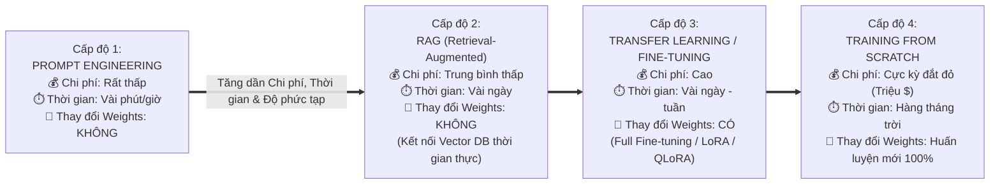
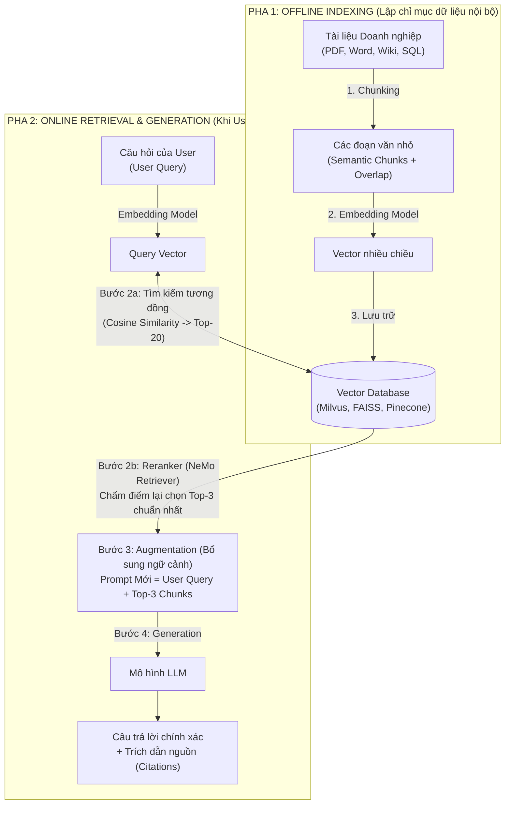
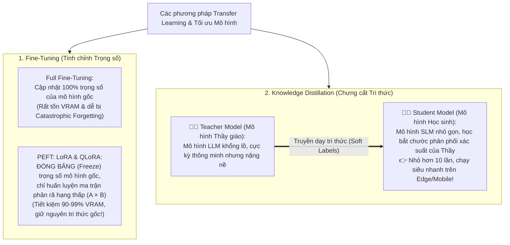

# Module 6: Model Customization (Phương pháp Tùy biến Mô hình)

> [!IMPORTANT]
> **Trọng tâm ôn thi NCA-GENL ở Module 6 (Trọng tâm thực tiễn doanh nghiệp - Chiếm tỷ trọng lớn!):**
> Hiểu rõ **3 lý do doanh nghiệp bắt buộc phải tùy biến Foundation Model**; thuộc lòng thứ tự **4 cấp độ tùy biến tăng dần về chi phí và độ phức tạp** (`Prompt Engineering` $\to$ `RAG` $\to$ `Transfer Learning / Fine-Tuning` $\to$ `Training from Scratch`); phân biệt các kỹ thuật **Prompting (Zero-shot, One-shot, Few-shot, CoT, System Prompt)**; nắm chắc luồng hoạt động của **RAG + Chunking + Reranking**; hiểu sâu cơ chế toán học của **PEFT / LoRA & QLoRA**, hiện tượng **Catastrophic Forgetting**, và **Knowledge Distillation (Teacher-Student)**.

---

## 1. Tại sao doanh nghiệp bắt buộc phải tùy biến mô hình?

Các mô hình nền tảng (Foundation Models như GPT-4 hay LLaMA-3 gốc) chỉ sở hữu kiến thức đại chúng trên Internet cho đến thời điểm cắt dữ liệu (**Knowledge Cutoff**). Doanh nghiệp bắt buộc phải tùy biến (Customize) mô hình vì **3 lý do sống còn**:
1. **Thích ứng với ngôn ngữ và thuật ngữ chuyên ngành (Domain-specific Jargon):** Ví dụ trong Y khoa (tên biệt dược, bệnh án lâm sàng), Luật pháp hay Tài chính ngân hàng.
2. **Nâng cao hiệu năng cho tác vụ đặc thù (Task-specific Performance):** Đảm bảo mô hình trả về đúng định dạng JSON chuẩn của hệ thống, sinh câu truy vấn SQL chính xác theo schema cơ sở dữ liệu công ty, hoặc phân loại đúng chuẩn quy trình CSKH.
3. **Cải thiện mức độ nhận thức ngữ cảnh nội bộ (Internal Context Awareness):** Tích hợp các chính sách nhân sự, tài liệu bảo hành sản phẩm mới ra mắt, hoặc tài liệu mật nội bộ mà mô hình công khai chưa từng được học.

---

## 2. Bốn Cấp độ Tùy biến Mô hình (Spectrum of Model Customization)

Trong kỳ thi NCA-GENL, bạn cần nhớ nguyên tắc vàng của kiến trúc sư AI: **Luôn ưu tiên đi từ giải pháp đơn giản, rẻ tiền nhất (bên trái) sang giải pháp phức tạp, đắt đỏ nhất (bên phải)!**

---

## 3. Cấp độ 1: Prompt Engineering (Kỹ nghệ Câu lệnh)

* **Bản chất:** Là phương pháp thiết kế, tối ưu hóa câu lệnh đầu vào (Input Prompt) bằng ngôn ngữ tự nhiên để dẫn dắt LLM sinh ra kết quả mong muốn mà **hoàn toàn KHÔNG làm thay đổi bất kỳ trọng số (weights) nào của mô hình**.

### Bảng phân biệt 5 kỹ thuật Prompting cốt lõi (Rất hay hỏi trong đề thi):
| Kỹ thuật Prompting | Định nghĩa & Cách nhận diện | Ví dụ minh họa thực tế | Khi nào nên dùng? |
| :--- | :--- | :--- | :--- |
| **1. Zero-shot Prompting** | Đặt câu hỏi hoặc giao nhiệm vụ **trực tiếp mà không kèm theo bất kỳ ví dụ mẫu nào**. | *"Phân loại cảm xúc câu sau: 'Bộ phim này hay ngoài mong đợi.' $\to$ Đáp án:"* | Các tác vụ phổ thông, đơn giản mà LLM đã hiểu rõ bản chất. |
| **2. One-shot Prompting** | Cung cấp **đúng 1 ví dụ mẫu (1 cặp Input-Output)** trước khi đưa ra câu hỏi chính. | *"Ví dụ: 'Giao hàng chậm' -> Tiêu cực. Hãy phân loại: 'Đóng gói rất kỹ' -> ?"* | Khi muốn mô hình bắt chước chính xác một định dạng đầu ra đơn giản. |
| **3. Few-shot Prompting** | Cung cấp từ **2 đến nhiều ví dụ mẫu đa dạng** ngay trong prompt để dạy mô hình quy luật tại chỗ (**In-context learning**). | Đưa 3-5 ví dụ chuyển đổi câu nói tự nhiên thành JSON trước khi yêu cầu xử lý câu mới. | Khi tác vụ có định dạng đặc thù hoặc cần phân biệt các trường hợp biên phức tạp. |
| **4. Chain-of-Thought (CoT)** | Yêu cầu mô hình **trình bày rõ từng bước lập luận trung gian** trước khi chốt đáp án cuối cùng (*"Let's think step by step"*). | *"Lan có 5 quả táo, mua thêm 2 túi mỗi túi 3 quả... Hãy giải thích từng bước tính."* | Cực kỳ hiệu quả cho bài toán **Toán học, Logic, Lập trình và Suy luận đa bước**. |
| **5. System Prompt (Role-based)** | Câu lệnh nền định nghĩa **vai trò (Persona), quy tắc ứng xử, giới hạn bảo mật và định dạng đầu ra** của toàn bộ cuộc hội thoại. | *"Bạn là trợ lý tài chính của ngân hàng X. Chỉ trả lời về lãi suất, từ chối mọi câu hỏi chính trị..."* | Định hình hành vi tổng thể; có **độ ưu tiên cao hơn User Prompt** để chống bẻ khóa (Jailbreak). |

---

## 4. Cấp độ 2: Retrieval-Augmented Generation (RAG)

* **Giải pháp RAG:** Giống như cho sinh viên đi thi dưới hình thức **"Thi mở sách (Open-Book Exam)"**. Thay vì bắt mô hình học thuộc lòng mọi tài liệu vào trọng số (Weights), hệ thống sẽ **tự động tra cứu đúng đoạn tài liệu nội bộ liên quan nhất từ Vector Database rồi đính kèm vào Prompt** để LLM đọc và tổng hợp câu trả lời!

### 4.1. Sơ đồ Kiến trúc & Quy trình 4 bước của RAG (Kèm Reranker)

### 4.2. Chiến lược Chunking & Tại sao Chunking lại sống còn trong RAG?
* **Chunking là gì?** Là kỹ thuật cắt nhỏ các tài liệu dài thành các đoạn văn bản nhỏ hơn (**Chunks**) có ý nghĩa ngữ nghĩa trọn vẹn.
* **Các chiến lược Chunking phổ biến (Thường hỏi trong phần Experimentation):**
  * **Fixed-size Chunking with Overlap (Cắt kích thước cố định có gối đầu):** Ví dụ mỗi chunk dài `512 tokens` và gối đầu lên nhau `50 tokens` (**Chunk Overlap**) để đảm bảo câu văn nằm ở ranh giới vết cắt không bị đứt mất ngữ cảnh!
  * **Semantic / Recursive Chunking (Cắt theo cấu trúc ngữ nghĩa):** Cắt thông minh theo ranh giới tiêu đề mục Markdown (`#`, `##`), đoạn văn (`\n\n`) hoặc câu hoàn chỉnh.
* **3 lợi ích bắt buộc của Chunking:**
  1. Tránh làm tràn **Cửa sổ ngữ cảnh (Context Window)** của LLM.
  2. Tăng độ chính xác khi tìm kiếm Vector (**Retrieval Precision**) vì vector của một đoạn ngắn tập trung đúng vào 1 ý cụ thể thay vì bị pha loãng.
  3. Giảm độ trễ và chi phí token khi gọi LLM.

---

## 5. Cấp độ 3: Transfer Learning, Fine-Tuning (LoRA/QLoRA) & Knowledge Distillation

* **Bản chất của Transfer Learning:** Tái sử dụng một mô hình đã được huấn luyện sẵn (**Pre-trained Model**) làm điểm xuất phát, sau đó huấn luyện tiếp để thích ứng với tác vụ chuyên sâu của doanh nghiệp.
* **Phép ẩn dụ Lái xe (Driving Analogy):** Một người **đã biết lái xe ô tô con** khi chuyển sang **học lái xe tải hạng nặng** sẽ học nhanh hơn gấp 10 lần so với người chưa từng cầm vô lăng bao giờ!
* **Lợi ích cốt lõi:** Tiết kiệm tới **90% thời gian và chi phí tính toán GPU**, cần ít dữ liệu gắn nhãn hơn rất nhiều so với huấn luyện từ đầu (Training from scratch).

### 5.1. Làm rõ chuyên sâu: Full Fine-Tuning vs. PEFT (LoRA & QLoRA)
1. **Hạn chế của Full Fine-Tuning:**
   * Đòi hỏi lượng VRAM khổng lồ (vì phải lưu cả trọng số, đạo hàm Gradients và trạng thái Optimizer cho toàn bộ hàng chục tỷ tham số).
   * Dễ gây ra hiện tượng **Catastrophic Forgetting (Quên thảm khốc):** Khi ép mô hình cập nhật lại toàn bộ trọng số trên tập dữ liệu hẹp của công ty, mô hình có nguy cơ xóa sạch các kiến thức ngôn ngữ và lập luận tổng quát mà nó đã học được ở giai đoạn Pre-training!
2. **Giải pháp PEFT – LoRA (Low-Rank Adaptation):**
   * **Cơ chế toán học cực hay cho Developer:** Thay vì sửa trực tiếp ma trận trọng số gốc $W_0$ (kích thước $d \times d$, ví dụ $4096 \times 4096 = 16.7\text{ triệu}$ tham số), **LoRA đóng băng hoàn toàn $W_0$** và gắn song song hai ma trận "ốm nhom" hạng thấp (**Low-rank matrices**) là $A$ (kích thước $d \times r$) và $B$ (kích thước $r \times d$) với bậc hạng $r \ll d$ (ví dụ $r = 8$):
     $$W_{\text{mới}} = W_0 + \Delta W = W_0 + (A \times B)$$
   * Với $r = 8$, tổng số tham số của $A$ và $B$ chỉ là $(4096 \times 8) + (8 \times 4096) = 65.536$ tham số $\to$ **Giảm hơn 99.6% số lượng tham số cần huấn luyện!**
   * Không bị *Catastrophic Forgetting* và có thể tháo lắp hàng chục bộ Adapter LoRA khác nhau trên cùng 1 Base Model đang chạy trong VRAM!
3. **QLoRA (Quantized LoRA):**
   * Bước tiến xa hơn nữa của LoRA: **Lượng tử hóa (Quantize) mô hình gốc đã đóng băng xuống chuẩn 4-bit (`NF4` - NormalFloat4)** kết hợp *Double Quantization* và *Paged Optimizers*, sau đó gắn các bộ Adapter LoRA 16-bit lên trên để huấn luyện.
   * Giúp một Developer có thể fine-tune mô hình LLM 65B–70B tham số ngay trên **1 chiếc GPU đơn lẻ**!

### 5.2. Knowledge Distillation (Chưng cất tri thức) & Đánh giá sau Fine-Tuning
* **Knowledge Distillation:** Dùng mô hình lớn (**Teacher Model**) truyền dạy phân phối xác suất đầu ra cho mô hình nhỏ (**Student Model**), giúp thu được mô hình nhỏ hơn 10 lần để chạy trên thiết bị biên (Edge/Mobile).
* **Độ đo quan trọng nhất khi đánh giá mô hình Fine-Tuned:** Chính là **Validation Set Accuracy (Độ chính xác trên tập kiểm định)** để kiểm tra khả năng tổng quát hóa trên dữ liệu chưa từng học và phát hiện sớm hiện tượng **Overfitting**.

---

## 6. Bẫy đề thi NCA-GENL & Câu hỏi Thực chiến (Exam Traps & Mini Quiz)

> [!WARNING]
> **Các bẫy kinh điển trong đề thi Module 6:**
> 1. **Bẫy RAG vs. Fine-Tuning:**
>    * Bài toán yêu cầu *"kết nối kho tài liệu nội bộ thay đổi thường xuyên, giảm ảo giác (hallucination), kèm trích dẫn nguồn mà không cập nhật trọng số mô hình"* $\to$ Chọn **RAG**!
>    * Bài toán yêu cầu *"dạy mô hình phong cách ngôn ngữ chuyên ngành sâu, định dạng đầu ra phức tạp cố định trên tập dữ liệu gán nhãn"* $\to$ Chọn **Fine-Tuning (LoRA/PEFT)**.
> 2. **Bẫy LoRA vs. QLoRA:**
>    * Đóng băng trọng số gốc và chèn các ma trận phân rã hạng thấp (Low-rank decomposition matrices) để giảm số lượng tham số huấn luyện $\to$ **LoRA**.
>    * Kết hợp LoRA với việc nén mô hình nền xuống **4-bit (NF4)** để fine-tune trên phần cứng rất hạn chế VRAM $\to$ **QLoRA**.
> 3. **Bẫy Teacher-Student:** Dùng mô hình lớn truyền tri thức cho mô hình nhỏ gọn hơn $\to$ **Knowledge Distillation**.

### Câu hỏi tự kiểm tra (Mini Quiz):
1. **Câu 1:** Một kỹ sư muốn tinh chỉnh (fine-tune) một mô hình LLaMA-3 70B cho tác vụ y khoa nhưng chỉ có 1 máy trạm GPU với dung lượng VRAM hạn chế. Kỹ thuật nào cho phép nén mô hình gốc xuống 4-bit và chỉ huấn luyện các ma trận hạng thấp gắn kèm để tiết kiệm tối đa bộ nhớ?
   * *Đáp án:* **QLoRA (Quantized Low-Rank Adaptation)**.
2. **Câu 2:** Tại sao khi thực hiện Chunking tài liệu trong hệ thống RAG, các kỹ sư thường thiết lập một khoảng chồng lấn nhỏ (**Chunk Overlap**, ví dụ 10–15% số token) giữa hai đoạn văn liên tiếp?
   * *Đáp án:* Để **bảo toàn ngữ cảnh liên tục tại vị trí ranh giới cắt**, tránh làm đứt gãy ý nghĩa của những câu văn nằm vắt ngang giữa hai chunk.
