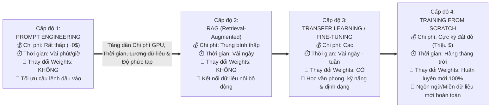
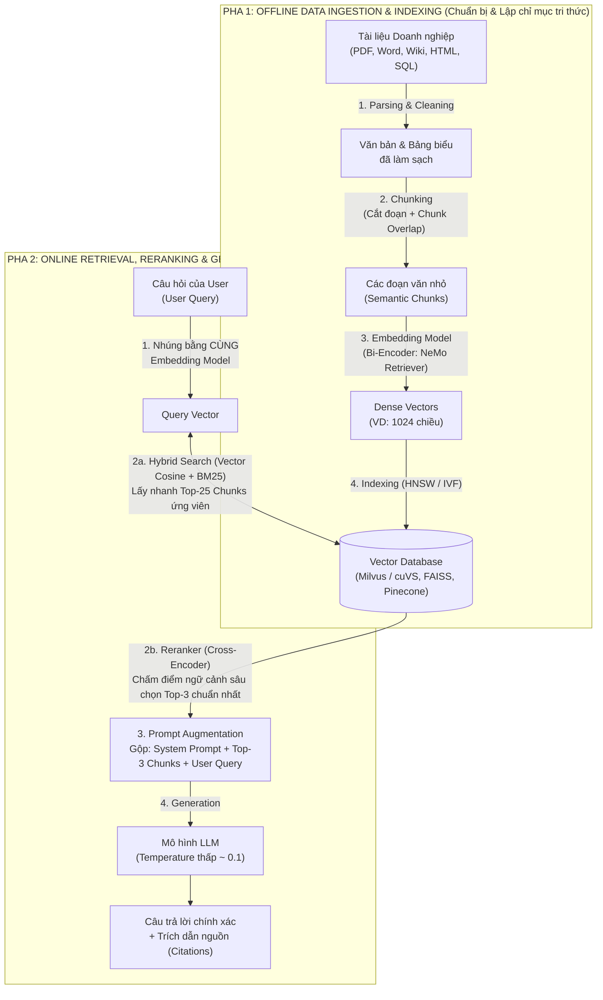
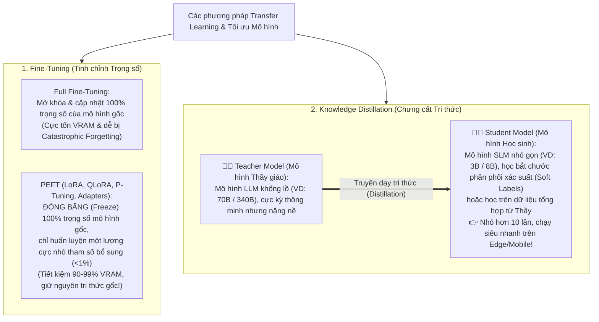
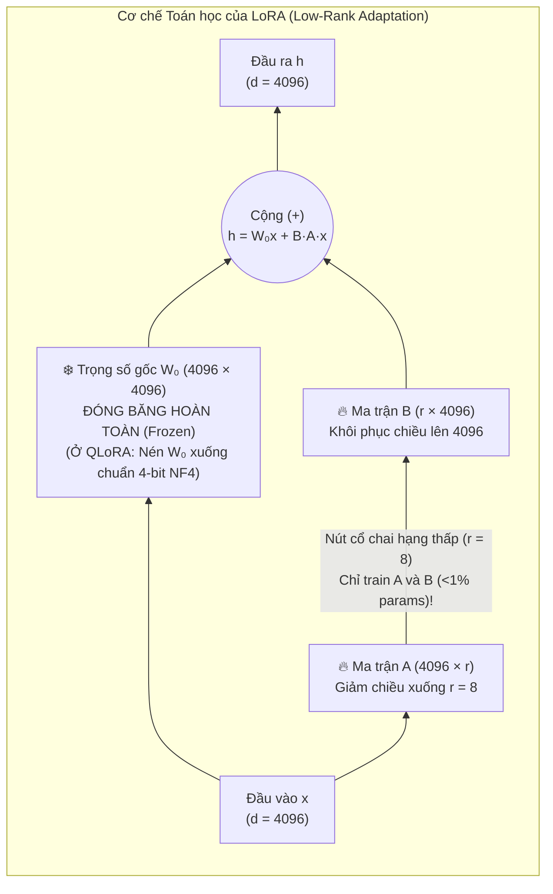

# Module 6: Model Customization (Phương pháp Tùy biến Mô hình)

> [!IMPORTANT]
> **Trọng tâm ôn thi NCA-GENL ở Module 6 (Trọng tâm thực tiễn doanh nghiệp - Chiếm tỷ trọng lớn!):**
> Hiểu rõ **3 lý do doanh nghiệp bắt buộc phải tùy biến Foundation Model**; thuộc lòng thứ tự **4 cấp độ tùy biến tăng dần về chi phí và độ phức tạp** (`Prompt Engineering` $\to$ `RAG` $\to$ `Transfer Learning / Fine-Tuning` $\to$ `Training from Scratch`) cùng **Ma trận Quyết định chọn giải pháp**; phân biệt các kỹ thuật **Prompting (Zero-shot, One-shot, Few-shot, CoT, Self-Consistency, ReAct, System Prompt)**; nắm chắc luồng hoạt động chuyên sâu của **RAG (Chunking + Overlap, Bi-Encoder Embedding, Vector DB HNSW/IVF, Hybrid Search BM25 + Vector, Cross-Encoder Reranking)**; hiểu sâu cơ chế toán học của **PEFT (LoRA, QLoRA, Adapter, Prompt/Prefix Tuning)**, hiện tượng **Catastrophic Forgetting**, và **Knowledge Distillation (Teacher-Student & Synthetic Data)**.

---

## 1. Tại sao doanh nghiệp bắt buộc phải tùy biến mô hình?

Các mô hình nền tảng (Foundation Models như GPT-4 hay LLaMA-3 gốc) chỉ sở hữu kiến thức đại chúng trên Internet cho đến thời điểm cắt dữ liệu (**Knowledge Cutoff**). Doanh nghiệp bắt buộc phải tùy biến (Customize) mô hình vì **3 lý do sống còn**:
1. **Thích ứng với ngôn ngữ và thuật ngữ chuyên ngành (Domain-specific Jargon & Vocabulary):** Ví dụ trong Y khoa (tên biệt dược, mã bệnh ICD-10, bệnh án lâm sàng), Luật pháp, Viễn thông hay Tài chính ngân hàng.
2. **Nâng cao hiệu năng cho tác vụ và định dạng đặc thù (Task-specific Performance & Formatting):** Đảm bảo mô hình trả về đúng cấu trúc JSON Schema nghiêm ngặt của hệ thống, sinh câu truy vấn SQL chính xác theo schema cơ sở dữ liệu công ty, hoặc tuân thủ đúng văn phong chăm sóc khách hàng của thương hiệu.
3. **Cải thiện mức độ nhận thức ngữ cảnh nội bộ & Dữ liệu thời gian thực (Internal Context & Fresh Data Awareness):** Tích hợp các chính sách nhân sự, bảng giá tồn kho thay đổi từng phút, tài liệu bảo hành sản phẩm mới ra mắt, hoặc tài liệu mật nội bộ mà mô hình công khai chưa từng được học.

---

## 2. Bốn Cấp độ Tùy biến Mô hình (Spectrum of Model Customization) & Ma trận Quyết định

Trong kỳ thi NCA-GENL, bạn cần nhớ nguyên tắc vàng của kiến trúc sư AI: **Luôn ưu tiên đi từ giải pháp đơn giản, nhanh và rẻ tiền nhất (bên trái) sang giải pháp phức tạp, đắt đỏ nhất (bên phải)!**

### Bảng Ma trận Quyết định: Khi nào dùng Prompting vs. RAG vs. Fine-Tuning? (CỰC KỲ QUAN TRỌNG!)
Đề thi rất hay đưa ra một kịch bản doanh nghiệp và hỏi bạn nên chọn phương pháp nào. Hãy đối chiếu bảng sau:

| Tiêu chí so sánh | 1. Prompt Engineering | 2. RAG (Retrieval-Augmented Generation) | 3. Fine-Tuning (PEFT / LoRA / SFT) | 4. Training from Scratch |
| :--- | :--- | :--- | :--- | :--- |
| **Có cập nhật Trọng số (Weights) của LLM không?** | **KHÔNG** | **KHÔNG** | **CÓ** (Cập nhật Adapter LoRA hoặc toàn bộ Weights) | **CÓ** (Khởi tạo và học mới 100% từ con số 0) |
| **Giải quyết bài toán gì tốt nhất?** | Định hướng nhanh hành vi, định dạng đầu ra hoặc suy luận logic ngay trong cửa sổ ngữ cảnh. | Bổ sung **tri thức sự kiện mới (External Facts), dữ liệu nội bộ thay đổi liên tục**, giảm ảo giác và cần **trích dẫn nguồn (Citations)**. | Dạy mô hình **hành vi mới, văn phong/giọng điệu đặc thù, cấu trúc đầu ra phức tạp cố định**, hoặc ngôn ngữ chuyên ngành sâu. | Xây dựng mô hình nền tảng cho một ngôn ngữ hoàn toàn mới hoặc dữ liệu khoa học đặc biệt (DNA/Protein/Khí hậu) chưa có Base Model. |
| **Tần suất dữ liệu thay đổi** | Tức thì theo từng câu lệnh. | **Thay đổi liên tục theo từng giây/phút** (chỉ cần cập nhật Vector DB, không cần train lại model!). | Dữ liệu tĩnh, ít thay đổi (mỗi lần muốn nạp quy luật mới phải chạy lại job Fine-tune). | Dữ liệu nền tảng tĩnh (cố định tại thời điểm Knowledge Cutoff). |
| **Nguy cơ Ảo giác (Hallucination)** | Trung bình – Cao nếu hỏi kiến thức ngoài luồng. | **Thấp nhất** (vì câu trả lời bị neo chặt vào đoạn văn bản truy xuất được). | Trung bình (Fine-tuning dạy *cách trả lời* tốt hơn là dạy *nhớ chính xác sự kiện mới*). | Phụ thuộc chất lượng dữ liệu gốc. |
| **Dữ liệu cần thiết** | 0 đến vài ví dụ mẫu (Few-shot). | Kho tài liệu thô (PDF, Wiki, Word, SQL) không cần gắn nhãn. | Hàng nghìn đến hàng trăm nghìn cặp `(Instruction, Ideal Response)` đã gắn nhãn sạch. | Hàng nghìn tỷ (Trillions) tokens dữ liệu thô + Cụm hàng nghìn GPU. |

> [!TIP]
> **Góc nhìn Thực chiến:** Trong các hệ thống AI doanh nghiệp hiện đại, **RAG và Fine-Tuning KHÔNG loại trừ nhau mà thường được KẾT HỢP (RAG + Fine-Tuning)**! Ví dụ: Dùng **LoRA Fine-Tuning** để dạy mô hình hiểu thuật ngữ y khoa và xuất báo cáo chuẩn bệnh viện, đồng thời kết nối **RAG** để tra cứu hồ sơ bệnh án mới nhất của từng bệnh nhân theo thời gian thực.

---

## 3. Cấp độ 1: Prompt Engineering (Kỹ nghệ Câu lệnh)

* **Bản chất:** Là phương pháp thiết kế, cấu trúc và tối ưu hóa câu lệnh đầu vào (Input Prompt) bằng ngôn ngữ tự nhiên để dẫn dắt LLM sinh ra kết quả mong muốn thông qua cơ chế **In-Context Learning (Học trong ngữ cảnh)** mà **hoàn toàn KHÔNG làm thay đổi bất kỳ trọng số (weights) nào của mô hình**.

### 3.1. Bảng phân biệt 7 kỹ thuật Prompting cốt lõi (Rất hay hỏi trong đề thi):
| Kỹ thuật Prompting | Định nghĩa & Cách nhận diện | Ví dụ minh họa thực tế | Khi nào nên dùng? |
| :--- | :--- | :--- | :--- |
| **1. Zero-shot Prompting** | Đặt câu hỏi hoặc giao nhiệm vụ **trực tiếp mà không kèm theo bất kỳ ví dụ mẫu nào**. | *"Phân loại cảm xúc câu sau thành Tích cực hoặc Tiêu cực: 'Bộ phim này hay ngoài mong đợi.' $\to$ Đáp án:"* | Các tác vụ phổ thông, đơn giản mà LLM đã hiểu rõ bản chất từ lúc Pre-train/SFT. |
| **2. One-shot Prompting** | Cung cấp **đúng 1 ví dụ mẫu hoàn chỉnh (1 cặp Input-Output)** trước khi đưa ra câu hỏi chính. | *"Ví dụ: 'Giao hàng chậm' -> Tiêu cực. Hãy phân loại: 'Đóng gói rất kỹ' -> ?"* | Khi muốn mô hình bắt chước chính xác một định dạng đầu ra đơn giản mà không tốn nhiều token. |
| **3. Few-shot Prompting** | Cung cấp từ **2 đến $N$ ví dụ mẫu đa dạng** ngay trong prompt để dạy mô hình quy luật ánh xạ tại chỗ (**In-context learning**). | Đưa 3–5 ví dụ chuyển đổi câu nói tự nhiên thành mã JSON chuẩn của công ty trước khi yêu cầu xử lý câu mới. | Khi tác vụ có định dạng đặc thù hoặc cần phân biệt các trường hợp biên phức tạp mà chưa muốn fine-tune. |
| **4. Chain-of-Thought (CoT)** | Yêu cầu mô hình **trình bày rõ từng bước lập luận trung gian** trước khi chốt đáp án cuối cùng (*"Let's think step by step"*). | *"Lan có 5 quả táo, mua thêm 2 túi mỗi túi 3 quả... Hãy suy nghĩ từng bước một trước khi đưa ra kết quả."* | Cực kỳ hiệu quả cho bài toán **Toán học, Logic, Lập trình và Suy luận đa bước** (kết hợpได้ với cả Zero-shot CoT và Few-shot CoT). |
| **5. Self-Consistency** | Mở rộng của CoT: Cho mô hình sinh ra **nhiều luồng suy luận CoT độc lập khác nhau** (với Temperature > 0), sau đó lấy **biểu quyết đa số (Majority Vote)** cho đáp án cuối cùng. | Sinh 5 cách giải cho cùng 1 bài toán phức tạp; nếu 4/5 cách đều ra đáp số `42`, chọn `42`. | Khi bài toán suy luận cực khó, một luồng CoT đơn lẻ vẫn có nguy cơ tính nhầm ở bước giữa. |
| **6. ReAct (Reason + Act)** | Mô hình lặp đi lặp lại chu trình: **Suy nghĩ (`Thought`) $\to$ Gọi công cụ bên ngoài (`Action`: Search API, SQL, Calculator) $\to$ Quan sát kết quả (`Observation`)** cho đến khi giải xong bài toán. | *"Thought: Cần tìm giá cổ phiếu NVDA hôm nay -> Action: gọi YahooFinance API -> Observation: \$140 -> Answer..."* | Nền tảng cốt lõi để xây dựng **AI Agents & Tool Calling / Function Calling**. |
| **7. System Prompt (Role / Persona)** | Câu lệnh nền định nghĩa **vai trò (Persona), quy tắc ứng xử, giới hạn bảo mật và định dạng đầu ra** của toàn bộ cuộc hội thoại. | *"Bạn là trợ lý tài chính của ngân hàng X. Chỉ trả lời bằng tiếng Việt lịch sự về lãi suất, từ chối mọi câu hỏi chính trị..."* | Định hình hành vi tổng thể của ứng dụng; có **độ ưu tiên cao hơn User Prompt** để giữ nhất quán và chống bẻ khóa. |

---

## 4. Cấp độ 2: Retrieval-Augmented Generation (RAG - Sinh văn bản Tăng cường Truy xuất)

* **Bản chất của RAG:** Giống như cho sinh viên đi thi dưới hình thức **"Thi mở sách (Open-Book Exam)"**. Thay vì bắt mô hình học thuộc lòng mọi tài liệu nội bộ vào trọng số (Parametric Memory), hệ thống sẽ **tự động tra cứu đúng đoạn tài liệu liên quan nhất từ kho lưu trữ ngoài (Non-parametric Memory / Vector Database) rồi đính kèm trực tiếp vào Prompt** để LLM đọc và tổng hợp câu trả lời!

### 4.1. Sơ đồ Kiến trúc & Quy trình 2 Pha của Hệ thống RAG Doanh nghiệp (Chuẩn NVIDIA NeMo Retriever)

### 4.2. Giải phẫu các thành phần kỹ thuật quan trọng trong RAG (Hay hỏi thi!):
1. **Chiến lược Chunking & Chunk Overlap (Cắt nhỏ tài liệu):**
   * *Tại sao bắt buộc phải Chunking?*
     1. Tránh vượt quá giới hạn **Cửa sổ ngữ cảnh (Context Window)** và tránh hiện tượng **"Lost in the Middle"** (LLM thường nhớ rất tốt phần đầu và phần cuối prompt nhưng hay quên thông tin nằm chìm nghỉm ở giữa một văn bản quá dài).
     2. Tăng **độ chính xác của Vector Embedding (Retrieval Precision)**: Nếu nhúng cả cuốn sách 200 trang thành 1 vector duy nhất, ý nghĩa của từng chi tiết sẽ bị trung bình hóa và pha loãng hoàn toàn; cắt thành từng đoạn nhỏ `256 - 512 tokens` giúp vector đại diện sắc nét cho đúng 1 ý cụ thể.
     3. Giảm độ trễ (**TTFT**) và tiết kiệm chi phí token mỗi lần gọi LLM.
   * *Tại sao phải có **Chunk Overlap** (Gối đầu khoảng 10–20%, ví dụ chunk 500 tokens gối đầu 50 tokens)?* Để **bảo toàn ngữ cảnh liên tục tại vị trí vết cắt**, tránh việc một câu văn quan trọng bị cắt đôi nằm nửa ở cuối Chunk 1, nửa ở đầu Chunk 2 làm mất hoàn toàn ý nghĩa!
2. **Cơ sở dữ liệu Vector (Vector Databases) & Thuật toán tìm kiếm ANN:**
   * Lưu trữ hàng triệu/tỷ vector nhúng cùng với dữ liệu gốc và **Metadata** (tên file, số trang, ngày tạo, quyền truy cập phòng ban RBAC).
   * Thay vì quét cạn từng vector một (Brute-force Flat Search rất chậm), các Vector DB (như **Milvus được tăng tốc bằng NVIDIA cuVS/RAFT, FAISS, Pinecone, Weaviate, Qdrant**) sử dụng các thuật toán **ANN (Approximate Nearest Neighbors)** như **HNSW (Hierarchical Navigable Small World - đồ thị phân tầng)** hoặc **IVF (Inverted File Index - phân cụm tâm)** để tìm ra Top-K vector gần nhất theo **Cosine Similarity** chỉ trong vài mili-giây!
3. **Hybrid Search (Tìm kiếm Lai) & Reranking (Sắp xếp lại bằng Cross-Encoder):**
   * **Hybrid Search = Dense Retrieval (Vector Embedding hiểu ngữ nghĩa) + Sparse Retrieval (BM25 / TF-IDF khớp chính xác mã sản phẩm, số hiệu hợp đồng, tên riêng)**: Kết hợp thế mạnh của cả hai để không bỏ sót tài liệu.
   * **Bi-Encoder (Embedding Model) vs. Cross-Encoder (Reranker Model):**
     * *Bước 1 (Bi-Encoder):* Nhúng độc lập câu hỏi và tài liệu để quét cực nhanh qua 10 triệu bản ghi trong Vector DB, lọc ra **Top-25 ứng viên**.
     * *Bước 2 (Cross-Encoder Reranker - ví dụ trong **NVIDIA NeMo Retriever**):* Đưa đồng thời từng cặp `(Câu hỏi + Chunk ứng viên)` vào mạng Transformer Cross-Encoder để tính Self-Attention chéo giữa mọi từ của câu hỏi và tài liệu, chấm điểm chính xác tuyệt đối rồi lọc lấy **Top-3 đến Top-5 đoạn xuất sắc nhất** đưa vào LLM!

---

## 5. Cấp độ 3: Transfer Learning, Fine-Tuning (LoRA/QLoRA) & Knowledge Distillation

* **Bản chất của Transfer Learning (Học chuyển giao):** Tái sử dụng một mô hình đã được huấn luyện sẵn trên tập dữ liệu lớn (**Pre-trained Model**) làm điểm xuất phát, sau đó tinh chỉnh tiếp để thích ứng với tác vụ hoặc miền dữ liệu chuyên sâu của doanh nghiệp.
* **Phép ẩn dụ Lái xe (Driving Analogy):** Một người **đã biết lái xe ô tô con thành thạo** khi chuyển sang **học lái xe tải hạng nặng** sẽ học nhanh hơn gấp 10 lần so với người chưa từng cầm vô lăng bao giờ (vì họ đã nắm sẵn luật giao thông, cách nhìn gương, cảm giác chân ga/phanh)!
* **Lợi ích cốt lõi:** Tiết kiệm tới **90% thời gian và chi phí tính toán GPU**, cần ít dữ liệu gắn nhãn hơn rất nhiều so với huấn luyện từ đầu (Training from scratch).

### 5.1. Làm rõ chuyên sâu: Full Fine-Tuning vs. Họ các kỹ thuật PEFT (Parameter-Efficient Fine-Tuning)
1. **Hai rào cản lớn của Full Fine-Tuning:**
   * **Bùng nổ bộ nhớ VRAM:** Để cập nhật toàn bộ 70 tỷ tham số của LLaMA-3 70B ở chuẩn 16-bit, ngoài `140 GB` lưu trọng số (Weights), GPU còn phải lưu `140 GB` cho đạo hàm (Gradients) và `280–560 GB` cho trạng thái bộ tối ưu hóa (Optimizer States của AdamW) + Activations $\to$ Đòi hỏi cụm từ **8 đến 16 GPU H100 80GB**!
   * **Hiện tượng Catastrophic Forgetting (Quên thảm khốc):** Khi ép mô hình ghi đè trực tiếp lên toàn bộ trọng số gốc trên một tập dữ liệu nhỏ/hẹp của công ty, mô hình rất dễ xóa sạch các kiến thức ngôn ngữ, lập luận logic và đa năng mà nó đã vất vả học được ở giai đoạn Pre-training!
2. **Giải pháp PEFT – Đóng băng mô hình gốc, chỉ huấn luyện $< 1\%$ tham số:**
   * **LoRA (Low-Rank Adaptation - Quan trọng số 1 trong đề thi!):**
     * *Cơ chế toán học:* Thay vì sửa trực tiếp ma trận trọng số gốc $W_0$ (kích thước $d \times d$, ví dụ $4096 \times 4096 = 16.77\text{ triệu}$ tham số), **LoRA đóng băng hoàn toàn $W_0$ (`requires_grad = False`)** và gắn song song hai ma trận phân rã hạng thấp (**Low-rank decomposition matrices**) là $A$ (kích thước $d \times r$) và $B$ (kích thước $r \times d$) với bậc hạng $r \ll d$ (ví dụ $r = 8$ hoặc $16$):
       $$h = W_0 x + \Delta W x = W_0 x + \frac{\alpha}{r} (B \cdot A) x$$
       *(Khi khởi tạo, ma trận $A$ khởi tạo ngẫu nhiên Gaussian còn ma trận $B$ khởi tạo toàn số $0$ để tại bước đầu tiên $\Delta W = 0$, không làm xáo trộn mô hình gốc).*
     * *Hiệu quả đáng kinh ngạc:* Với $r = 8$, tổng số tham số cần học của $A$ và $B$ chỉ là $(4096 \times 8) + (8 \times 4096) = 65.536$ tham số $\to$ **Giảm hơn 99.6% số lượng tham số cần huấn luyện**, không cần lưu Optimizer State cho $W_0$, chống *Catastrophic Forgetting* tuyệt vời!
     * *Zero Inference Latency Overhead (Không tăng độ trễ lúc suy luận):* Sau khi train xong, bạn có thể cộng gộp trực tiếp $W_{\text{merged}} = W_0 + B \times A$ thành một ma trận duy nhất (hoặc giữ rời để phục vụ **Multi-LoRA Serving** trên Triton/NIM: 1 Base Model nằm trong VRAM phục vụ hàng chục bộ Adapter LoRA mỏng nhẹ cho hàng chục phòng ban khác nhau!).
   * **QLoRA (Quantized LoRA):**
     * Bước tiến đột phá giúp fine-tune LLM trên phần cứng hạn chế: **Nén (Quantize) mô hình gốc đã đóng băng $W_0$ xuống định dạng 4-bit (`NF4` - NormalFloat4)** kết hợp *Double Quantization* (nén cả hằng số lượng tử hóa) và *Paged Optimizers* (tự động mượn tạm System RAM khi VRAM chạm đỉnh), trong khi vẫn gắn và huấn luyện các thanh Adapter LoRA ở độ chính xác `BF16`/`FP16`.
     * Nhờ QLoRA, một kỹ sư có thể fine-tune mô hình **LLaMA-3 70B chỉ trên 1 chiếc GPU 48GB–80GB duy nhất**!
   * **Các kỹ thuật PEFT khác trong NVIDIA NeMo Customizer:**
     * **Prompt Tuning / P-Tuning:** Đóng băng 100% mô hình, chỉ gắn thêm một chuỗi các vector liên tục học được (**Learnable Soft Prompt / Virtual Tokens**) vào phía trước chuỗi đầu vào.
     * **Prefix Tuning:** Gắn thêm các vector tiền tố học được vào các tầng Key và Value của mọi khối Attention.
     * **Adapter Tuning:** Chèn thêm các lớp mạng bottleneck nhỏ nối tiếp vào bên trong từng khối Transformer.

### 5.2. Knowledge Distillation (Chưng cất tri thức) & Đánh giá sau Fine-Tuning
* **Knowledge Distillation:** Quá trình chuyển giao tri thức từ một mô hình lớn, phức tạp (**Teacher Model**, ví dụ LLaMA-3 70B/405B) sang một mô hình nhỏ gọn hơn nhiều (**Student Model**, ví dụ SLM 3B/8B).
  * Thay vì chỉ học trên nhãn cứng (Hard labels 0 hoặc 1), Student Model học cách bắt chước toàn bộ **phân phối xác suất đầu ra (Soft Labels / Logits)** hoặc học trên tập dữ liệu tổng hợp (**Synthetic Data**) có kèm lập luận do Teacher Model sinh ra $\to$ Giúp thu được mô hình nhỏ hơn 10 lần, giảm chi phí và chạy siêu tốc trên thiết bị biên (Edge/Mobile).
* **Độ đo quan trọng nhất khi đánh giá mô hình Fine-Tuned:** Chính là **Validation Set Accuracy / Loss (Độ chính xác và hàm mất mát trên tập kiểm định chưa từng thấy trong lúc train)** để kiểm tra khả năng tổng quát hóa và phát hiện sớm hiện tượng **Overfitting**.

---

## 6. Bẫy đề thi NCA-GENL & Câu hỏi Thực chiến (Exam Traps & Mini Quiz)

> [!WARNING]
> **Các bẫy kinh điển trong đề thi Module 6:**
> 1. **Bẫy RAG vs. Fine-Tuning:**
>    * Bài toán yêu cầu *"kết nối kho tài liệu nội bộ thay đổi thường xuyên theo thời gian thực, giảm ảo giác (hallucination), kèm trích dẫn nguồn (citations) mà không cập nhật trọng số mô hình"* $\to$ Chọn **RAG**!
>    * Bài toán yêu cầu *"dạy mô hình phong cách ngôn ngữ chuyên ngành sâu, thay đổi giọng văn hoặc tuân thủ định dạng đầu ra phức tạp cố định trên tập dữ liệu gán nhãn"* $\to$ Chọn **Fine-Tuning (LoRA/PEFT)**.
> 2. **Bẫy LoRA vs. QLoRA:**
>    * Đóng băng trọng số gốc và chèn các ma trận phân rã hạng thấp (Low-rank decomposition matrices) để giảm số lượng tham số huấn luyện $\to$ **LoRA**.
>    * Kết hợp LoRA với việc lượng tử hóa mô hình nền đã đóng băng xuống **4-bit (`NF4`)** để fine-tune trên phần cứng rất hạn chế VRAM $\to$ **QLoRA**.
> 3. **Bẫy Teacher-Student:** Dùng mô hình lớn truyền tri thức cho mô hình nhỏ gọn hơn để triển khai tiết kiệm tài nguyên $\to$ **Knowledge Distillation**.
> 4. **Bẫy Catastrophic Forgetting:** Khi Full Fine-Tuning làm mô hình quên mất các kỹ năng ngôn ngữ tổng quát ban đầu $\to$ Khắc phục bằng cách dùng **PEFT (LoRA)** hoặc trộn thêm dữ liệu tổng quát vào tập fine-tune.

### Câu hỏi tự kiểm tra (Mini Quiz):
1. **Câu 1:** Một kỹ sư muốn tinh chỉnh (fine-tune) một mô hình LLaMA-3 70B cho tác vụ y khoa nhưng chỉ có 1 máy trạm GPU với dung lượng VRAM hạn chế. Kỹ thuật nào cho phép nén mô hình gốc xuống 4-bit và chỉ huấn luyện các ma trận hạng thấp gắn kèm để tiết kiệm tối đa bộ nhớ?
   * *Đáp án:* **QLoRA (Quantized Low-Rank Adaptation)**.
2. **Câu 2:** Tại sao khi thực hiện Chunking tài liệu trong hệ thống RAG, các kỹ sư thường thiết lập một khoảng chồng lấn nhỏ (**Chunk Overlap**, ví dụ 10–15% số token) giữa hai đoạn văn liên tiếp?
   * *Đáp án:* Để **bảo toàn ngữ cảnh liên tục tại vị trí ranh giới cắt**, tránh làm đứt gãy ý nghĩa của những câu văn hoặc ý tưởng nằm vắt ngang giữa hai chunk.
3. **Câu 3:** Một tập đoàn luật muốn xây dựng chatbot tra cứu hàng chục nghìn văn bản quy phạm pháp luật mới ban hành hàng tuần. Yêu cầu bắt buộc là mọi câu trả lời của AI phải trích dẫn chính xác số hiệu điều khoản luật và tuyệt đối không được tự suy diễn sai lệch. Phương pháp tùy biến nào phù hợp nhất?
   * *Đáp án:* **RAG (Retrieval-Augmented Generation)** kết hợp cơ sở dữ liệu Vector và bộ Reranker (vì dữ liệu cập nhật hàng tuần và đòi hỏi trích dẫn nguồn chính xác, chống ảo giác).
4. **Câu 4:** Khi giải các bài toán đố toán học phức tạp hoặc lập luận logic nhiều bước mà không được phép fine-tune mô hình, kỹ thuật Prompt Engineering nào yêu cầu mô hình viết ra từng bước suy luận trung gian trước khi đưa ra câu trả lời cuối cùng?
   * *Đáp án:* **Chain-of-Thought (CoT) Prompting**.
5. **Câu 5:** Hiện tượng một mô hình ngôn ngữ lớn sau khi được Full Fine-Tuning trên tập dữ liệu câu lệnh SQL lại mất đi khả năng làm thơ và trò chuyện tự nhiên vốn có của Base Model được gọi là gì?
   * *Đáp án:* **Catastrophic Forgetting (Quên thảm khốc)**.
6. **Câu 6:** Trong kiến trúc RAG nâng cao (như NVIDIA NeMo Retriever), tại sao người ta thường đặt thêm một mô hình **Reranker (Cross-Encoder)** ngay sau bước tìm kiếm Vector (Bi-Encoder)?
   * *Đáp án:* Vì Vector Search (Bi-Encoder) tối ưu cho tốc độ quét nhanh qua hàng triệu bản ghi để lấy Top-25 ứng viên nhưng nén riêng rẽ câu hỏi và tài liệu; trong khi **Reranker (Cross-Encoder)** chấm điểm tương tác ngữ cảnh sâu trực tiếp giữa câu hỏi và từng đoạn văn ứng viên để lọc ra Top-3 đoạn chính xác nhất đưa vào LLM.
