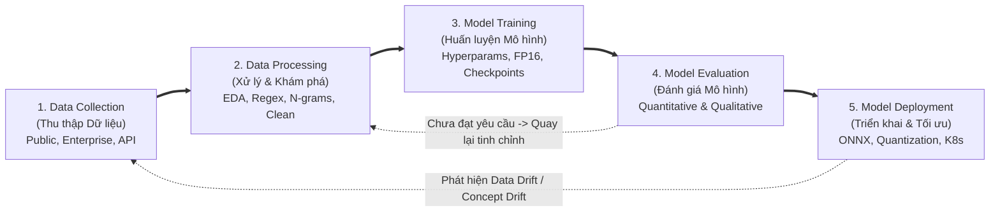
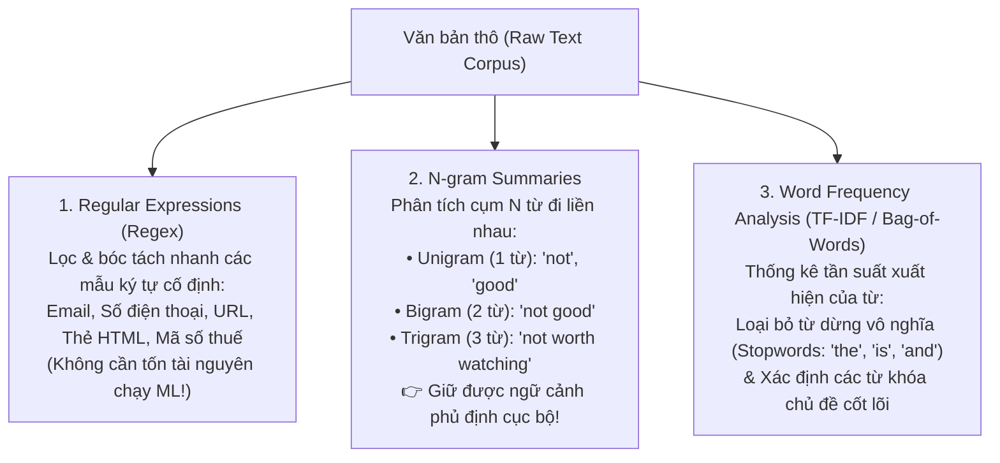
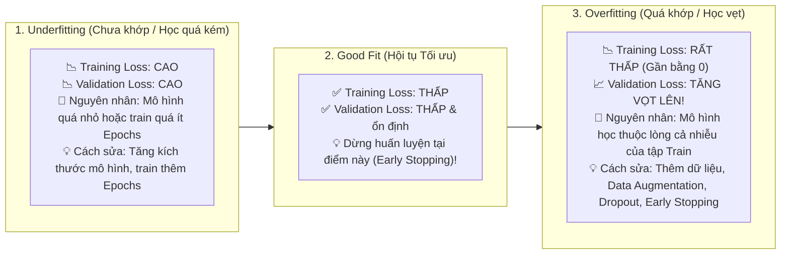
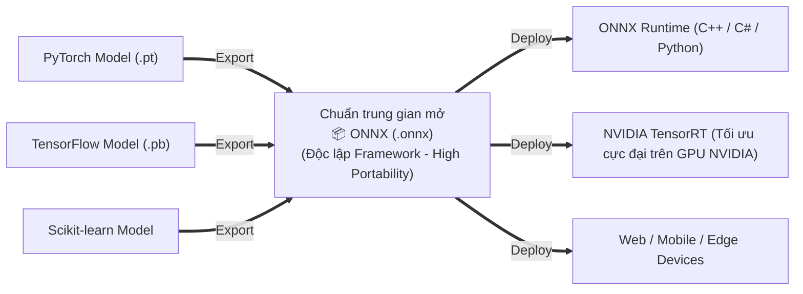
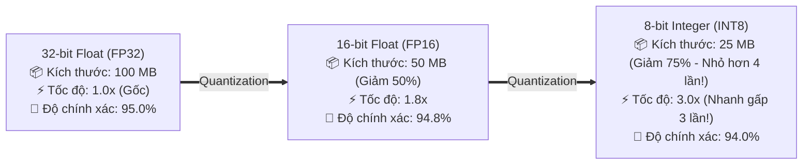

# Module 7: Model Training & Deployment Lifecycle (Vòng đời Huấn luyện & Triển khai Mô hình)

> [!IMPORTANT]
> **Trọng tâm ôn thi NCA-GENL ở Module 7:**
> Thuộc lòng **5 giai đoạn trong vòng đời dự án ML/GenAI**; phân biệt **3 nguồn dữ liệu**; hiểu vai trò sống còn của **EDA (Exploratory Data Analysis)** và các công cụ xử lý văn bản (**Regex, N-grams, Word Frequency**); nắm rõ các **Hyperparameters (Learning Rate, Batch Size, Epochs)**; phân biệt đánh giá **Định lượng (Quantitative - bao gồm Perplexity) vs. Định tính (Qualitative)**; nắm chắc kỹ thuật triển khai tối ưu: **ONNX**, **Quantization (`FP32` $\to$ `FP16` $\to$ `INT8`, PTQ vs. QAT)**, **Batch vs. Real-time Deployment**, **Docker & Kubernetes**, và giám sát **Data Drift / Concept Drift** sau triển khai.

---

## 1. Năm giai đoạn trong Vòng đời Dự án ML / GenAI

Mọi dự án AI chuẩn công nghiệp đều đi qua đường ống (Pipeline) 5 giai đoạn tuần tự và lặp lại liên tục:

---

## 2. Giai đoạn 1: Data Collection (Thu thập Dữ liệu)

Chất lượng của mô hình phụ thuộc trực tiếp vào nguyên lý **"Garbage In, Garbage Out"** (Dữ liệu rác đầu vào $\to$ Mô hình rác đầu ra). Có **3 nguồn dữ liệu chính**:

| Nguồn dữ liệu | Ví dụ điển hình | Đặc điểm & Lưu ý cho kỳ thi |
| :--- | :--- | :--- |
| **1. Public Datasets (Dữ liệu công khai)** | Hugging Face Datasets, Kaggle, **NVIDIA NGC Catalog**, Common Crawl, ImageNet, COCO. | Miễn phí, sẵn có, rất tốt để học tập, nghiên cứu ban đầu và chấm điểm chuẩn (**Benchmarking**). |
| **2. Enterprise / Proprietary Data (Dữ liệu nội bộ doanh nghiệp)** | Hồ sơ khách hàng CRM, lịch sử giao dịch ngân hàng, ticket hỗ trợ kỹ thuật, log cảm biến IoT. | Tạo ra **lợi thế cạnh tranh độc quyền** cho doanh nghiệp, nhưng đòi hỏi bảo mật, ẩn danh hóa (PII masking) và phân quyền nghiêm ngặt. |
| **3. External / API-Based Data (Dữ liệu bên ngoài qua API)** | Dữ liệu thời gian thực từ Bloomberg API, mạng xã hội X/Twitter, NewsAPI, dữ liệu thời tiết. | Cung cấp thông tin tươi mới (Real-time/Fresh data), thường kết hợp trong pipeline thu thập tự động hoặc RAG. |

* **Giải pháp Lưu trữ tương ứng:** Dùng **Object Storage (AWS S3 / GCS)** cho dữ liệu thô khổng lồ; **Data Lake (Delta Lake, Apache Parquet)** để truy vấn phân tích nhanh; và **NVIDIA GPUDirect Storage (GDS)** để nạp dữ liệu huấn luyện thẳng từ ổ cứng vào VRAM của GPU.

---

## 3. Giai đoạn 2: Data Processing (Xử lý & Khám phá Dữ liệu)

### 3.1. Exploratory Data Analysis (EDA - Phân tích Khám phá Dữ liệu)
* **Phép ẩn dụ Y khoa (Medical Analogy):** Làm EDA trước khi huấn luyện mô hình giống hệt như **bác sĩ phải khám lâm sàng, xét nghiệm máu và chụp X-quang trước khi kê đơn hoặc phẫu thuật**. Bỏ qua EDA mà lao vào train mô hình ngay giống như mổ mà không chụp phim — chắc chắn sẽ thất bại!
* **3 mục tiêu sống còn của EDA:**
  1. **Làm sạch dữ liệu:** Phát hiện các giá trị ngoại lai dị biệt (**Outliers**), dữ liệu bị khuyết thiếu (**Missing values / NaN**) và các bản ghi trùng lặp (**Duplicates**).
  2. **Phát hiện mất cân bằng nhãn (Class Imbalance):** Ví dụ trong tập dữ liệu phát hiện gian lận thẻ tín dụng, có tới **99% là giao dịch bình thường** và chỉ có **1% là giao dịch gian lận**.
  3. **Chọn lọc đặc trưng (Feature Selection):** Khám phá mối tương quan (correlation) giữa các biến số để giữ lại các cột dữ liệu mang nhiều thông tin nhất.

### 3.2. Ba kỹ thuật xử lý dữ liệu văn bản (Text Processing) cần nhớ

---

## 4. Giai đoạn 3: Model Training (Huấn luyện Mô hình)

Quá trình huấn luyện bao gồm **5 bước kỹ thuật**:
1. **Lựa chọn kiến trúc (Model Architecture Selection):**
   * Xử lý ngôn ngữ tự nhiên / Sinh văn bản $\to$ **Transformer**.
   * Thị giác máy tính / Phân loại ảnh $\to$ **CNN (Convolutional Neural Networks)**.
   * Sinh ảnh nghệ thuật từ văn bản $\to$ **Diffusion Models**.
2. **Chiến lược huấn luyện (Training Strategy):** Chọn giữa *Full Training from Scratch*, *Full Fine-Tuning* hay *PEFT/LoRA*.
3. **Cấu hình Siêu tham số (Hyperparameter Configuration):**
   * **Learning Rate (Tốc độ học):** Độ lớn của bước nhảy khi cập nhật trọng số theo ngược chiều Gradient.
     * *Quá cao (Too high):* Mô hình nhảy vọt qua điểm cực tiểu (Overshooting / Divergence), hàm Loss dao động mạnh không hội tụ được.
     * *Quá thấp (Too low):* Quá trình học bò cực kỳ chậm và dễ bị mắc kẹt ở cực tiểu cục bộ (Local minimum).
   * **Batch Size (Kích thước lô):** Số lượng mẫu dữ liệu được đưa vào GPU tính toán trong cùng 1 bước cập nhật (iteration). Batch size lớn giúp tận dụng GPU tốt hơn và đạo hàm mượt hơn nhưng tốn nhiều VRAM hơn.
   * **Epochs (Số chu kỳ huấn luyện):** Số lần mà **toàn bộ tập dữ liệu huấn luyện** được duyệt qua mô hình trọn vẹn.
4. **Thực thi huấn luyện (Training Execution):** Chạy trên **PyTorch / NVIDIA NeMo**, bật **Mixed Precision (`FP16` / `BF16`)** và lưu **Checkpoints** định kỳ để phòng sự cố sập nguồn.
5. **Giám sát (Monitoring) – Phân biệt Underfitting vs. Overfitting:**

---

## 5. Giai đoạn 4: Model Evaluation (Đánh giá Mô hình)

| Phương pháp đánh giá | Bản chất & Công cụ | Ví dụ chỉ số cụ thể |
| :--- | :--- | :--- |
| **1. Đánh giá Định lượng (Quantitative Evaluation)** | Đo lường tự động bằng các **công thức toán học và con số thống kê khách quan** trên tập Test. | • Phân loại: **Accuracy, Precision, Recall, F1-Score**. • Dịch thuật: **BLEU** \| Tóm tắt: **ROUGE**. • Mô hình ngôn ngữ (LLM): **Perplexity (PPL)**. |
| **2. Đánh giá Định tính (Qualitative Evaluation)** | **Chuyên gia con người (Human-in-the-loop)** trực tiếp đọc, trải nghiệm và thẩm định chất lượng đầu ra. | Kiểm tra giọng văn có tự nhiên không, tính mạch lạc logic, phát hiện ảo giác (Hallucination) tinh vi, kiểm tra độ an toàn đạo đức và thiên vị văn hóa. |

### Làm rõ chỉ số Perplexity (PPL) cho LLM (Hay hỏi trong đề thi!):
* **Perplexity là gì?** Là hàm mũ của Cross-Entropy Loss ($\text{PPL} = e^{\text{Loss}}$), đo lường **mức độ "bối rối / ngạc nhiên / không chắc chắn"** của mô hình ngôn ngữ khi dự đoán token tiếp theo trên tập dữ liệu kiểm thử.
* **Trực giác cho Developer:** Nếu một mô hình có $\text{Perplexity} = 10$, điều đó tương đương với việc ở mỗi bước sinh từ tiếp theo, mô hình đang phân vân giữa 10 từ có khả năng ngang nhau. Do đó: **Perplexity CÀNG THẤP $\to$ Mô hình càng tự tin và dự đoán ngôn ngữ CÀNG CHÍNH XÁC!**

---

## 6. Giai đoạn 5: Model Deployment, Optimization & Post-Deployment Monitoring

### 6.1. Chuẩn hóa mô hình với ONNX (Open Neural Network Exchange)
* **ONNX** là **định dạng chuẩn mở trung gian (Open Standard Format)** biểu diễn đồ thị mạng nơ-ron độc lập với framework. Bạn có thể train mô hình bằng **PyTorch** hoặc **TensorFlow**, xuất ra file `.onnx`, rồi đem chạy trên **ONNX Runtime (C++/C#/Java)** hoặc nạp vào **NVIDIA TensorRT** mà không cần cài lại môi trường Python nặng nề.

---

### 6.2. Kỹ thuật Quantization (Lượng tử hóa - Nén mô hình)
* **Quantization** là kỹ thuật nén mô hình bằng cách **giảm độ chính xác số học (bit-width)** của các trọng số và giá trị kích hoạt từ số thực 32-bit (**`FP32`**) xuống **16-bit (`FP16` / `BF16`)**, **8-bit (`INT8` / `FP8`)** hoặc **4-bit (`INT4`)**.

* **Phân biệt 2 phương pháp Quantization:**
  1. **PTQ (Post-Training Quantization):** Huấn luyện xong xuôi ở FP32/FP16 rồi mới nén thẳng xuống INT8/INT4 (nhanh, không cần train lại, dùng một tập dữ liệu nhỏ gọi là *Calibration dataset* để căn chỉnh).
  2. **QAT (Quantization-Aware Training):** Mô phỏng sai số làm tròn của INT8 ngay trong lúc đang huấn luyện (fine-tune) để mô hình tự điều chỉnh trọng số thích nghi $\to$ Giữ độ chính xác cao hơn PTQ.

---

### 6.3. Phương thức Triển khai & Giám sát Sự trôi dạt Dữ liệu (Drift Monitoring)
* **Batch Deployment (Xử lý theo lô):** Chạy offline định kỳ cho lượng dữ liệu lớn không cần phản hồi ngay (VD: chấm điểm tín dụng lúc 2h sáng).
* **Real-time Deployment (Thời gian thực):** Phục vụ tức thì qua REST API / gRPC, đóng gói bằng **Docker** và điều phối mở rộng tự động bằng **Kubernetes (K8s)**.
* **Giám sát sau triển khai (Post-Deployment Monitoring) – Data Drift vs. Concept Drift:**
  Sau khi đưa lên Production vài tháng, độ chính xác của mô hình thường tự nhiên giảm xuống do thế giới thực thay đổi:
  * **Data Drift (Covariate Shift):** Phân phối của dữ liệu đầu vào $P(X)$ thay đổi so với lúc train (Ví dụ: Giới trẻ xuất hiện nhiều từ lóng mới mà lúc train mô hình chưa từng gặp).
  * **Concept Drift:** Bản chất mối quan hệ giữa đầu vào và đầu ra $P(Y \mid X)$ thay đổi (Ví dụ: Cùng một mức thu nhập và hành vi mua sắm đó, nhưng trước và sau thời kỳ lạm phát cao, khả năng vỡ nợ của khách hàng đã thay đổi hoàn toàn).
  * *Giải pháp:* Phải thiết lập hệ thống giám sát liên tục (**Continuous Monitoring**) để phát hiện Drift và kích hoạt quy trình huấn luyện lại (**Retraining / Continuous Learning**).

---

## 7. Bẫy đề thi NCA-GENL & Câu hỏi Thực chiến (Exam Traps & Mini Quiz)

> [!WARNING]
> **Các bẫy kinh điển trong đề thi Module 7:**
> 1. **Bẫy Perplexity:** Điểm Perplexity của Mô hình A là `12.5` và của Mô hình B là `45.0`. Mô hình nào tốt hơn? $\to$ **Mô hình A tốt hơn** (Perplexity càng thấp = mô hình càng ít bối rối và dự đoán từ tiếp theo càng chính xác!).
> 2. **Bẫy Overfitting vs. Underfitting:** Training Loss rất thấp nhưng Validation Loss rất cao $\to$ **Overfitting**. Cả hai Loss đều cao $\to$ **Underfitting**.
> 3. **Bẫy Quantization:** Giảm từ `FP32` (32-bit) xuống `INT8` (8-bit) giúp giảm kích thước bộ nhớ mô hình đi bao nhiêu lần? $\to$ **Giảm 4 lần ($32 / 8 = 4$)** (từ 100MB xuống 25MB).

### Câu hỏi tự kiểm tra (Mini Quiz):
1. **Câu 1:** Sau khi triển khai mô hình phân loại bình luận mạng xã hội lên Production được 6 tháng, kỹ sư nhận thấy độ chính xác suy giảm do người dùng bắt đầu sử dụng nhiều từ viết tắt và trào lưu ngôn ngữ mới chưa từng có trong tập dữ liệu huấn luyện ban đầu. Hiện tượng này được gọi là gì?
   * *Đáp án:* **Data Drift (Sự trôi dạt dữ liệu)**.
2. **Câu 2:** Để lọc bỏ nhanh các chuỗi có định dạng cố định như địa chỉ Email, số thẻ tín dụng và đường dẫn URL khỏi tập dữ liệu văn bản thô trước khi đưa vào huấn luyện LLM, công cụ nào hiệu quả và tiết kiệm tài nguyên nhất?
   * *Đáp án:* **Regular Expressions (Regex - Biểu thức chính quy)**.
