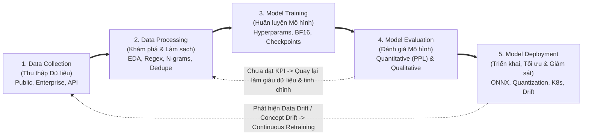
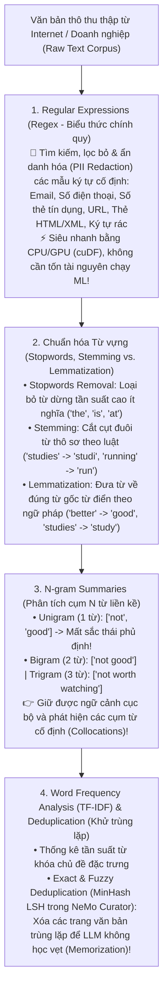
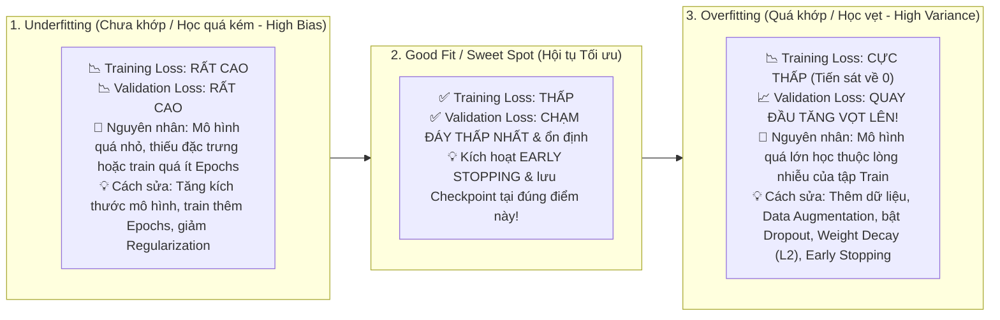
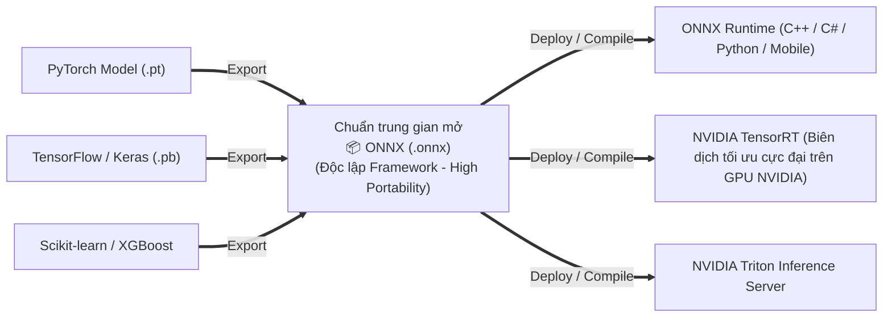
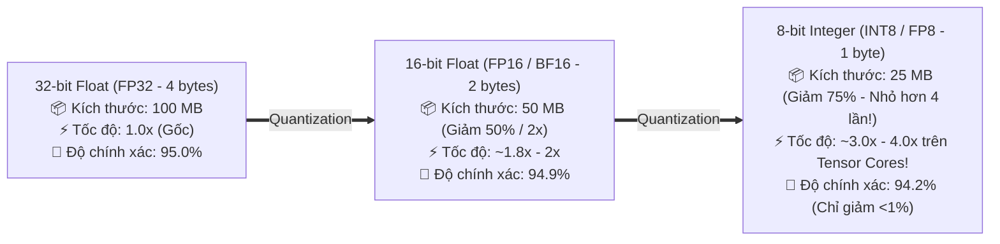

# Module 7: Model Training & Deployment Lifecycle (Vòng đời Huấn luyện & Triển khai Mô hình)

> [!IMPORTANT]
> **Trọng tâm ôn thi NCA-GENL ở Module 7 (Thuộc Domain "Software Development - 24%", "Experimentation - 22%" & "Data Analysis - 14%"):**
> Thuộc lòng **5 giai đoạn trong vòng đời dự án ML/GenAI**; phân biệt **3 nguồn dữ liệu**; hiểu vai trò sống còn của **EDA (Exploratory Data Analysis)**, xử lý dữ liệu khuyết/ngoại lai/mất cân bằng (**SMOTE, Normalization vs. Standardization**), và các công cụ tiền xử lý văn bản (**Regex, N-grams, TF-IDF, Stemming vs. Lemmatization, Deduplication**); nắm rõ các **Hyperparameters (Learning Rate + Warmup/Decay, Batch Size + Gradient Accumulation, Epochs, Early Stopping)**; phân biệt đánh giá **Định lượng (Quantitative - bao gồm Perplexity) vs. Định tính (Qualitative)**; nắm chắc bộ 3 kỹ thuật nén & tối ưu triển khai: **ONNX**, **Quantization (`FP32` $\to$ `FP16` $\to$ `INT8`/`INT4`, PTQ vs. QAT)**, **Pruning (Structured 2:4 Sparsity vs. Unstructured)**, **Batch vs. Real-time Deployment**, **Docker & Kubernetes**, và giám sát **Data Drift vs. Concept Drift** sau triển khai.

---

## 1. Năm giai đoạn trong Vòng đời Dự án ML / GenAI (End-to-End Lifecycle)

Mọi dự án AI chuẩn công nghiệp (MLOps / LLMOps) đều đi qua đường ống (Pipeline) 5 giai đoạn tuần tự và lặp lại liên tục:

---

## 2. Giai đoạn 1: Data Collection (Thu thập Dữ liệu)

Chất lượng của mô hình phụ thuộc trực tiếp vào nguyên lý bất di bất dịch: **"Garbage In, Garbage Out"** (Dữ liệu rác đầu vào $\to$ Mô hình rác đầu ra). Có **3 nguồn dữ liệu chính**:

| Nguồn dữ liệu | Ví dụ điển hình | Đặc điểm & Lưu ý cho kỳ thi |
| :--- | :--- | :--- |
| **1. Public Datasets (Dữ liệu công khai)** | Hugging Face Datasets, Kaggle, **NVIDIA NGC Catalog**, Common Crawl, The Pile, Wikipedia, ImageNet, COCO. | Miễn phí, đa dạng, sẵn có; rất tốt để học tập, pre-train nền tảng, nghiên cứu ban đầu và chấm điểm chuẩn (**Benchmarking**). Cần kiểm tra kỹ bản quyền (License) và lọc nội dung độc hại. |
| **2. Enterprise / Proprietary Data (Dữ liệu nội bộ doanh nghiệp)** | Hồ sơ khách hàng CRM, lịch sử giao dịch ngân hàng, biên bản cuộc họp, ticket hỗ trợ kỹ thuật, log cảm biến IoT. | Tạo ra **lợi thế cạnh tranh độc quyền (Competitive Moat)** cho doanh nghiệp khi dùng cho RAG hoặc Fine-tuning, nhưng đòi hỏi bảo mật, ẩn danh hóa (**PII Masking/Redaction**) và phân quyền nghiêm ngặt. |
| **3. External / API-Based & Synthetic Data (Dữ liệu bên ngoài qua API & Dữ liệu tổng hợp)** | Dữ liệu thời gian thực từ Bloomberg API, mạng xã hội, thời tiết; hoặc **Synthetic Data** do mô hình lớn (như Nemotron-4 340B) sinh ra. | API cung cấp thông tin tươi mới (Real-time data); còn Synthetic Data giúp giải quyết tình trạng khan hiếm dữ liệu gắn nhãn ở các lĩnh vực hẹp. |

* **Giải pháp Lưu trữ tương ứng theo quy mô:** Dùng **Object Storage (AWS S3 / GCS / MinIO)** cho kho dữ liệu thô khổng lồ (Data Lake); định dạng cột nén **Apache Parquet** hoặc **WebDataset** để đọc tuần tự tốc độ cao; và **NVIDIA GPUDirect Storage (GDS)** để nạp dữ liệu huấn luyện thẳng từ ổ cứng NVMe/Parallel FS vào VRAM của GPU.

---

## 3. Giai đoạn 2: Data Processing & Exploratory Data Analysis (Xử lý & Khám phá Dữ liệu)

### 3.1. Exploratory Data Analysis (EDA - Phân tích Khám phá Dữ liệu)
* **Phép ẩn dụ Y khoa (Medical Analogy):** Làm EDA trước khi huấn luyện mô hình giống hệt như **bác sĩ phải khám lâm sàng, xét nghiệm máu và chụp X-quang trước khi kê đơn hoặc phẫu thuật**. Bỏ qua EDA mà lao vào train mô hình ngay giống như mổ mà không chụp phim — tốn hàng nghìn giờ GPU vô ích!
* **4 nhiệm vụ cốt lõi trong EDA & Tiền xử lý dữ liệu dạng bảng (Tabular Preprocessing):**
  1. **Xử lý dữ liệu khuyết thiếu (Missing Values / `NaN` / `Null`) & Trùng lặp (Duplicates):**
     * Nếu tỷ lệ thiếu rất nhỏ: Xóa dòng bị thiếu (`dropna`).
     * Nếu dữ liệu quý giá: Điền giá trị thay thế (**Imputation**) bằng giá trị **Trung bình (Mean)**, **Trung vị (Median - tốt hơn khi có Outliers)**, **Giá trị phổ biến nhất (Mode)** cho biến phân loại, hoặc dùng thuật toán k-NN Imputer.
  2. **Phát hiện và xử lý Điểm ngoại lai dị biệt (Outliers):**
     * Dùng biểu đồ hộp (**Box Plot / IQR - Interquartile Range**) hoặc điểm chuẩn **Z-score ($|Z| > 3$)** để phát hiện các điểm dữ liệu sai lệch bất thường (ví dụ nhập nhầm tuổi khách hàng = `999`).
  3. **Xử lý Mất cân bằng Nhãn (Class Imbalance - Ví dụ: 99% bình thường, 1% gian lận):**
     * **Oversampling (Tăng mẫu lớp thiểu số):** Nhân bản hoặc dùng thuật toán **SMOTE (Synthetic Minority Over-sampling Technique)** để nội suy sinh thêm mẫu mới cho lớp 1%.
     * **Undersampling (Giảm mẫu lớp đa số):** Cắt bớt ngẫu nhiên mẫu của lớp 99%.
     * **Cost-Sensitive Learning (Class Weights):** Tăng trọng số phạt trong hàm Loss gấp 100 lần nếu mô hình đoán sai mẫu thuộc lớp thiểu số.
  4. **Chuẩn hóa Thang đo Đặc trưng (Feature Scaling: Normalization vs. Standardization):**
     * Khi cột *"Tuổi"* có giá trị từ `18 – 80` còn cột *"Thu nhập"* có giá trị từ `10,000,000 – 500,000,000`, thuật toán Gradient Descent và khoảng cách vector sẽ bị cột Thu nhập lấn át hoàn toàn. Ta dùng 1 trong 2 cách:
       * **Min-Max Normalization:** Ép mọi giá trị vào đoạn cố định **$[0, 1]$** theo công thức $x' = \frac{x - x_{\min}}{x_{\max} - x_{\min}}$.
       * **Standardization (Z-Score Scaling):** Đưa phân phối về **Trung bình $\mu = 0$ và Độ lệch chuẩn $\sigma = 1$** theo công thức $z = \frac{x - \mu}{\sigma}$ (Ít bị bóp méo bởi Outliers hơn Min-Max).

---

### 3.2. Các Kỹ thuật Xử lý Dữ liệu Văn bản cho NLP & LLM (Text Preprocessing Pipeline)
Trong miền *Data Analysis (14%)* của đề thi NCA-GENL, bạn sẽ gặp các câu hỏi về công cụ xử lý văn bản thô:

* **Lưu ý đặc biệt khi tiền xử lý cho LLM hiện đại vs. NLP cổ điển:**
  * Trong **NLP cổ điển (Bag-of-Words / TF-IDF + Naive Bayes/SVM)**: Ta luôn xóa Stopwords (`"the"`, `"not"`, `"is"`) và đưa về chữ thường (Lowercasing) để giảm chiều vector.
  * Trong **LLM hiện đại (Transformer)**: Ta **KHÔNG xóa Stopwords** và **KHÔNG cắt Stemming** vì cơ chế Self-Attention cần đầy đủ từng từ dừng và chữ hoa/thường để hiểu trọn vẹn cấu trúc ngữ pháp và sinh câu văn tự nhiên! Thay vào đó, bước quan trọng nhất cho LLM là **Lọc rác bằng Regex, Ẩn danh hóa PII, và Khử trùng lặp (Deduplication)** bằng công cụ như **NVIDIA NeMo Curator**.

---

## 4. Giai đoạn 3: Model Training (Huấn luyện Mô hình)

Quá trình huấn luyện bao gồm **5 bước kỹ thuật cốt lõi**:
1. **Lựa chọn kiến trúc (Model Architecture Selection):**
   * Xử lý ngôn ngữ tự nhiên / Sinh văn bản / Code $\to$ **Transformer (Decoder / Encoder / Seq2Seq)**.
   * Thị giác máy tính / Phân loại & nhận diện ảnh $\to$ **CNN (Convolutional Neural Networks: ResNet, YOLO)** hoặc **Vision Transformer (ViT)**.
   * Sinh ảnh / Video nghệ thuật từ văn bản $\to$ **Diffusion Models (Latent Diffusion / DiT)**.
   * Dữ liệu dạng bảng có cấu trúc (Tabular Data) $\to$ **Gradient Boosted Trees (XGBoost / LightGBM / CatBoost)** hoặc **Random Forest**.
2. **Chiến lược huấn luyện (Training Strategy):** Chọn giữa *Full Training from Scratch*, *Continual Pre-training*, *Full Fine-Tuning* hay *PEFT (LoRA / QLoRA)*.
3. **Cấu hình Siêu tham số (Hyperparameter Configuration - Cực kỳ hay hỏi trong đề thi!):**
   * *Phân biệt Parameters vs. Hyperparameters:*
     * **Model Parameters (Tham số mô hình):** Trọng số ($W$) và độ lệch ($b$) bên trong mạng nơ-ron — do mô hình **tự động học và cập nhật** trong lúc train.
     * **Hyperparameters (Siêu tham số):** Các nút vặn cấu hình bên ngoài do **Kỹ sư AI thiết lập trước khi bấm nút train** (Learning Rate, Batch Size, số Epochs, số tầng, bậc $r$ của LoRA, Dropout rate).

| Siêu tham số (Hyperparameter) | Ý nghĩa kỹ thuật | Chuyện gì xảy ra nếu đặt SAI? | Kỹ thuật tối ưu nâng cao |
| :--- | :--- | :--- | :--- |
| **1. Learning Rate ($\eta$ - Tốc độ học)** | Độ lớn của bước nhảy khi cập nhật trọng số ngược chiều đạo hàm: $W \leftarrow W - \eta \nabla L$. *(Siêu tham số quan trọng nhất!)* | • **Quá cao (Too High):** Nhảy vọt qua đáy cực tiểu (**Overshooting / Divergence**), hàm Loss dao động hỗn loạn hoặc nổ thành `NaN`. • **Quá thấp (Too Low):** Hội tụ cực kỳ chậm chạp (tốn tiền GPU) và dễ bị kẹt ở cực tiểu cục bộ (**Local Minimum**). | Dùng **Learning Rate Scheduler**: Tăng dần tuyến tính ở vài trăm bước đầu (**Warmup**) để ổn định đạo hàm, sau đó giảm dần theo hình cô-sin (**Cosine Annealing Decay**). |
| **2. Batch Size (Kích thước lô)** | Số lượng mẫu dữ liệu được đưa vào GPU tính toán song song trong **1 bước cập nhật trọng số (1 Iteration/Step)**. | • **Quá lớn:** Tận dụng GPU tốt, đạo hàm chuẩn nhưng **tốn rất nhiều VRAM (dễ lỗi `CUDA OOM`)** và đôi khi hội tụ vào cực tiểu nhọn kém tổng quát. • **Quá nhỏ (VD: Batch = 1):** Đạo hàm rất nhiễu (Noisy gradients) và không tận dụng hết nhân GPU. | **Gradient Accumulation (Tích lũy đạo hàm):** Nếu VRAM chỉ chứa nổi `micro_batch = 2`, ta chạy xuôi-ngược 16 lần liên tiếp cộng dồn Gradient lại rồi mới gọi `optimizer.step()` 1 lần $\to$ Giả lập được `Effective Batch Size = 32` mà không tốn thêm VRAM! |
| **3. Epochs (Số chu kỳ huấn luyện)** | Số lần mà **toàn bộ 100% tập dữ liệu huấn luyện** được đẩy qua mô hình trọn vẹn. *(Ví dụ: Tập dữ liệu có $10.000$ mẫu, `Batch Size = 100` $\to$ $1\text{ Epoch} = 100\text{ Iterations/Steps}$).* | • **Quá ít Epochs:** Mô hình chưa kịp học hết quy luật $\to$ **Underfitting**. • **Quá nhiều Epochs:** Mô hình học thuộc lòng cả nhiễu của tập Train $\to$ **Overfitting**. | **Early Stopping (Dừng sớm):** Theo dõi `Validation Loss` sau mỗi Epoch; nếu thấy Validation Loss không giảm nữa (hoặc bắt đầu tăng lên) trong $k$ epochs liên tiếp (`patience`), tự động dừng train ngay và lấy Checkpoint tốt nhất! |

4. **Thực thi huấn luyện (Training Execution):** Chạy trên **PyTorch / NVIDIA NeMo Megatron**, bật **Mixed Precision (`BF16` / `FP16` / `FP8`)**, áp dụng **Gradient Clipping** (cắt ngưỡng độ dài vector đạo hàm để chống nổ đạo hàm *Exploding Gradients*), và lưu **Checkpoints** định kỳ ra Parallel File System để nếu cụm 1.000 GPU có 1 máy bị lỗi phần cứng thì chỉ cần khôi phục từ Checkpoint gần nhất thay vì mất trắng nhiều tuần chạy.
5. **Giám sát Đường cong Huấn luyện (Monitoring Loss Curves) – Chẩn đoán Underfitting vs. Overfitting:**

---

## 5. Giai đoạn 4: Model Evaluation (Đánh giá Mô hình: Định lượng vs. Định tính)

| Phương pháp đánh giá | Bản chất & Công cụ | Ví dụ chỉ số cụ thể |
| :--- | :--- | :--- |
| **1. Đánh giá Định lượng (Quantitative Evaluation)** | Đo lường tự động, khách quan và có thể lặp lại bằng các **công thức toán học và con số thống kê** trên tập dữ liệu kiểm thử (Test Set / Benchmarks). | • Phân loại: **Accuracy, Precision, Recall, F1-Score, ROC-AUC**. • Dịch thuật: **BLEU** \| Tóm tắt: **ROUGE** \| RAG: **Cosine Similarity**. • Độ tự tin nội tại của LLM: **Perplexity (PPL)**. • Hệ thống: **Latency (TTFT, TPOT), Throughput (tokens/s)**. |
| **2. Đánh giá Định tính (Qualitative Evaluation)** | **Chuyên gia con người (Human-in-the-loop / Domain Experts)** hoặc khảo sát người dùng trực tiếp đọc, trải nghiệm và thẩm định chất lượng đầu ra theo ngữ cảnh. | Kiểm tra giọng văn có tự nhiên, lịch sự không; tính mạch lạc logic; phát hiện các ca **Ảo giác (Hallucination)** tinh vi; kiểm tra độ an toàn đạo đức, sắc thái văn hóa và cảm nhận thực tế (**Vibe check / Red Teaming**). |

### Làm rõ chỉ số Perplexity (PPL) cho LLM (Câu hỏi tủ trong đề thi!):
* **Perplexity là gì?** Là lũy thừa tự nhiên của hàm mất mát Cross-Entropy trên tập kiểm thử:
  $$\text{Perplexity (PPL)} = \exp\left(-\frac{1}{N}\sum_{i=1}^N \log P(w_i \mid w_{<i})\right) = e^{\text{Cross-Entropy Loss}}$$
* **Ý nghĩa trực quan:** Đo lường **mức độ "bối rối / ngạc nhiên / phân vân"** (Branching factor) của mô hình ngôn ngữ khi dự đoán token tiếp theo.
* **Trực giác cho Developer:** Nếu Mô hình A có $\text{Perplexity} = 8.5$ và Mô hình B có $\text{Perplexity} = 42.0$, điều đó có nghĩa là ở mỗi bước chọn từ tiếp theo, Mô hình A chỉ phân vân giữa ~8 từ hợp lý, trong khi Mô hình B đang hoang mang giữa 42 từ!
* **Quy tắc vàng cần nhớ:** **Perplexity CÀNG THẤP (Lower is Better) $\to$ Cross-Entropy Loss càng thấp $\to$ Mô hình dự đoán ngôn ngữ CÀNG CHÍNH XÁC VÀ TỰ TIN!**

---

## 6. Giai đoạn 5: Model Deployment, Optimization (ONNX, Quantization, Pruning) & Drift Monitoring

Sau khi huấn luyện xong, mô hình thường rất nặng nề. Để đưa lên Production phục vụ hàng triệu người dùng với chi phí thấp nhất, kỹ sư áp dụng các kỹ thuật chuẩn hóa và nén mô hình:

### 6.1. Chuẩn hóa mô hình đa nền tảng với ONNX (Open Neural Network Exchange)
* **ONNX** là **định dạng chuẩn mở trung gian (Open Standard Format)** biểu diễn đồ thị tính toán mạng nơ-ron (Computation Graph + Weights) hoàn toàn **độc lập với framework**.
* **Giá trị cốt lõi (Interoperability & Portability):** Đội ngũ Data Science có thể thoải mái nghiên cứu và huấn luyện mô hình bằng **PyTorch, TensorFlow hoặc Scikit-learn**, sau đó xuất (Export) ra một file `.onnx` duy nhất để đội ngũ Engineering triển khai trên **ONNX Runtime (C++, C#, Java, JavaScript)** hoặc nạp thẳng vào **NVIDIA TensorRT / Triton Inference Server** mà không cần cài đặt bộ thư viện Python huấn luyện nặng nề.

---

### 6.2. Bộ Ba Kỹ thuật Nén và Tăng tốc Mô hình: Quantization, Pruning & Distillation

#### A. Kỹ thuật Quantization (Lượng tử hóa - Giảm độ chính xác bit số học)
* **Quantization** nén mô hình bằng cách **giảm số lượng bit biểu diễn (bit-width)** của mỗi trọng số (Weights) và giá trị kích hoạt (Activations) từ số thực 32-bit (**`FP32`**) xuống **16-bit (`FP16` / `BF16`)**, **8-bit (`INT8` / `FP8`)** hoặc **4-bit (`INT4` - AWQ / GPTQ)**.

* **Phân biệt 2 phương pháp thực hiện Quantization (Hay hỏi thi):**
  1. **PTQ (Post-Training Quantization - Lượng tử hóa sau huấn luyện):** Mô hình đã huấn luyện xong xuôi ở FP32/BF16 được đem nén thẳng xuống `INT8`/`FP8`/`INT4` (chỉ cần chạy qua một tập dữ liệu nhỏ khoảng vài trăm mẫu gọi là **Calibration Dataset** để đo dải giá trị cực đại/cực tiểu mà **không cần huấn luyện lại**). *Ưu điểm:* Cực nhanh, tiết kiệm tài nguyên (Hỗ trợ mạnh mẽ trong **NVIDIA TensorRT / TensorRT-LLM Model Optimizer**).
  2. **QAT (Quantization-Aware Training - Huấn luyện nhận thức lượng tử hóa):** Chèn các nút giả lập sai số làm tròn (Fake quantization nodes) ngay trong quá trình Fine-tuning để mô hình tự điều chỉnh trọng số thích nghi với chuẩn 8-bit/4-bit. *Ưu điểm:* Bảo toàn độ chính xác cao hơn PTQ ở các mức bit cực thấp, nhưng tốn chi phí GPU để train thêm.

#### B. Kỹ thuật Model Pruning (Cắt tỉa mạng nơ-ron)
* Giống như cắt tỉa những cành cây khô không ra quả: **Pruning** loại bỏ các trọng số gần bằng $0$, các nơ-ron, các kênh (channels), các đầu chú ý (Attention Heads) hoặc thậm chí toàn bộ các tầng dư thừa ít đóng góp vào kết quả dự đoán:
  * **Unstructured Pruning (Cắt tỉa phi cấu trúc):** Cho các trọng số nhỏ lẻ rải rác trong ma trận bằng $0$. Tuy giảm được dung lượng khi nén file nhưng GPU khó tăng tốc vì ma trận bị thủng lỗ chỗ không đều.
  * **Structured Pruning & NVIDIA 2:4 Structured Sparsity (Cắt tỉa có cấu trúc):** Cắt bỏ nguyên cả hàng/cột/kênh hoặc áp dụng chuẩn **2:4 Sparsity của NVIDIA** (trong mỗi nhóm 4 trọng số liên tiếp, giữ lại 2 số lớn nhất và cho 2 số nhỏ nhất bằng $0$) $\to$ Phần cứng **Sparse Tensor Cores** trên GPU Ampere/Hopper/Blackwell tự động bỏ qua các số $0$ và **tăng gấp đôi (2x) tốc độ nhân ma trận**!
  * *(Trong hệ sinh thái NVIDIA hiện đại như mô hình **Llama-3.1-Nemotron-Nano/Ultra**, các kỹ sư kết hợp **Structured Pruning + Knowledge Distillation** thông qua phương pháp **Minitron** để tạo ra các mô hình vừa nhỏ gọn vừa cực kỳ thông minh!).*

---

### 6.3. Phương thức Triển khai (Batch vs. Real-time) & Giám sát Sự trôi dạt (Drift Monitoring)
* **Hai mô hình triển khai chính:**
  1. **Batch Deployment / Offline Inference (Xử lý theo lô định kỳ):** Gom hàng triệu bản ghi chạy offline theo lịch cố định (ví dụ 2h sáng hàng ngày chạy dự báo doanh số tồn kho, gửi email gợi ý sản phẩm hàng tuần). *Mục tiêu tối ưu:* **Throughput (Thông lượng) và hiệu quả chi phí cao nhất**, không đòi hỏi độ trễ thấp tức thì.
  2. **Real-time / Online Deployment (Suy luận thời gian thực):** Phục vụ trực tiếp từng yêu cầu của người dùng qua **REST API / gRPC / WebSockets** với độ trễ mili-giây (ví dụ: Chatbot CSKH, tự động hoàn thành code IDE, phát hiện gian lận khi quẹt thẻ). Thường đóng gói trong **Docker Containers**, chạy trên **NVIDIA Triton / NIM** và điều phối co giãn tự động (Horizontal Pod Autoscaler) bằng **Kubernetes (K8s)**.
* **Giám sát sau triển khai (Post-Deployment Monitoring) – Phân biệt Data Drift vs. Concept Drift:**
  Mô hình AI không giống như phần mềm truyền thống viết xong là chạy mãi mãi; theo thời gian, thế giới thực thay đổi làm chất lượng mô hình suy thoái (**Model Decay / Degradation**):

| Loại Trôi dạt (Drift) | Bản chất Toán học | Ví dụ Thực tế Dễ nhớ | Cách khắc phục |
| :--- | :--- | :--- | :--- |
| **1. Data Drift (Covariate Shift / Feature Drift)** | Phân phối của **dữ liệu đầu vào $P(X)$ thay đổi** so với tập dữ liệu lúc huấn luyện, nhưng quy luật bản chất $P(Y \mid X)$ vẫn giữ nguyên. | • Người dùng mạng xã hội bắt đầu dùng nhiều **từ lóng, viết tắt mới** mà lúc train mô hình chưa từng gặp. • Camera nhà máy bị mờ bụi hoặc thay đổi góc chiếu sáng khác với ảnh lúc train. | Thu thập dữ liệu đầu vào mới gần đây, gắn nhãn bổ sung và **huấn luyện lại (Retrain / Fine-tune)** hoặc cập nhật kho RAG. |
| **2. Concept Drift (Sự trôi dạt khái niệm)** | Dữ liệu đầu vào $X$ trông vẫn như cũ, nhưng **bản chất mối quan hệ giữa đầu vào và đầu ra $P(Y \mid X)$ đã thay đổi hoàn toàn**! | • Cùng một mức thu nhập và lịch sử mua sắm đó, nhưng khi xảy ra **đại dịch COVID-19 hoặc khủng hoảng lạm phát**, hành vi tiêu dùng và tỷ lệ vỡ nợ của khách hàng đảo chiều hoàn toàn. • Kẻ lừa đảo đổi sang phương thức rửa tiền mới. | Phải **xây dựng lại tập nhãn mới phản ánh quy luật mới của thời cuộc**, điều chỉnh đặc trưng và huấn luyện lại mô hình (**Continuous Learning**). |

---

## 7. Bẫy đề thi NCA-GENL & Câu hỏi Thực chiến (Exam Traps & Mini Quiz)

> [!WARNING]
> **Các bẫy kinh điển trong đề thi Module 7:**
> 1. **Bẫy Perplexity:** Điểm Perplexity của Mô hình A là `12.5` và của Mô hình B là `45.0`. Mô hình nào tốt hơn? $\to$ **Mô hình A tốt hơn** (Perplexity càng thấp = mô hình càng ít bối rối và dự đoán từ tiếp theo càng chính xác!).
> 2. **Bẫy Overfitting vs. Underfitting:** Training Loss rất thấp nhưng Validation Loss tăng cao $\to$ **Overfitting** (Sửa bằng: *Dropout, Early Stopping, Data Augmentation, L2 Weight Decay*). Cả hai Loss đều cao $\to$ **Underfitting** (Sửa bằng: *Mô hình lớn hơn, train thêm Epochs*).
> 3. **Bẫy Quantization:** Giảm từ `FP32` (32-bit) xuống `INT8` (8-bit) giúp giảm kích thước bộ nhớ mô hình đi bao nhiêu lần? $\to$ **Giảm 4 lần ($32 / 8 = 4$)** (từ 100MB xuống 25MB) và tăng tốc khoảng $3\times$.
> 4. **Bẫy Data Drift vs. Concept Drift:** Đầu vào thay đổi (từ lóng mới, nhóm tuổi khách hàng mới) $\to$ **Data Drift**. Ý nghĩa/hành vi thực tế thay đổi theo thời cuộc dù đầu vào giống hệt cũ $\to$ **Concept Drift**.

### Câu hỏi tự kiểm tra (Mini Quiz):
1. **Câu 1:** Sau khi triển khai mô hình phân loại bình luận mạng xã hội lên Production được 6 tháng, kỹ sư nhận thấy độ chính xác suy giảm do người dùng bắt đầu sử dụng nhiều từ viết tắt và trào lưu ngôn ngữ mới chưa từng có trong tập dữ liệu huấn luyện ban đầu. Hiện tượng này được gọi là gì?
   * *Đáp án:* **Data Drift (Sự trôi dạt dữ liệu đầu vào / Covariate Shift)**.
2. **Câu 2:** Để lọc bỏ nhanh các chuỗi có định dạng cố định như địa chỉ Email, số thẻ tín dụng, số điện thoại và đường dẫn URL khỏi tập dữ liệu văn bản thô trước khi đưa vào huấn luyện LLM, công cụ nào hiệu quả và tiết kiệm tài nguyên nhất?
   * *Đáp án:* **Regular Expressions (Regex - Biểu thức chính quy)**.
3. **Câu 3:** Khi phân tích văn bản bằng phương pháp thống kê truyền thống, tại sao việc sử dụng **Bigrams (2-grams)** hoặc **Trigrams (3-grams)** lại giúp mô hình phân tích cảm xúc chính xác hơn so với chỉ dùng **Unigrams (từng từ đơn lẻ)**?
   * *Đáp án:* Vì N-grams ($N \ge 2$) giữ lại được **ngữ cảnh kết hợp từ liền kề (đặc biệt là các cụm từ phủ định như `"not good"`, `"not worth watching"`)**, trong khi Unigram tách rời chữ `"not"` và `"good"` làm mất đi ý nghĩa chê bai.
4. **Câu 4:** Trong quá trình huấn luyện mô hình Deep Learning, kỹ sư thiết lập `Learning Rate` ở mức quá cao (ví dụ `1.0`). Hiện tượng gì sẽ xảy ra với hàm mất mát (Loss Function)?
   * *Đáp án:* Trọng số mô hình sẽ nhảy vọt qua điểm cực tiểu (**Overshooting**), khiến hàm Loss **dao động mạnh hỗn loạn, không thể hội tụ hoặc phát nổ (Divergence / `NaN`)**.
5. **Câu 5:** Một nhóm kỹ sư huấn luyện mô hình bằng PyTorch nhưng đội ngũ vận hành lại yêu cầu triển khai mô hình đó trên môi trường C++ đa nền tảng mà không phụ thuộc vào Python. Họ nên xuất mô hình sang định dạng chuẩn mở nào?
   * *Đáp án:* **ONNX (Open Neural Network Exchange)**.
6. **Câu 6:** Khi so sánh hai mô hình ngôn ngữ lớn trên cùng một tập dữ liệu kiểm thử văn bản, `Model X` đạt chỉ số **Perplexity = 9.2**, trong khi `Model Y` đạt **Perplexity = 28.7**. Mô hình nào có khả năng dự đoán từ tiếp theo tốt hơn và tại sao?
   * *Đáp án:* **`Model X` tốt hơn** vì Perplexity đo lường mức độ bối rối/không chắc chắn của mô hình ($e^{\text{Loss}}$) — **Perplexity càng thấp chứng tỏ mô hình càng tự tin và dự đoán chính xác chuỗi ngôn ngữ hơn**.
