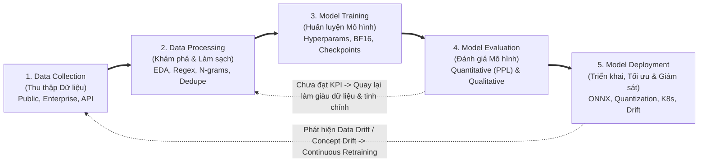
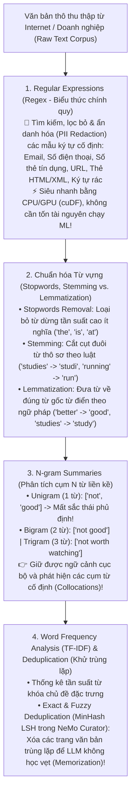
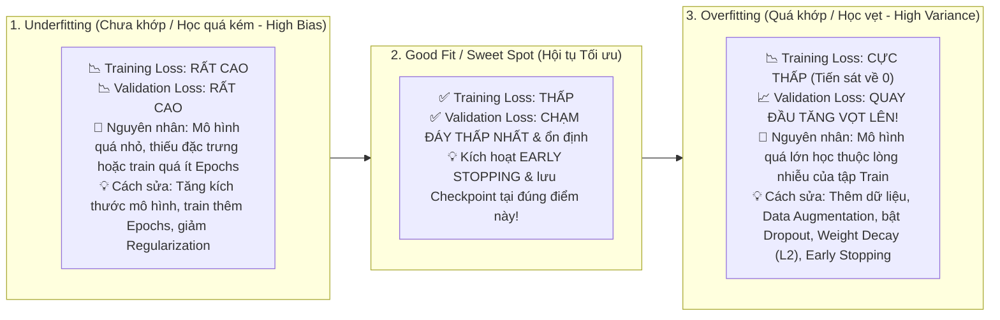
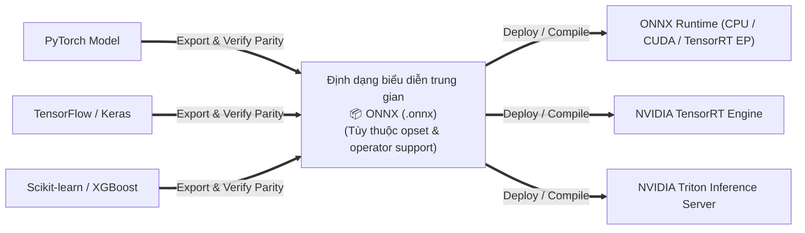
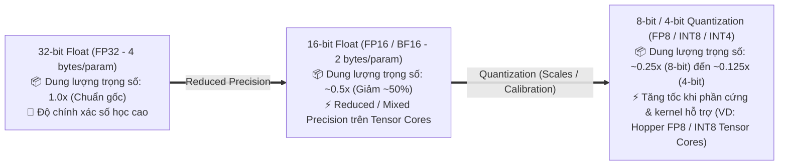

# Module 7: Model Training & Deployment Lifecycle (Vòng đời Huấn luyện & Triển khai Mô hình)

> [!IMPORTANT]
> **Trọng tâm ôn tập NCA-GENL ở Module 7 (Thuộc Domain "Software Development - 24%", "Experimentation - 22%" & "Data Analysis - 14%"):**
> Nắm vững **5 giai đoạn trong vòng đời dự án ML/GenAI**; phân biệt **3 nguồn dữ liệu**; hiểu vai trò của **EDA (Exploratory Data Analysis)**, xử lý dữ liệu khuyết/ngoại lai/mất cân bằng (**SMOTE, Normalization vs. Standardization** và phòng chống **Data Leakage**), cùng các công cụ tiền xử lý văn bản (**Regex, N-grams, TF-IDF, Stemming vs. Lemmatization, Deduplication**); nắm rõ các **Hyperparameters (Learning Rate + Warmup/Decay, Batch Size + Gradient Accumulation, Epochs, Early Stopping)**; phân biệt đánh giá **Định lượng (Quantitative - bao gồm Perplexity) vs. Định tính (Qualitative)**; nắm chắc bộ 3 kỹ thuật nén & tối ưu triển khai: **ONNX**, **Reduced Precision & Quantization (`FP16`/`BF16`, `FP8`, `INT8`/`INT4`, PTQ vs. QAT)**, **Pruning (Structured 2:4 Sparsity vs. Unstructured)**, **Batch vs. Real-time Deployment**, **Docker & Kubernetes**, và giám sát **Data Drift vs. Concept Drift** sau triển khai.

---

## 1. Năm giai đoạn trong Vòng đời Dự án ML / GenAI (End-to-End Lifecycle)

Mọi dự án AI chuẩn công nghiệp (MLOps / LLMOps) đều đi qua đường ống (Pipeline) 5 giai đoạn tuần tự và lặp lại liên tục:

---

## 2. Giai đoạn 1: Data Collection (Thu thập Dữ liệu)

Chất lượng của mô hình phụ thuộc trực tiếp vào nguyên lý bất di bất dịch: **"Garbage In, Garbage Out"** (Dữ liệu rác đầu vào $\to$ Mô hình rác đầu ra). Có **3 nguồn dữ liệu chính**:

| Nguồn dữ liệu | Ví dụ điển hình | Đặc điểm & Lưu ý cho kỳ thi |
| :--- | :--- | :--- |
| **1. Public Datasets (Dữ liệu công khai)** | Hugging Face Datasets, Kaggle, **NVIDIA NGC Catalog**, Common Crawl, The Pile, Wikipedia, ImageNet, COCO. | Miễn phí, đa dạng, sẵn có; rất tốt để học tập, pre-train nền tảng, nghiên cứu ban đầu và chấm điểm chuẩn (**Benchmarking**). Cần kiểm tra kỹ bản quyền (License) và lọc nội dung độc hại. |
| **2. Enterprise / Proprietary Data (Dữ liệu nội bộ doanh nghiệp)** | Hồ sơ khách hàng CRM, lịch sử giao dịch ngân hàng, biên bản cuộc họp, ticket hỗ trợ kỹ thuật, log cảm biến IoT. | Tạo ra **lợi thế cạnh tranh độc quyền (Competitive Moat)** cho doanh nghiệp khi dùng cho RAG hoặc Fine-tuning, nhưng đòi hỏi bảo mật, ẩn danh hóa (**PII Masking/Redaction**) và phân quyền nghiêm ngặt. |
| **3. External / API-Based & Synthetic Data (Dữ liệu bên ngoài qua API & Dữ liệu tổng hợp)** | Dữ liệu thời gian thực từ Bloomberg API, mạng xã hội, thời tiết; hoặc **Synthetic Data** do mô hình lớn (như Nemotron-4 340B) sinh ra. | API cung cấp thông tin tươi mới (Real-time data); còn Synthetic Data giúp giải quyết tình trạng khan hiếm dữ liệu gắn nhãn ở các lĩnh vực hẹp. |

* **Giải pháp Lưu trữ tương ứng theo quy mô:** Dùng **Object Storage (AWS S3 / GCS / MinIO)** cho kho dữ liệu thô khổng lồ (Data Lake); định dạng cột nén **Apache Parquet** hoặc **WebDataset** để đọc tuần tự tốc độ cao; và **NVIDIA GPUDirect Storage (GDS)** để nạp dữ liệu huấn luyện thẳng từ ổ cứng NVMe/Parallel FS vào VRAM của GPU.

---

## 3. Giai đoạn 2: Data Processing & Exploratory Data Analysis (Xử lý & Khám phá Dữ liệu)

### 3.1. Exploratory Data Analysis (EDA - Phân tích Khám phá Dữ liệu)
* **Phép ẩn dụ Y khoa (Medical Analogy):** Làm EDA trước khi huấn luyện mô hình giống hệt như **bác sĩ phải khám lâm sàng, xét nghiệm máu và chụp X-quang trước khi kê đơn hoặc phẫu thuật**. Bỏ qua EDA mà lao vào train mô hình ngay giống như mổ mà không chụp phim — tốn hàng nghìn giờ GPU vô ích!
* **4 nhiệm vụ cốt lõi trong EDA & Tiền xử lý dữ liệu dạng bảng (Tabular Preprocessing):**
  1. **Xử lý dữ liệu khuyết thiếu (Missing Values / `NaN` / `Null`) & Trùng lặp (Duplicates):**
     * Nếu tỷ lệ thiếu rất nhỏ: Xóa dòng bị thiếu (`dropna`).
     * Nếu dữ liệu quý giá: Điền giá trị thay thế (**Imputation**) bằng giá trị **Trung bình (Mean)**, **Trung vị (Median - tốt hơn khi có Outliers)**, **Giá trị phổ biến nhất (Mode)** cho biến phân loại, hoặc dùng thuật toán k-NN Imputer.
  2. **Phát hiện và xử lý Điểm ngoại lai dị biệt (Outliers):**
     * Dùng biểu đồ hộp (**Box Plot / IQR - Interquartile Range**) hoặc điểm chuẩn **Z-score ($|Z| > 3$)** để phát hiện các điểm dữ liệu sai lệch bất thường (ví dụ nhập nhầm tuổi khách hàng = `999`).
  3. **Xử lý Mất cân bằng Nhãn (Class Imbalance - Ví dụ: 99% bình thường, 1% gian lận):**
     * **Oversampling (Tăng mẫu lớp thiểu số):** Nhân bản hoặc dùng thuật toán **SMOTE (Synthetic Minority Over-sampling Technique)** để nội suy sinh thêm mẫu cho lớp thiểu số. *(Lưu ý chống Data Leakage: SMOTE chỉ được áp dụng **bên trong tập huấn luyện / training fold** sau khi đã chia tách Train/Validation/Test, tuyệt đối không chạy SMOTE trên toàn bộ dataset trước khi split!).*
     * **Undersampling (Giảm mẫu lớp đa số):** Giảm bớt mẫu của lớp chiếm đa số.
     * **Cost-Sensitive Learning (Class Weights):** Tăng trọng số phạt trong hàm Loss nếu mô hình đoán sai mẫu thuộc lớp thiểu số.
  4. **Chuẩn hóa Thang đo Đặc trưng (Feature Scaling: Normalization vs. Standardization):**
     * Khi cột *"Tuổi"* có giá trị từ `18 – 80` còn cột *"Thu nhập"* có giá trị từ `10,000,000 – 500,000,000`, thuật toán Gradient Descent và các thuật toán dựa trên khoảng cách (k-NN, SVM, K-Means, PCA) sẽ bị cột Thu nhập chi phối. Ta dùng 1 trong 2 cách (và lưu ý chỉ **`fit` tham số $x_{\min}, x_{\max}, \mu, \sigma$ trên tập Train**, sau đó dùng tham số đó để `transform` tập Validation/Test — tham khảo [scikit-learn Common Pitfalls](https://scikit-learn.org/stable/common_pitfalls.html)):
       * **Min-Max Normalization:** Đưa giá trị trên tập train về đoạn **$[0, 1]$** theo công thức $x' = \frac{x - x_{\min}}{x_{\max} - x_{\min}}$.
       * **Standardization (Z-Score Scaling):** Đưa phân phối về **Trung bình $\mu = 0$ và Độ lệch chuẩn $\sigma = 1$** theo công thức $z = \frac{x - \mu}{\sigma}$ (Ít bị ảnh hưởng bởi Outliers hơn Min-Max).

---

### 3.2. Các Kỹ thuật Xử lý Dữ liệu Văn bản cho NLP & LLM (Text Preprocessing Pipeline)
Trong miền *Data Analysis (14%)* của đề thi NCA-GENL, bạn sẽ gặp các câu hỏi về công cụ xử lý văn bản thô:

* **Lưu ý đặc biệt khi tiền xử lý cho LLM hiện đại vs. NLP cổ điển:**
  * Trong **NLP cổ điển (Bag-of-Words / TF-IDF + Naive Bayes/SVM)**: Ta luôn xóa Stopwords (`"the"`, `"not"`, `"is"`) và đưa về chữ thường (Lowercasing) để giảm chiều vector.
  * Trong **LLM hiện đại (Transformer)**: Ta **KHÔNG xóa Stopwords** và **KHÔNG cắt Stemming** vì cơ chế Self-Attention cần đầy đủ từng từ dừng và chữ hoa/thường để hiểu trọn vẹn cấu trúc ngữ pháp và sinh câu văn tự nhiên! Thay vào đó, bước quan trọng nhất cho LLM là **Lọc rác bằng Regex, Ẩn danh hóa PII, và Khử trùng lặp (Deduplication)** bằng công cụ như **NVIDIA NeMo Curator**.

---

## 4. Giai đoạn 3: Model Training (Huấn luyện Mô hình)

Quá trình huấn luyện bao gồm **5 bước kỹ thuật cốt lõi**:
1. **Lựa chọn kiến trúc (Model Architecture Selection):**
   * Xử lý ngôn ngữ tự nhiên / Sinh văn bản / Code $\to$ **Transformer (Decoder / Encoder / Seq2Seq)**.
   * Thị giác máy tính / Phân loại & nhận diện ảnh $\to$ **CNN (Convolutional Neural Networks: ResNet, YOLO)** hoặc **Vision Transformer (ViT)**.
   * Sinh ảnh / Video nghệ thuật từ văn bản $\to$ **Diffusion Models (Latent Diffusion / DiT)**.
   * Dữ liệu dạng bảng có cấu trúc (Tabular Data) $\to$ **Gradient Boosted Trees (XGBoost / LightGBM / CatBoost)** hoặc **Random Forest**.
2. **Chiến lược huấn luyện (Training Strategy):** Chọn giữa *Full Training from Scratch*, *Continual Pre-training*, *Full Fine-Tuning* hay *PEFT (LoRA / QLoRA)*.
3. **Cấu hình Siêu tham số (Hyperparameter Configuration - Cực kỳ hay hỏi trong đề thi!):**
   * *Phân biệt Parameters vs. Hyperparameters:*
     * **Model Parameters (Tham số mô hình):** Trọng số ($W$) và độ lệch ($b$) bên trong mạng nơ-ron — do mô hình **tự động học và cập nhật** trong lúc train.
     * **Hyperparameters (Siêu tham số):** Các nút vặn cấu hình bên ngoài do **Kỹ sư AI thiết lập trước khi bấm nút train** (Learning Rate, Batch Size, số Epochs, số tầng, bậc $r$ của LoRA, Dropout rate).

| Siêu tham số (Hyperparameter) | Ý nghĩa kỹ thuật | Chuyện gì xảy ra nếu đặt SAI? | Kỹ thuật tối ưu nâng cao |
| :--- | :--- | :--- | :--- |
| **1. Learning Rate ($\eta$ - Tốc độ học)** | Độ lớn của bước nhảy khi cập nhật trọng số ngược chiều đạo hàm: $W \leftarrow W - \eta \nabla L$. *(Siêu tham số quan trọng nhất!)* | • **Quá cao (Too High):** Nhảy vọt qua đáy cực tiểu (**Overshooting / Divergence**), hàm Loss dao động hỗn loạn hoặc nổ thành `NaN`. • **Quá thấp (Too Low):** Hội tụ cực kỳ chậm chạp (tốn tiền GPU) và dễ bị kẹt ở cực tiểu cục bộ (**Local Minimum**). | Dùng **Learning Rate Scheduler**: Tăng dần tuyến tính ở vài trăm bước đầu (**Warmup**) để ổn định đạo hàm, sau đó giảm dần theo hình cô-sin (**Cosine Annealing Decay**). |
| **2. Batch Size (Kích thước lô)** | Số lượng mẫu dữ liệu được đưa vào GPU tính toán song song trong **1 bước cập nhật trọng số (1 Iteration/Step)**. | • **Quá lớn:** Tận dụng GPU tốt, đạo hàm chuẩn nhưng **tốn rất nhiều VRAM (dễ lỗi `CUDA OOM`)** và đôi khi hội tụ vào cực tiểu nhọn kém tổng quát. • **Quá nhỏ (VD: Batch = 1):** Đạo hàm rất nhiễu (Noisy gradients) và không tận dụng hết nhân GPU. | **Gradient Accumulation (Tích lũy đạo hàm):** Nếu VRAM chỉ chứa nổi `micro_batch = 2`, ta chạy xuôi-ngược 16 lần liên tiếp cộng dồn Gradient lại rồi mới gọi `optimizer.step()` 1 lần $\to$ Giả lập được `Effective Batch Size = 32` mà không tốn thêm VRAM! |
| **3. Epochs (Số chu kỳ huấn luyện)** | Số lần mà **toàn bộ 100% tập dữ liệu huấn luyện** được đẩy qua mô hình trọn vẹn. *(Ví dụ: Tập dữ liệu có $10.000$ mẫu, `Batch Size = 100` $\to$ $1\text{ Epoch} = 100\text{ Iterations/Steps}$).* | • **Quá ít Epochs:** Mô hình chưa kịp học hết quy luật $\to$ **Underfitting**. • **Quá nhiều Epochs:** Mô hình học thuộc lòng cả nhiễu của tập Train $\to$ **Overfitting**. | **Early Stopping (Dừng sớm):** Theo dõi `Validation Loss` sau mỗi Epoch; nếu thấy Validation Loss không giảm nữa (hoặc bắt đầu tăng lên) trong $k$ epochs liên tiếp (`patience`), tự động dừng train ngay và lấy Checkpoint tốt nhất! |

4. **Thực thi huấn luyện (Training Execution):** Chạy trên **PyTorch / NVIDIA NeMo Megatron**, bật **Mixed Precision (`BF16` / `FP16` / `FP8`)**, áp dụng **Gradient Clipping** (cắt ngưỡng độ dài vector đạo hàm để chống nổ đạo hàm *Exploding Gradients*), và lưu **Checkpoints** định kỳ ra Parallel File System để nếu cụm 1.000 GPU có 1 máy bị lỗi phần cứng thì chỉ cần khôi phục từ Checkpoint gần nhất thay vì mất trắng nhiều tuần chạy.
5. **Giám sát Đường cong Huấn luyện (Monitoring Loss Curves) – Chẩn đoán Underfitting vs. Overfitting:**

---

## 5. Giai đoạn 4: Model Evaluation (Đánh giá Mô hình: Định lượng vs. Định tính)

| Phương pháp đánh giá | Bản chất & Công cụ | Ví dụ chỉ số cụ thể |
| :--- | :--- | :--- |
| **1. Đánh giá Định lượng (Quantitative Evaluation)** | Đo lường tự động, khách quan và có thể lặp lại bằng các **công thức toán học và con số thống kê** trên tập dữ liệu kiểm thử (Test Set / Benchmarks). | • Phân loại: **Accuracy, Precision, Recall, F1-Score, PR-AUC, ROC-AUC**. • Dịch thuật: **BLEU** \| Tóm tắt: **ROUGE**. • RAG: Phân tách **Retrieval** (`Recall@k`, `MRR`, `nDCG`), **Grounding/Faithfulness**, và **Answer Correctness/Relevance** (lưu ý `Cosine Similarity` chỉ đo độ gần giữa các vector nhúng, không đánh giá trực tiếp độ chính xác câu trả lời cuối cùng). • Mô hình ngôn ngữ nội tại: **Perplexity (PPL)**. • Hệ thống: **Latency (TTFT, TPOT), Throughput (tokens/s), Cost**. |
| **2. Đánh giá Định tính (Qualitative Evaluation)** | **Chuyên gia con người (Human-in-the-loop / Domain Experts)** hoặc khảo sát người dùng trực tiếp đọc, trải nghiệm và thẩm định chất lượng đầu ra theo ngữ cảnh. | Kiểm tra giọng văn có tự nhiên, lịch sự không; tính mạch lạc logic; phát hiện các ca **Ảo giác (Hallucination)** tinh vi; kiểm tra độ an toàn đạo đức, sắc thái văn hóa và cảm nhận thực tế (**Human Evaluation / Red Teaming**). |

### Làm rõ chỉ số Perplexity (PPL) cho LLM (Khái niệm đáng ôn theo Blueprint):
* **Perplexity là gì?** Là lũy thừa tự nhiên của hàm mất mát Cross-Entropy trung bình trên tập kiểm thử:
  $$\text{Perplexity (PPL)} = \exp\left(-\frac{1}{N}\sum_{i=1}^N \log P(w_i \mid w_{<i})\right) = e^{\text{Cross-Entropy Loss}}$$
* **Ý nghĩa trực quan:** Đo lường **mức độ "bối rối / không chắc chắn"** (Branching factor) của mô hình ngôn ngữ khi dự đoán token tiếp theo trên một bộ dữ liệu và bộ tokenizer xác định.
* **Trực giác cho Developer:** Khi so sánh trên cùng một bộ tokenizer và tập test, nếu Mô hình A có $\text{Perplexity} = 8.5$ và Mô hình B có $\text{Perplexity} = 42.0$, điều đó có nghĩa là ở mỗi bước chọn từ tiếp theo, Mô hình A chỉ phân vân tương đương ~8 lựa chọn đều nhau, trong khi Mô hình B phân vân giữa ~42 lựa chọn.
* **Quy tắc cần nhớ:** **Perplexity CÀNG THẤP (Lower is Better) $\to$ Cross-Entropy Loss càng thấp $\to$ Mô hình dự đoán phân phối ngôn ngữ trên tập test đó càng tốt.**

---

## 6. Giai đoạn 5: Model Deployment, Optimization (ONNX, Quantization, Pruning) & Drift Monitoring

Sau khi huấn luyện xong, mô hình thường tốn nhiều tài nguyên. Để đưa lên Production phục vụ người dùng hiệu quả, kỹ sư thường áp dụng các kỹ thuật chuẩn hóa và tối ưu hóa mô hình:

### 6.1. Chuẩn hóa biểu diễn mô hình với ONNX (Open Neural Network Exchange)
* **ONNX** là **định dạng biểu diễn mô hình chuẩn mở (Open Standard Format)** giúp hỗ trợ khả năng tương tác (**Interoperability & Portability**) giữa các công cụ và runtime khác nhau (Tham khảo: [ONNX Specification](https://onnx.ai/) & [ONNX Runtime Docs](https://onnxruntime.ai/docs/)).
* **Giá trị cốt lõi & Lưu ý thực tế:** Đội ngũ phát triển có thể huấn luyện mô hình trên các framework được hỗ trợ (như PyTorch, TensorFlow, Scikit-learn) và export sang đồ thị `.onnx` để chạy trên **ONNX Runtime** hoặc biên dịch tiếp sang **NVIDIA TensorRT / Triton Inference Server**. Tuy nhiên, **khả năng export và thực thi thành công phụ thuộc vào danh sách toán tử được hỗ trợ (operator support), phiên bản `opset`, trình chuyển đổi (converters), kích thước động (dynamic shapes) và execution provider**. Một mô hình sau khi export sang ONNX vẫn luôn cần kiểm tra **độ khớp số học (numerical parity)**, độ trễ và tính tương thích trên target runtime thực tế.

---

### 6.2. Các Kỹ thuật Giảm Độ chính xác (Reduced Precision), Lượng tử hóa (Quantization) & Cắt tỉa (Pruning)

#### A. Phân biệt Reduced/Mixed Precision và Quantization (Lượng tử hóa)
* **Phân loại khái niệm kỹ thuật:**
  * Chuyển đổi từ **`FP32` sang `FP16` hoặc `BF16`** thường được mô tả là **giảm độ chính xác dấu phẩy động (Reduced Precision) hoặc độ chính xác hỗn hợp (Mixed Precision)**.
  * **Quantization (Lượng tử hóa)** thường chỉ việc ánh xạ trọng số (Weights) và/hoặc giá trị kích hoạt (Activations) sang các định dạng số có độ rộng bit thấp hơn — đặc biệt là số nguyên **`INT8` / `INT4`** hoặc định dạng dấu phẩy động 8-bit **`FP8`** — thông qua các hệ số tỷ lệ (**scale factors / zero-points**).
* **Lưu ý thực nghiệm về dung lượng và tốc độ:** Giảm độ rộng bit từ 32-bit xuống 16-bit hoặc 8-bit giúp giảm dung lượng lưu trữ trọng số theo tỷ lệ bit tương ứng (~2x hoặc ~4x). Tuy nhiên, **mức tăng tốc thực tế và độ hao hụt chất lượng chỉ mang tính minh họa nếu không đi kèm model, dataset, dòng GPU/CPU, batch size, phiên bản phần mềm và phương pháp đo cụ thể**. Quantization có thể làm giảm chất lượng đầu ra (đặc biệt ở 4-bit) hoặc **không làm tăng tốc độ suy luận nếu phần cứng đích không có nhân tính toán (hardware kernels) hỗ trợ định dạng đó**.

* **Phân biệt 2 phương pháp thực hiện Quantization:**
  1. **PTQ (Post-Training Quantization - Lượng tử hóa sau huấn luyện):** Mô hình đã huấn luyện xong được lượng tử hóa sang `INT8`/`FP8`/`INT4` mà **không cần huấn luyện lại toàn bộ**. Với lượng tử hóa cả activation (như `SmoothQuant` hoặc `FP8`/`INT8` static quantization), PTQ thường chạy qua một tập dữ liệu nhỏ (**Calibration Dataset** vài trăm mẫu) để ước lượng dải giá trị; trong khi một số phương pháp **weight-only quantization** trực tiếp theo từng nhóm trọng số có thể không cần bước calibration phức tạp.
  2. **QAT (Quantization-Aware Training - Huấn luyện nhận thức lượng tử hóa):** Chèn các nút mô phỏng sai số lượng tử hóa (Fake quantization nodes) ngay trong quá trình huấn luyện/fine-tuning để mô hình tự điều chỉnh trọng số thích nghi với định dạng bit thấp. *Ưu điểm:* Thường giữ chất lượng tốt hơn PTQ ở mức bit rất thấp, nhưng tốn thêm chi phí GPU để huấn luyện.

#### B. Kỹ thuật Model Pruning (Cắt tỉa mạng nơ-ron)
* **Pruning** loại bỏ các trọng số ít quan trọng, các kênh (channels), đầu chú ý (Attention Heads) hoặc tầng dư thừa:
  * **Unstructured Pruning (Cắt tỉa phi cấu trúc):** Đặt các trọng số nhỏ lẻ rải rác trong ma trận bằng $0$. Tuy giảm được kích thước khi nén thưa nhưng phần cứng GPU thông thường khó tăng tốc trực tiếp nếu ma trận thưa không có cấu trúc đều.
  * **Structured Pruning & NVIDIA 2:4 Structured Sparsity (Cắt tỉa có cấu trúc):** Cắt bỏ nguyên hàng/cột/kênh hoặc áp dụng mẫu **2:4 Sparsity của NVIDIA** (trong mỗi 4 trọng số liên tiếp có ít nhất 2 số bằng $0$) để phần cứng **Sparse Tensor Cores** trên GPU được hỗ trợ (từ kiến trúc Ampere trở đi) có thể khai thác tăng tốc phép nhân ma trận.

---

### 6.3. Phương thức Triển khai (Batch vs. Real-time) & Giám sát Sự trôi dạt (Drift Monitoring)
* **Hai mô hình triển khai chính:**
  1. **Batch Deployment / Offline Inference (Xử lý theo lô định kỳ):** Gom lượng lớn bản ghi chạy offline theo lịch cố định (ví dụ chạy dự báo doanh số tồn kho hàng đêm). *Mục tiêu tối ưu:* **Throughput (Thông lượng) và hiệu quả chi phí**, không đòi hỏi phản hồi tức thì.
  2. **Real-time / Online Deployment (Suy luận thời gian thực):** Phục vụ trực tiếp từng yêu cầu của người dùng qua **REST API / gRPC / WebSockets** với độ trễ thấp (ví dụ: Chatbot CSKH, gợi ý code IDE, phát hiện gian lận khi quẹt thẻ). Thường đóng gói trong **Docker Containers**, chạy trên **NVIDIA Triton / NIM** và điều phối bằng **Kubernetes (K8s)**.
* **Giám sát sau triển khai (Post-Deployment Monitoring) – Phân biệt Data Drift vs. Concept Drift:**
  Theo thời gian, môi trường thực tế thay đổi làm chất lượng mô hình suy giảm (**Model Decay / Degradation**):

| Loại Trôi dạt (Drift) | Bản chất Toán học | Ví dụ Thực tế | Cách khắc phục |
| :--- | :--- | :--- | :--- |
| **1. Data Drift (Covariate Shift / Feature Drift)** | Phân phối của **dữ liệu đầu vào $P(X)$ thay đổi** so với tập dữ liệu lúc huấn luyện, trong khi mối quan hệ $P(Y \mid X)$ có thể chưa đổi. | • Người dùng mạng xã hội bắt đầu dùng nhiều **từ lóng, viết tắt mới** mà lúc train mô hình chưa gặp. • Camera nhà máy bị mờ bụi hoặc thay đổi góc chiếu sáng khác với ảnh lúc train. | Thu thập dữ liệu đầu vào mới đại diện, gắn nhãn bổ sung và **huấn luyện lại (Retrain / Fine-tune)** hoặc cập nhật kho RAG. |
| **2. Concept Drift (Sự trôi dạt khái niệm)** | Dữ liệu đầu vào $X$ có thể vẫn tương tự, nhưng **mối quan hệ giữa đầu vào và đầu ra mục tiêu $P(Y \mid X)$ đã thay đổi**. | • Cùng một mức thu nhập và lịch sử mua sắm đó, nhưng khi xảy ra **biến động kinh tế vĩ mô / lạm phát**, hành vi tiêu dùng và tỷ lệ vỡ nợ của khách hàng thay đổi. • Kẻ gian đổi sang phương thức gian lận mới. | Cần **cập nhật tập nhãn mới phản ánh quy luật hiện hành**, điều chỉnh đặc trưng và huấn luyện lại mô hình (**Continuous Learning**). |

---

## 7. Lưu ý Ôn tập & Câu hỏi Luyện tập Minh họa (Review Notes & Practice Quiz)

> [!WARNING]
> **Các điểm cần lưu ý ở Module 7:**
> 1. **Lưu ý Perplexity:** Khi đo trên cùng tập kiểm thử và cùng bộ tokenizer, điểm Perplexity của Mô hình A là `12.5` và của Mô hình B là `45.0` $\to$ **Mô hình A có Perplexity thấp hơn** (mức độ bối rối thấp hơn khi dự đoán token tiếp theo).
> 2. **Lưu ý Overfitting vs. Underfitting:** Training Loss rất thấp nhưng Validation Loss tăng cao $\to$ **Overfitting** (Giảm thiểu bằng: *Dropout, Early Stopping, Data Augmentation, L2 Weight Decay*). Cả hai Loss đều cao $\to$ **Underfitting** (Cải thiện bằng: *Mô hình có dung lượng phù hợp hơn, tinh chỉnh Learning Rate, huấn luyện thêm Epochs, cải thiện đặc trưng*).
> 3. **Lưu ý Quantization:** Chuyển trọng số từ `FP32` (32-bit, 4 bytes) sang `INT8` (8-bit, 1 byte) giúp giảm dung lượng lưu trữ trọng số khoảng **4 lần ($32 / 8 = 4$)**; tốc độ suy luận thực tế phụ thuộc vào phần cứng/kernel hỗ trợ (như TensorRT trên GPU có INT8 Tensor Cores).
> 4. **Lưu ý Data Drift vs. Concept Drift:** Phân phối đầu vào $P(X)$ thay đổi (từ lóng mới, nhóm khách hàng mới) $\to$ **Data Drift**. Mối quan hệ $P(Y \mid X)$ thay đổi theo thời cuộc $\to$ **Concept Drift**.

### Câu hỏi tự kiểm tra (Mini Quiz):
1. **Câu 1:** Sau khi triển khai mô hình phân loại bình luận mạng xã hội lên Production được 6 tháng, kỹ sư nhận thấy độ chính xác suy giảm do người dùng bắt đầu sử dụng nhiều từ viết tắt và trào lưu ngôn ngữ mới chưa từng có trong tập dữ liệu huấn luyện ban đầu. Hiện tượng này được gọi là gì?
   * *Đáp án:* **Data Drift (Sự trôi dạt dữ liệu đầu vào / Covariate Shift)**.
2. **Câu 2:** Để lọc bỏ nhanh các chuỗi có định dạng cố định như địa chỉ Email, số thẻ tín dụng, số điện thoại và đường dẫn URL khỏi tập dữ liệu văn bản thô trước khi đưa vào huấn luyện LLM, công cụ nào hiệu quả và tiết kiệm tài nguyên nhất?
   * *Đáp án:* **Regular Expressions (Regex - Biểu thức chính quy)**.
3. **Câu 3:** Khi phân tích văn bản bằng phương pháp thống kê truyền thống, tại sao việc sử dụng **Bigrams (2-grams)** hoặc **Trigrams (3-grams)** lại giúp mô hình phân tích cảm xúc chính xác hơn so với chỉ dùng **Unigrams (từng từ đơn lẻ)**?
   * *Đáp án:* Vì N-grams ($N \ge 2$) giữ lại được **ngữ cảnh kết hợp từ liền kề (đặc biệt là các cụm từ phủ định như `"not good"`, `"not worth watching"`)**, trong khi Unigram tách rời chữ `"not"` và `"good"` làm mất đi ý nghĩa chê bai.
4. **Câu 4:** Trong quá trình huấn luyện mô hình Deep Learning, kỹ sư thiết lập `Learning Rate` ở mức quá cao (ví dụ `1.0`). Hiện tượng gì sẽ xảy ra với hàm mất mát (Loss Function)?
   * *Đáp án:* Trọng số mô hình sẽ nhảy vọt qua điểm cực tiểu (**Overshooting**), khiến hàm Loss **dao động mạnh hỗn loạn, không thể hội tụ hoặc phát nổ (Divergence / `NaN`)**.
5. **Câu 5:** Một nhóm kỹ sư huấn luyện mô hình bằng PyTorch nhưng đội ngũ vận hành lại yêu cầu triển khai mô hình đó trên môi trường C++ đa nền tảng mà không phụ thuộc vào Python. Họ nên xuất mô hình sang định dạng chuẩn mở nào?
   * *Đáp án:* **ONNX (Open Neural Network Exchange)**.
6. **Câu 6:** Khi so sánh hai mô hình ngôn ngữ lớn trên cùng một tập dữ liệu kiểm thử văn bản, `Model X` đạt chỉ số **Perplexity = 9.2**, trong khi `Model Y` đạt **Perplexity = 28.7**. Mô hình nào có khả năng dự đoán từ tiếp theo tốt hơn và tại sao?
   * *Đáp án:* **`Model X` tốt hơn** vì Perplexity đo lường mức độ bối rối/không chắc chắn của mô hình ($e^{\text{Loss}}$) — **Perplexity càng thấp chứng tỏ mô hình càng tự tin và dự đoán chính xác chuỗi ngôn ngữ hơn**.
