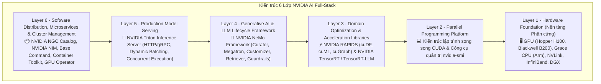
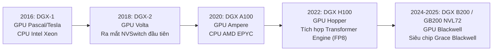
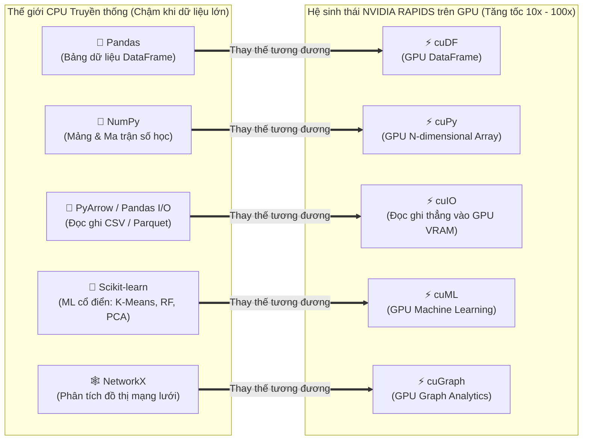
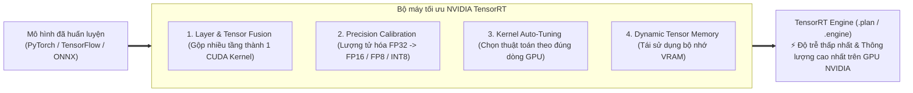
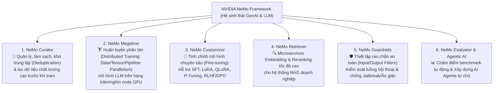
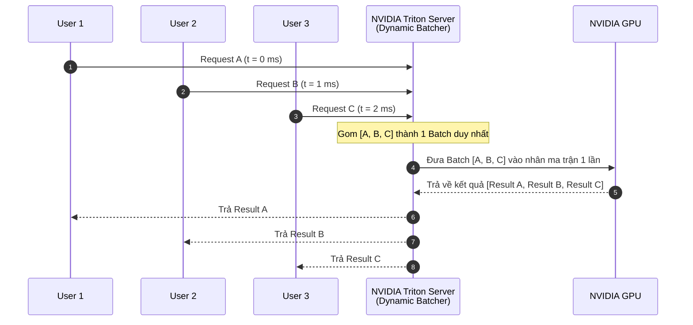

# Module 8: NVIDIA AI Ecosystem (Hệ sinh thái Toàn diện của NVIDIA)

> [!IMPORTANT]
> **Trọng tâm ôn thi NCA-GENL ở Module 8 (Thuộc Domain "Software Development - 24%" & "Data Analysis - 14%" — Chiếm ~30% tổng số câu hỏi!):**
> Bạn BẮT BUỘC phải nắm vững vai trò và sự khác biệt của từng công cụ trong hệ sinh thái NVIDIA:
> * **Phần cứng & Quản trị Cụm:** Hệ thống **DGX**, **Grace CPU** (kiến trúc Arm + NVLink-C2C), và phần mềm quản trị cụm **NVIDIA Base Command**.
> * **Lập trình & Giám sát GPU:** **CUDA** & lệnh **`nvidia-smi`**.
> * **Tăng tốc Khoa học Dữ liệu (NVIDIA RAPIDS):** Thuộc lòng bảng ánh xạ `Pandas` $\to$ **`cuDF`**, `NumPy` $\to$ **`cuPy`**, `Scikit-learn` $\to$ **`cuML`**, `NetworkX` $\to$ **`cuGraph`**, `PyArrow` $\to$ **`cuIO`**.
> * **Tối ưu Suy luận:** **NVIDIA TensorRT** và **TensorRT-LLM** (In-flight batching, PagedAttention, FP8).
> * **Framework GenAI/LLM:** **NVIDIA NeMo** (Curator, Megatron, Customizer, Retriever, Guardrails).
> * **Triển khai & Phục vụ Mô hình:** **NVIDIA Triton Inference Server** (Dynamic Batching, Concurrent Model Execution, Ensembles) và **NVIDIA NIM (Inference Microservices)**.
> * **Phân phối & Cloud-Native:** **NGC Catalog**, **NVIDIA Container Toolkit**, **NVIDIA GPU Operator**.

---

## 1. Kiến trúc AI Full-Stack 6 Lớp của NVIDIA

NVIDIA cung cấp một ngăn xếp công nghệ hoàn chỉnh từ phần cứng vi mạch bên dưới cho tới các контейнеры microservice ở tầng trên cùng:

---

## 2. Layer 1: Phần cứng chuyên dụng – NVIDIA DGX, Grace CPU & Base Command

### 2.1. Dòng siêu máy tính AI: NVIDIA DGX Systems
**NVIDIA DGX** là dòng siêu máy tính chuyên dụng được thiết kế tối ưu hóa toàn diện (từ GPU, NVLink/NVSwitch, mạng InfiniBand đến tản nhiệt) cho các tác vụ huấn luyện và suy luận AI/DL nặng nhất:

### 2.2. Bộ vi xử lý NVIDIA Grace CPU
* **Grace CPU:** Bộ vi xử lý máy chủ **72 nhân (cores)** dựa trên kiến trúc **Arm** siêu tiết kiệm điện năng do NVIDIA thiết kế cho trung tâm dữ liệu AI.
* **Giao tiếp NVLink-C2C (Chip-to-Chip):** Kết nối trực tiếp Grace CPU với GPU Hopper (**GH200**) hoặc GPU Blackwell (**GB200**) với băng thông bộ nhớ cực rộng (900 GB/s - nhanh gấp 7 lần PCIe Gen 5) và bộ nhớ dùng chung mạch lạc (Coherent Unified Memory), loại bỏ hoàn toàn điểm nghẽn cổ chai truyền dữ liệu giữa CPU và GPU.

### 2.3. Quản trị Cụm Huấn luyện Quy mô lớn: NVIDIA Base Command
* **NVIDIA Base Command (và Base Command Manager):** Là nền tảng phần mềm điều phối, quản lý hạ tầng cụm máy chủ AI (DGX SuperPOD / Hybrid Cloud).
* **Vai trò trong đề thi:** Giúp quản trị viên và đội ngũ AI lập lịch chạy các job huấn luyện lớn (qua Slurm / Kubernetes), cấp phát tài nguyên GPU cho từng nhóm nghiên cứu, theo dõi sức khỏe toàn bộ cụm máy chủ và tối ưu hóa hiệu suất sử dụng GPU.

---

## 3. Layer 2: Lập trình & Quản trị GPU – CUDA & `nvidia-smi`

### 3.1. CUDA (Compute Unified Device Architecture)
* **Định nghĩa:** Nền tảng tính toán song song và mô hình lập trình (API) cho phép các ngôn ngữ như **C, C++, Python** điều khiển trực tiếp hàng nghìn nhân GPU xử lý các phép tính khoa học và mạng nơ-ron.
* **Phép ẩn dụ Sơn hàng rào (Painting a Fence Analogy):** Nếu CPU là **1 người thợ sơn** đi sơn lần lượt từng tấm ván từ trái qua phải, thì CUDA giống như việc tổ chức **1.000 người thợ sơn** cùng quét 1.000 tấm ván đồng thời trong một tích tắc.

### 3.2. Công cụ dòng lệnh `nvidia-smi` (NVIDIA System Management Interface)
* Tiện ích dòng lệnh (CLI) tiêu chuẩn giúp kỹ sư theo dõi tình trạng phần cứng GPU theo thời gian thực:
  * **GPU Utilization (%):** Tỷ lệ % nhân GPU đang bận tính toán.
  * **VRAM Memory Usage (`MiB`):** Dung lượng bộ nhớ GPU đang bị chiếm dụng trên tổng dung lượng (chẩn đoán lỗi `CUDA Out of Memory`).
  * **Temperature (°C) & Power Usage (Watts):** Nhiệt độ và mức tiêu thụ điện của từng card GPU.
  * **Processes (PID):** Danh sách các tiến trình Python/C++ đang chạy trên mỗi GPU.

---

## 4. Layer 3A: Tăng tốc Khoa học Dữ liệu với NVIDIA RAPIDS

> [!TIP]
> **Góc nhìn Developer Python:** Bình thường khi bạn tiền xử lý dữ liệu bằng `pandas`, `numpy` hay `scikit-learn`, toàn bộ code đó chỉ chạy trên **CPU**. **NVIDIA RAPIDS** là bộ thư viện mã nguồn mở xây dựng trên nền CUDA giúp bạn thực thi toàn bộ đường ống khoa học dữ liệu (Data Science Pipeline) **trực tiếp trên VRAM của GPU** mà không cần डेटा phải copy qua lại về CPU!

### Bảng đối chiếu thư viện CPU vs. NVIDIA RAPIDS (HỌC THUỘC LÒNG 100%!)
| Tác vụ Khoa học Dữ liệu | Thư viện chuẩn trên CPU | Thư viện tương ứng trên GPU (NVIDIA RAPIDS) | Chức năng chi tiết |
| :--- | :--- | :--- | :--- |
| **Xử lý Bảng dữ liệu (DataFrames)** | `Pandas` | **`cuDF`** | Lọc (filter), gom nhóm (`groupby`), nối bảng (`join/merge`), làm sạch dữ liệu dạng bảng trên GPU. |
| **Tính toán Mảng đa chiều** | `NumPy` | **`cuPy`** | Các phép toán đại số tuyến tính, mảng ma trận đa chiều tăng tốc bằng CUDA. |
| **Đọc / Ghi File tốc độ cao** | `PyArrow` / `Pandas I/O` | **`cuIO`** | Đọc và giải nén trực tiếp các tệp CSV, Parquet, ORC, JSON vào thẳng bộ nhớ GPU. |
| **Học máy cổ điển (Classical ML)** | `Scikit-learn` | **`cuML`** | Chạy các thuật toán ML truyền thống trên GPU: Linear/Logistic Regression, Random Forest, K-Means, DBSCAN, PCA. |
| **Phân tích Đồ thị (Graph Analytics)** | `NetworkX` | **`cuGraph`** | Phân tích mạng xã hội, phát hiện cộng đồng, tìm đường đi ngắn nhất (PageRank, BFS) trên đồ thị lớn. |

---

## 5. Layer 3B: Tối ưu hóa Suy luận với NVIDIA TensorRT & TensorRT-LLM

### 5.1. NVIDIA TensorRT (Inference Optimizer & Runtime)
* **TensorRT là gì?** Là bộ SDK và trình biên dịch tối ưu hóa suy luận dành độc quyền cho các dòng GPU NVIDIA.
* **4 Kỹ thuật tối ưu ngầm của TensorRT (Rất hay hỏi trong đề thi):**
  1. **Layer & Tensor Fusion (Gộp tầng):** Hợp nhất nhiều lớp mạng liên tiếp (ví dụ: `Convolution` + `Bias` + `ReLU`) thành **1 nhân tính toán CUDA (single kernel) duy nhất** để không phải ghi/đọc kết quả trung gian ra VRAM nhiều lần!
  2. **Precision Calibration / Quantization:** Hạ độ chính xác từ `FP32` xuống `FP16`, `FP8` hoặc `INT8` mà vẫn bảo toàn độ chính xác đầu ra.
  3. **Kernel Auto-Tuning:** Tự động thử nghiệm và chọn ra thuật toán nhân ma trận tối ưu nhất cho chính xác kiến trúc dòng GPU đang cắm trên máy (ví dụ tối ưu riêng cho H100 khác với L4 hay A100).
  4. **Dynamic Tensor Memory:** Tối ưu hóa việc cấp phát và tái sử dụng vùng nhớ VRAM.

### 5.2. Mở rộng chuyên biệt cho Mô hình Ngôn ngữ Lớn: NVIDIA TensorRT-LLM
Đối với các mô hình LLM (như LLaMA-3, Mistral, GPT), quá trình sinh văn bản diễn ra theo kiểu tự hồi quy từng token một (Autoregressive). **TensorRT-LLM** bổ sung thêm các kỹ thuật tối ưu chuyên sâu cho kiến trúc Transformer:
* **In-Flight Batching (Continuous Batching):** Không bắt cả Batch phải chờ câu dài nhất sinh xong mới nhận request mới; hễ 1 câu trong Batch vừa sinh xong token kết thúc `<EOS>`, TensorRT-LLM lập tức rút câu đó ra và **nhét ngay 1 request mới đang chờ vào thế chỗ ngay giữa chuyến bay (in-flight)**!
* **PagedAttention & KV Cache Optimization:** Quản lý bộ nhớ đệm Key-Value (KV Cache) theo từng trang nhớ không liên tục (giống Virtual Memory của OS), giúp chống phân mảnh VRAM và cho phép xử lý nhiều người dùng đồng thời hơn gấp bội.

### 5.3. Bảng phân biệt ONNX vs. TensorRT
| Tiêu chí | ONNX (Open Neural Network Exchange) | NVIDIA TensorRT / TensorRT-LLM |
| :--- | :--- | :--- |
| **Mục tiêu cốt lõi** | **Tính tương thích & Di động (Portability):** Chuyển đổi mô hình giữa các framework khác nhau而 không tối ưu sâu phần cứng. | **Hiệu năng suy luận cực đại (Maximum Performance):** Độ trễ thấp nhất, thông lượng cao nhất. |
| **Phụ thuộc phần cứng** | Chạy trên mọi hãng phần cứng (CPU, GPU, NPU). | **Độc quyền chỉ chạy trên GPU NVIDIA**. |

---

## 6. Layer 4: Xây dựng & Tùy biến LLM với NVIDIA NeMo Framework

**NVIDIA NeMo** là framework đám mây nguyên bản (Cloud-native), mô-đun hóa toàn diện giúp doanh nghiệp xây dựng, huấn luyện, tinh chỉnh và bảo vệ các mô hình **Generative AI / LLM / Multimodal** ở quy mô lớn:

---

## 7. Layer 5 & 6: Triển khai Sản xuất – Triton Inference Server, NVIDIA NIM & NGC

### 7.1. Máy chủ Suy luận: NVIDIA Triton Inference Server (Dynamo Triton)
**Triton Inference Server** là phần mềm mã nguồn mở chuẩn hóa việc phục vụ mô hình AI (Model Serving) trong môi trường sản xuất:
* **Hỗ trợ Đa Framework (Multi-Framework):** Chạy đồng thời **TensorRT, TensorRT-LLM, vLLM, ONNX, PyTorch, TensorFlow, OpenVINO, Python, FIL (XGBoost/cuML)** trên cùng 1 server.
* **Giao thức chuẩn:** Cung cấp cả **HTTP/REST** và **gRPC** API, quản lý phiên bản mô hình (Model Versioning) và kiểm tra sức khỏe (Health checks / Metrics Prometheus).
* **3 Tính năng tối ưu cốt lõi của Triton (Hay hỏi thi):**
  1. **Dynamic Batching:** Tự động gom nhiều request lẻ tẻ đến gần nhau trong vài mili-giây thành 1 Batch lớn để đẩy vào GPU tính toán một lần $\to$ Tăng vọt Throughput.
  2. **Concurrent Model Execution:** Cho phép chạy **nhiều mô hình khác nhau** (hoặc nhiều bản sao của cùng 1 mô hình) **đồng thời trên cùng 1 chiếc GPU** để tận dụng hết VRAM và nhân tính toán.
  3. **Model Ensemble Pipelines:** Nối chuỗi nhiều bước (ví dụ: `Tiền xử lý ảnh` $\to$ `Mô hình phát hiện vật thể` $\to$ `Mô hình nhận diện chữ OCR`) thành 1 đường ống tự động ngay bên trong Triton mà không cần trả dữ liệu trung gian về Client.

> [!CAUTION]
> **3 Bẫy kinh điển về Triton trong đề thi NCA-GENL:**
> * **Bẫy 1:** Triton là **phần mềm**, KHÔNG phải phần cứng GPU.
> * **Bẫy 2:** Triton chỉ dùng cho **Suy luận (Inference Serving)**, KHÔNG dùng để huấn luyện (Training).
> * **Bẫy 3:** Triton hỗ trợ **đa framework** và chạy được trên **cả GPU lẫn CPU**.

---

### 7.2. NVIDIA NIM (NVIDIA Inference Microservices)
* **NVIDIA NIM là gì?** Là các **Container Microservices đã được đóng gói và tối ưu hóa sẵn trọn gói** (bao gồm trọng số mô hình Foundation Model + Engine tối ưu như TensorRT-LLM + Máy chủ Triton Inference Server + Chuẩn giao tiếp **OpenAI-compatible REST API**).
* **Lợi ích cho Developer:** Thay vì mất hàng tuần tự cài CUDA, biên dịch TensorRT-LLM và cấu hình Triton, Developer chỉ cần tải container **NIM** từ NGC về và chạy 1 lệnh `docker run` duy nhất là có ngay một endpoint LLM nội bộ chuẩn doanh nghiệp trong 5 phút!

### 7.3. NVIDIA NGC Catalog, Container Toolkit & GPU Operator
* **NVIDIA NGC (NVIDIA GPU Cloud) Catalog:** Kho lưu trữ trung tâm (Registry/Hub) chứa các Docker Containers AI, Pre-trained Models, Helm Charts và SDK đã được NVIDIA kiểm thử và tối ưu hóa sẵn.
* **NVIDIA Container Toolkit:** Giúp các container **Docker** truy cập trực tiếp vào phần cứng GPU của máy chủ.
* **NVIDIA GPU Operator:** Tự động hóa việc cài đặt Driver, Container Toolkit và quản lý tài nguyên GPU trên toàn bộ cụm **Kubernetes (K8s)**.

---

## 8. Bẫy đề thi NCA-GENL & Câu hỏi Thực chiến (Exam Traps & Mini Quiz)

### Câu hỏi tự kiểm tra (Mini Quiz):
1. **Câu 1:** Một doanh nghiệp muốn triển khai nhanh mô hình LLaMA-3 dưới dạng một container microservice đã tích hợp sẵn TensorRT-LLM, Triton Inference Server và cung cấp sẵn REST API chuẩn công nghiệp để đội ngũ lập trình viên tích hợp vào ứng dụng trong vài phút. Giải pháp nào của NVIDIA được thiết kế cho mục đích này?
   * *Đáp án:* **NVIDIA NIM (NVIDIA Inference Microservices)**.
2. **Câu 2:** Kỹ thuật nào trong **NVIDIA TensorRT** giúp hợp nhất nhiều tầng mạng nơ-ron liên tiếp (như Convolution, Bias và ReLU) thành một nhân tính toán (kernel) duy nhất để giảm số lần đọc/ghi bộ nhớ VRAM?
   * *Đáp án:* **Layer & Tensor Fusion (Gộp tầng và tensor)**.
