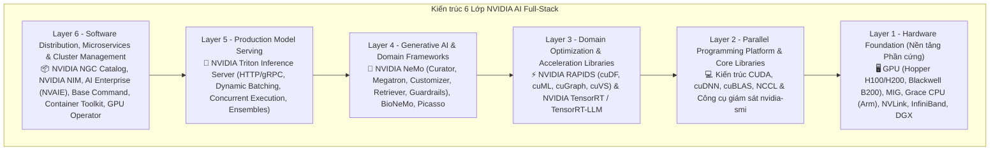
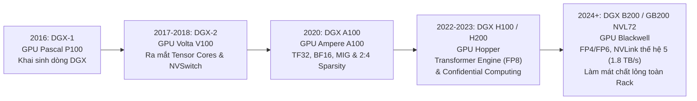
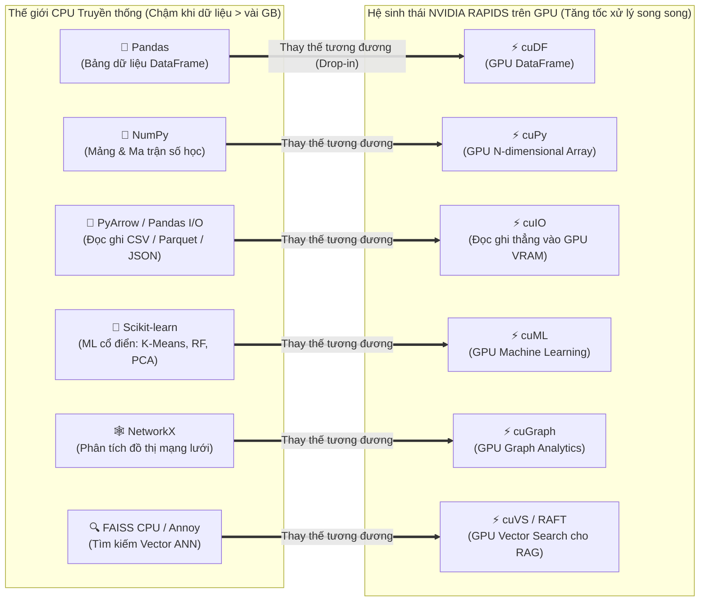
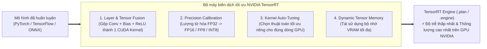
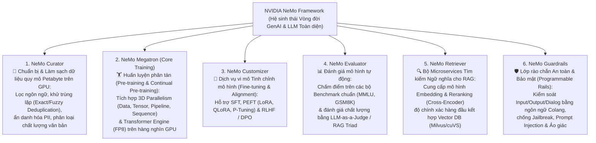
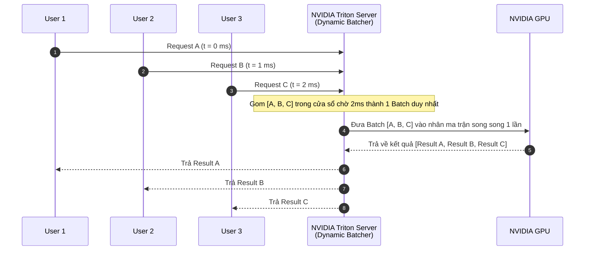

# Module 8: NVIDIA AI Ecosystem (Hệ sinh thái Toàn diện của NVIDIA)

> [!IMPORTANT]
> **Trọng tâm ôn tập NCA-GENL ở Module 8 (Thuộc Domain "Software Development - 24%" & "Data Analysis - 14%"):**
> Cần nắm vững vai trò, kiến trúc và sự khác biệt của từng công cụ trong hệ sinh thái NVIDIA:
> * **Phần cứng & Quản trị Cụm:** Hệ thống **DGX (Volta $\to$ Ampere $\to$ Hopper $\to$ Blackwell)**, công nghệ chia nhỏ GPU **MIG (Multi-Instance GPU)** (tùy dòng GPU hỗ trợ), **Grace CPU** (kiến trúc Arm + NVLink-C2C), và phần mềm quản trị cụm **NVIDIA Base Command**.
> * **Lập trình & Giám sát GPU:** **CUDA** (Thread $\to$ Warp $\to$ Block $\to$ Grid, cuBLAS/cuDNN/NCCL) & lệnh **`nvidia-smi`**.
> * **Tăng tốc Khoa học Dữ liệu (NVIDIA RAPIDS):** Nắm vững bảng ánh xạ `Pandas` $\to$ **`cuDF`**, `NumPy` $\to$ **`cuPy`**, `Scikit-learn` $\to$ **`cuML`**, `NetworkX` $\to$ **`cuGraph`**, `PyArrow` $\to$ **`cuIO`**, và tìm kiếm vector **`cuVS / RAFT`**.
> * **Tối ưu Suy luận:** **NVIDIA TensorRT** (Layer Fusion, Quantization, Kernel Auto-Tuning) và **TensorRT-LLM** (In-flight Batching, PagedAttention, FP8 KV Cache).
> * **Framework GenAI/LLM:** **NVIDIA NeMo** (Curator, Megatron, Customizer, Evaluator, Retriever, Guardrails) cùng dòng mô hình **NVIDIA Nemotron**, **BioNeMo**, **Picasso/Edify**.
> * **Triển khai & Phục vụ Mô hình:** **NVIDIA Triton Inference Server** (Dynamic Batching, Concurrent Model Execution, Model Ensembles) và **NVIDIA NIM (Inference Microservices)**.
> * **Phân phối & Cloud-Native:** **NGC Catalog**, **NVIDIA AI Enterprise (NVAIE)**, **NVIDIA Container Toolkit**, **NVIDIA GPU Operator**.

---

## 1. Kiến trúc AI Full-Stack 6 Lớp của NVIDIA

NVIDIA không chỉ là công ty bán chip phần cứng mà là một công ty **AI Full-Stack** cung cấp ngăn xếp công nghệ đồng bộ từ vi mạch silicon bên dưới cho tới các container microservices ở tầng ứng dụng trên cùng:



---

## 2. Layer 1: Phần cứng chuyên dụng – NVIDIA DGX, MIG, Grace CPU & Base Command

### 2.1. Dòng siêu máy tính AI: NVIDIA DGX Systems & Sự tiến hóa Kiến trúc GPU
**NVIDIA DGX** là dòng máy chủ/siêu máy tính chuyên dụng được NVIDIA thiết kế tối ưu hóa toàn diện (tích hợp sẵn 8 GPU kết nối qua NVLink/NVSwitch, card mạng InfiniBand tốc độ cao, ổ cứng NVMe RAID và phần mềm chuẩn hóa) cho các tác vụ huấn luyện và suy luận AI/DL nặng nhất:



| Thế hệ Kiến trúc GPU | Dòng GPU Tiêu biểu | Đột phá Công nghệ Quan trọng Cần Nhớ Cho Kỳ Thi |
| :--- | :--- | :--- |
| **1. Volta (2017)** | Tesla V100 | Thế hệ GPU đầu tiên giới thiệu nhân **Tensor Cores** chuyên dụng cho phép nhân ma trận Deep Learning (`FP16`) và chip chuyển mạch **NVSwitch**. |
| **2. Ampere (2020)** | A100 (40GB / 80GB) | Giới thiệu định dạng **`TF32`**, **`BF16`**, **2:4 Structured Sparsity** và công nghệ chia nhỏ phần cứng GPU **MIG (Multi-Instance GPU)**. |
| **3. Ada Lovelace (2022)** | L4, L40S, RTX 4090 | Tối ưu hóa cho suy luận đa phương thức (Inference), đồ họa Omniverse, dựng hình 3D và xử lý Video/AI tiêu thụ ít điện năng. |
| **4. Hopper (2022–2023)** | H100 (80GB), H200 (141GB HBM3e) | Giới thiệu **Transformer Engine** (tự động chuyển đổi động giữa **`FP8`** và `FP16`/`BF16`), **NVIDIA Confidential Computing (TEE)**, và NVLink thế hệ 4 (900 GB/s). |
| **5. Blackwell (2024+)** | B200, GB200 NVL72 | Thế hệ Transformer Engine thứ 2 hỗ trợ lượng tử hóa **`FP4` / `FP6`**, NVLink thế hệ 5 (**1.8 TB/s**), kết nối 72 GPU Blackwell như một GPU khổng lồ duy nhất trong 1 Rack làm mát bằng chất lỏng (**GB200 NVL72**). |

### 2.2. Công nghệ Chia nhỏ GPU: MIG (Multi-Instance GPU)
* **Vấn đề thực tế:** Một chiếc GPU Data Center lớn như A100/H100 80GB có thể dư thừa tài nguyên nếu chỉ dùng để chạy một mô hình nhỏ (như BERT hoặc SLM nhỏ) hoặc phục vụ nhiều kỹ sư cùng chạy thực nghiệm nhẹ. Nếu cho nhiều tiến trình chạy chung trên 1 GPU theo chế độ mặc định, tiến trình này ngốn băng thông bộ nhớ có thể ảnh hưởng độ trễ của tiến trình kia (**Noisy Neighbor problem**).
* **Giải pháp – NVIDIA MIG (Multi-Instance GPU):** Cho phép phân vùng vật lý **1 chiếc GPU dòng hỗ trợ (như A100, H100, H200, B200) thành tối đa 7 GPU con độc lập ở cấp độ phần cứng (tối đa 7 MIG Instances trên các SKU này)**. Mỗi MIG Instance có phần bộ nhớ HBM riêng, bộ nhớ đệm L2 Cache riêng và các cụm nhân SM riêng biệt — giúp cách ly lỗi và đảm bảo chất lượng dịch vụ (QoS) ổn định.
* **Lưu ý giới hạn theo SKU phần cứng:** Số lượng MIG instances tối đa **phụ thuộc vào model GPU và MIG profiles cụ thể**. Ví dụ A100, H100, B200 có thể hỗ trợ tối đa 7 instances; một số sản phẩm khác hỗ trợ MIG (như A30) có giới hạn số instances nhỏ hơn. **MIG chỉ hoạt động trên các dòng GPU được NVIDIA hỗ trợ**, không áp dụng mặc định cho toàn bộ GPU NVIDIA (Tham khảo bảng SKU chính thức: [NVIDIA MIG Supported GPUs](https://docs.nvidia.com/datacenter/tesla/mig-user-guide/latest/supported-gpus.html)).

### 2.3. Bộ vi xử lý NVIDIA Grace CPU & Siêu chip Grace Hopper / Grace Blackwell
* **Grace CPU:** Bộ vi xử lý máy chủ **72 nhân (cores) kiến trúc Arm Neoverse** hiệu suất cao và siêu tiết kiệm điện năng do chính NVIDIA thiết kế cho trung tâm dữ liệu AI.
* **Giao tiếp NVLink-C2C (Chip-to-Chip):** Kết nối trực tiếp Grace CPU với GPU Hopper (**Siêu chip GH200**) hoặc 2 GPU Blackwell (**Siêu chip GB200**) với băng thông **900 GB/s (nhanh gấp 7 lần PCIe Gen 5)** và tạo thành một không gian **Bộ nhớ Hợp nhất Mạch lạc (Hardware-Coherent Unified Memory)** lên tới hàng trăm Gigabyte, cho phép GPU truy cập trực tiếp vào RAM LPDDR5X của CPU để chạy các mô hình khổng lồ mà không bị nghẽn PCIe.

### 2.4. Quản trị Cụm Huấn luyện Quy mô lớn: NVIDIA Base Command
* **NVIDIA Base Command (và Base Command Manager - BCM):** Là nền tảng phần mềm quản trị, điều phối và giám sát toàn diện hạ tầng cụm siêu máy tính AI (**DGX SuperPOD** / Hybrid Cloud).
* **Vai trò trong đề thi:** Cung cấp giao diện thống nhất cho quản trị viên cấp phát tài nguyên cụm (Provisioning), lập lịch chạy các job huấn luyện lớn (tích hợp **Slurm** và **Kubernetes**), quản lý hạn ngạch (Quota) người dùng, theo dõi sức khỏe phần cứng/nhiệt độ/mạng InfiniBand toàn cụm và tự động cô lập node lỗi để khôi phục huấn luyện.

---

## 3. Layer 2: Lập trình & Giám sát GPU – CUDA & `nvidia-smi`

### 3.1. Kiến trúc CUDA (Compute Unified Device Architecture) & Các Thư viện Toán học Lõi
* **Định nghĩa:** Nền tảng tính toán song song và mô hình lập trình (API) độc quyền của NVIDIA (ra mắt năm 2006) cho phép các ngôn ngữ như **C, C++, Fortran, Python** điều khiển trực tiếp hàng nghìn nhân GPU.
* **Phép ẩn dụ Sơn hàng rào (Painting a Fence Analogy):** Nếu CPU là **1 người thợ sơn chuyên nghiệp** đi sơn lần lượt từng tấm ván từ tấm số 1 đến tấm số 1.000, thì CUDA giống như việc tổ chức **1.000 người thợ sơn** mỗi người phụ trách đúng 1 tấm ván và cùng quét cọ đồng thời trong 1 giây!
* **Phân cấp thực thi trong lập trình CUDA (CUDA Execution Hierarchy):**
  1. **Thread (Luồng đơn lẻ):** Đơn vị nhỏ nhất thực thi một hàm **CUDA Kernel** trên 1 phần tử dữ liệu.
  2. **Warp (Nhóm 32 Threads):** 32 luồng gắn kết thực thi đồng bộ cùng một lệnh trên một cụm SM.
  3. **Thread Block (Khối luồng):** Tập hợp nhiều Threads/Warps chạy trên cùng một SM và có thể chia sẻ dữ liệu siêu nhanh qua **Shared Memory (SRAM)**.
  4. **Grid (Lưới):** Tập hợp tất cả các Thread Blocks được phóng lên toàn bộ GPU để giải quyết bài toán.
* **Bộ 3 Thư viện Tăng tốc Lõi bên dưới PyTorch/TensorFlow:**
  * **`cuBLAS`:** Thư viện đại số tuyến tính chuẩn trên GPU (nhân ma trận GEMM).
  * **`cuDNN` (CUDA Deep Neural Network library):** Thư viện cung cấp các hàm nguyên thủy đã tối ưu cực đại cho mạng nơ-ron (Convolution, Attention, Pooling, Normalization, Activation).
  * **`NCCL` (NVIDIA Collective Communications Library):** Thư viện đồng bộ dữ liệu đa GPU / đa Node (`All-Reduce`, `Broadcast`, `All-Gather`).

### 3.2. Công cụ dòng lệnh `nvidia-smi` (NVIDIA System Management Interface)
* Tiện ích dòng lệnh (CLI) tiêu chuẩn cài sẵn cùng NVIDIA Driver giúp kỹ sư kiểm tra và theo dõi tình trạng phần cứng GPU theo thời gian thực:

```text
+-----------------------------------------------------------------------------------------+
| NVIDIA-SMI 550.54.15              Driver Version: 550.54.15      CUDA Version: 12.4     |
|-----------------------------------------+------------------------+----------------------+
| GPU  Name                 Persistence-M | Bus-Id          Disp.A | Volatile Uncorr. ECC |
| Fan  Temp   Perf          Pwr:Usage/Cap |           Memory-Usage | GPU-Util  Compute M. |
|                                         |                        |               MIG M. |
|=========================================+========================+======================|
|   0  NVIDIA H100 80GB HBM3          On  |   00000000:1B:00.0 Off |                    0 |
| N/A   42C    P0             310W / 700W |   68420MiB / 81559MiB  |     98%      Default |
+-----------------------------------------+------------------------+----------------------+
| Processes:                                                                              |
|  GPU   GI   CI        PID   Type   Process name                              GPU Memory |
|        ID   ID                                                               Usage      |
|=========================================================================================|
|    0   N/A  N/A     14892      C   python3 (tritonserver / train.py)           68400MiB |
+-----------------------------------------------------------------------------------------+
```

* **Các thông số quan trọng đọc từ `nvidia-smi` (Hay hỏi trong đề thi):**
  1. **GPU-Util (`98%`):** Tỷ lệ % thời gian các nhân tính toán của GPU đang bận hoạt động (Nếu trong lúc train mà chỉ số này thấp lè tè `10-20%`, chứng tỏ hệ thống đang bị nghẽn cổ chai ở khâu đọc dữ liệu CPU/Storage I/O!).
  2. **Memory-Usage (`68420MiB / 81559MiB`):** Dung lượng VRAM đang bị chiếm dụng trên tổng VRAM vật lý (Giúp chẩn đoán lỗi tràn bộ nhớ `CUDA Out of Memory - OOM` hoặc chọn Batch Size vừa khít).
  3. **Temp (`42C`) & Pwr:Usage/Cap (`310W / 700W`):** Nhiệt độ hoạt động và công suất tiêu thụ điện thực tế so với mức trần TDP.
  4. **Processes (`PID 14892`):** Danh sách các tiến trình đang chiếm giữ VRAM của từng GPU (để tìm và `kill` các tiến trình treo "zombie processes").
  5. *(Mẹo lệnh hữu ích: `nvidia-smi -l 1` hoặc `watch -n 1 nvidia-smi` để cập nhật liên tục mỗi giây; `nvidia-smi topo -m` để xem sơ đồ kết nối NVLink và InfiniBand giữa các GPU).*

---

## 4. Layer 3A: Tăng tốc Khoa học Dữ liệu với NVIDIA RAPIDS

> [!TIP]
> **Góc nhìn Developer Python:** Bình thường khi bạn tiền xử lý dữ liệu bằng `pandas`, `numpy`, `scikit-learn` hay `networkx`, toàn bộ code đó chỉ chạy trên **CPU** và trở nên cực kỳ ì ạch khi gặp bảng dữ liệu hàng chục triệu dòng (hàng chục GB). **NVIDIA RAPIDS** là bộ thư viện mã nguồn mở xây dựng trên nền CUDA và định dạng bộ nhớ cột **Apache Arrow**, giúp bạn thực thi toàn bộ đường ống khoa học dữ liệu (End-to-End Data Science Pipeline) **trực tiếp trên VRAM của GPU** với cú pháp giống hệt thư viện CPU!



### Bảng đối chiếu thư viện CPU vs. NVIDIA RAPIDS (Khái niệm đáng ôn theo Blueprint)
| Tác vụ Khoa học Dữ liệu | Thư viện chuẩn trên CPU | Thư viện tương ứng trên GPU (NVIDIA RAPIDS) | Chức năng chi tiết |
| :--- | :--- | :--- | :--- |
| **Xử lý Bảng dữ liệu (DataFrames)** | `Pandas` | **`cuDF`** | Lọc (filter), gom nhóm (`groupby`), nối bảng (`join/merge`), xử lý chuỗi Regex, làm sạch dữ liệu dạng bảng trên GPU (Có chế độ `cudf.pandas` hỗ trợ tăng tốc nhiều thao tác Pandas với thay đổi code tối thiểu). |
| **Tính toán Mảng đa chiều** | `NumPy` | **`cuPy`** | Các phép toán đại số tuyến tính, biến đổi Fourier, mảng ma trận đa chiều tăng tốc bằng CUDA. |
| **Đọc / Ghi File tốc độ cao** | `PyArrow` / `Pandas I/O` | **`cuIO`** (Tích hợp dưới đáy `cuDF`) | Đọc, giải nén và ghi trực tiếp các tệp CSV, Apache Parquet, ORC, JSON từ ổ cứng (hỗ trợ GPUDirect Storage) vào bộ nhớ GPU. |
| **Học máy cổ điển (Classical ML)** | `Scikit-learn` | **`cuML`** | Chạy các thuật toán ML truyền thống trên GPU: Linear/Logistic Regression, Random Forest, XGBoost (qua FIL), K-Means, DBSCAN, PCA, UMAP, t-SNE, k-NN. |
| **Phân tích Đồ thị (Graph Analytics)** | `NetworkX` | **`cuGraph`** | Phân tích mạng xã hội, phát hiện cộng đồng (Louvain), tìm đường đi ngắn nhất, xếp hạng nút (**PageRank**, BFS) trên đồ thị lớn. |
| **Tìm kiếm Vector & RAG** | `FAISS (CPU)` / `HNSWLib` | **`cuVS` / `RAFT`** | Tăng tốc lập chỉ mục (Indexing) và tìm kiếm láng giềng gần nhất (ANN Vector Search) cho các Vector Database như **Milvus**. |

### Minh họa Code Python chuyển đổi sang NVIDIA RAPIDS:
> **Lưu ý về hiệu năng:** Mức độ tăng tốc thực tế khi chuyển từ CPU sang RAPIDS, TensorRT hoặc Quantization phụ thuộc chặt chẽ vào kích thước tập dữ liệu, đặc trưng bài toán, cấu hình GPU/CPU, băng thông bộ nhớ, batch size và phiên bản phần mềm; không có một tỷ lệ tăng tốc cố định áp dụng cho mọi trường hợp.

```python
# --- CÁCH TRÊN CPU VỚI PANDAS & SCIKIT-LEARN ---
# import pandas as pd
# from sklearn.cluster import KMeans

# --- CÁCH TRÊN GPU VỚI NVIDIA RAPIDS (API tương đồng) ---
import cudf as pd                  # Thay pandas bằng cudf
from cuml.cluster import KMeans    # Thay sklearn bằng cuml

# 1. Đọc file Parquet thẳng vào GPU VRAM (nhờ cuIO + GPUDirect Storage)
df = pd.read_parquet("customer_transactions_50M.parquet")

# 2. Tiền xử lý & Tổng hợp dữ liệu trực tiếp trên GPU với cuDF
features = df.groupby("customer_id")[["amount", "frequency"]].mean()

# 3. Phân cụm khách hàng trên GPU với cuML (Dữ liệu nằm nguyên trên VRAM, không tốn công copy về CPU!)
kmeans = KMeans(n_clusters=5, random_state=42)
features["segment"] = kmeans.fit_predict(features)
```
*(Lưu ý thêm: Khi dữ liệu lớn vượt quá VRAM của 1 GPU, RAPIDS kết hợp với **`Dask` (`dask-cudf`)** để tự động phân phối bảng dữ liệu qua nhiều GPU và nhiều Node!).*

---

## 5. Layer 3B: Tối ưu hóa Suy luận với NVIDIA TensorRT & TensorRT-LLM

### 5.1. NVIDIA TensorRT (High-Performance Deep Learning Inference Optimizer & Runtime)
* **TensorRT là gì?** Là bộ SDK và trình biên dịch (Compiler) tối ưu hóa suy luận dành độc quyền cho các dòng GPU NVIDIA. Nó nhận đầu vào là một mô hình đã huấn luyện (từ PyTorch, TensorFlow hoặc file `.onnx`) và biên dịch thành một tệp thực thi siêu tốc gọi là **TensorRT Engine (`.plan` / `.engine`)**.
* **5 Kỹ thuật tối ưu ngầm của TensorRT (Rất hay hỏi trong đề thi):**
  1. **Layer & Tensor Fusion (Gộp tầng và tensor):** Hợp nhất nhiều lớp mạng liên tiếp theo chiều dọc và chiều ngang (ví dụ: `Convolution` + `BatchNorm` + `Bias` + `ReLU`) thành **1 nhân tính toán CUDA (Single Fused Kernel) duy nhất**. Nhờ đó, GPU chỉ cần đọc dữ liệu từ VRAM lên bộ nhớ đệm SRAM 1 lần, tính liền mạch cả 4 bước rồi mới ghi kết quả ra VRAM $\to$ Giảm mạnh độ trễ truy xuất bộ nhớ!
  2. **Precision Calibration / Quantization (Lượng tử hóa độ chính xác):** Hạ độ chính xác từ `FP32` xuống `FP16`, `BF16`, `FP8` hoặc `INT8` (kèm bước Calibration tự động) để tận dụng tối đa sức mạnh của **Tensor Cores**.
  3. **Kernel Auto-Tuning (Tự động tinh chỉnh nhân theo phần cứng):** TensorRT kiểm tra chính xác mã chip GPU đang cắm trên máy chủ (ví dụ H100 khác với A100 hay L4), chạy thử nghiệm hàng loạt thuật toán nhân ma trận khác nhau và chọn ra kernel chạy nhanh nhất trên đúng dòng GPU đó! *(Lưu ý: Do đặc tính này nên file TensorRT `.engine` biên dịch trên GPU A100 không đem chạy trực tiếp sang GPU H100 được mà cần build trên đúng kiến trúc mục tiêu).*
  4. **Dynamic Tensor Memory:** Cấp phát bộ nhớ VRAM vừa khít đúng thời điểm từng tensor cần dùng và tái sử dụng ngay lập tức cho các tầng sau, giảm tối đa dung lượng VRAM tiêu thụ.
  5. **Multi-Stream Execution:** Xử lý song song nhiều luồng dữ liệu đầu vào cùng lúc.



### 5.2. Mở rộng chuyên biệt cho Mô hình Ngôn ngữ Lớn: NVIDIA TensorRT-LLM
Đối với các mô hình LLM (như LLaMA-3, Mistral, Nemotron, GPT), quá trình sinh văn bản diễn ra lặp đi lặp lại theo kiểu tự hồi quy từng token một (Autoregressive). **TensorRT-LLM** là bộ thư viện mã nguồn mở cung cấp Python API để biên dịch LLM thành TensorRT Engine với các kỹ thuật tối ưu hóa tiên tiến nhất:
1. **In-Flight Batching (Continuous / Iteration-level Batching):**
   * *Static Batching cũ:* Nếu gom 4 câu hỏi vào 1 Batch, trong đó Câu 1 chỉ sinh 10 chữ là xong (`<EOS>`), còn Câu 2 sinh bài văn dài 500 chữ, thì GPU ở vị trí Câu 1 phải ngồi chơi không 490 bước chờ Câu 2 viết xong mới được nhận khách mới!
   * *In-Flight Batching của TensorRT-LLM:* Ngay tại khoảnh khắc Câu 1 vừa sinh ra token kết thúc `<EOS>`, hệ thống lập tức trả kết quả Câu 1 cho User và **chèn ngay một câu hỏi mới đang đợi trong hàng chờ vào đúng khe trống đó ngay ở vòng lặp token tiếp theo** $\to$ Tăng thông lượng GPU lên gấp **2x – 5x**!
2. **PagedAttention & Quantized KV Cache:**
   * Phân bổ bộ nhớ đệm **KV Cache** thành các khối trang nhớ không liên tục (Non-contiguous memory blocks giống bộ nhớ ảo của Hệ điều hành), xóa bỏ hoàn toàn sự lãng phí phân mảnh VRAM và cho phép nén cả KV Cache xuống chuẩn **`FP8` / `INT8`**.
3. **Multi-GPU / Multi-Node Inference Parallelism:** Hỗ trợ sẵn **Tensor Parallelism** và **Pipeline Parallelism** để chạy mượt các mô hình khổng lồ như LLaMA-3 405B qua nhiều GPU kết nối NVLink.
4. **Speculative Decoding (Giải mã suy đoán):** Dùng một mô hình nháp nhỏ (Draft model) đoán nhanh trước 4–5 token, rồi cho mô hình lớn kiểm tra toàn bộ 5 token đó chỉ trong 1 bước song song duy nhất.

### 5.3. Bảng phân biệt ONNX vs. TensorRT (Câu hỏi so sánh kinh điển)
| Tiêu chí | ONNX (Open Neural Network Exchange) | NVIDIA TensorRT / TensorRT-LLM |
| :--- | :--- | :--- |
| **Mục tiêu cốt lõi** | **Tính tương thích & Di động (Portability / Interoperability):** Định dạng trung gian giúp chuyển đổi mô hình dễ dàng giữa các framework khác nhau. | **Hiệu năng suy luận cực đại (Maximum Inference Performance):** Đạt độ trễ thấp nhất (Low latency) và thông lượng cao nhất (High throughput). |
| **Phụ thuộc phần cứng** | Độc lập phần cứng: Chạy trên mọi hãng (CPU Intel/AMD/Arm, GPU, NPU). | **Độc quyền tối ưu sâu ở mức phần cứng chỉ dành riêng cho GPU NVIDIA**. |

---

## 6. Layer 4: Xây dựng, Tùy biến & Quản trị LLM với NVIDIA NeMo Framework

**NVIDIA NeMo** là một framework đám mây nguyên bản (Cloud-native), đầu-cuối (End-to-end) và mô-đun hóa giúp doanh nghiệp xây dựng, huấn luyện, tinh chỉnh, đánh giá và bảo vệ các mô hình **Generative AI / LLM / Multimodal / Speech AI** ở mọi quy mô:



* **Các Nền tảng & Dòng Mô hình Chuyên ngành Khác của NVIDIA (Cần biết tên cho đề thi):**
  * **NVIDIA Nemotron:** Gia đình các mô hình ngôn ngữ lớn (LLM) mở có hiệu năng cao do chính NVIDIA huấn luyện (như *Nemotron-4 340B Base/Instruct/Reward* dùng để sinh dữ liệu tổng hợp và *Llama-3.1-Nemotron*).
  * **NVIDIA BioNeMo:** Nền tảng và bộ mô hình nền tảng chuyên biệt cho **Y sinh học, Khám phá thuốc mới (Drug Discovery), Dự đoán cấu trúc Protein (AlphaFold/ESMFold) và Hóa học phân tử**.
  * **NVIDIA Picasso / Edify:** Nền tảng đám mây (Foundry) chuyên dụng để huấn luyện và triển khai các mô hình tạo sinh thị giác (**Visual Generative AI: Tạo ảnh, Video, 3D Assets từ văn bản**) tôn trọng bản quyền.

---

## 7. Layer 5 & 6: Triển khai Sản xuất – Triton Inference Server, NVIDIA NIM & NGC

### 7.1. Máy chủ Phục vụ Suy luận: NVIDIA Triton Inference Server (Dynamo Triton)
Khi đã có mô hình tối ưu (TensorRT Engine, ONNX, PyTorch, vLLM...), làm sao để biến nó thành một dịch vụ API chịu tải hàng chục nghìn người dùng? Đó là nhiệm vụ của **NVIDIA Triton Inference Server**:
* **Bản chất:** Là **phần mềm máy chủ suy luận mã nguồn mở (Open-source Inference Serving Software)** chuẩn hóa việc triển khai mô hình AI vào sản xuất.
* **Hỗ trợ Đa Framework & Đa Phần cứng (Multi-Framework & Heterogeneous Hardware):**
  * Chạy đồng thời các mô hình từ **TensorRT, TensorRT-LLM, vLLM, PyTorch (TorchScript), ONNX Runtime, TensorFlow, OpenVINO, Python Backend, và FIL (Forest Inference Library cho XGBoost/LightGBM/Random Forest)**.
  * Chạy được trên **cả GPU NVIDIA lẫn trên CPU** (rất hữu ích khi muốn chạy bước tiền xử lý hoặc mô hình nhẹ trên CPU và mô hình nặng trên GPU).
* **Giao thức chuẩn:** Cung cấp sẵn giao diện **HTTP/REST** và **gRPC** (tốc độ cao), cùng endpoint xuất chỉ số giám sát **Prometheus Metrics** (GPU utilization, queue time, compute latency).
* **4 Tính năng tối ưu nổi bật của Triton Inference Server:**
  1. **Dynamic Batching (Gom lô động):** Khi nhiều người dùng gửi request đơn lẻ (`Batch = 1`) tới server gần nhau, Triton có thể giữ trong hàng đợi một khoảng thời gian cấu hình cực ngắn (ví dụ `2 ms`), **gom chúng lại thành 1 Batch lớn hơn rồi đẩy vào GPU thực thi** $\to$ Cải thiện đáng kể Throughput trong ngưỡng độ trễ cho phép.
  2. **Concurrent Model Execution (Thực thi đồng thời nhiều mô hình):** Cho phép nạp và chạy **nhiều mô hình khác nhau** (hoặc nhiều bản sao `Instance Groups` của cùng 1 mô hình) **đồng thời trên cùng 1 chiếc GPU** để tăng hiệu suất sử dụng phần cứng.
  3. **Model Ensemble Pipelines & Business Logic Scripting (BLS):** Cho phép nối chuỗi nhiều mô hình (ví dụ: `Tokenizer` $\to$ `Embedding Model` $\to$ `Reranker` $\to$ `LLM`) thành một đường ống ngay trong Triton.
  4. **Triton Model Analyzer:** Công cụ dòng lệnh chạy thử nghiệm các cấu hình (Batch size, số lượng model instances, độ chính xác) và xuất báo cáo giúp kỹ sư chọn cấu hình Triton phù hợp với giới hạn VRAM và SLA độ trễ.



> [!CAUTION]
> **3 Điểm dễ nhầm lẫn về Triton trong bài thi NCA-GENL:**
> * **Điểm 1:** Triton là **PHẦN MỀM máy chủ (Software)**, KHÔNG phải là một loại chip phần cứng GPU hay CPU!
> * **Điểm 2:** Triton dùng cho giai đoạn **Phục vụ Suy luận (Inference Serving)**, KHÔNG dùng để huấn luyện mô hình (Training)!
> * **Điểm 3:** Triton hỗ trợ **đa framework (PyTorch, ONNX, TensorFlow, TensorRT, vLLM, XGBoost...)** chứ không chỉ giới hạn ở TensorRT, và chạy được trên **cả GPU lẫn CPU**!

---

### 7.2. NVIDIA NIM (NVIDIA Inference Microservices)
* **Bài toán thực tế của Developer:** Để tự triển khai một mô hình LLM đạt hiệu năng cao, kỹ sư thường phải tải trọng số, đồng bộ phiên bản CUDA/cuDNN, biên dịch sang TensorRT-LLM/vLLM cho dòng GPU đích, cấu hình Triton Inference Server và viết tầng REST API.
* **Giải pháp – NVIDIA NIM:** Là các **Container Microservices suy luận đã được NVIDIA đóng gói và tối ưu hóa sẵn (Pre-built, Pre-optimized Containers)** (Tham khảo: [NVIDIA NIM Documentation](https://docs.api.nvidia.com/nim/)).
* **Bên trong 1 Container NVIDIA NIM thường tích hợp sẵn:**
  1. Trọng số mô hình nền tảng đã kiểm thử (LLaMA-3, Mistral, Nemotron, Embedding, Reranker, BioNeMo...).
  2. Engine suy luận tối ưu cho phần cứng đích (**TensorRT / TensorRT-LLM / vLLM**).
  3. Máy chủ phục vụ công nghiệp (**NVIDIA Triton Inference Server**).
  4. Giao diện **REST API chuẩn hóa**: Nhiều NVIDIA NIM microservices cung cấp các API **tương thích một phần với các endpoint và schema kiểu OpenAI** (như `v1/chat/completions`, `v1/embeddings`), giúp tái sử dụng một số OpenAI SDK workflows. **Lưu ý:** Khả năng tương thích này **không đồng nghĩa với việc hỗ trợ toàn bộ mọi endpoint, tham số (parameters), chế độ streaming hoặc hành vi đặc thù** của OpenAI API; lập trình viên cần kiểm tra tài liệu của từng NIM và phiên bản cụ thể.
* **Lợi ích:** Triển khai linh hoạt (trên Cloud, On-Premise DGX, hoặc Kubernetes) thông qua container chuẩn và thuận tiện tích hợp vào ứng dụng Python hiện có.

```python
# Minh họa gọi NVIDIA NIM bằng thư viện chuẩn của OpenAI (Chỉ cần trỏ base_url về NIM container nội bộ!)
from openai import OpenAI

client = OpenAI(
    base_url="http://localhost:8000/v1", # Địa chỉ container NVIDIA NIM đang chạy nội bộ
    api_key="nvapi-your-key"
)

response = client.chat.completions.create(
    model="meta/llama-3.1-70b-instruct",
    messages=[{"role": "user", "content": "Giải thích ngắn gọn cơ chế Self-Attention."}],
    temperature=0.1,
    max_tokens=256
)
print(response.choices[0].message.content)
```

### 7.3. NVIDIA NGC Catalog, NVIDIA AI Enterprise, Container Toolkit & GPU Operator
* **NVIDIA NGC (NVIDIA GPU Cloud) Catalog:** Cổng lưu trữ và phân phối phần mềm tập trung (Hub/Registry) chứa hàng trăm **Docker Containers AI (PyTorch, NeMo, Triton, RAPIDS, NIM)**, **Pre-trained Models**, **Helm Charts** và **SDKs** đã được NVIDIA kiểm thử tương thích, vá lỗi bảo mật và tối ưu hóa hiệu năng tối đa.
* **NVIDIA AI Enterprise (NVAIE):** Bộ phần mềm đám mây nguyên bản cấp doanh nghiệp (Enterprise-grade Software Suite) bao gồm bản quyền thương mại của NIM, NeMo, RAPIDS, Triton, TensorRT cùng cam kết hỗ trợ kỹ thuật dài hạn (SLA, патch bảo mật CVE) từ chuyên gia NVIDIA.
* **NVIDIA Container Toolkit (`nvidia-docker`):** Công cụ cầu nối cho phép các container **Docker** nhìn thấy và sử dụng trực tiếp phần cứng GPU của máy chủ Host mà không cần cài lại NVIDIA Driver bên trong từng container.
* **NVIDIA GPU Operator (Dành cho Kubernetes):** Tự động hóa hoàn toàn việc cài đặt và quản lý toàn bộ ngăn xếp phần mềm GPU (NVIDIA Driver, Container Toolkit, Device Plugin, MIG Manager, công cụ giám sát DCGM) trên hàng trăm node trong cụm **Kubernetes (K8s)**.

---

## 8. Bẫy đề thi NCA-GENL & Câu hỏi Thực chiến (Exam Traps & Mini Quiz)

### Câu hỏi tự kiểm tra (Mini Quiz):
1. **Câu 1:** Một doanh nghiệp muốn triển khai nhanh mô hình LLaMA-3 dưới dạng một container microservice đã tích hợp sẵn TensorRT-LLM, Triton Inference Server và cung cấp sẵn REST API tương thích chuẩn OpenAI để đội ngũ lập trình viên tích hợp vào ứng dụng trong vài phút. Giải pháp nào của NVIDIA được thiết kế cho mục đích này?
   * *Đáp án:* **NVIDIA NIM (NVIDIA Inference Microservices)**.
2. **Câu 2:** Kỹ thuật nào trong **NVIDIA TensorRT** giúp hợp nhất nhiều tầng mạng nơ-ron liên tiếp (như Convolution, Bias và ReLU) thành một nhân tính toán (kernel) duy nhất để giảm số lần đọc/ghi bộ nhớ VRAM?
   * *Đáp án:* **Layer & Tensor Fusion (Gộp tầng và tensor)**.
3. **Câu 3:** Một kỹ sư dữ liệu đang viết script Python xử lý bảng dữ liệu 100 triệu dòng bằng `Pandas` và huấn luyện mô hình phân loại bằng `Scikit-learn` trên CPU rất chậm. Hai thư viện nào trong hệ sinh thái **NVIDIA RAPIDS** cho phép chuyển trực tiếp hai tác vụ này lên GPU với thay đổi code tối thiểu?
   * *Đáp án:* **`cuDF`** (thay cho Pandas) và **`cuML`** (thay cho Scikit-learn).
4. **Câu 4:** Trong quá trình chạy huấn luyện mô hình trên máy chủ Linux, kỹ sư gặp lỗi `CUDA Out of Memory (OOM)` và muốn kiểm tra ngay lập tức xem tiến trình (PID) nào đang chiếm dụng bao nhiêu dung lượng VRAM cũng như nhiệt độ hiện tại của từng chiếc GPU. Lệnh CLI nào cần được sử dụng?
   * *Đáp án:* **`nvidia-smi`** (NVIDIA System Management Interface).
5. **Câu 5:** Một trường đại học có 1 chiếc GPU NVIDIA H100 80GB và muốn chia chiếc GPU này thành 7 phần cứng GPU nhỏ độc lập hoàn toàn (có bộ nhớ và nhân tính toán tách biệt) cho 7 nghiên cứu sinh chạy các bài thí nghiệm nhỏ cùng lúc mà không ảnh hưởng lẫn nhau. Công nghệ nào của NVIDIA cho phép làm việc này?
   * *Đáp án:* **MIG (Multi-Instance GPU)**.
6. **Câu 6:** Trong bộ công cụ **NVIDIA NeMo Framework**, mô-đun chuyên biệt nào đảm nhận việc làm sạch dữ liệu văn bản thô quy mô lớn, lọc bỏ nội dung rác và khử trùng lặp (Deduplication) trước khi đưa vào huấn luyện LLM?
   * *Đáp án:* **NVIDIA NeMo Curator**.
