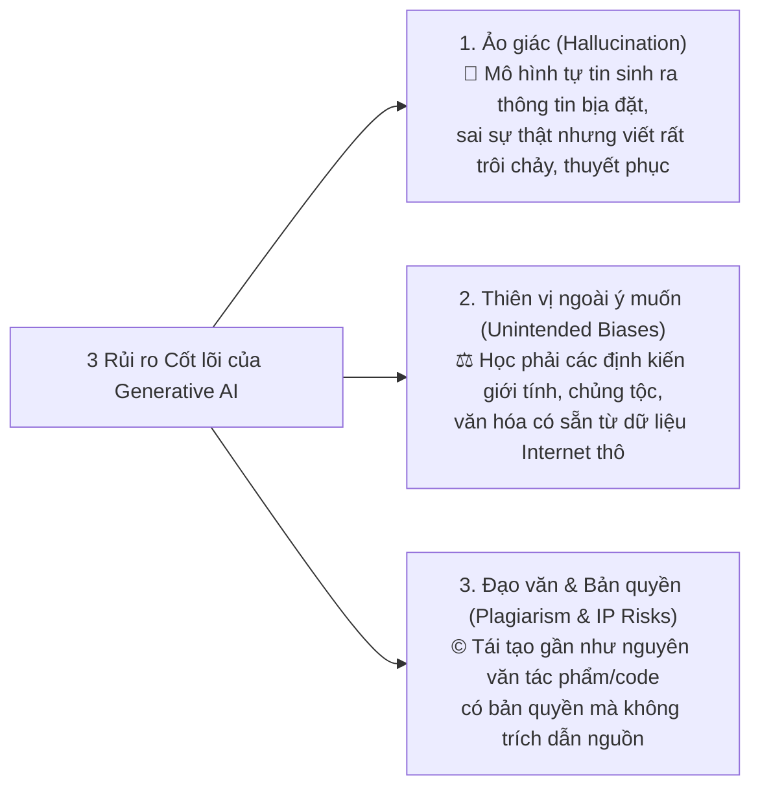
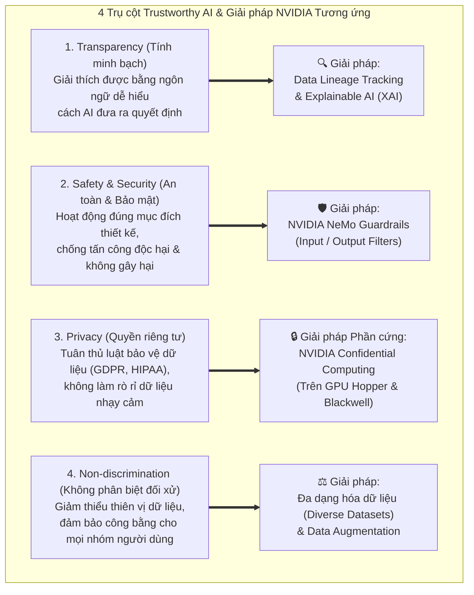
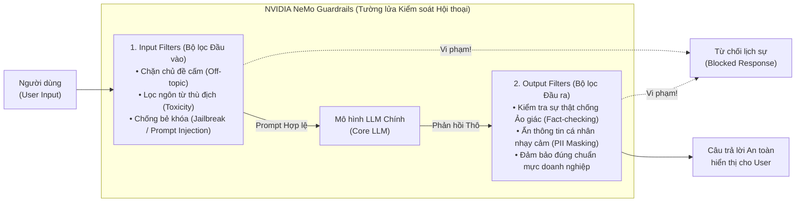
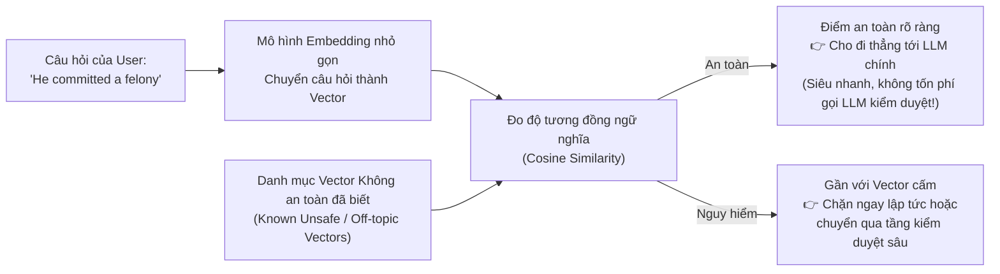

# Module 9: Ethical & Trustworthy AI (AI Đạo đức và Đáng tin cậy)

> [!IMPORTANT]
> **Trọng tâm ôn thi NCA-GENL ở Module 9:**
> Nhận diện **3 rủi ro lớn của Generative AI** (Hallucination, Unintended Biases, Plagiarism/IP Risks); thuộc lòng **4 trụ cột của Trustworthy AI** và **4 giải pháp kỹ thuật tương ứng của NVIDIA** (**Confidential Computing** trên Hopper/Blackwell cho Privacy, **NeMo Guardrails** cho Safety, **Data Lineage & XAI** cho Transparency, **Data Augmentation** cho Non-discrimination); hiểu sâu cơ chế **Embedding Classifier** trong NeMo Guardrails, cùng các khái niệm **Red Teaming** và **Accountability**.

---

## 1. Ba Rủi ro và Thách thức Lớn của Generative AI

Sự bùng nổ của các mô hình LLM/GenAI mang lại sức mạnh to lớn nhưng đi kèm **3 rủi ro kỹ thuật và xã hội nghiêm trọng** mà mọi doanh nghiệp phải đối mặt:

1. **Ảo giác (Hallucination):** Do bản chất của LLM là dự đoán từ tiếp theo dựa trên xác suất thống kê chứ không phải tra cứu cơ sở dữ liệu sự thật, mô hình có thể tự bịa ra một bộ luật không tồn tại, một bài báo khoa học giả hoặc số liệu tài chính sai lệch với giọng văn cực kỳ tự tin.
2. **Thiên vị ngoài ý muốn (Unintended Biases):** Kho dữ liệu huấn luyện khổng lồ thu thập từ Internet phản ánh những định kiến lịch sử của con người (về giới tính, sắc tộc, tuổi tác, tôn giáo, vùng miền). Nếu không được lọc và cân bằng, AI sẽ khuếch đại sự phân biệt đối xử này (ví dụ: mặc định "Giám đốc/Lập trình viên" là nam giới, "Y tá" là nữ giới, hoặc chấm điểm tín dụng thấp hơn cho một nhóm dân cư).
3. **Đạo văn và Xâm phạm Quyền sở hữu trí tuệ (Plagiarism & IP Risks):** Mô hình tạo sinh có nguy cơ học thuộc lòng và xuất ra các đoạn văn bản, hình ảnh nghệ thuật hoặc mã nguồn thương mại có bản quyền của tác giả khác mà không xin phép hay trích dẫn nguồn.

---

## 2. Bốn Nguyên tắc Cốt lõi của Trustworthy AI & Giải pháp Kỹ thuật từ NVIDIA

Để xây dựng một hệ thống **AI Đáng tin cậy (Trustworthy AI)**, tổ chức phải đảm bảo **4 trụ cột đạo đức**, và NVIDIA đã cung cấp chính xác các công nghệ phần cứng/phần mềm tương ứng cho từng trụ cột:

### Bảng đối chiếu Vàng (Học thuộc lòng cho kỳ thi!):
| Trụ cột Trustworthy AI | Ý nghĩa cốt lõi | Giải pháp kỹ thuật tương ứng của NVIDIA |
| :--- | :--- | :--- |
| **1. Quyền riêng tư (Privacy)** | Bảo vệ dữ liệu cá nhân/nhạy cảm (GDPR, HIPAA) ngay cả trong lúc đang tính toán trên Cloud. | **NVIDIA Confidential Computing** (Phần cứng GPU **Hopper** & **Blackwell**). |
| **2. An toàn & Kiểm soát (Safety & Security)** | Ngăn chặn prompt độc hại (Jailbreak), kiểm soát chủ đề hội thoại và lọc ảo giác đầu ra. | **NVIDIA NeMo Guardrails**. |
| **3. Tính minh bạch (Transparency)** | Giải thích được nguyên nhân ra quyết định cho người không chuyên và truy vết nguồn gốc dữ liệu. | **Data Lineage Tracking** (Truy vết dòng chảy dữ liệu) & **Explainable AI (XAI)**. |
| **4. Không phân biệt đối xử (Non-discrimination)** | Loại bỏ định kiến, cân bằng các nhóm dữ liệu thiểu số trong tập huấn luyện. | Đa dạng hóa tập dữ liệu kết hợp **Data Augmentation** (Tăng cường dữ liệu). |

---

## 3. Bảo mật Cấp độ Phần cứng: NVIDIA Confidential Computing

> [!TIP]
> **Góc nhìn Developer Bảo mật:** Thông thường, bạn mã hóa dữ liệu khi nằm trên ổ cứng (**Data at Rest** - AES-256) và khi truyền qua mạng (**Data in Transit** - TLS/HTTPS). Nhưng khi dữ liệu được nạp vào RAM/VRAM để tính toán (**Data in Use**), nó phải giải mã ra dạng rõ (plaintext)! Nếu hacker hoặc quản trị viên Cloud xấu tính dump bộ nhớ VRAM lúc đó, dữ liệu mật sẽ bị lộ.
> **NVIDIA Confidential Computing** giải quyết triệt để lỗ hổng cuối cùng này: **Bảo vệ dữ liệu ngay trong lúc đang tính toán (Data in Use)!**

* **Cơ chế hoạt động:** Xử lý dữ liệu và trọng số mô hình bên trong một vùng bộ nhớ được cách ly và mã hóa hoàn toàn ở cấp độ vi mạch phần cứng, gọi là **Hardware-based Trusted Execution Environment (TEE / Hardware Enclave)**.
* **Mức độ bảo vệ tuyệt đối:** Ngay cả quản trị viên hệ thống đám mây (Cloud Admin), nhân viên vật lý tại trung tâm dữ liệu, hệ điều hành máy chủ (Host OS / Hypervisor) hay mã độc chiếm quyền `root` cũng **không thể nhìn thấy hoặc đánh cắp** dữ liệu và mô hình đang chạy bên trong GPU.
* **Phần cứng hỗ trợ nguyên bản:** Kiến trúc GPU **NVIDIA Hopper (H100)** và **NVIDIA Blackwell (B200)** — yếu tố bắt buộc đối với các ngân hàng, bệnh viện và cơ quan chính phủ khi muốn đưa dữ liệu tối mật lên Cloud.

---

## 4. Rào chắn Bảo vệ Ứng dụng LLM: NVIDIA NeMo Guardrails

**NVIDIA NeMo Guardrails** là bộ công cụ mã nguồn mở đóng vai trò như một lớp **"Tường lửa thông minh (AI Firewall / Middleware)"** nằm kẹp giữa Người dùng và Mô hình LLM.

### Kỹ thuật Tối ưu hóa Chi phí & Độ trễ bằng Embedding Classifier (Cực kỳ hay hỏi thi!)
* **Bài toán thực tế:** Nếu mỗi lần người dùng nhắn một câu (`"Xin chào"`, `"Giá sản phẩm A bao nhiêu?"`), hệ thống lại phải gọi một mô hình LLM lớn khác để đọc và phán xét xem câu đó có an toàn hay không, thì **chi phí gọi API sẽ tăng gấp đôi** và **độ trễ (latency) tăng vọt**! Còn nếu chỉ dùng bộ lọc từ khóa tĩnh (`if "crime" in prompt: block()`), kẻ xấu chỉ cần đổi sang từ đồng nghĩa (`"He committed a felony"`) là vượt qua dễ dàng!
* **Giải pháp thông minh – Embedding Classifier:**

* **Tại sao Embedding Classifier vượt trội hơn cả hai cách cũ?**
  1. **So với gọi LLM kiểm duyệt:** Nhúng câu văn thành vector và tính **Cosine Similarity** chỉ tốn vài mili-giây và chi phí gần như bằng 0, chỉ những câu thực sự an toàn mới được đi thẳng vào LLM chính.
  2. **So với bộ lọc từ khóa tĩnh (Keyword Filter):** Bộ lọc từ khóa chỉ chặn đúng chữ `"crime"` nhưng để lọt câu `"He committed a felony"` (Anh ta phạm trọng tội). Ngược lại, **Embedding Classifier hiểu ngữ nghĩa (Semantic understanding)** nên vector của `"felony"` và `"crime"` nằm sát nhau $\to$ Chặn chính xác cả hai!

---

## 5. Bốn Phương pháp Kỹ thuật Bổ trợ Quản trị AI (AI Governance)

1. **Data Lineage Tracking (Theo vết nguồn gốc và dòng chảy dữ liệu):**
   * Là khả năng ghi nhật ký và truy vết chính xác một mẫu dữ liệu được thu thập từ đâu, ai đã chỉnh sửa, đi qua những bước làm sạch/biến đổi nào trước khi đưa vào huấn luyện mô hình.
   * *Vai trò:* Bắt buộc phải có để phục vụ **kiểm toán pháp lý (Auditing)**, chứng minh dữ liệu hợp pháp không vi phạm bản quyền và nhanh chóng tìm ra nguyên nhân gốc rễ nếu mô hình bị nhiễm dữ liệu bẩn.
2. **Red Teaming (Tấn công mô phỏng chủ động):**
   * Lấy cảm hứng từ ngành An ninh mạng (Cybersecurity Pentesting): Một đội ngũ chuyên gia độc lập đóng vai **kẻ tấn công (Adversary)**, cố tình tìm mọi cách gửi các câu lệnh lắt léo, độc hại, bẻ khóa (Jailbreak) hoặc gài bẫy đạo đức nhằm ép mô hình bộc lộ lỗ hổng **trước khi** sản phẩm được phát hành ra công chúng.
3. **Data Augmentation (Tăng cường dữ liệu):**
   * Kỹ thuật tạo thêm dữ liệu huấn luyện nhân tạo có tính đa dạng cao từ tập dữ liệu gốc (Ví dụ với ảnh: lật ngang, xoay góc, thay đổi độ sáng, cắt cúp; Ví dụ với văn bản: thay thế từ đồng nghĩa, dịch ngược qua ngôn ngữ khác - Back translation).
   * *Vai trò trong Đạo đức AI:* Giúp bổ sung thêm mẫu cho các nhóm dân cư/trường hợp thiểu số bị thiếu hụt trong dữ liệu gốc (**giảm Unintended Bias / Non-discrimination**) và giúp mô hình tổng quát hóa tốt hơn.
4. **Accountability (Trách nhiệm giải trình):**
   * Nguyên tắc quản trị quy định rõ ràng: Máy móc không thể tự chịu trách nhiệm trước pháp luật; phải có **cá nhân và tổ chức con người cụ thể** chịu trách nhiệm pháp lý và đạo đức đối với các quyết định, sai sót và thiệt hại do hệ thống AI gây ra.

---

## 6. Bẫy đề thi NCA-GENL & Câu hỏi Thực chiến (Exam Traps & Mini Quiz)

> [!WARNING]
> **Các bẫy kinh điển trong đề thi Module 9:**
> 1. **Bẫy Confidential Computing vs. Guardrails:**
>    * Bảo vệ **dữ liệu nhạy cảm trong bộ nhớ phần cứng GPU khi đang tính toán trên Cloud (Privacy)** $\to$ Chọn **NVIDIA Confidential Computing (Hopper/Blackwell)**.
>    * Kiểm soát **đầu vào/đầu ra của cuộc hội thoại LLM, chặn chủ đề cấm và chống ảo giác (Safety)** $\to$ Chọn **NVIDIA NeMo Guardrails**.
> 2. **Bẫy Embedding Classifier vs. Keyword Filter:** Tại sao dùng Embedding Classifier để lọc đầu vào lại tốt hơn lọc từ khóa (Keyword matching) và gọi LLM phụ? $\to$ Vì nó **hiểu được ngữ nghĩa của các từ đồng nghĩa/diễn đạt khác nhau** (vượt trội hơn Keyword filter) đồng thời **nhanh và rẻ hơn nhiều** so với việc gọi một LLM lớn để kiểm duyệt mọi câu hỏi.
> 3. **Bẫy Data Lineage vs. Red Teaming:** Truy vết lịch sử nguồn gốc dữ liệu phục vụ kiểm toán $\to$ **Data Lineage Tracking**. Đóng giả hacker tấn công thử nghiệm để tìm lỗ hổng mô hình $\to$ **Red Teaming**.

### Câu hỏi tự kiểm tra (Mini Quiz):
1. **Câu 1:** Một tổ chức tài chính muốn huấn luyện mô hình AI trên đám mây công cộng (Public Cloud) nhưng yêu cầu dữ liệu khách hàng phải được mã hóa và cách ly ngay cả trong quá trình GPU đang xử lý tính toán để quản trị viên Cloud không thể đọc trộm. Công nghệ nào của NVIDIA đáp ứng yêu cầu này?
   * *Đáp án:* **NVIDIA Confidential Computing** (trên kiến trúc GPU Hopper hoặc Blackwell).
2. **Câu 2:** Để giảm thiểu sự thiên vị (Bias) khi một nhóm nhân khẩu học có quá ít mẫu trong tập dữ liệu huấn luyện, kỹ sư nên áp dụng kỹ thuật xử lý dữ liệu nào?
   * *Đáp án:* **Data Augmentation (Tăng cường dữ liệu)** kết hợp thu thập tập dữ liệu đa dạng hơn.
