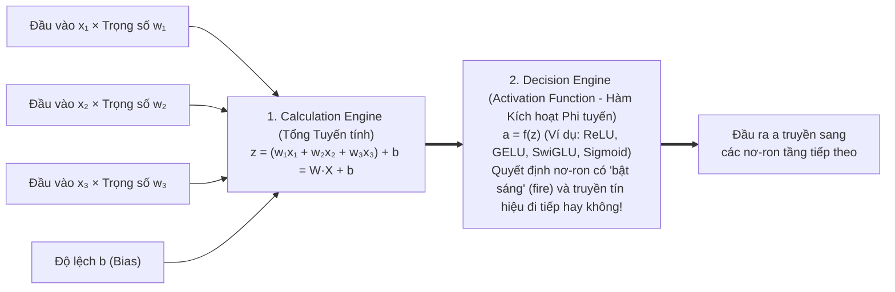
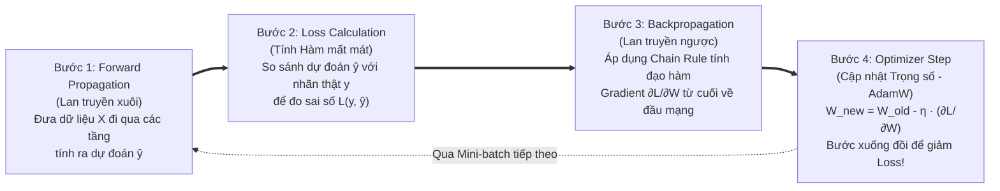
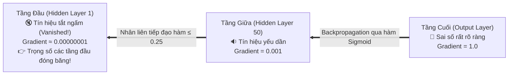
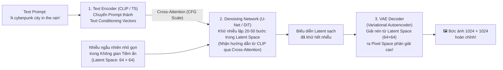
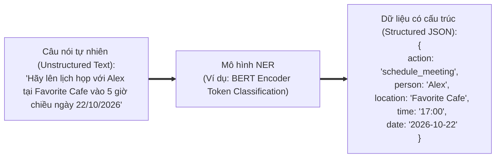

# Module 10: Additional Technical Topics (Các Chủ đề Kỹ thuật Bổ trợ Quan trọng)

> [!IMPORTANT]
> **Trọng tâm ôn thi NCA-GENL ở Module 10 (Thuộc Domain "Core ML & AI Knowledge - 30%" & "Software Development - 24%"):**
> Nắm vững giải phẫu một Nơ-ron và vòng lặp toán học **Forward Propagation $\to$ Loss Function (MSE vs. Cross-Entropy) $\to$ Backpropagation & Optimizers (SGD, Adam, AdamW)**; hiểu sâu hiện tượng **Vanishing Gradients vs. Exploding Gradients** qua phép ẩn dụ Trò chơi truyền tin và cách khắc phục bằng hàm kích hoạt **ReLU / GELU / SwiGLU** cùng **Skip/Residual Connections**; phân biệt **ReLU vs. Leaky ReLU vs. Sigmoid vs. Tanh vs. Softmax**; hiểu sự khác nhau giữa **Layer Normalization (LayerNorm / RMSNorm) vs. Batch Normalization** và vai trò của **Dropout**; nắm chắc 2 pha của **Diffusion Models (Forward vs. Reverse Diffusion)**, **Latent Diffusion (VAE + U-Net/DiT + CLIP)** và tham số **CFG Scale**; cùng các khái niệm **Vision Transformer (ViT)**, **NER (Named Entity Recognition)**, **Extractive vs. Abstractive Summarization**, **RAD (Rapid Application Development)** và hệ sinh thái **Hugging Face (`transformers`, `datasets`, `peft`, `safetensors`)**.

---

## 1. Cơ chế Toán học Huấn luyện Mạng Nơ-ron & Cấu tạo một Nơ-ron

### 1.1. Giải phẫu bên trong 1 Nơ-ron Nhân tạo (Artificial Neuron / Perceptron)
Lấy cảm hứng từ tế bào thần kinh sinh học trong não người (có sợi nhánh Dendrites nhận tín hiệu, thân tế bào Soma tổng hợp, và sợi trục Axon phát xung điện qua khớp thần kinh Synapse), mỗi nơ-ron nhân tạo hoạt động như một hàm toán học gồm **2 bộ phận nối tiếp nhau**:



* **Vai trò của Trọng số ($w_i$ - Weights) và Độ lệch ($b$ - Bias):**
  * **Weights ($w_i$):** Quyết định **mức độ quan trọng (cường độ ảnh hưởng)** của từng đặc trưng đầu vào $x_i$ (nếu $w_i > 0$ là kích thích, $w_i < 0$ là ức chế, $w_i = 0$ là bỏ qua hoàn toàn đặc trưng đó).
  * **Bias ($b$):** Hằng số dịch chuyển ngưỡng kích hoạt (giúp đường thẳng $z = wx + b$ không bị ép phải đi qua gốc tọa độ $(0,0)$).
* **Câu hỏi bản chất: Tại sao bắt buộc phải có Hàm kích hoạt phi tuyến (Non-linear Activation Function)?**
  * Nếu bỏ hàm kích hoạt phi tuyến đi (hoặc chỉ dùng hàm tuyến tính $f(z) = z$), thì dù bạn có xếp chồng $1.000$ tầng ẩn liên tiếp nhau, tích của $1.000$ phép nhân ma trận tuyến tính $W_{1000}(\dots(W_2(W_1 x + b_1) + b_2)\dots)$ theo đại số tuyến tính vẫn **suy biến thành đúng 1 phép nhân ma trận tuyến tính đơn giản duy nhất ($y = W_{\text{total}}x + b_{\text{total}}$ — tức tương đương mạng 1 lớp không có tầng ẩn)**!
  * Chính các **Hàm kích hoạt phi tuyến (Non-linearities)** mới giúp mạng nơ-ron sâu có khả năng "uốn cong" không gian để xấp xỉ bất kỳ hàm toán học phức tạp nào trên đời (**Định lý Xấp xỉ Vạn năng - Universal Approximation Theorem**) như nhận diện khuôn mặt, giọng nói hay hiểu ngôn ngữ tự nhiên!

---

### 1.2. Bốn thành phần trong Vòng lặp Huấn luyện (The 4-Step Training Loop)
Mọi quá trình huấn luyện mạng nơ-ron trong PyTorch/TensorFlow đều lặp đi lặp lại 4 bước toán học sau cho mỗi Mini-batch:



1. **Forward Propagation (Lan truyền xuôi):** Dữ liệu đầu vào $X$ đi xuôi từ tầng Input qua các tầng Hidden đến tầng Output để sinh ra **kết quả dự đoán ($\hat{y}$)**.
2. **Loss Function (Hàm mất mát / Hàm mục tiêu):** Đo lường khoảng cách sai số giữa dự đoán của mô hình ($\hat{y}$) và nhãn thực tế đúng (**Ground Truth $y$**).
   * *Bài toán Hồi quy (Regression - dự đoán số liên tục):* Dùng **MSE (Mean Squared Error)**: $L = \frac{1}{n}\sum (y - \hat{y})^2$ hoặc **MAE (L1 Loss)**.
   * *Bài toán Phân loại nhị phân (Binary Classification):* Dùng **Binary Cross-Entropy Loss (Log Loss)**.
   * *Bài toán Phân loại đa lớp & Dự đoán token tiếp theo trong LLM:* Dùng **Categorical Cross-Entropy Loss** (Negative Log-Likelihood của token đúng).
3. **Backpropagation (Lan truyền ngược):** Áp dụng quy tắc đạo hàm hàm hợp (**Chain Rule**) trong giải tích để truyền ngược tín hiệu sai số từ tầng Output về lại từng tầng ẩn phía trước, tính toán chính xác vector đạo hàm riêng (**Gradients** $\nabla_W L = \frac{\partial L}{\partial W}$) cho từng trọng số trong mạng.
4. **Optimizer (Thuật toán tối ưu hóa – SGD, Momentum, Adam, AdamW):** Sử dụng giá trị Gradient vừa tính được từ Backpropagation cùng với **Learning Rate ($\eta$)** để thực sự bước xuống đồi cập nhật trọng số:
   $$W_{t+1} = W_t - \eta \cdot \nabla L(W_t)$$
   * **SGD (Stochastic Gradient Descent):** Bước xuống đồi với tốc độ học cố định cho mọi tham số; dễ bị dao động ở các hẻm núi hẹp.
   * **Adam (Adaptive Moment Estimation) & AdamW (Adam with Decoupled Weight Decay):** **Bộ tối ưu hóa tiêu chuẩn vàng cho mọi mô hình Transformer và LLM hiện đại!** Nó lưu trữ cả trung bình trượt của đạo hàm bậc 1 (**Momentum** - giữ quán tính hướng đi) và đạo hàm bậc 2 (**Adaptive Variance** - tự động chia nhỏ bước nhảy cho những tham số biến động mạnh và tăng bước nhảy cho tham số thưa), kết hợp điều chuẩn trọng số **Weight Decay (L2)** chống Overfitting.

---

## 2. Vấn đề Triệt tiêu & Bùng nổ Đạo hàm (Vanishing & Exploding Gradients) và Các Hàm Kích hoạt

### 2.1. Hiện tượng Vanishing Gradients (Triệt tiêu đạo hàm) vs. Exploding Gradients (Bùng nổ đạo hàm)
Khi mạng nơ-ron có rất nhiều tầng sâu (ví dụ 50 – 100 tầng), trong quá trình **Backpropagation**, đạo hàm tại tầng đầu tiên (Layer 1) được tính bằng **tích nhân liên tiếp (Chain Rule)** của các đạo hàm từ tầng cuối cùng ngược về tầng đầu:
$$\frac{\partial L}{\partial W_1} = \frac{\partial L}{\partial a_N} \times \frac{\partial a_N}{\partial a_{N-1}} \times \dots \times \frac{\partial a_2}{\partial a_1} \times \frac{\partial a_1}{\partial W_1}$$

* **Vanishing Gradients (Triệt tiêu đạo hàm):**
  * Nếu mỗi tầng sử dụng hàm kích hoạt **Sigmoid** (vốn có đạo hàm cực đại chỉ bằng **$0.25$**, và ở hai đầu bão hòa đạo hàm gần bằng $0$), thì sau khi nhân liên tiếp qua 50 tầng:
    $$(0.25)^{50} \approx 8 \times 10^{-31} \to \mathbf{0}$$
  * **Phép ẩn dụ Trò chơi Truyền tin (Whispering Game / Telephone Game Analogy):**
    Giống như 100 người xếp thành một hàng dọc chơi trò truyền tin thì thầm. Người đứng cuối hàng (Output layer) nói rất rõ sai số ở đâu cho người thứ 99, nhưng qua mỗi người âm lượng lại giảm đi 4 lần. Đến khi truyền tới những người đứng đầu hàng (Early layers), âm thanh đã **tắt ngấm hoàn toàn (tiến về 0)** — những người đầu hàng không nghe thấy gì nên **các tầng đầu tiên ngừng học hoàn toàn ($W_{\text{new}} = W_{\text{old}} - 0$)**!
* **Exploding Gradients (Bùng nổ đạo hàm):**
  * Ngược lại, nếu các ma trận trọng số có giá trị lớn hơn $1$ (ví dụ $2.0$), sau khi nhân liên tiếp 50 tầng: $2^{50} \approx 1.12 \times 10^{15} \to \infty$ (`NaN`), khiến bước cập nhật trọng số văng khỏi quỹ đạo và phá hỏng mô hình ngay lập tức!



### 2.2. Bảng Tổng hợp Giải pháp Khắc phục Vanishing vs. Exploding Gradients (Hay hỏi thi!)
| Vấn đề Đạo hàm | Giải pháp Kỹ thuật Khắc phục Triệt để | Cơ chế Toán học |
| :--- | :--- | :--- |
| **1. Vanishing Gradients (Đạo hàm tiến về $0$)** | • **Đổi hàm kích hoạt sang họ `ReLU` (`ReLU`, `Leaky ReLU`, `GELU`, `SwiGLU`)**.<br/>• **Sử dụng Kết nối tắt: `Skip Connections / Residual Connections` ($y = F(x) + x$)**.<br/>• Dùng cổng nhớ LSTM/GRU hoặc đổi hẳn sang **Transformer**. | • Đạo hàm của `ReLU` với mọi số dương luôn bằng đúng hằng số **$1$** ($1 \times 1 \times \dots \times 1 = 1$), không bị suy hao!<br/>• Đường nối tắt $+ x$ tạo ra đạo hàm bằng $1$ truyền thẳng từ tầng cuối về tầng đầu như đường cao tốc không trạm thu phí. |
| **2. Exploding Gradients (Đạo hàm vọt lên $\infty$ / `NaN`)** | • **Kỹ thuật Cắt ngưỡng Đạo hàm: `Gradient Clipping`**.<br/>• **Chuẩn hóa Tầng: `Layer Normalization (LayerNorm)` / `BatchNorm`**.<br/>• Khởi tạo trọng số chuẩn (**Xavier / He Initialization**) & Giảm Learning Rate / thêm **Weight Decay**. | • **Gradient Clipping:** Nếu độ dài vector đạo hàm $\|\nabla L\| > \text{threshold}$ (ví dụ $1.0$), tự động thu nhỏ vector đạo hàm về đúng bằng $1.0$ trước khi cập nhật.<br/>• **LayerNorm:** Giữ các giá trị kích hoạt luôn nằm gọn quanh trung bình $0$, phương sai $1$. |

---

### 2.3. Bảng So sánh Toàn diện Các Hàm Kích hoạt (Activation Functions) trong Deep Learning & LLM
Trong đề thi NCA-GENL, bạn cần phân biệt rõ khi nào dùng hàm kích hoạt nào:

| Hàm kích hoạt | Công thức & Đồ thị | Miền giá trị đầu ra | Ưu điểm, Nhược điểm & Vị trí Sử dụng Chuẩn |
| :--- | :--- | :---: | :--- |
| **1. ReLU (Rectified Linear Unit)** | $$f(x) = \max(0, x)$$ *(Nếu $x < 0 \to 0$; nếu $x > 0 \to x$)* | $[0, +\infty)$ | • **Ưu:** Tính toán siêu nhanh trên GPU (chỉ là phép so sánh), **chống Vanishing Gradient tuyệt vời** cho miền dương (đạo hàm = $1$).<br/>• **Nhược:** Hiện tượng *"Dying ReLU"* (nếu nơ-ron rơi vào vùng âm liên tục thì đạo hàm = $0$).<br/>• **Vị trí:** Mặc định cho **các Tầng ẩn (Hidden Layers)** của CNN và MLP. |
| **2. Leaky ReLU / GELU / SwiGLU** | • Leaky ReLU: $\max(0.01x, x)$<br/>• **GELU / SwiGLU**: Biến thể mượt của ReLU | $(-\infty, +\infty)$ | • Khắc phục hiện tượng *Dying ReLU* bằng cách cho phép một lượng nhỏ đạo hàm ở miền âm.<br/>• **GELU** và **SwiGLU** là **hàm kích hoạt chuẩn bên trong khối FFN của mọi LLM hiện đại** (GPT-4, BERT, LLaMA-3, Mistral)! |
| **3. Sigmoid (Logistic)** | $$\sigma(x) = \frac{1}{1 + e^{-x}}$$ *(Đường cong chữ S)* | $(0, 1)$ | • **Nhược:** Tính hàm mũ $e^{-x}$ chậm, đầu ra không đối xứng qua $0$, **gây Vanishing Gradient nặng nề nếu đặt ở tầng ẩn**.<br/>• **Vị trí:** Chỉ dùng ở **Tầng đầu ra (Output Layer) cho bài toán Phân loại Nhị phân (Binary Classification)** để biểu diễn xác suất Đúng/Sai từ $0$ đến $1$. |
| **4. Tanh (Hyperbolic Tangent)** | $$\tanh(x) = \frac{e^x - e^{-x}}{e^x + e^{-x}}$$ | $(-1, 1)$ | • Đối xứng qua tâm $0$ (Zero-centered) nên tốt hơn Sigmoid, dùng trong các cổng của LSTM, nhưng vẫn bị Vanishing Gradient ở hai đầu bão hòa. |
| **5. Softmax** | $$\text{softmax}(z_i) = \frac{e^{z_i}}{\sum_{j=1}^K e^{z_j}}$$ | $(0, 1)$ và $\sum P_i = 1.0$ | • Biến một vector điểm số thô (**Logits**) thành một **Phân phối xác suất chuẩn** (tổng tất cả các lớp bằng đúng $100\%$).<br/>• **Vị trí:** Bắt buộc đặt ở **Tầng đầu ra (Output Layer) của bài toán Phân loại Đa lớp (Multi-class)**, đầu ra dự đoán từ vựng của **LLM** và bên trong công thức **Self-Attention**! |

---

## 3. Kỹ thuật Chuẩn hóa Tầng (LayerNorm vs. BatchNorm) & Chống Học vẹt (Dropout)

### 3.1. Layer Normalization (LayerNorm / RMSNorm) vs. Batch Normalization (BatchNorm)
* **Vấn đề kỹ thuật (Internal Covariate Shift):** Khi dữ liệu đi qua hàng chục tầng nhân ma trận trong mạng sâu, phân phối của các con số kích hoạt (activations) bị xô lệch liên tục — có tầng vọt lên hàng triệu, có tầng tụt xuống cực nhỏ, làm quá trình huấn luyện rất khó hội tụ.
* **Bản chất của Layer Normalization (Chuẩn hóa Tầng):** Quy chuẩn hóa đầu ra của tất cả các đặc trưng bên trong **cùng một mẫu dữ liệu đơn lẻ tại một tầng** về phân phối chuẩn có **Trung bình bằng $0$ ($\mu = 0$)** và **Độ lệch chuẩn bằng $1$ ($\sigma = 1$)** (hầu hết các giá trị nằm gọn trong dải an toàn từ **$-3$ đến $+3$**).
* **Phép ẩn dụ Điểm thi Đại học (School Exam Z-Score Analogy):**
  Ba học sinh nộp điểm từ 3 trường có thang điểm khác nhau (Trường A chấm thang $50$, Trường B chấm thang $100$, Trường C chấm thang $200$). Nếu cộng gộp điểm thô sẽ gây sai lệch hoàn toàn. Quy đổi toàn bộ điểm số về **thang điểm chuẩn Z-Score ($\mu=0, \sigma=1$)** giúp so sánh công bằng và giữ cho mọi khối **Transformer** hội tụ ổn định.
* **Phân biệt nhanh BatchNorm vs. LayerNorm (Hay hỏi nâng cao):**
  * **Batch Normalization (BatchNorm):** Chuẩn hóa dọc theo từng cột đặc trưng **qua tất cả các mẫu trong cùng một Mini-batch** $\to$ Phụ thuộc vào kích thước Batch Size, rất phổ biến trong **Mạng thị giác CNN (ResNet)**.
  * **Layer Normalization (LayerNorm) & RMSNorm:** Chuẩn hóa ngang theo các chiều ẩn của **từng token độc lập** mà hoàn toàn không phụ thuộc vào Batch Size hay độ dài câu $\to$ **Tiêu chuẩn bắt buộc cho mọi kiến trúc Chuỗi / NLP / Transformer / LLM**!

### 3.2. Kỹ thuật Dropout (Chống Overfitting)
* **Cơ chế hoạt động:** Trong suốt quá trình **Training (Huấn luyện)**, ở mỗi bước lặp, lớp **Dropout** sẽ **ngẫu nhiên tắt (gán giá trị bằng $0$) một tỷ lệ $p\%$ các nơ-ron** trong tầng (ví dụ `Dropout rate p = 0.1` hoặc `0.2`, tức tắt ngẫu nhiên 10–20% nơ-ron).
* **Phép ẩn dụ Đội bóng / Công ty:** Nếu trong một nhóm làm việc có 1 ngôi sao quá giỏi, các thành viên khác sẽ ỷ lại ngồi chơi. Nếu mỗi ngày quản lý ngẫu nhiên cho 20% nhân viên nghỉ phép, tất cả các nhân viên còn lại bắt buộc phải tự rèn luyện kỹ năng đa năng để gánh vác công việc!
* **Tác dụng:** Ngăn chặn hiện tượng các nơ-ron phụ thuộc đồng bộ mù quáng vào nhau (**Co-adaptation**) để học thuộc lòng nhiễu của tập Train, buộc mạng nơ-ron học các biểu diễn đặc trưng phân tán và vững chắc hơn $\to$ **Giảm thiểu Overfitting cực kỳ hiệu quả!**
* **Lưu ý sống còn khi đi thi:** **Dropout CHỈ BẬT trong lúc `Training` (`model.train()`)**; khi chuyển sang chạy **Suy luận thực tế `Inference / Evaluation` (`model.eval()`), Dropout BẮT BUỘC PHẢI TẮT ĐI** để sử dụng 100% toàn bộ nơ-ron của mạng nhằm cho ra dự đoán ổn định và chính xác nhất!

---

## 4. Thuật toán Khuếch tán Sinh ảnh/Video: Diffusion Models, Latent Diffusion & Vision Transformer (ViT)

### 4.1. Quy trình 2 Pha đối nghịch nhau của Diffusion Models (Cần nhớ rõ!):
**Diffusion Models (Mô hình Khuếch tán)** là kiến trúc cốt lõi đứng đằng sau các hệ thống tạo sinh hình ảnh, nghệ thuật và video như **Stable Diffusion, Midjourney, DALL-E 3, OpenAI Sora, NVIDIA Edify / Cosmos**.

```mermaid
flowchart TD
    subgraph P1["PHA 1: FORWARD DIFFUSION (Khuếch tán Xuôi - Diễn ra trong lúc HUẤN LUYỆN)"]
        direction LR
        Img0["🐱 Bức ảnh gốc sắc nét x₀<br/>(Step t = 0)"]
        Img1["🌫️ Ảnh hơi mờ nhiễu x₅₀<br/>(Step t = 50)"]
        ImgT["📺 Màn hình nhiễu hạt 100% x_T<br/>(Pure Gaussian Noise - Step t = 1000)"]
        
        Img0 ==>|"Cộng dần nhiễu Gaussian nhỏ q(x_t | x_{t-1})"| Img1 ==>|"Phá hủy cấu trúc ảnh"| ImgT
    end

    subgraph P2["PHA 2: REVERSE DIFFUSION (Khuếch tán Ngược - Diễn ra trong lúc SUY LUẬN / TẠO ẢNH)"]
        direction LR
        Noise["📺 Khung hình nhiễu ngẫu nhiên x_T<br/>+ Text Prompt: 'Một chú mèo đội mũ phi hành gia'"]
        Denoise["🎨 Mạng nơ-ron (U-Net / DiT) dự đoán lượng nhiễu ε_θ<br/>và trừ bỏ từng lớp nhiễu nhỏ qua từng bước"]
        NewImg["🚀🐱 Bức ảnh mới nguyên bản x₀,<br/>sắc nét & khớp hoàn hảo với Prompt!"]
        
        Noise ==>|"Khử nhiễu có định hướng (Guided Denoising)"| Denoise ==>|"Hoàn tất sau 20-50 bước"| NewImg
    end
```



1. **Forward Diffusion Process (Khuếch tán xuôi – Pha Huấn luyện):** Bắt đầu từ một bức ảnh thật sắc nét ($x_0$), hệ thống **cộng thêm từng lượng nhỏ nhiễu chuẩn Gaussian (Gaussian Noise)** qua $T$ bước thời gian liên tiếp (ví dụ $T = 1000$) cho đến khi bức ảnh gốc bị phá hủy hoàn toàn, trở thành một màn hình tivi mất sóng nhiễu hạt trắng xóa ($x_T \sim \mathcal{N}(0, \mathbf{I})$).
2. **Reverse Diffusion Process (Khuếch tán ngược / Denoising – Pha Suy luận tạo ảnh mới):** Bắt đầu từ một khung hình nhiễu ngẫu nhiên hoàn toàn ($x_T$), dưới sự dẫn dắt của câu lệnh **Text Prompt** (thông qua cơ chế Cross-Attention), mạng nơ-ron dự đoán chính xác phần nhiễu ở mỗi bước và **bóc tách/khử bỏ từng lớp nhiễu nhỏ** lặp đi lặp lại ($x_T \to x_{T-1} \to \dots \to x_0$) cho đến khi lộ ra một bức ảnh mới hoàn toàn, sắc nét và đúng như mô tả!

### 4.2. Giải phẫu Kiến trúc Latent Diffusion Models (Stable Diffusion) & Tham số CFG Scale
Nếu chạy quá trình khử nhiễu 50 bước trực tiếp trên ma trận điểm ảnh phân giải cao $1024 \times 1024 \times 3$ (**Pixel Space**), khối lượng tính toán sẽ cực kỳ khổng lồ và chậm chạp. **Latent Diffusion Model (LDM)** giải quyết bài toán này bằng sự phối hợp của **3 thành phần cốt lõi**:



1. **VAE (Variational Autoencoder):** Bộ **VAE Encoder** nén bức ảnh từ không gian điểm ảnh lớn (Pixel Space) xuống một **Không gian tiềm ẩn (Latent Space)** nhỏ gọn hơn 48 lần (nhưng vẫn giữ nguyên mọi đặc trưng cấu trúc) để huấn luyện; và sau khi khử nhiễu xong, **VAE Decoder** phóng đại ngược vector Latent đó ra bức ảnh độ phân giải cao hoàn chỉnh.
2. **U-Net hoặc DiT (Diffusion Transformer):** Trái tim thực hiện việc dự đoán và khử nhiễu từng bước ngay bên trong không gian Latent nhỏ gọn. *(Các mô hình thế hệ mới nhất như **Sora, Flux, Stable Diffusion 3** thay thế mạng tích chập U-Net bằng kiến trúc **DiT - Diffusion Transformer** để mở rộng quy mô tốt hơn).*
3. **CLIP (Contrastive Language-Image Pre-training - Bộ mã hóa văn bản):** Mô hình đa phương thức (do OpenAI giới thiệu) được huấn luyện trên 400 triệu cặp `(Ảnh, Chú thích)` để căn chỉnh văn bản và hình ảnh vào cùng một không gian vector. Trong Diffusion, **CLIP Text Encoder** biến câu Prompt của người dùng thành vector ngữ nghĩa rồi tiêm vào mạng U-Net/DiT qua tầng **Cross-Attention** để dẫn đường cho việc khử nhiễu.
   * **Tham số `CFG Scale` (Classifier-Free Guidance Scale):** Điều chỉnh mức độ mô hình "nghe lời" câu lệnh Text Prompt:
     * *CFG thấp ($1 - 3$):* Mô hình tự do sáng tạo nhưng dễ bỏ sót chi tiết trong Prompt.
     * *CFG cân bằng ($7 - 9$):* Bám sát mô tả của Prompt và ảnh đẹp tự nhiên.
     * *CFG quá cao ($> 15$):* Ép bám sát Prompt thái quá làm ảnh bị cháy sáng và vỡ màu.
4. **Vision Transformer (ViT):** Cách áp dụng trực tiếp kiến trúc Transformer vào Thị giác máy tính — cắt bức ảnh thành một lưới các **ô vuông nhỏ cố định (Image Patches, ví dụ $16 \times 16$ pixels)**, trải phẳng mỗi ô vuông thành một vector rồi coi mỗi ô vuông đó giống hệt như **1 Token từ vựng** đưa vào Transformer Encoder!

---

## 5. Các Tác vụ NLP Cốt lõi (NER, Summarization), Phương pháp RAD & Hệ sinh thái Hugging Face

### 5.1. Named Entity Recognition (NER - Nhận diện Thực thể Định danh) & Các Tác vụ NLP
* **NER là gì?** Là kỹ thuật NLP tự động quét qua văn bản phi cấu trúc để xác định ranh giới và phân loại các từ/cụm từ quan trọng vào các nhóm **Thực thể định danh có cấu trúc (Predefined Categories)**: **Tên người (`PER`), Tổ chức/Công ty (`ORG`), Địa điểm (`LOC`), Ngày giờ (`DATE/TIME`), Tiền tệ (`MONEY`), Mã bệnh/Thuốc (`MEDICAL`)**.



* **Phân biệt 2 phương pháp Tóm tắt văn bản (Text Summarization - Hay hỏi trong đề thi):**
  1. **Extractive Summarization (Tóm tắt Trích xuất):** Giống như dùng bút dạ quang **gạch chân và trích nguyên văn các câu quan trọng nhất** có sẵn trong bài viết gốc ghép lại (không tự viết thêm từ mới; thường dùng các mô hình Encoder như BERT).
  2. **Abstractive Summarization (Tóm tắt Trừu tượng / Diễn giải):** Giống như con người đọc hiểu toàn bộ văn bản rồi **tự dùng ngôn từ mới của mình để viết lại bản tóm tắt ngắn gọn, mượt mà** (sử dụng các mô hình **Encoder-Decoder như T5, BART** hoặc **Decoder-only LLM**).

---

### 5.2. Phương pháp Phát triển Phần mềm RAD & Hệ sinh thái Thư viện Hugging Face
1. **RAD (Rapid Application Development - Phát triển Ứng dụng Nhanh):**
   * Là phương pháp luận kỹ thuật phần mềm (Software Engineering Methodology) ưu tiên việc **xây dựng nhanh nguyên mẫu hoạt động được (Rapid Prototyping)**, phát hành thử nghiệm sớm và **lặp đi lặp lại liên tục dựa trên phản hồi trực tiếp của người dùng (Iterative User Feedback)** thay vì mất hàng tháng trời viết tài liệu thiết kế cứng nhắc từ đầu (như mô hình Thác nước - Waterfall).
   * *Tại sao RAD cực kỳ quan trọng trong đề thi NCA-GENL?* Vì các dự án Generative AI mang tính thực nghiệm rất cao (không biết trước Prompt nào hay mô hình nào sẽ hiệu quả nhất trên dữ liệu thật), nên áp dụng **RAD** (kết hợp các công cụ dựng UI nhanh như *Gradio, Streamlit* và microservice *NVIDIA NIM*) giúp đội ngũ AI kiểm chứng ý tưởng (PoC) chỉ trong vài ngày!
2. **Hệ sinh thái Thư viện `Hugging Face` (Tiêu chuẩn công nghiệp cho Developer AI):**
   * **`transformers`:** Thư viện Python cốt lõi cung cấp API thống nhất (`AutoTokenizer`, `AutoModelForCausalLM`, `pipeline`) để tải và chạy hàng trăm nghìn mô hình Pre-trained (NLP, Vision, Audio, Multimodal), tương thích mượt mà với cả **PyTorch** và **TensorFlow**.
   * **`datasets`:** Thư viện tải và xử lý các tập dữ liệu lớn siêu tốc dựa trên định dạng bộ nhớ Apache Arrow (Memory-mapping không làm tràn RAM).
   * **`tokenizers`:** Thư viện thực thi Subword Tokenization (BPE, WordPiece) được viết bằng ngôn ngữ **Rust** siêu nhanh.
   * **`peft` & `trl`:** Thư viện chuẩn để gắn LoRA/QLoRA (`peft`) và huấn luyện SFT / DPO / RLHF (`trl` - Transformer Reinforcement Learning).
   * **`safetensors`:** Định dạng lưu trữ trọng số mô hình mới an toàn và nạp nhanh (Zero-copy), thay thế cho định dạng `.bin` / `pickle` cũ của Python vốn tiềm ẩn nguy cơ bị chèn mã độc thực thi tự động (**Arbitrary Code Execution**).

### Minh họa Code Python sử dụng `Hugging Face transformers` trong 5 dòng code:
```python
from transformers import pipeline

# 1. Tác vụ Phân tích cảm xúc (Tự động tải mô hình Encoder-only như DistilBERT)
classifier = pipeline("sentiment-analysis")
print(classifier("NVIDIA TensorRT-LLM speeds up inference dramatically!"))
# Kết quả: [{'label': 'POSITIVE', 'score': 0.9998}]

# 2. Tác vụ Trích xuất thực thể định danh (NER)
ner_tagger = pipeline("ner", grouped_entities=True)
print(ner_tagger("Jensen Huang founded NVIDIA in Santa Clara."))
# Kết quả: [{'entity_group': 'PER', 'word': 'Jensen Huang'}, {'entity_group': 'ORG', 'word': 'NVIDIA'}, {'entity_group': 'LOC', 'word': 'Santa Clara'}]
```

---

## 6. Bẫy đề thi NCA-GENL & Câu hỏi Thực chiến (Exam Traps & Mini Quiz)

> [!WARNING]
> **Các bẫy kinh điển trong đề thi Module 10:**
> 1. **Bẫy ReLU vs. Sigmoid vs. Softmax:**
>    * Dùng ở **Hidden Layers** để tính toán nhanh và **chống Vanishing Gradients** $\to$ **ReLU** (hoặc **GELU / SwiGLU**).
>    * Ép đầu ra về khoảng **$(0, 1)$** và dùng ở **Output Layer cho phân loại nhị phân** $\to$ **Sigmoid**.
>    * Chuyển vector điểm số Logits thành **phân phối xác suất có tổng bằng $1.0$** ở Output Layer của LLM hoặc trong Self-Attention $\to$ **Softmax**.
> 2. **Bẫy Diffusion:** Pha nào **thêm nhiễu Gaussian (adds noise)** vào ảnh gốc trong lúc huấn luyện? $\to$ **Forward Diffusion**. Pha nào **khử nhiễu từng bước (removes noise / denoising)** từ màn hình nhiễu ngẫu nhiên để tạo ra bức ảnh mới lúc suy luận? $\to$ **Reverse Diffusion**.
> 3. **Bẫy LayerNorm vs. Dropout:** Chuẩn hóa đầu ra của mỗi tầng về trung bình $0$, độ lệch chuẩn $1$ để giữ ổn định huấn luyện Transformer $\to$ **Layer Normalization**. Tắt ngẫu nhiên một tỷ lệ nơ-ron trong lúc train để chống Overfitting $\to$ **Dropout** (và nhớ tắt Dropout khi chạy Inference!).
> 4. **Bẫy Loss Function vs. Backpropagation vs. Optimizer:** Đo độ lệch sai số $\to$ **Loss Function**. Truyền ngược sai số tính đạo hàm Gradient $\to$ **Backpropagation**. Dùng Gradient cập nhật trọng số $\to$ **Optimizer (Adam/AdamW/SGD)**.

### Câu hỏi tự kiểm tra (Mini Quiz):
1. **Câu 1:** Tại sao các mạng nơ-ron sâu hiện đại ưu tiên sử dụng hàm kích hoạt **ReLU (hoặc GELU)** ở các tầng ẩn thay vì hàm **Sigmoid**?
   * *Đáp án:* Vì ReLU tính toán cực kỳ nhanh và giữ đạo hàm bằng hằng số $1$ cho các giá trị dương, giúp **ngăn chặn hiện tượng triệt tiêu đạo hàm (Vanishing Gradients)** khi lan truyền ngược qua nhiều tầng sâu (trong khi Sigmoid có đạo hàm tối đa chỉ $0.25$ khiến tín hiệu đạo hàm bị nhân nhỏ dần về $0$).
2. **Câu 2:** Phương pháp phát triển phần mềm nào ưu tiên việc dựng nhanh nguyên mẫu (rapid prototyping) và thu thập phản hồi của người dùng lặp đi lặp lại liên tục, rất phù hợp cho giai đoạn thử nghiệm các ứng dụng Generative AI?
   * *Đáp án:* **RAD (Rapid Application Development)**.
3. **Câu 3:** Trong kiến trúc **Latent Diffusion Model (như Stable Diffusion)**, thành phần nào chịu trách nhiệm nén bức ảnh từ không gian điểm ảnh lớn (Pixel Space) xuống không gian tiềm ẩn nhỏ gọn (Latent Space) và giải mã ngược lại thành bức ảnh hoàn chỉnh sau khi đã khử nhiễu?
   * *Đáp án:* **VAE (Variational Autoencoder)**.
4. **Câu 4:** Một kỹ sư đang xây dựng hệ thống tự động đọc hàng nghìn hợp đồng thương mại để bóc tách chính xác Tên công ty, Tên người đại diện, Địa chỉ trụ sở và Ngày ký kết vào bảng cơ sở dữ liệu. Đây là bài toán NLP gì?
   * *Đáp án:* **NER (Named Entity Recognition - Nhận diện thực thể định danh)**.
5. **Câu 5:** Trong quá trình huấn luyện mạng Transformer sâu, ngoài việc sử dụng hàm kích hoạt phù hợp, thành phần kiến trúc nào tạo ra một "đường nối tắt" cộng trực tiếp đầu vào $x$ vào đầu ra của tầng con ($x + \text{SubLayer}(x)$) để giúp đạo hàm truyền thẳng về các tầng đầu mà không bị suy giảm?
   * *Đáp án:* **Skip Connections / Residual Connections (Kết nối tắt / Kết nối dư)**.
6. **Câu 6:** Khi chuyển một mô hình mạng nơ-ron từ chế độ Huấn luyện (`Training`) sang chế độ Suy luận thực tế (`Inference / Evaluation`), lớp **Dropout** phải được xử lý như thế nào?
   * *Đáp án:* Lớp **Dropout phải được vô hiệu hóa (tắt đi)** để toàn bộ 100% các nơ-ron trong mạng đều tham gia tính toán, đảm bảo kết quả dự đoán đạt độ chính xác cao nhất và nhất quán.
