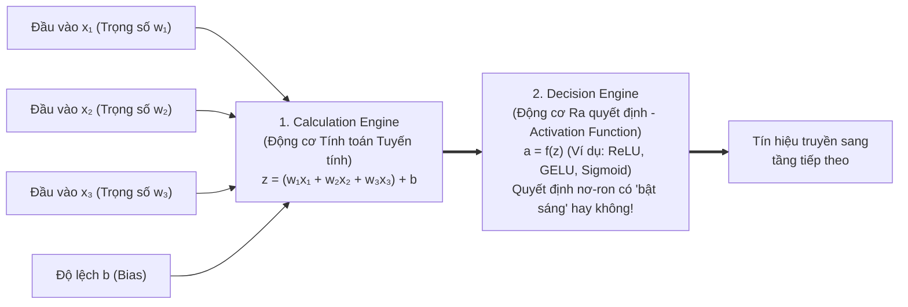
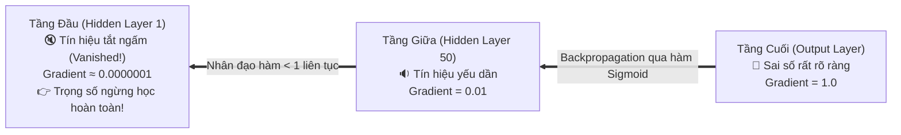
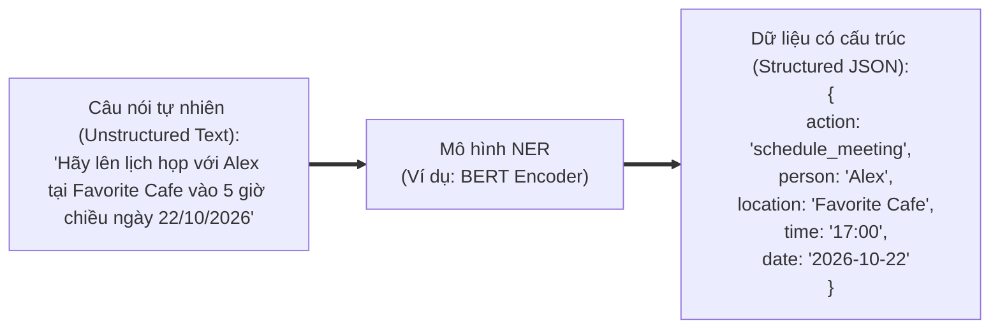

# Module 10: Additional Technical Topics (Các Chủ đề Kỹ thuật Bổ trợ Quan trọng)

> [!IMPORTANT]
> **Trọng tâm ôn thi NCA-GENL ở Module 10:**
> Nắm vững vòng lặp toán học **Forward Propagation $\to$ Loss Function $\to$ Backpropagation & Optimizers (SGD, Adam)**; hiểu rõ hiện tượng **Vanishing Gradients (Triệt tiêu đạo hàm)** qua phép ẩn dụ Trò chơi truyền tin và cách khắc phục bằng hàm kích hoạt **ReLU** cùng **Skip/Residual Connections**; phân biệt **ReLU vs. Sigmoid**; hiểu vai trò của **Layer Normalization** và **Dropout**; nắm chắc 2 pha của **Diffusion Models (Forward vs. Reverse Diffusion)** và kiến trúc **Latent Diffusion (VAE + U-Net + CLIP)**; cùng các khái niệm **NER (Named Entity Recognition)**, **RAD (Rapid Application Development)**, thư viện **Hugging Face Transformers**.

---

## 1. Cơ chế Toán học Huấn luyện Mạng Nơ-ron & Cấu tạo một Nơ-ron

### 1.1. Giải phẫu bên trong 1 Nơ-ron Nhân tạo (Artificial Neuron)
Mỗi nơ-ron nhân tạo hoạt động như một hàm xử lý gồm **2 bộ phận nối tiếp nhau**:

* **Tại sao bắt buộc phải có Hàm kích hoạt phi tuyến (Non-linear Activation Function)?**
  Nếu không có hàm kích hoạt phi tuyến, thì dù bạn có ghép nối 1.000 tầng nơ-ron liên tiếp, tích của các phép biến đổi tuyến tính vẫn chỉ suy biến thành **1 phép nhân ma trận tuyến tính đơn giản duy nhất** ($y = Wx + b$) và mạng nơ-ron sẽ không bao giờ học được các quy luật phức tạp như hình ảnh hay ngôn ngữ!

### 1.2. Bốn thành phần trong Vòng lặp Huấn luyện (Training Loop)
1. **Forward Propagation (Lan truyền xuôi):** Dữ liệu đầu vào đi xuôi từ tầng Input qua các tầng Hidden đến tầng Output để sinh ra **kết quả dự đoán ($\hat{y}$)**.
2. **Loss Function (Hàm mất mát):** Đo lường khoảng cách sai số giữa dự đoán của mô hình ($\hat{y}$) và nhãn thực tế đúng (**Ground Truth $y$**).
   * Bài toán Hồi quy (dự đoán số thực như giá nhà) $\to$ Dùng **MSE (Mean Squared Error)** hoặc **MAE**.
   * Bài toán Phân loại / Dự đoán xác suất từ tiếp theo trong LLM $\to$ Dùng **Cross-Entropy Loss**.
3. **Backpropagation (Lan truyền ngược):** Áp dụng quy tắc đạo hàm hàm hợp (**Chain Rule**) trong giải tích để truyền ngược sai số từ tầng Output về lại các tầng phía trước, tính toán đạo hàm riêng (**Gradients** $\frac{\partial L}{\partial W}$) cho từng trọng số.
4. **Optimizer (Thuật toán tối ưu hóa – SGD, Adam, AdamW):** Sử dụng giá trị Gradient vừa tính được từ Backpropagation cùng với **Learning Rate ($\eta$)** để thực sự bước xuống đồi cập nhật trọng số:
   $$W_{\text{mới}} = W_{\text{cũ}} - \eta \cdot \nabla L(W)$$
   *(Trong đó **Adam / AdamW** là thuật toán tối ưu tiêu chuẩn để huấn luyện các mô hình Transformer/LLM vì nó tự động điều chỉnh tốc độ học thích ứng cho từng tham số).*

---

## 2. Vấn đề Triệt tiêu Đạo hàm (Vanishing Gradients) & Giải pháp Khắc phục

### 2.1. Hiện tượng Vanishing Gradients là gì?
Khi mạng nơ-ron có rất nhiều tầng sâu (Deep Neural Network), trong quá trình **Backpropagation**, đạo hàm (Gradient) ở các tầng đầu tiên được tính bằng cách **nhân liên tiếp** các đạo hàm từ tầng cuối cùng ngược về trước (theo quy tắc Chain Rule).
Nếu mỗi tầng có đạo hàm nhỏ hơn $1$ (ví dụ dùng hàm Sigmoid có đạo hàm tối đa chỉ là $0.25$), thì sau khi nhân liên tiếp qua 50 tầng:
$$(0.25)^{50} \approx 8 \times 10^{-31} \to 0$$

* **Phép ẩn dụ Trò chơi Truyền tin (Whispering Game / Telephone Game Analogy):**
  Giống như 100 người xếp thành một hàng dọc chơi trò truyền tin thì thầm. Người đứng cuối hàng (Output layer) nói rất rõ sai số ở đâu cho người thứ 99, nhưng qua mỗi người âm lượng lại nhỏ đi một phần. Đến khi truyền tới những người đứng đầu hàng (Early layers), âm thanh đã **tắt ngấm (tiến về 0)** — những người đầu hàng không nghe thấy gì nên không biết phải sửa đổi hành động ra sao!
* **Hậu quả:** Các trọng số ở các tầng đầu tiên gần như **đóng băng, không được cập nhật**, khiến quá trình huấn luyện bị đình trệ hoàn toàn.

### 2.2. Hai giải pháp khắc phục triệt để Vanishing Gradients:
1. **Thay hàm Sigmoid bằng hàm kích hoạt ReLU (hoặc GELU/SwiGLU trong LLM):** Vì đạo hàm của ReLU đối với mọi số dương luôn bằng đúng **$1$** ($1 \times 1 \times \dots \times 1 = 1$), tín hiệu Gradient truyền ngược qua bao nhiêu tầng cũng không bị suy giảm!
2. **Sử dụng Kết nối tắt – Skip Connections / Residual Connections ($y = F(x) + x$):** Được giới thiệu trong mạng **ResNet** và là thành phần bắt buộc trong mọi khối **Transformer**. Nó tạo ra một "đường cao tốc nối tắt" cho phép Gradient truyền thẳng từ tầng cuối về tầng đầu mà không bị cản trở qua các phép nhân trung gian.

### 2.3. Bảng so sánh hai Hàm kích hoạt kinh điển: ReLU vs. Sigmoid
| Tiêu chí so sánh | ReLU (Rectified Linear Unit) | Sigmoid |
| :--- | :--- | :--- |
| **Công thức toán học** | $$f(x) = \max(0, x)$$ *(Nếu âm thì bằng $0$, nếu dương thì giữ nguyên $x$)* | $$\sigma(x) = \frac{1}{1 + e^{-x}}$$ *(Ép mọi giá trị vào đường cong chữ S)* |
| **Miền giá trị đầu ra** | $[0, +\infty)$ | $(0, 1)$ |
| **Tốc độ tính toán trên GPU** | **Cực kỳ nhanh** (chỉ là một phép so sánh `if x > 0` đơn giản). | **Chậm hơn nhiều** vì phải tính hàm mũ $e^{-x}$ và phép chia thực. |
| **Vấn đề Vanishing Gradient** | **Khắc phục triệt để** cho miền dương vì đạo hàm luôn bằng hằng số **$1$** khi $x > 0$. | **Rất dễ gây triệt tiêu đạo hàm** (Vanishing Gradient) ở hai đầu bão hòa. |
| **Vị trí sử dụng chuẩn trong mạng** | Dùng làm mặc định cho **tất cả các Tầng ẩn (Hidden Layers)** của mạng nơ-ron sâu. | Chỉ dùng ở **Tầng đầu ra (Output Layer)** cho bài toán phân loại nhị phân (dự đoán xác suất Đúng/Sai từ $0$ đến $1$). |

---

## 3. Kỹ thuật Chuẩn hóa Tầng (Layer Normalization) & Chống Học vẹt (Dropout)

### 3.1. Layer Normalization (LayerNorm)
* **Vấn đề kỹ thuật:** Khi dữ liệu đi qua hàng chục tầng nhân ma trận trong mạng sâu, các con số kích hoạt (activations) có thể bị khuếch đại vọt lên hàng triệu hoặc tụt xuống cực nhỏ, dao động hỗn loạn gây mất ổn định (**Exploding Gradients**).
* **Bản chất của Layer Normalization:** Quy chuẩn hóa đầu ra của tất cả các nơ-ron trong cùng một tầng về một phân phối chuẩn có **Trung bình bằng $0$ (Mean = 0)** và **Độ lệch chuẩn bằng $1$ (Std = 1)** (nằm gọn trong dải an toàn từ **$-3$ đến $+3$**).
* **Phép ẩn dụ Điểm thi Đại học (School Exam Z-Score Analogy):**
  Ba học sinh nộp điểm từ 3 trường có thang điểm khác nhau (Trường thang $50$, Trường thang $100$, Trường thang $200$). Nếu so sánh điểm thô sẽ gây sai lệch hoàn toàn. Quy đổi toàn bộ điểm số về **thang điểm chuẩn Z-Score** giúp đánh giá công bằng và giữ cho mọi khối **Transformer** hội tụ ổn định.

### 3.2. Kỹ thuật Dropout (Chống Overfitting)
* Trong quá trình **Training**, **Dropout** sẽ **tắt ngẫu nhiên (cho bằng 0) một tỷ lệ % các nơ-ron** (ví dụ `p = 0.1` tức tắt ngẫu nhiên 10% nơ-ron ở mỗi bước lặp).
* *Mục đích:* Ngăn không cho các nơ-ron phụ thuộc ỷ lại vào nhau hoặc học thuộc lòng một vài đặc trưng cục bộ, buộc toàn bộ mạng phải học cách biểu diễn phân tán vững chắc hơn $\to$ **Giảm thiểu Overfitting hiệu quả!** (Lưu ý: Khi chạy **Inference**, Dropout được tắt đi để dùng 100% sức mạnh của mạng).

---

## 4. Thuật toán Khuếch tán Sinh ảnh: Diffusion Models & Latent Diffusion

**Diffusion Models (Mô hình Khuếch tán)** là kiến trúc cốt lõi đứng đằng sau các hệ thống tạo sinh hình ảnh/video như **Stable Diffusion, Midjourney, DALL-E 3, Sora**.

### 4.1. Quy trình 2 Pha đối nghịch nhau của Diffusion Models (Cần nhớ rõ!):

```mermaid
flowchart TD
    subgraph P1["PHA 1: FORWARD DIFFUSION (Khuếch tán Xuôi - Trong lúc HUẤN LUYỆN)"]
        direction LR
        Img0["🐱 Bức ảnh gốc sắc nét<br/>(Step t = 0)"]
        Img1["🌫️ Ảnh hơi mờ nhiễu<br/>(Step t = 50)"]
        ImgT["📺 Màn hình nhiễu hạt 100%<br/>(Pure Gaussian Noise - Step t = T)"]
        
        Img0 ==>|"Cộng dần nhiễu Gaussian nhỏ"| Img1 ==>|"Cộng nhiễu liên tục"| ImgT
    end

    subgraph P2["PHA 2: REVERSE DIFFUSION (Khuếch tán Ngược - Trong lúc SUY LUẬN / TẠO ẢNH)"]
        direction LR
        Noise["📺 Khung hình nhiễu ngẫu nhiên<br/>+ Text Prompt: 'Một chú mèo đội mũ phi hành gia'"]
        Denoise["🎨 Mạng nơ-ron (U-Net / DiT) dự đoán & bóc tách<br/>từng lớp nhiễu nhỏ qua từng bước"]
        NewImg["🚀🐱 Bức ảnh mới hoàn toàn,<br/>sắc nét & khớp với Prompt!"]
        
        Noise ==>|"Khử nhiễu có định hướng (Guided Denoising)"| Denoise ==>|"Hoàn tất"| NewImg
    end
```

1. **Forward Diffusion (Khuếch tán xuôi – Pha Huấn luyện):** Bắt đầu từ bức ảnh thật sắc nét, **cộng thêm từng lượng nhiễu Gaussian nhỏ** qua hàng trăm bước cho đến khi bức ảnh trở thành nhiễu hạt trắng xóa hoàn toàn (pure static noise).
2. **Reverse Diffusion (Khuếch tán ngược – Pha Suy luận/Tạo ảnh):** Bắt đầu từ khung hình nhiễu ngẫu nhiên hoàn toàn, dưới sự dẫn dắt của câu lệnh **Text Prompt**, mạng nơ-ron dự đoán lượng nhiễu và **khử bỏ từng lớp nhiễu nhỏ** qua từng bước lặp cho đến khi lộ ra bức ảnh mới sắc nét.

### 4.2. Làm rõ Latent Diffusion Models (Stable Diffusion)
* Nếu chạy khử nhiễu trực tiếp trên không gian điểm ảnh phân giải cao $1024 \times 1024$ (**Pixel Space**), khối lượng tính toán sẽ cực kỳ nặng nề.
* **Latent Diffusion Model (LDM)** dùng bộ mã hóa **VAE (Variational Autoencoder)** để nén bức ảnh xuống một **Không gian tiềm ẩn (Latent Space)** nhỏ gọn hơn 48 lần, sau đó mới chạy quá trình khử nhiễu bằng mạng **U-Net** (kết hợp bộ mã hóa văn bản **CLIP** để hiểu Prompt), rồi cuối cùng giải mã ngược ra ảnh phân giải cao $\to$ Nhanh hơn hàng chục lần và chạy vừa trên 1 GPU tiêu dùng!

---

## 5. Trích xuất Thực thể Định danh (NER), Phương pháp RAD & Hugging Face

### 5.1. Named Entity Recognition (NER)
* **NER** là kỹ thuật NLP xác định và phân loại các từ ngữ trong văn bản phi cấu trúc thành các thực thể định danh có cấu trúc: **Người (Person), Địa điểm (Location), Thời gian (Date/Time), Tổ chức (Organization)**.

### 5.2. RAD (Rapid Application Development) & Thư viện Hugging Face
* **RAD (Rapid Application Development):** Phương pháp phát triển phần mềm nhấn mạnh vào việc **tạo nguyên mẫu thử nghiệm nhanh (Rapid Prototyping)** và lặp liên tục dựa trên phản hồi của người dùng. Rất lý tưởng cho các dự án GenAI để kiểm chứng nhanh tính khả thi của Prompt và mô hình trước khi đầu tư hạ tầng lớn.
* **Hugging Face `transformers`:** Thư viện Python mã nguồn mở tiêu chuẩn công nghiệp cung cấp quyền truy cập vào hàng trăm nghìn mô hình Pre-trained, tích hợp mượt mà với **PyTorch, TensorFlow** từ bước Tokenizer đến Pipeline suy luận.

---

## 6. Bẫy đề thi NCA-GENL & Câu hỏi Thực chiến (Exam Traps & Mini Quiz)

> [!WARNING]
> **Các bẫy kinh điển trong đề thi Module 10:**
> 1. **Bẫy ReLU vs. Sigmoid:**
>    * Dùng ở **Hidden Layers** để tính toán nhanh và **chống Vanishing Gradients** $\to$ **ReLU**.
>    * Ép đầu ra về khoảng **$(0, 1)$** và dùng ở **Output Layer cho phân loại nhị phân** $\to$ **Sigmoid**.
> 2. **Bẫy Diffusion:** Pha nào **thêm nhiễu (adds noise)** vào ảnh gốc? $\to$ **Forward Diffusion**. Pha nào **khử nhiễu (removes noise / denoising)** từ màn hình nhiễu để tạo ra bức ảnh mới? $\to$ **Reverse Diffusion**.
> 3. **Bẫy LayerNorm vs. Dropout:** Chuẩn hóa đầu ra của tầng về trung bình $0$, độ lệch chuẩn $1$ để giữ ổn định huấn luyện Transformer $\to$ **Layer Normalization**. Tắt ngẫu nhiên một số nơ-ron trong lúc train để chống Overfitting $\to$ **Dropout**.

### Câu hỏi tự kiểm tra (Mini Quiz):
1. **Câu 1:** Tại sao các mạng nơ-ron sâu hiện đại ưu tiên sử dụng hàm kích hoạt **ReLU** ở các tầng ẩn thay vì hàm **Sigmoid**?
   * *Đáp án:* Vì ReLU tính toán cực kỳ nhanh và giữ đạo hàm bằng $1$ cho các giá trị dương, giúp **ngăn chặn hiện tượng triệt tiêu đạo hàm (Vanishing Gradients)** khi lan truyền ngược qua nhiều tầng.
2. **Câu 2:** Phương pháp phát triển phần mềm nào ưu tiên việc dựng nhanh nguyên mẫu (prototyping) và thu thập phản hồi lặp đi lặp lại liên tục, rất phù hợp cho giai đoạn thử nghiệm các ứng dụng Generative AI?
   * *Đáp án:* **RAD (Rapid Application Development)**.
