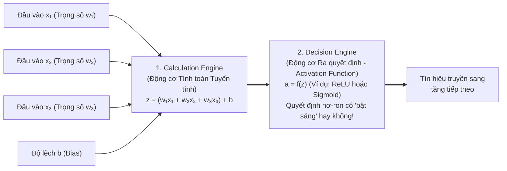
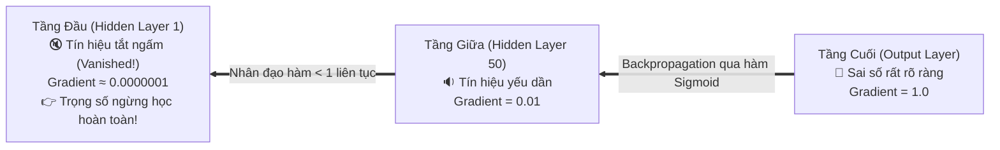
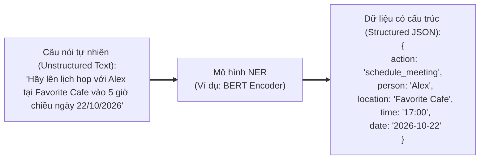

# Module 10: Additional Technical Topics (Các Chủ đề Kỹ thuật Bổ trợ Quan trọng)

> [!IMPORTANT]
> **Trọng tâm ôn thi NCA-GENL ở Module 10:**
> Nắm vững vòng lặp toán học **Forward Propagation $\to$ Loss Function $\to$ Backpropagation**; hiểu rõ hiện tượng **Vanishing Gradients (Triệt tiêu đạo hàm)** qua phép ẩn dụ Trò chơi truyền tin và cách khắc phục bằng hàm kích hoạt **ReLU**; phân biệt **ReLU vs. Sigmoid**; hiểu vai trò ổn định giá trị của **Layer Normalization** trong Transformer; nắm chắc 2 pha của **Diffusion Models (Forward vs. Reverse Diffusion)** cho bài toán sinh ảnh; và các khái niệm **NER (Named Entity Recognition)**, **RAD (Rapid Application Development)**, thư viện **Hugging Face Transformers**.

---

## 1. Cơ chế Toán học Huấn luyện Mạng Nơ-ron & Cấu tạo một Nơ-ron

### 1.1. Giải phẫu bên trong 1 Nơ-ron Nhân tạo (Artificial Neuron)
Mỗi nơ-ron nhân tạo hoạt động như một hàm xử lý gồm **2 bộ phận nối tiếp nhau**:

* **Tại sao bắt buộc phải có Hàm kích hoạt (Activation Function)?**
  Nếu không có hàm kích hoạt phi tuyến (Non-linear activation function), thì dù bạn có ghép nối 1.000 tầng nơ-ron liên tiếp, tích của các phép biến đổi tuyến tính vẫn chỉ suy biến thành **1 phép nhân ma trận tuyến tính đơn giản duy nhất** ($y = Wx + b$) và mạng nơ-ron sẽ không bao giờ học được các quy luật phức tạp như hình ảnh hay ngôn ngữ!

### 1.2. Ba bước trong Vòng lặp Huấn luyện (Training Loop)
1. **Forward Propagation (Lan truyền xuôi):** Dữ liệu đầu vào đi xuôi từ tầng Input qua các tầng Hidden đến tầng Output, thực hiện các phép nhân trọng số và hàm kích hoạt để sinh ra **kết quả dự đoán ($\hat{y}$)**.
2. **Loss Function (Hàm mất mát):** Đo lường khoảng cách sai số giữa dự đoán của mô hình ($\hat{y}$) và nhãn thực tế đúng (**Ground Truth $y$**).
   * Bài toán Hồi quy (dự đoán số thực như giá nhà) $\to$ Dùng **MSE (Mean Squared Error)**.
   * Bài toán Phân loại / Dự đoán xác suất từ tiếp theo $\to$ Dùng **Cross-Entropy Loss**.
3. **Backpropagation (Lan truyền ngược):** Áp dụng quy tắc đạo hàm hàm hợp (**Chain Rule**) trong giải tích để truyền ngược sai số từ tầng Output về lại các tầng phía trước, tính toán đạo hàm (**Gradients**) và dùng thuật toán tối ưu (như SGD / Adam) cập nhật lại các **Trọng số ($W$)** nhằm làm giảm giá trị hàm mất mát ở vòng lặp sau.

---

## 2. Vấn đề Triệt tiêu Đạo hàm (Vanishing Gradients) & Giải pháp ReLU

### 2.1. Hiện tượng Vanishing Gradients là gì?
Khi mạng nơ-ron có rất nhiều tầng sâu (Deep Neural Network), trong quá trình **Backpropagation**, đạo hàm (Gradient) ở các tầng đầu tiên được tính bằng cách **nhân liên tiếp** các đạo hàm từ tầng cuối cùng ngược về trước (theo quy tắc Chain Rule).
Nếu mỗi tầng có đạo hàm nhỏ hơn $1$ (ví dụ dùng hàm Sigmoid có đạo hàm tối đa chỉ là $0.25$), thì sau khi nhân liên tiếp qua 50 tầng:
$$0.25 \times 0.25 \times \dots \times 0.25 = (0.25)^{50} \approx 0.0000000000000000000000000000008 \to 0$$

* **Phép ẩn dụ Trò chơi Truyền tin (Whispering Game / Telephone Game Analogy):**
  Giống như 100 người xếp thành một hàng dọc chơi trò truyền tin thì thầm. Người đứng cuối hàng (Output layer) biết rõ đáp án sai ở đâu và nói cho người thứ 99, nhưng qua mỗi người âm lượng lại nhỏ đi một nửa. Đến khi truyền tới những người đứng đầu hàng (Early layers), âm thanh đã **tắt ngấm (tiến về 0)** — những người đầu hàng không nghe thấy gì nên không biết phải sửa đổi hành động ra sao!
* **Hậu quả:** Các trọng số ở các tầng đầu tiên gần như **đóng băng, không được cập nhật**, khiến quá trình huấn luyện bị đình trệ hoàn toàn.

### 2.2. Bảng so sánh hai Hàm kích hoạt kinh điển: ReLU vs. Sigmoid
Cách khắc phục đơn giản và hiệu quả nhất cho vấn đề Vanishing Gradients chính là thay thế hàm **Sigmoid** ở các tầng ẩn bằng hàm **ReLU (Rectified Linear Unit)**, kết hợp với kết nối tắt (**Skip/Residual Connections** như trong ResNet và Transformer):

| Tiêu chí so sánh | ReLU (Rectified Linear Unit) | Sigmoid |
| :--- | :--- | :--- |
| **Công thức toán học** | $$f(x) = \max(0, x)$$ *(Nếu âm thì bằng $0$, nếu dương thì giữ nguyên $x$)* | $$\sigma(x) = \frac{1}{1 + e^{-x}}$$ *(Ép mọi giá trị vào đường cong chữ S)* |
| **Miền giá trị đầu ra** | $[0, +\infty)$ | $(0, 1)$ |
| **Tốc độ tính toán trên GPU** | **Cực kỳ nhanh** (chỉ là một phép so sánh `if x > 0` đơn giản). | **Chậm hơn nhiều** vì phải tính hàm mũ $e^{-x}$ và phép chia thực. |
| **Vấn đề Vanishing Gradient** | **Khắc phục triệt để** cho miền dương vì đạo hàm luôn bằng hằng số **$1$** khi $x > 0$ (nhân $1 \times 1 \times 1$ bao nhiêu lần vẫn bằng $1$!). | **Rất dễ gây triệt tiêu đạo hàm** (Vanishing Gradient) khi $x$ quá lớn hoặc quá nhỏ (hai đầu bão hòa đạo hàm tiến về $0$). |
| **Vị trí sử dụng chuẩn trong mạng** | Dùng làm mặc định cho **tất cả các Tầng ẩn (Hidden Layers)** của mạng nơ-ron sâu. | Chỉ dùng ở **Tầng đầu ra (Output Layer)** cho bài toán phân loại nhị phân (dự đoán xác suất Đúng/Sai từ $0$ đến $1$). |

---

## 3. Kỹ thuật Chuẩn hóa Tầng: Layer Normalization (LayerNorm)

* **Vấn đề kỹ thuật:** Khi dữ liệu đi qua hàng chục tầng nhân ma trận trong mạng sâu, các con số kích hoạt (activations) có thể bị khuếch đại vọt lên hàng triệu hoặc tụt xuống cực nhỏ, dao động hỗn loạn giữa các nơ-ron. Điều này làm mạng nơ-ron rất dễ bị nổ đạo hàm (**Exploding Gradients**) hoặc không thể hội tụ.
* **Giải pháp – Layer Normalization:**
  * Là kỹ thuật tính giá trị trung bình ($\mu$) và độ lệch chuẩn ($\sigma$) của tất cả các nơ-ron trong cùng một tầng, sau đó **quy chuẩn hóa (normalize)** toàn bộ đầu ra của tầng đó về phân phối chuẩn có **Trung bình bằng $0$ (Mean = 0)** và **Độ lệch chuẩn bằng $1$ (Standard Deviation = 1)** (hầu hết các giá trị sẽ nằm gọn gàng trong khoảng an toàn từ **$-3$ đến $+3$**).
* **Phép ẩn dụ Điểm thi Đại học (School Exam Z-Score Analogy):**
  Hãy tưởng tượng hội đồng tuyển sinh nhận bảng điểm của 3 học sinh từ 3 quốc gia có thang điểm khác nhau:
  * Trường A chấm thang điểm $10$: Học sinh đạt $8.5$.
  * Trường B chấm thang điểm $100$: Học sinh đạt $85$.
  * Trường C chấm thang điểm $1000$: Học sinh đạt $850$.
  Nếu cộng trực tiếp các con số thô ($8.5$, $85$, $850$) vào công thức xét tuyển, con số $850$ sẽ đè bẹp hoàn toàn hai số kia! **Layer Normalization** giống như việc quy đổi toàn bộ điểm số của mọi trường về cùng một **Thang điểm chuẩn Z-Score (từ $-3$ đến $+3$)** để mọi tầng trong mạng **Transformer** làm việc ổn định và công bằng.

---

## 4. Thuật toán Khuếch tán Sinh ảnh: Diffusion Models

Nếu **Transformer** là ông vua của xử lý ngôn ngữ (Text), thì **Diffusion Models (Mô hình Khuếch tán)** chính là kiến trúc cốt lõi đứng đằng sau các siêu phẩm tạo sinh hình ảnh/video như **Stable Diffusion, Midjourney, DALL-E 3, Sora**.

### Quy trình 2 Pha đối nghịch nhau của Diffusion Models (Cần nhớ rõ!):

```mermaid
flowchart TD
    subgraph P1["PHA 1: FORWARD DIFFUSION (Khuếch tán Xuôi - Trong lúc HUẤN LUYỆN)"]
        direction LR
        Img0["🐱 Bức ảnh gốc sắc nét<br/>(Step t = 0)"]
        Img1["🌫️ Ảnh hơi mờ nhiễu<br/>(Step t = 50)"]
        ImgT["📺 Màn hình nhiễu hạt 100%<br/>(Pure Gaussian Noise - Step t = T)"]
        
        Img0 ==>|"Cộng dần nhiễu Gaussian nhỏ"| Img1 ==>|"Cộng nhiễu liên tục"| ImgT
    end

    subgraph P2["PHA 2: REVERSE DIFFUSION (Khuếch tán Ngược - Trong lúc SUY LUẬN / TẠO ẢNH)"]
        direction LR
        Noise["📺 Khung hình nhiễu ngẫu nhiên<br/>+ Text Prompt: 'Một chú mèo đội mũ phi hành gia'"]
        Denoise["🎨 Mạng nơ-ron dự đoán & bóc tách<br/>từng lớp nhiễu nhỏ qua từng bước"]
        NewImg["🚀🐱 Bức ảnh mới hoàn toàn,<br/>sắc nét & khớp với Prompt!"]
        
        Noise ==>|"Khử nhiễu có định hướng (Guided Denoising)"| Denoise ==>|"Hoàn tất"| NewImg
    end
```

1. **Forward Diffusion (Khuếch tán xuôi – Quá trình phá hủy dữ liệu để dạy mô hình):**
   * Bắt đầu từ một bức ảnh thật sắc nét ($x_0$).
   * Qua hàng trăm bước thời gian ($t_1 \to t_2 \to \dots \to t_T$), hệ thống chủ động **cộng thêm từng chút nhiễu ngẫu nhiên (Gaussian Noise)** vào bức ảnh cho đến khi bức ảnh biến thành một màn hình tivi mất sóng trắng xóa hoàn toàn (**Pure static noise**).
   * Mục đích: Để mạng nơ-ron quan sát và học được chính xác quy luật dữ liệu bị nhiễu làm hỏng như thế nào ở từng bước.
2. **Reverse Diffusion (Khuếch tán ngược – Quá trình khử nhiễu để sáng tạo ảnh mới):**
   * Khi người dùng gõ câu lệnh (Prompt) yêu cầu vẽ tranh, hệ thống bắt đầu từ một **khung hình nhiễu hạt ngẫu nhiên 100%**.
   * Dưới sự dẫn dắt của Text Prompt, mô hình thực hiện quá trình **khử nhiễu ngược (Denoising)** từng bước một: dự đoán lớp nhiễu thừa và gọt bỏ nó đi (giống như nhà điêu khắc đục bỏ phần đá thừa từ một tảng đá thô).
   * Sau vài chục bước lặp, từ đám nhiễu vô nghĩa dần hiện lên bố cục thô $\to$ đường nét $\to$ một bức ảnh nghệ thuật sắc nét hoàn toàn mới!

---

## 5. Trích xuất Thực thể Định danh: Named Entity Recognition (NER)

* **NER là gì?** Là một bài toán cốt lõi trong Xử lý Ngôn ngữ Tự nhiên (NLP) nhằm **xác định vị trí và phân loại các từ/cụm từ quan trọng trong văn bản phi cấu trúc** vào các nhóm thực thể định sẵn như:
  * **Person (Tên người):** *"Alex"*, *"Jensen Huang"*
  * **Organization (Tổ chức/Công ty):** *"NVIDIA"*, *"Vietcombank"*
  * **Location (Địa điểm):** *"Hà Nội"*, *"Favorite Cafe"*
  * **Date / Time (Ngày giờ):** *"5 giờ chiều"*, *"ngày mai"*
* **Góc nhìn Developer (Tại sao NER cực kỳ hữu ích khi làm App/Agent?):**
  NER giúp biến một câu nói tự nhiên lộn xộn của người dùng thành một **Object JSON có cấu trúc chuẩn** để truyền vào hàm gọi API (Function Calling):

---

## 6. Phát triển Ứng dụng Nhanh (RAD) & Thư viện Hugging Face Transformers

1. **RAD (Rapid Application Development - Phát triển Ứng dụng Nhanh):**
   * Là phương pháp luận kỹ thuật phần mềm ưu tiên việc **xây dựng nguyên mẫu thử nghiệm nhanh (Rapid Prototyping)** và cải tiến lặp đi lặp lại liên tục (Iterative feedback) thay vì ngồi viết tài liệu thiết kế cứng nhắc hàng tháng trời (Waterfall).
   * *Tại sao RAD là kim chỉ nam cho dự án GenAI?* Trong các dự án LLM, bạn không thể biết trước Prompt hay mô hình nào sẽ hoạt động tốt nhất trên dữ liệu thực tế. Áp dụng RAD giúp Developer dựng nhanh một bản PoC (với Gradio/Streamlit + API) trong vài ngày để người dùng thử nghiệm, lấy phản hồi và tinh chỉnh ngay trước khi đầu tư hạ tầng lớn.
2. **Thư viện Hugging Face `transformers`:**
   * Là thư viện Python mã nguồn mở tiêu chuẩn công nghiệp hiện nay, đóng vai trò như "GitHub của thế giới AI".
   * Cung cấp API thống nhất chỉ với vài dòng code (`pipeline`, `AutoTokenizer`, `AutoModel`) để tải và chạy hàng trăm nghìn mô hình Pre-trained cho cả văn bản, hình ảnh và âm thanh, tương thích mượt mà với cả **PyTorch, TensorFlow và JAX**.

---

## 7. Bẫy đề thi NCA-GENL & Câu hỏi Thực chiến (Exam Traps & Mini Quiz)

> [!WARNING]
> **Các bẫy kinh điển trong đề thi Module 10:**
> 1. **Bẫy ReLU vs. Sigmoid:**
>    * Hàm kích hoạt nào dùng ở **Hidden Layers** để tính toán nhanh và **chống Vanishing Gradients**? $\to$ Chọn **ReLU**.
>    * Hàm kích hoạt nào ép đầu ra về khoảng **$(0, 1)$** và thường dùng ở **Output Layer cho phân loại nhị phân**? $\to$ Chọn **Sigmoid**.
> 2. **Bẫy Diffusion:** Pha nào **thêm nhiễu (adds noise)** vào ảnh gốc? $\to$ **Forward Diffusion**. Pha nào **loại bỏ nhiễu (removes noise / denoising)** từ màn hình nhiễu để tạo ra bức ảnh mới? $\to$ **Reverse Diffusion**.
> 3. **Bẫy LayerNorm:** Kỹ thuật nào chuẩn hóa đầu ra của tầng nơ-ron về phân phối có trung bình bằng $0$ và độ lệch chuẩn bằng $1$ để giữ ổn định quá trình huấn luyện Transformer? $\to$ **Layer Normalization**.
> 4. **Bẫy NER:** Bài toán bóc tách tên người, địa điểm, ngày tháng từ câu văn tự nhiên để điền vào lịch hẹn gọi là gì? $\to$ **Named Entity Recognition (NER)**.

### Câu hỏi tự kiểm tra (Mini Quiz):
1. **Câu 1:** Khi huấn luyện một mạng nơ-ron rất sâu sử dụng hàm kích hoạt Sigmoid ở mọi tầng, kỹ sư nhận thấy các tầng đầu tiên của mạng hầu như không cập nhật trọng số. Hiện tượng này gọi là gì và nên thay thế Sigmoid ở các tầng ẩn bằng hàm nào?
   * *Đáp án:* Hiện tượng **Vanishing Gradients (Triệt tiêu đạo hàm)**; nên thay thế bằng hàm **ReLU (Rectified Linear Unit)**.
2. **Câu 2:** Trong mô hình Diffusion tạo ảnh từ văn bản, quá trình bắt đầu từ nhiễu ngẫu nhiên hoàn toàn và khử nhiễu từng bước để hình thành bức ảnh hoàn chỉnh được gọi là gì?
   * *Đáp án:* **Reverse Diffusion (Khuếch tán ngược)**.
