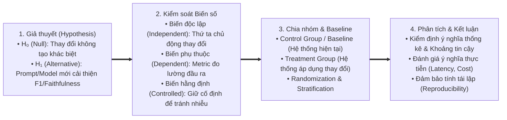
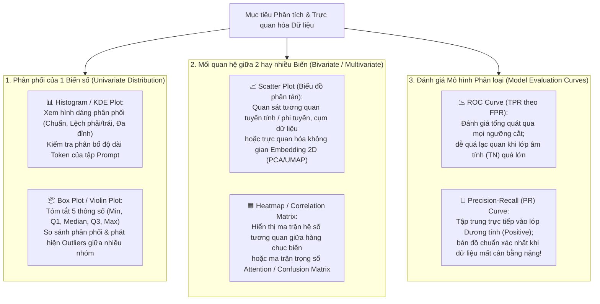
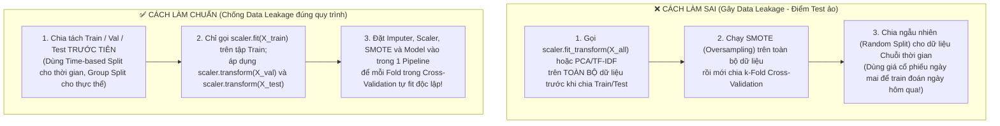

# Module 11: Experiment Design, Data Analysis & Visualization (Thiết kế Thực nghiệm, Phân tích & Trực quan hóa Dữ liệu)

> [!IMPORTANT]
> **Trọng tâm ôn tập NCA-GENL ở Module 11 (Bổ sung chuyên sâu cho 2 Miền trọng số lớn: "Experimentation - 22%" & "Data Analysis & Visualization - 14%"):**
> Nắm vững các nguyên tắc **Thiết kế thực nghiệm khoa học (Experiment Design)**: giả thuyết ($H_0, H_1$), biến độc lập/phụ thuộc/gây nhiễu, nhóm đối chứng (Control vs. Treatment), mô hình cơ sở (Baseline), ngẫu nhiên hóa, phân tầng (Stratification), nghiên cứu cắt bỏ (**Ablation Study**), tinh chỉnh siêu tham số và **tính tái lập (Reproducibility)**; làm chủ **Phân tích & Trực quan hóa dữ liệu (Data Analysis & Visualization)**: thống kê mô tả (Mean vs. Median, IQR, Percentiles), cơ chế khuyết dữ liệu (MCAR, MAR, MNAR), cách chọn và đọc hiểu biểu đồ (**Histogram, Box Plot, Scatter Plot, Confusion Matrix, ROC vs. PR Curve**), phân biệt **Tương quan vs. Nhân quả (Correlation vs. Causation)**; và nắm vững các quy tắc **Phòng chống Rò rỉ Dữ liệu (Data Leakage Prevention)** trong tiền xử lý, Cross-Validation, SMOTE, chia tách theo thời gian (Temporal Split) và đánh giá LLM.

---

## 1. Thiết kế Thực nghiệm Khoa học trong AI/ML & LLM (Experiment Design)

Trong kỳ thi NCA-GENL, miền **Experimentation (22%)** kiểm tra xem kỹ sư có biết cách thiết lập một thí nghiệm công bằng, có kiểm soát và có khả năng tái lập để chứng minh một thay đổi kỹ thuật (ví dụ: đổi Prompt, thêm Reranker, hay fine-tune bằng LoRA) thực sự mang lại hiệu quả hay không.

### 1.1. Các Thành phần Cốt lõi của một Thực nghiệm Có kiểm soát (Controlled Experiment)



| Khái niệm Thực nghiệm | Bản chất Kỹ thuật | Ví dụ Thực tế trong Dự án LLM / RAG |
| :--- | :--- | :--- |
| **1. Null Hypothesis ($H_0$) vs. Alternative Hypothesis ($H_1$)** | • **$H_0$ (Giả thuyết không):** Không có sự khác biệt thực sự giữa phương pháp mới và phương pháp cũ (mọi chênh lệch nhỏ quan sát được chỉ do ngẫu nhiên mẫu).<br/>• **$H_1$ (Giả thuyết đối):** Phương pháp mới tạo ra sự cải thiện có ý nghĩa so với phương pháp cũ. | • $H_0$: Thêm Cross-Encoder Reranker không làm thay đổi điểm `Recall@3` so với chỉ dùng Vector Search.<br/>• $H_1$: Thêm Cross-Encoder Reranker làm tăng `Recall@3` trên tập kiểm thử. |
| **2. Independent Variable (Biến độc lập / Yếu tố can thiệp)** | Biến số mà người làm thí nghiệm **chủ động thay đổi** giữa các lần chạy để kiểm tra tác động của nó. *(Nguyên tắc vàng: Thay đổi từng yếu tố một - One factor at a time hoặc theo thiết kế ma trận).* | Loại Prompt Template (Zero-shot vs. Few-shot CoT), kích thước Chunk (`256` vs. `512` tokens), hoặc bậc hạng `r` của LoRA (`8` vs. `32`). |
| **3. Dependent Variable (Biến phụ thuộc / Độ đo kết quả)** | Chỉ số đầu ra được **đo lường** để đánh giá hiệu quả của biến độc lập. | Điểm `F1-Score`, `ROUGE-L`, `Faithfulness`, độ trễ `TTFT (ms)`, hoặc tỷ lệ người dùng bấm *Thumbs-up*. |
| **4. Confounding Variables (Biến gây nhiễu / Biến ngoại lai)** | Các yếu tố khác **vô tình thay đổi cùng lúc** với biến độc lập, làm ta không biết kết quả tốt lên là nhờ biến độc lập hay do biến gây nhiễu! | Khi so sánh **Prompt A** và **Prompt B**, kỹ sư lại vô tình chạy Prompt A trên `LLaMA-3 8B (temperature=0.7)` và chạy Prompt B trên `LLaMA-3 70B (temperature=0.0)` $\to$ **Kích thước model và temperature là biến gây nhiễu làm hỏng kết luận thí nghiệm!** |
| **5. Baseline & Control Group (Mô hình cơ sở & Nhóm đối chứng)** | Điểm mốc tham chiếu ban đầu (thường là hệ thống đang chạy hiện tại, một quy tắc heuristic đơn giản, hoặc mô hình Zero-shot chưa tinh chỉnh) để so sánh với nhóm thử nghiệm (**Treatment Group**). | Trước khi đầu tư 2 tuần Fine-tune LLM, phải đo điểm của **Zero-shot / Few-shot Prompt Baseline** trên cùng tập Test Set. |

---

### 1.2. Tình huống Thực tiễn: Làm sao để So sánh Công bằng 2 Prompt hoặc 2 Mô hình LLM?
> [!TIP]
> **Tình huống thường gặp trong thiết kế thí nghiệm LLM:**
> Giả sử một kỹ sư muốn kiểm chứng xem **Prompt Template B (có hướng dẫn Chain-of-Thought)** có giúp trích xuất thông tin hợp đồng chính xác hơn **Prompt Template A (Zero-shot)** hay không. Để kết luận sự khác biệt quan sát được thực sự là do Prompt, kỹ sư phải **giữ cố định (hold constant) hoặc ghi nhận đầy đủ** các điều kiện sau:
> 1. **Cùng một phiên bản mô hình (Exact Model Checkpoint/Version):** Ví dụ cùng chạy trên `meta/llama-3.1-8b-instruct` (cùng mức lượng tử hóa `BF16` hoặc `FP8`).
> 2. **Cùng một bộ dữ liệu kiểm thử (Identical Evaluation Dataset):** Chạy trên cùng tập câu hỏi/hợp đồng đại diện (có phân tầng theo độ khó/loại hợp đồng).
> 3. **Cùng bộ tham số giải mã (Decoding Parameters):** Giữ nguyên `temperature`, `top_p`, `max_tokens`, `seed`.
> 4. **Cùng tiêu chí và công cụ chấm điểm (Evaluation Rubric / Judge):** Dùng cùng một hàm đo (`Exact Match`, `F1`) hoặc cùng một phiên bản LLM-as-a-Judge với rubric chấm điểm ẩn danh (Blind evaluation).

---

### 1.3. Ablation Study (Nghiên cứu Cắt bỏ Thành phần) & Tinh chỉnh Siêu tham số
1. **Ablation Study (Nghiên cứu cắt bỏ):**
   * Khi một hệ thống AI phức tạp gồm nhiều mô-đun ghép lại (ví dụ: `Hybrid Search` + `Chunk Overlap 15%` + `Cross-Encoder Reranker` + `Few-shot Prompt`), làm sao biết thành phần nào thực sự đóng góp vào độ chính xác và thành phần nào chỉ làm tăng độ trễ vô ích?
   * **Cách thực hiện:** Kỹ sư **loại bỏ (hoặc tắt) từng thành phần một** trong khi giữ nguyên phần còn lại, rồi đo lại sự sụt giảm của Metric:
     * *Full System:* `Recall@5 = 91%`, `Latency = 420 ms`.
     * *Bỏ Reranker:* `Recall@5` tụt xuống `76%` $\to$ Chứng tỏ Reranker đóng góp rất lớn (+15%).
     * *Bỏ BM25 (chỉ dùng Dense Vector):* `Recall@5` tụt xuống `83%` $\to$ Hybrid Search đóng góp +8%.
2. **Chiến lược Tìm kiếm Siêu tham số (Hyperparameter Tuning Strategies):**
   * **Grid Search (Tìm kiếm lưới vét cạn):** Thử tất cả mọi tổ hợp có thể trên một lưới giá trị định sẵn (ví dụ 4 mức Learning Rate $\times$ 3 mức Batch Size $\times$ 3 mức Weight Decay = 36 lần chạy). *Nhược điểm:* Bùng nổ tổ hợp khi số siêu tham số lớn.
   * **Random Search (Tìm kiếm ngẫu nhiên):** Lấy mẫu ngẫu nhiên các tổ hợp siêu tham số trong không gian tìm kiếm. Thường hiệu quả hơn Grid Search trong cùng một ngân sách tính toán khi chỉ có một vài siêu tham số (như Learning Rate) ảnh hưởng mạnh nhất đến kết quả.
   * **Bayesian Optimization (Tối ưu hóa Bayes - ví dụ Optuna, Ray Tune):** Xây dựng mô hình xác suất dự đoán vùng siêu tham số hứa hẹn dựa trên kết quả của các lần chạy trước để chọn cấu hình thử nghiệm tiếp theo thông minh hơn.
3. **Diễn giải Kết quả Thực nghiệm (Statistical vs. Practical Significance):**
   * **Ý nghĩa thống kê (Statistical Significance):** Liệu mức tăng `+0.8%` F1-Score có lớn hơn sai số ngẫu nhiên của phép lấy mẫu không (kiểm tra qua độ lệch chuẩn giữa các folds, khoảng tin cậy 95% - Confidence Interval, hoặc kiểm định giả thuyết như *Paired Bootstrap / McNemar's test*)?
   * **Ý nghĩa thực tiễn (Practical / Engineering Significance):** Nếu Mô hình B tăng `+0.3%` độ chính xác so với Mô hình A nhưng làm độ trễ `TPOT` tăng gấp 4 lần và chi phí GPU tăng gấp 3 lần, thì xét về mặt kỹ thuật hệ thống, Mô hình A vẫn có thể là lựa chọn tối ưu hơn.

---

### 1.4. Tính Tái lập trong Thực nghiệm Học sâu (Reproducibility)
Một thí nghiệm khoa học chỉ có giá trị khi người khác (hoặc chính bạn sau 3 tháng) chạy lại cùng đoạn code trên cùng dữ liệu và thu được kết quả nhất quán (Tham khảo: [PyTorch Reproducibility Guidance](https://docs.pytorch.org/docs/stable/notes/randomness.html)):
* **Các nguồn gây ngẫu nhiên cần kiểm soát:** Khởi tạo trọng số ngẫu nhiên (Weight initialization), thứ tự xáo trộn dữ liệu (DataLoader shuffling), lớp Dropout, lấy mẫu sinh token (`temperature > 0`), và các phép cộng dấu phẩy động bất định (non-deterministic atomic operations) trong một số CUDA kernels.
* **Thực hành chuẩn trong Python / PyTorch:**

```python
import os
import random
import numpy as np
import torch

def set_reproducible_seed(seed: int = 42) -> None:
    os.environ["PYTHONHASHSEED"] = str(seed)
    random.seed(seed)
    np.random.seed(seed)
    torch.manual_seed(seed)
    torch.cuda.manual_seed_all(seed)
    # Bật chế độ thuật toán xác định (lưu ý: có thể làm giảm nhẹ tốc độ trên một số CUDA ops)
    torch.backends.cudnn.deterministic = True
    torch.backends.cudnn.benchmark = False
    torch.use_deterministic_algorithms(True, warn_only=True)
```

---

## 2. Phân tích & Trực quan hóa Dữ liệu (Data Analysis & Visualization)

Miền **Data Analysis & Visualization (14%)** yêu cầu kỹ sư hiểu rõ đặc tính thống kê của tập dữ liệu, chọn đúng loại biểu đồ cho từng câu hỏi phân tích và tránh các ngộ nhận thống kê.

### 2.1. Thống kê Mô tả (Descriptive Statistics) & Khi nào dùng Mean vs. Median?
| Đại lượng thống kê | Công thức / Định nghĩa | Khi nào sử dụng & Lưu ý thực chiến |
| :--- | :--- | :--- |
| **1. Mean (Trung bình cộng)** | $$\mu = \frac{1}{n}\sum_{i=1}^n x_i$$ | Phù hợp khi dữ liệu có **phân phối đối xứng / phân phối chuẩn (Normal Distribution)** và không có điểm dị biệt lớn. <br/>⚠️ **Nhược điểm:** Rất nhạy cảm với **Outliers (Điểm ngoại lai)** (VD: 9 khách hàng thu nhập 15 triệu, 1 tỷ phú thu nhập 1.000 tỷ $\to$ Mean bị kéo vọt lên ~100 tỷ, không còn đại diện cho nhóm khách hàng!). |
| **2. Median (Trung vị - Phân vị thứ 50 / $P_{50}$)** | Giá trị nằm ở chính giữa khi sắp xếp dữ liệu theo thứ tự tăng dần | **Thước đo xu hướng trung tâm bền vững (Robust) trước Outliers và phân phối lệch (Skewed Distributions)**! Luôn dùng Median (kèm $P_{90}, P_{95}, P_{99}$) khi báo cáo **Thu nhập, Giá nhà, Độ dài văn bản token, hoặc Độ trễ API (Latency)**. |
| **3. Variance ($\sigma^2$) & Standard Deviation ($\sigma$ - Độ lệch chuẩn)** | $$\sigma = \sqrt{\frac{1}{n}\sum_{i=1}^n (x_i - \mu)^2}$$ | Đo mức độ phân tán của dữ liệu quanh giá trị Mean (cùng đơn vị đo với dữ liệu gốc). Đi cặp với **Mean** cho phân phối chuẩn. |
| **4. IQR (Interquartile Range - Khoảng tứ phân vị)** | $$\text{IQR} = Q_3 (P_{75}) - Q_1 (P_{25})$$ | Độ rộng của 50% dữ liệu nằm ở phần giữa. Đi cặp với **Median** để mô tả mức độ phân tán trên dữ liệu bị lệch và dùng để xác định ngưỡng Outliers ($< Q_1 - 1.5\text{ IQR}$ hoặc $> Q_3 + 1.5\text{ IQR}$). |

### 2.2. Ba Cơ chế Khuyết thiếu Dữ liệu (Missing Data Mechanisms)
Trước khi quyết định xóa dòng (`dropna`) hay điền khuyết (`Imputation`), cần hiểu tại sao dữ liệu bị khuyết:
1. **MCAR (Missing Completely at Random - Khuyết hoàn toàn ngẫu nhiên):** Việc một giá trị bị thiếu hoàn toàn độc lập với mọi biến số (ví dụ: mẫu xét nghiệm bị rơi vỡ ngẫu nhiên trong phòng thí nghiệm). Xóa dòng ít gây chệch (bias) nhưng làm giảm cỡ mẫu.
2. **MAR (Missing at Random - Khuyết ngẫu nhiên có điều kiện):** Xác suất bị khuyết phụ thuộc vào các biến **đã quan sát được** khác (ví dụ: nhân viên trẻ tuổi thường ít điền mục "Số năm kinh nghiệm quản lý" hơn nhân viên lớn tuổi). Có thể điền khuyết hiệu quả dựa trên các cột liên quan (k-NN Imputer / Iterative Imputer).
3. **MNAR (Missing Not at Random - Khuyết không ngẫu nhiên / Có chủ đích):** Xác suất bị khuyết phụ thuộc trực tiếp vào **chính giá trị đang bị giấu đi** (ví dụ: người có thu nhập cực cao hoặc nợ xấu thường cố tình bỏ trống ô "Thu nhập" / "Dư nợ"). Nếu chỉ xóa dòng hoặc điền Mean đơn giản sẽ gây **sai lệch chọn mẫu (Selection Bias)** nghiêm trọng; thường nên tạo thêm một cột cờ nhị phân (`is_income_missing = 1`) để mô hình biết việc bỏ trống đó mang thông tin!

---

### 2.3. Hướng dẫn Chọn và Đọc hiểu Biểu đồ (Data Visualization Taxonomy)



| Loại Biểu đồ | Dùng để trả lời câu hỏi gì? | Bẫy đọc hiểu biểu đồ cần tránh |
| :--- | :--- | :--- |
| **1. Histogram (Biểu đồ tần suất cột liền)** | Biến số liên tục (như độ dài văn bản, độ tuổi, thu nhập) phân bố đối xứng hay bị lệch về một phía (**Right-skewed / Long-tailed**)? Có mấy đỉnh (**Bimodal/Multimodal**)? | Chọn số lượng khoảng chia (`bins`) quá ít làm mất chi tiết đa đỉnh, hoặc quá nhiều làm biểu đồ răng cưa nhiễu. |
| **2. Box Plot (Biểu đồ hộp & râu)** | Trung vị (**Median** - vạch giữa hộp), độ phân tán (**IQR** - chiều dài hộp) và các **điểm ngoại lai (Outliers** - các chấm tròn nằm ngoài 2 đầu râu) giữa các nhóm khác nhau như thế nào? | Box Plot không hiển thị rõ được nếu dữ liệu bên trong hộp có 2 đỉnh tách biệt (khi đó nên dùng kèm **Violin Plot** hoặc **Histogram**). |
| **3. Scatter Plot (Biểu đồ phân tán XY)** | Hai biến liên tục có tương quan dương, tương quan âm, quan hệ phi tuyến (hình parabol/logarit) hay tách thành các cụm rời nhau? | **Correlation $\neq$ Causation:** Thấy hai biến tăng cùng nhau trên Scatter Plot không chứng minh biến X là nguyên nhân gây ra biến Y! |
| **4. ROC Curve vs. Precision-Recall (PR) Curve** | Khi thay đổi ngưỡng xác suất (Classification Threshold từ $0.0 \to 1.0$), sự đánh đổi giữa khả năng bắt trúng và báo động giả diễn ra như thế nào? | Trên tập dữ liệu **cực kỳ mất cân bằng** (ví dụ: 99% Negative, 1% Positive), vì mẫu số $TN$ trong $\text{FPR} = \frac{FP}{FP+TN}$ quá khổng lồ nên FPR vẫn rất nhỏ ngay cả khi có hàng nghìn báo động giả ($FP$). Khi đó, **PR Curve (Precision vs. Recall)** phản ánh hiệu năng thực tế trên lớp hiếm trung thực hơn nhiều so với ROC Curve! |

---

### 2.4. Ngộ nhận Thống kê: Tương quan vs. Nhân quả & Nghịch lý Simpson
1. **Tương quan không đồng nghĩa với Nhân quả (Correlation Does Not Imply Causation):**
   * *Ví dụ kinh điển:* Dữ liệu thống kê cho thấy doanh số bán kem ($X$) có hệ số tương quan dương rất mạnh ($r = 0.85$) với số vụ cháy rừng hoặc đuối nước ($Y$). Tuy nhiên, ăn kem không gây cháy rừng! Cả hai đều bị chi phối bởi một **biến gây nhiễu thứ ba (Confounding variable $Z$)** là **Nhiệt độ mùa hè nắng nóng**.
   * Muốn kết luận **Nhân quả (Causality)**, không thể chỉ nhìn hệ số tương quan thụ động mà cần thực hiện **Thực nghiệm có đối chứng ngẫu nhiên (Randomized Controlled Trial / A/B Testing)** hoặc phân tích nhân quả có kiểm soát biến gây nhiễu.
2. **Nghịch lý Simpson (Simpson's Paradox) & Lỗi gộp trung bình (Aggregation Fallacy):**
   * Một xu hướng xuất hiện khi gộp chung toàn bộ dữ liệu có thể **biến mất hoặc đảo chiều hoàn toàn** khi ta tách dữ liệu ra theo từng nhóm con (Subgroups / Slices)!
   * *Ứng dụng trong đánh giá AI:* Một mô hình LLM có điểm trung bình toàn cục tăng nhẹ từ `82%` lên `83%`, nhưng khi phân tách theo ngôn ngữ (Slice-based evaluation), độ chính xác trên tiếng Anh tăng `+3%` trong khi độ chính xác trên tiếng Việt tụt `-15%`! Do đó, luôn phải phân tích kết quả theo **từng lát cắt dữ liệu quan trọng (Data Slices / Subpopulations)**.

---

## 3. Phòng chống Rò rỉ Dữ liệu & Quy trình Tiền xử lý Chuẩn (Data Leakage Prevention)

**Data Leakage (Rò rỉ dữ liệu)** xảy ra khi thông tin từ tập Validation/Test hoặc thông tin từ tương lai (mà mô hình không thể biết tại thời điểm dự đoán thực tế) vô tình lọt vào quá trình huấn luyện hoặc chọn đặc trưng. Hệ quả là mô hình đạt điểm cực cao trong lúc thử nghiệm nhưng thất bại nặng nề khi đưa lên Production (Tham khảo: [scikit-learn Common Pitfalls](https://scikit-learn.org/stable/common_pitfalls.html)).

### 3.1. Bốn Tình huống Rò rỉ Dữ liệu Phổ biến nhất và Cách Khắc phục



| Lỗi Data Leakage thường gặp | Tại sao lại gây rò rỉ thông tin? | Quy tắc chuẩn để phòng tránh |
| :--- | :--- | :--- |
| **1. Tiền xử lý trước khi chia tách (Preprocessing before Splitting)** | Nếu tính Mean/Std (`StandardScaler`), Min/Max, điền khuyết (`Imputer`), chọn đặc trưng hay `TfidfVectorizer` trên toàn bộ dataset trước khi split, phân phối của tập Test đã bị trộn vào tham số của tập Train. | **Split trước, Fit sau:** Chỉ gọi `.fit()` (hoặc `.fit_transform()`) trên `X_train`; với `X_val` và `X_test` chỉ được gọi **`.transform()`**. |
| **2. Áp dụng SMOTE trước Cross-Validation** | Nếu nhân bản hoặc nội suy mẫu bằng SMOTE trước khi chia k-Fold, các điểm dữ liệu tổng hợp (nội suy trực tiếp từ điểm gốc) sẽ nằm ở cả Train Fold và Validation Fold $\to$ Mô hình chỉ việc nhớ điểm láng giềng sát vách! | Chỉ áp dụng SMOTE **bên trong tập huấn luyện của từng Fold** (sử dụng `imblearn.pipeline.Pipeline`), giữ nguyên phân phối gốc của Validation/Test Fold. |
| **3. Chia ngẫu nhiên trên dữ liệu Chuỗi thời gian hoặc Nhóm thực thể (Temporal & Group Leakage)** | • Với chuỗi thời gian (Time-series / Logs): Random split cho phép mô hình học các sự kiện ở tháng 12 để dự đoán tháng 6.<br/>• Với dữ liệu y tế/khách hàng: Cùng 1 bệnh nhân có 10 ảnh X-quang nằm ở cả Train và Test $\to$ Mô hình nhớ giải phẫu riêng của bệnh nhân đó thay vì học triệu chứng bệnh. | • Dùng **Time-based Split (`TimeSeriesSplit`)**: Tập Train luôn nằm ở quá khứ ($t < T_0$), tập Test nằm ở tương lai ($t \ge T_0$).<br/>• Dùng **Group Split (`GroupKFold`)**: Đảm bảo mọi mẫu của cùng một `user_id` / `patient_id` chỉ nằm trọn ở Train hoặc chỉ nằm ở Test. |
| **4. Rò rỉ đặc trưng tương lai (Target / Future Feature Leakage) & Nhiễm bẩn Benchmark LLM** | • Đưa cột `"ngày thanh toán thực tế"` vào làm đặc trưng để dự đoán `"khách có trả nợ đúng hạn không"`.<br/>• Tập dữ liệu Pre-training của LLM vô tình chứa sẵn các câu hỏi và đáp án của bộ đề thi MMLU/GSM8K (**Train-Test Contamination**). | • Loại bỏ mọi cột đặc trưng được sinh ra *sau* thời điểm ra quyết định.<br/>• Thực hiện **Exact & Fuzzy Deduplication (n-gram / MinHash decontamination)** giữa tập dữ liệu huấn luyện và các bộ Benchmark kiểm thử. |

### 3.2. Minh họa Code Python Chuẩn Chống Data Leakage với `scikit-learn Pipeline`
```python
from sklearn.model_selection import StratifiedKFold, cross_val_score, train_test_split
from sklearn.impute import SimpleImputer
from sklearn.preprocessing import StandardScaler
from sklearn.linear_model import LogisticRegression
from sklearn.pipeline import Pipeline

# 1. Tách riêng tập Test Set ngay từ đầu trước mọi bước xử lý
X_train, X_test, y_train, y_test = train_test_split(
    X, y, test_size=0.2, stratify=y, random_state=42
)

# 2. Đóng gói toàn bộ bước tiền xử lý và mô hình vào Pipeline
# Khi chạy Cross-Validation, Pipeline đảm bảo Imputer và Scaler CHỈ .fit() trên phần Train của mỗi Fold!
clf_pipeline = Pipeline([
    ("imputer", SimpleImputer(strategy="median")),
    ("scaler", StandardScaler()),
    ("classifier", LogisticRegression(class_weight="balanced", random_state=42))
])

cv = StratifiedKFold(n_splits=5, shuffle=True, random_state=42)
cv_f1_scores = cross_val_score(clf_pipeline, X_train, y_train, cv=cv, scoring="f1")

# 3. Huấn luyện trên toàn bộ X_train và đánh giá cuối cùng trên X_test
clf_pipeline.fit(X_train, y_train)
test_predictions = clf_pipeline.predict(X_test)
```

---

## 4. Lưu ý Ôn tập & Câu hỏi Luyện tập Minh họa (Review Notes & Practice Quiz)

> [!WARNING]
> **Các điểm cần lưu ý ở Module 11:**
> 1. **Kiểm soát biến trong thí nghiệm (Controlled Experiments):** Khi muốn đánh giá tác động của một thay đổi (như Prompt mới, mô hình Embedding mới), phải giữ cố định các biến khác (model version, decoding parameters, test set, rubric) để tránh **Confounding Variables**.
> 2. **Ablation Study:** Gỡ bỏ từng thành phần của hệ thống phức tạp để đo lường đóng góp thực tế của mỗi thành phần vào hiệu năng tổng thể.
> 3. **Mean vs. Median & ROC vs. PR Curve:** Dùng **Median & IQR** khi dữ liệu lệch (skewed) hoặc có **Outliers**. Dùng **Precision-Recall (PR) Curve** khi đánh giá lớp dương tính cực kỳ hiếm.
> 4. **Phòng chống Data Leakage:** Luôn chia tách dữ liệu trước, chỉ `fit` bộ tiền xử lý và áp dụng `SMOTE` trên tập huấn luyện (training split/fold).

### Câu hỏi luyện tập minh họa (Mini Quiz):
1. **Câu 1:** Một kỹ sư muốn kiểm nghiệm xem việc chuyển từ kỹ thuật Zero-shot Prompting sang Few-shot Prompting có giúp cải thiện độ chính xác phân loại ticket hỗ trợ khách hàng hay không. Trong khi thử nghiệm, kỹ sư chạy Zero-shot trên mô hình 8B với `temperature=0.7` và chạy Few-shot trên mô hình 70B với `temperature=0.0`. Thiết kế thí nghiệm này mắc lỗi phương pháp luận gì?
   * *Đáp án:* Mắc lỗi **Biến gây nhiễu (Confounding Variables)** do thay đổi đồng thời nhiều yếu tố (cả kích thước mô hình, tham số `temperature` và kỹ thuật Prompting). Để thí nghiệm hợp lệ, phải giữ cố định mô hình, tham số giải mã và tập dữ liệu kiểm thử, chỉ thay đổi duy nhất Prompt.
2. **Câu 2:** Khi phân tích độ trễ phản hồi (Latency) của một dịch vụ suy luận LLM, kỹ sư nhận thấy 95% request phản hồi trong khoảng `150–300 ms`, nhưng có 5% request phức tạp kéo dài tới `8.000 ms` (phân phối lệch phải mạnh / có Outliers). Đại lượng thống kê và biểu đồ nào phù hợp nhất để báo cáo xu hướng trung tâm và sự phân tán của độ trễ?
   * *Đáp án:* Sử dụng **Trung vị (Median / $P_{50}$)** kết hợp các phân vị cao (**$P_{95}, P_{99}$** và **IQR**) thay vì chỉ dùng Mean, đồng thời trực quan hóa bằng **Histogram** hoặc **Box Plot**.
3. **Câu 3:** Một nhà khoa học dữ liệu chuẩn hóa toàn bộ tập dữ liệu bằng `StandardScaler().fit_transform(X)` và tạo thêm mẫu thiểu số bằng `SMOTE().fit_resample(X, y)`, sau đó mới dùng `train_test_split` để chia ra tập Train và tập Test. Tại sao điểm số trên tập Test thu được lại cao bất thường nhưng mô hình chạy thực tế lại kém?
   * *Đáp án:* Do lỗi **Rò rỉ dữ liệu (Data Leakage)** — thông tin thống kê và các điểm nội suy của tập Test đã bị trộn lẫn vào quá trình huấn luyện. Quy trình đúng là phải chia tách Train/Test trước, sau đó chỉ `fit` bộ chuẩn hóa và chỉ chạy `SMOTE` riêng trên tập Train.
4. **Câu 4:** Một hệ thống RAG mới được bổ sung đồng thời 3 cải tiến: *Semantic Chunking*, *Hybrid Search (BM25 + Vector)* và *Cross-Encoder Reranker*. Để biết chính xác mỗi thành phần đóng góp bao nhiêu % vào mức tăng điểm `Recall@5` và làm tăng bao nhiêu mili-giây độ trễ, kỹ sư nên thực hiện phương pháp thực nghiệm nào?
   * *Đáp án:* Thực hiện **Nghiên cứu cắt bỏ (Ablation Study)** — lần lượt tắt từng thành phần một so với cấu hình đầy đủ và đo lường sự thay đổi của các chỉ số trên cùng tập kiểm thử.
5. **Câu 5:** Khi đánh giá một mô hình phát hiện sự cố phần cứng hiếm gặp (chỉ chiếm `0.05%` tổng số bản ghi log), đường cong ROC-AUC đạt tới `0.98` nhưng đội ngũ vận hành lại nhận được quá nhiều cảnh báo giả (False Positives). Biểu đồ nào giúp phản ánh rõ hơn sự đánh đổi giữa tỷ lệ cảnh báo đúng và độ bao phủ trên lớp hiếm này?
   * *Đáp án:* **Đường cong Precision-Recall (PR Curve / PR-AUC)** vì nó tập trung trực tiếp vào lớp Positive mà không bị làm mờ bởi số lượng True Negatives ($TN$) khổng lồ như FPR trong đường cong ROC.
6. **Câu 6:** Một ngân hàng muốn huấn luyện mô hình dự đoán giao dịch gian lận cho tháng tới dựa trên dữ liệu lịch sử giao dịch từ tháng 1 đến tháng 10. Phương pháp chia tách dữ liệu nào phù hợp nhất để đánh giá khả năng dự báo thực tế và tránh rò rỉ thông tin từ tương lai?
   * *Đáp án:* **Chia tách theo thời gian (Time-based / Temporal Split)** — dùng dữ liệu các tháng trước (ví dụ tháng 1–8) làm tập Train, tháng 9 làm Validation và tháng 10 làm tập Test, không dùng Random Split xáo trộn thời gian.
