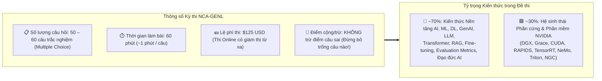

# NVIDIA Certified Associate (NCA-GENL): Cẩm nang Ôn thi, Bảng Tổng hợp & Chiến lược Thực chiến

> [!IMPORTANT]
> Tài liệu này được thiết kế như một **"Bản đồ Tác chiến Giờ chót (Last-Minute Master Cheat Sheet)"** dành riêng cho Developer trước khi bước vào phòng thi **NCA-GENL (NVIDIA Certified Associate – Generative AI and LLMs)**. Hãy đọc kỹ các bảng đối chiếu nhanh và danh sách bẫy đề thi dưới đây!

---

## 1. Cấu trúc và Thông số Kỹ thuật Kỳ thi NCA-GENL

---

## 2. Lộ trình Ôn tập 3 Giai đoạn Hiệu quả nhất cho Developer

1. **Giai đoạn 1 – Deep Concept Mapping (Hiểu bản chất qua góc nhìn Dev):**
   * Đọc lần lượt từ [Module 01](file:///c:/Users/ACER/OneDrive/Documents/NCA-GENL/Module_01_AI_Infrastructure.md) đến [Module 10](file:///c:/Users/ACER/OneDrive/Documents/NCA-GENL/Module_10_Additional_Topics.md).
   * Đừng học vẹt định nghĩa tiếng Anh; hãy gắn mỗi khái niệm với một phép ẩn dụ hoặc một công cụ Dev quen thuộc (ví dụ: *Memory Pool = DB Connection Pool*, *ONNX = Chuẩn trung gian đa nền tảng*, *TensorRT = Trình biên dịch tối ưu phần cứng `-O3`*, *Triton = API Gateway/Web Server cho AI*, *NeMo Guardrails = Middleware lọc Request/Response*).
2. **Giai đoạn 2 – Scenario & Trap Drills (Luyện phản xạ nhận diện từ khóa):**
   * Đề thi của NVIDIA rất thích ra câu hỏi dạng **Tình huống doanh nghiệp (Scenario-based)**: *"Một công ty X gặp vấn đề Y và có ràng buộc Z, giải pháp nào tối ưu nhất?"*.
   * Hãy luyện thói quen **gạch chân từ khóa ràng buộc** (ví dụ: *không thay đổi trọng số*, *dữ liệu cập nhật hàng giờ*, *thiết bị biên ít RAM*, *dịch thuật*, *tóm tắt*...) để khóa mục tiêu đáp án ngay trong 15 giây đầu.
3. **Giai đoạn 3 – Last-Minute Cheat Sheet Review (30 phút trước giờ thi):**
   * Ôn lại đúng **6 Bảng Phản Xạ Nhanh** ở Mục 3 ngay dưới đây để toàn bộ từ khóa nằm sẵn trong bộ nhớ ngắn hạn (RAM) của bạn khi mở đề!

---

## 3. Sáu Bảng Phản Xạ Nhanh ("Nhìn Từ Khóa – Khoanh Đáp Án")

### Bảng 1: Chọn Kiến trúc Transformer & Mô hình theo Bài toán (Module 4)
| Từ khóa bài toán trong đề thi | Kiến trúc phải chọn | Mô hình đại diện | Cơ chế cốt lõi |
| :--- | :--- | :--- | :--- |
| Phân loại văn bản, Phân tích cảm xúc (Sentiment), Lọc Spam, Trích xuất thực thể (**NER**), Tìm kiếm ngữ nghĩa | **Encoder-only** | **BERT**, RoBERTa, DeBERTa | Đọc hiểu ngữ cảnh **2 chiều (Bidirectional)** / Masked Language Modeling |
| Sinh văn bản mở, Chatbot hội thoại, Trợ lý viết Code, Kể chuyện sáng tạo | **Decoder-only** | **GPT-4**, **LLaMA 3**, Claude, Mistral | Dự đoán từ tiếp theo **1 chiều từ trái sang phải (Autoregressive)** |
| **Dịch máy** giữa các ngôn ngữ (Translation), **Tóm tắt** văn bản dài thành ngắn (Summarization) | **Encoder-Decoder (Seq2Seq)** | **T5**, **Flan-T5**, BART, NLLB | Encoder đọc hiểu toàn bộ chuỗi nguồn $\to$ Decoder sinh chuỗi đích mới |

### Bảng 2: Chọn Độ đo Đánh giá (Evaluation Metrics) theo Tác vụ (Module 5 & 7)
| Tác vụ AI cần đánh giá | Độ đo (Metric) chuẩn xác | Bản chất kỹ thuật cần nhớ |
| :--- | :--- | :--- |
| **Dịch máy (Machine Translation)** | **BLEU** | Thiên về **Precision** (Đếm tỷ lệ cụm từ trùng khớp chính xác với bản dịch mẫu). |
| **Tóm tắt văn bản (Text Summarization)** | **ROUGE** (ROUGE-1, ROUGE-2, ROUGE-L) | Thiên về **Recall** (Đo mức độ bao phủ, không bỏ sót các ý chính của văn bản gốc). |
| **Tìm kiếm ngữ nghĩa (Semantic Search) & RAG** | **Cosine Similarity** | Đo cô-sin góc giữa **2 Vector Embedding** (từ $-1$ đến $1$; $1$ là trùng nghĩa). |
| **Độ tự tin của LLM khi đoán từ tiếp theo** | **Perplexity (PPL)** | Perplexity **càng thấp** $\to$ Mô hình càng ít bối rối và dự đoán càng chính xác. |
| **Đánh giá mô hình sau khi Fine-Tuning** | **Validation Set Accuracy / Loss** | Đo trên dữ liệu kiểm định chưa từng học để phát hiện **Overfitting (Học vẹt)**. |

### Bảng 3: Chọn Phương pháp Tùy biến Mô hình theo Ràng buộc (Module 6)
| Tình huống & Ràng buộc của Doanh nghiệp | Giải pháp Tùy biến Tối ưu | Có thay đổi Weights không? |
| :--- | :--- | :--- |
| Cần định hướng đầu ra nhanh nhất, chi phí bằng 0, chỉ cung cấp câu lệnh hoặc vài ví dụ mẫu | **Prompt Engineering** (Zero/One/Few-shot, CoT, System Prompt) | **Không** |
| Cần trả lời dựa trên **tài liệu nội bộ cập nhật liên tục**, chống ảo giác, có **trích dẫn nguồn**, chi phí thấp | **RAG (Retrieval-Augmented Generation)** + Vector DB + Chunking | **Không** |
| Cần dạy mô hình **thuật ngữ chuyên ngành sâu**, thay đổi hẳn văn phong/cấu trúc đầu ra trên dữ liệu gán nhãn | **Transfer Learning / Fine-Tuning** (Full Fine-Tuning hoặc **PEFT/LoRA**) | **Có** |
| Cần nén tri thức từ một LLM khổng lồ sang một **SLM nhỏ gọn** để chạy nhanh trên điện thoại/Edge | **Knowledge Distillation** (Mô hình **Teacher $\to$ Student**) | **Có** (Huấn luyện Student) |

### Bảng 4: Ánh xạ Thư viện CPU sang GPU với NVIDIA RAPIDS (Module 8)
| Tác vụ xử lý dữ liệu | Thư viện CPU (Chậm) | Thư viện GPU NVIDIA RAPIDS (Siêu tốc) |
| :--- | :--- | :--- |
| Xử lý bảng dữ liệu **DataFrame** (lọc, ghép nối, nhóm) | `Pandas` | **`cuDF`** |
| Tính toán mảng đa chiều & đại số tuyến tính | `NumPy` | **`cuPy`** |
| Đọc/Ghi file CSV, Parquet trực tiếp vào VRAM | `PyArrow` / `Pandas I/O` | **`cuIO`** |
| Thuật toán Machine Learning cổ điển (K-Means, Random Forest, PCA, Regression) | `Scikit-learn` | **`cuML`** |
| Phân tích đồ thị mạng lưới quy mô lớn (PageRank, đường đi ngắn nhất) | `NetworkX` | **`cuGraph`** |

### Bảng 5: Phân biệt Bộ Công cụ Phần mềm trong Hệ sinh thái NVIDIA (Module 8 & 9)
| Công cụ NVIDIA | Vai trò cốt lõi duy nhất cần nhớ | Từ khóa nhận diện trong câu hỏi |
| :--- | :--- | :--- |
| **CUDA** | Nền tảng lập trình tính toán song song trên GPU | Cho phép C/C++/Python điều khiển trực tiếp các nhân GPU. |
| **`nvidia-smi`** | Tiện ích dòng lệnh (CLI) giám sát GPU | Xem GPU Utilization %, VRAM usage, nhiệt độ, công suất điện, PID. |
| **NVIDIA TensorRT** | Trình biên dịch & Tối ưu hóa **Suy luận (Inference Optimizer)** | Gộp tầng (**Layer Fusion**), lượng tử hóa **FP16/INT8**, tối ưu độc quyền cho GPU NVIDIA. |
| **ONNX** | Định dạng chuẩn mở trung gian giữa các Framework | Tính di động (**Portability**), chuyển mô hình từ PyTorch sang C++/Runtime khác. |
| **NVIDIA NeMo** | Framework xây dựng, huấn luyện & tùy biến **LLM / GenAI** | Huấn luyện phân tán (Megatron), làm sạch dữ liệu (Curator), Fine-tune (Customizer). |
| **NVIDIA Triton** | **Phần mềm Máy chủ Suy luận (Inference Server)** | Phục vụ mô hình qua **HTTP/gRPC**, hỗ trợ **đa framework**, chạy cả GPU & CPU, có **Dynamic Batching**. |
| **NVIDIA NGC** | Kho lưu trữ **Docker Containers & Pre-trained Models** | Tải container đã đóng gói sẵn CUDA, Driver, Framework tối ưu hóa. |
| **Confidential Computing** | Bảo mật dữ liệu cấp độ **Phần cứng GPU (Hopper/Blackwell)** | Mã hóa và cách ly vùng nhớ (**Hardware Enclave**) khi dữ liệu đang tính toán trên Cloud (**Privacy**). |
| **NeMo Guardrails** | Bộ lọc rào chắn **An toàn cho ứng dụng LLM (Safety)** | **Input/Output Filters**, chống Jailbreak, kiểm tra ảo giác, dùng **Embedding Classifier**. |

### Bảng 6: Hạ tầng Mạng & Lưu trữ trong AI Data Center (Module 1)
| Thành phần Hạ tầng | Giải pháp Chuẩn cho AI | Lý do chọn |
| :--- | :--- | :--- |
| **Mạng liên kết cụm GPU** | **InfiniBand + GPUDirect RDMA** | GPU giữa các máy chủ đọc/ghi trực tiếp vào VRAM của nhau qua mạng, bỏ qua CPU, độ trễ micro-giây. |
| **Lưu trữ dữ liệu đang Train trên 1 máy** | **Local NVMe SSD** (+ GPUDirect Storage) | Tốc độ đọc/ghi cục bộ qua PCIe nhanh nhất cho Hot Data. |
| **Lưu trữ dữ liệu Train dùng chung cho cả cụm trăm Node** | **Parallel File System** (Lustre, GPFS, WEKA) | Cho phép hàng trăm máy chủ GPU đọc/ghi song song cùng lúc không bị nghẽn cổ chai. |
| **Lưu trữ Code, Scripts, Configs nhẹ** | **NFS (Network File System)** | Chia sẻ file cấu hình và mã nguồn đơn giản qua mạng. |
| **Lưu trữ Raw Data, Backups, Checkpoints cũ dài hạn** | **Object Storage** (AWS S3, GCS, Ceph) | Dung lượng mở rộng vô hạn, chi phí lưu trữ Cold Data rẻ nhất. |

---

## 4. Chiến lược Làm bài Thi Thực tế (Exam Logistics & Tips)

1. **Chuẩn bị kỹ thuật trước 24 giờ:**
   * Kiểm tra kỹ webcam, microphone, đường truyền Internet ổn định và cập nhật trình duyệt theo đúng hướng dẫn của hệ thống thi Certiverse/NVIDIA.
2. **Đăng nhập sớm 15 phút trước giờ thi:**
   * Bạn cần thời gian chụp ảnh giấy tờ tùy thân (CCCD/Passport) và quay webcam 360 độ kiểm tra bàn làm việc (bàn làm việc phải dọn sạch giấy nháp, điện thoại, màn hình phụ).
3. **Chiến thuật quản lý 60 phút trong phòng thi (2-Pass Strategy):**
   * **Lượt 1 (40 phút đầu):** Đọc nhanh câu hỏi, bắt từ khóa và chọn ngay đáp án với những câu rõ ràng (khoảng 45 câu). Nếu gặp câu tình huống quá dài hoặc phân vân giữa 2 đáp án, hãy **chọn tạm 1 đáp án có khả năng cao nhất + Bấm nút `Flag / Mark for Review` (Gắn cờ)** rồi chuyển ngay sang câu tiếp theo. Tuyệt đối không đứng hình quá 90 giây ở một câu!
   * **Lượt 2 (20 phút cuối):** Quay lại danh sách các câu đã gắn cờ (`Flagged Questions`), đọc kỹ từng từ khóa loại trừ để chốt đáp án cuối cùng.
4. **Quy tắc tối thượng – KHÔNG BỎ TRỐNG CÂU NÀO:**
   * Kỳ thi NCA-GENL **không trừ điểm đối với câu trả lời sai**. Ngay cả khi không chắc chắn 100%, việc loại trừ 2 phương án sai rõ ràng sẽ giúp bạn nâng xác suất đúng từ 25% lên 50%!
