# NVIDIA Certified Associate (NCA-GENL): Cẩm nang Ôn thi, Bảng Tổng hợp & Đề Thi Thử Thực Chiến

> [!IMPORTANT]
> Tài liệu này là **"Bản đồ Tác chiến Giờ chót (Last-Minute Master Cheat Sheet)"** kết hợp với **Bộ 15 Câu Hỏi Thi Thử Mô Phỏng (Mock Exam)** bám sát 100% cấu trúc Blueprint chính thức của kỳ thi **NCA-GENL (NVIDIA Certified Associate – Generative AI and LLMs)**.

---

## 1. Cấu trúc Kỳ thi & Phân bổ Điểm số theo Blueprint Chính thức của NVIDIA

```mermaid
flowchart LR
    subgraph Exam["Thông số Kỳ thi NCA-GENL"]
        direction TB
        I1["📋 Số lượng câu hỏi: 50 – 60 câu trắc nghiệm (Single & Multiple-Response)"]
        I2["⏱️ Thời gian làm bài: 60 phút (~1 phút / câu)"]
        I3["💵 Lệ phí thi: $125 USD | Hiệu lực chứng chỉ: 2 năm"]
        I4["🎯 Điểm cộng/trừ: KHÔNG trừ điểm câu sai (Tuyệt đối không bỏ trống!)"]
    end

    subgraph Blueprint["5 Miền Kiến thức Chính thức (Official Blueprint Domains)"]
        direction TB
        D1["1. Core Machine Learning & AI Knowledge: 30%<br/>(ML/DL, Transformer, Attention Q/K/V, Tokenization, Diffusion)"]
        D2["2. Software Development: 24%<br/>(Python, RAG Pipeline, NVIDIA NeMo, TensorRT-LLM, Triton, NIM)"]
        D3["3. Experimentation: 22%<br/>(Prompt Engineering, LoRA/QLoRA, Temperature/Top-P, BLEU/ROUGE, CV)"]
        D4["4. Data Analysis: 14%<br/>(EDA, Regex, N-grams, NVIDIA RAPIDS: cuDF/cuML, Drift Monitoring)"]
        D5["5. Trustworthy AI: 10%<br/>(Hallucination, Bias, Prompt Injection, NeMo Guardrails, Confidential Computing)"]
    end

    Exam ==> Blueprint
```

---

## 2. Sáu Bảng Phản Xạ Nhanh ("Nhìn Từ Khóa – Khoanh Đáp Án trong 15 Giây")

### Bảng 1: Chọn Kiến trúc Transformer & Mô hình theo Bài toán (Module 4)
| Từ khóa bài toán trong đề thi | Kiến trúc phải chọn | Mô hình đại diện | Cơ chế cốt lõi |
| :--- | :--- | :--- | :--- |
| Phân loại văn bản, Phân tích cảm xúc (Sentiment), Lọc Spam, Trích xuất thực thể (**NER**), Tìm kiếm ngữ nghĩa | **Encoder-only** | **BERT**, RoBERTa, DeBERTa | Đọc hiểu ngữ cảnh **2 chiều (Bidirectional)** / Masked Language Modeling |
| Sinh văn bản mở, Chatbot hội thoại, Trợ lý viết Code, Kể chuyện sáng tạo | **Decoder-only** | **GPT-4**, **LLaMA 3**, Claude, Mistral | Dự đoán từ tiếp theo **1 chiều từ trái sang phải (Autoregressive)** |
| **Dịch máy** giữa các ngôn ngữ (Translation), **Tóm tắt** văn bản dài thành ngắn (Summarization) | **Encoder-Decoder (Seq2Seq)** | **T5**, **Flan-T5**, BART, NLLB | Encoder đọc hiểu toàn bộ chuỗi nguồn $\to$ Decoder sinh chuỗi đích mới |

### Bảng 2: Chọn Độ đo Đánh giá (Evaluation Metrics) theo Tác vụ (Module 5 & 7)
| Tác vụ AI cần đánh giá | Độ đo (Metric) chuẩn xác | Bản chất kỹ thuật cần nhớ |
| :--- | :--- | :--- |
| **Dịch máy (Machine Translation)** | **BLEU** | Thiên về **Precision** (Đếm tỷ lệ cụm từ trùng khớp chính xác với bản dịch mẫu). |
| **Tóm tắt văn bản (Text Summarization)** | **ROUGE** (ROUGE-1, ROUGE-2, ROUGE-L) | Thiên về **Recall** (Đo mức độ bao phủ, không bỏ sót các ý chính của văn bản gốc). |
| **Tìm kiếm ngữ nghĩa (Semantic Search) & RAG** | **Cosine Similarity** | Đo cô-sin góc giữa **2 Vector Embedding** (từ $-1$ đến $1$; $1$ là trùng nghĩa). |
| **Độ tự tin của LLM khi đoán từ tiếp theo** | **Perplexity (PPL)** | Perplexity **càng thấp** $\to$ Mô hình càng ít bối rối và dự đoán càng chính xác. |
| **Phân loại trên dữ liệu mất cân bằng (Imbalanced Data)** | **F1-Score** (Cân bằng Precision & Recall) | Không được dùng Accuracy! Sợ bắt nhầm (Spam) $\to$ **Precision**; Sợ bỏ lọt (Ung thư/Gian lận) $\to$ **Recall**. |
| **Đánh giá mô hình sau khi Fine-Tuning** | **Validation Set Accuracy / Loss** | Đo trên dữ liệu kiểm định chưa từng học để phát hiện **Overfitting (Học vẹt)**. |

### Bảng 3: Chọn Phương pháp Tùy biến Mô hình theo Ràng buộc (Module 6)
| Tình huống & Ràng buộc của Doanh nghiệp | Giải pháp Tùy biến Tối ưu | Có thay đổi Weights không? |
| :--- | :--- | :--- |
| Cần định hướng đầu ra nhanh nhất, chi phí bằng 0, chỉ cung cấp câu lệnh hoặc vài ví dụ mẫu | **Prompt Engineering** (Zero/One/Few-shot, CoT, System Prompt) | **Không** |
| Cần trả lời dựa trên **tài liệu nội bộ cập nhật liên tục**, chống ảo giác, có **trích dẫn nguồn**, chi phí thấp | **RAG (Retrieval-Augmented Generation)** + Vector DB + Chunking | **Không** |
| Cần dạy mô hình **thuật ngữ chuyên ngành sâu**, thay đổi hẳn văn phong/cấu trúc đầu ra trên dữ liệu gán nhãn với ít VRAM | **PEFT: LoRA / QLoRA** (Đóng băng mô hình gốc, chỉ train ma trận hạng thấp $A \times B$) | **Có** (Huấn luyện Adapter) |
| Cần nén tri thức từ một LLM khổng lồ sang một **SLM nhỏ gọn** để chạy nhanh trên điện thoại/Edge | **Knowledge Distillation** (Mô hình **Teacher $\to$ Student**) | **Có** (Huấn luyện Student) |

### Bảng 4: Ánh xạ Thư viện CPU sang GPU với NVIDIA RAPIDS (Module 8)
| Tác vụ xử lý dữ liệu | Thư viện CPU (Chậm) | Thư viện GPU NVIDIA RAPIDS (Siêu tốc) |
| :--- | :--- | :--- |
| Xử lý bảng dữ liệu **DataFrame** (lọc, ghép nối, nhóm) | `Pandas` | **`cuDF`** |
| Tính toán mảng đa chiều & đại số tuyến tính | `NumPy` | **`cuPy`** |
| Đọc/Ghi file CSV, Parquet trực tiếp vào VRAM | `PyArrow` / `Pandas I/O` | **`cuIO`** |
| Thuật toán Machine Learning cổ điển (K-Means, Random Forest, PCA, Regression) | `Scikit-learn` | **`cuML`** |
| Phân tích đồ thị mạng lưới quy mô lớn (PageRank, đường đi ngắn nhất) | `NetworkX` | **`cuGraph`** |

### Bảng 5: Phân biệt Bộ Công cụ Phần mềm trong Hệ sinh thái NVIDIA (Module 8 & 9)
| Công cụ NVIDIA | Vai trò cốt lõi duy nhất cần nhớ | Từ khóa nhận diện trong câu hỏi |
| :--- | :--- | :--- |
| **CUDA** | Nền tảng lập trình tính toán song song trên GPU | Cho phép C/C++/Python điều khiển trực tiếp các nhân GPU. |
| **`nvidia-smi`** | Tiện ích dòng lệnh (CLI) giám sát GPU | Xem GPU Utilization %, VRAM usage, nhiệt độ, công suất điện, PID. |
| **NVIDIA TensorRT / TensorRT-LLM** | Trình biên dịch & Tối ưu hóa **Suy luận (Inference Optimizer)** | Gộp tầng (**Layer Fusion**), lượng tử hóa **FP16/INT8**, **In-flight Batching**, **PagedAttention**. |
| **ONNX** | Định dạng chuẩn mở trung gian giữa các Framework | Tính di động (**Portability**), chuyển mô hình từ PyTorch sang C++/Runtime khác. |
| **NVIDIA NeMo** | Framework xây dựng, huấn luyện & tùy biến **LLM / GenAI** | Huấn luyện phân tán (Megatron), làm sạch dữ liệu (Curator), Fine-tune (Customizer). |
| **NVIDIA Triton** | **Phần mềm Máy chủ Suy luận (Inference Server)** | Phục vụ mô hình qua **HTTP/gRPC**, hỗ trợ **đa framework**, chạy cả GPU & CPU, có **Dynamic Batching**. |
| **NVIDIA NIM** | **Container Microservices suy luận đóng gói sẵn** | Đóng gói sẵn Model + TensorRT-LLM + Triton + OpenAI-compatible API, chạy ngay trong vài phút. |
| **NVIDIA Base Command** | Nền tảng quản trị & điều phối cụm huấn luyện AI lớn | Lập lịch job (Scheduling), phân bổ tài nguyên GPU, giám sát cụm DGX SuperPOD. |
| **NVIDIA NGC** | Kho lưu trữ **Docker Containers & Pre-trained Models** | Tải container đã đóng gói sẵn CUDA, Driver, Framework tối ưu hóa. |
| **Confidential Computing** | Bảo mật dữ liệu cấp độ **Phần cứng GPU (Hopper/Blackwell)** | Mã hóa và cách ly vùng nhớ (**Hardware Enclave**) khi dữ liệu đang tính toán trên Cloud (**Privacy**). |
| **NeMo Guardrails** | Bộ lọc rào chắn **An toàn cho ứng dụng LLM (Safety)** | **Input/Output Filters**, ngôn ngữ **Colang**, chống Jailbreak/Prompt Injection, dùng **Embedding Classifier**. |

### Bảng 6: Hạ tầng Mạng & Lưu trữ trong AI Data Center (Module 1)
| Thành phần Hạ tầng | Giải pháp Chuẩn cho AI | Lý do chọn |
| :--- | :--- | :--- |
| **Kết nối GPU trong cùng 1 máy chủ** | **NVLink & NVSwitch** | Băng thông cực đại (900 GB/s – 1.8 TB/s) nối trực tiếp giữa các GPU trong cùng 1 node. |
| **Mạng liên kết giữa các máy chủ GPU** | **InfiniBand + GPUDirect RDMA** | GPU giữa các máy chủ đọc/ghi trực tiếp vào VRAM của nhau qua mạng, bỏ qua CPU, độ trễ micro-giây. |
| **Lưu trữ dữ liệu đang Train trên 1 máy** | **Local NVMe SSD + GPUDirect Storage (GDS)** | Đường truyền DMA thẳng từ ổ cứng NVMe vào VRAM GPU không qua CPU RAM. |
| **Lưu trữ dữ liệu Train dùng chung cho cả cụm trăm Node** | **Parallel File System** (Lustre, GPFS, WEKA) | Cho phép hàng trăm máy chủ GPU đọc/ghi song song cùng lúc không bị nghẽn cổ chai. |
| **Lưu trữ Code, Scripts, Configs nhẹ** | **NFS (Network File System)** | Chia sẻ file cấu hình và mã nguồn đơn giản qua mạng. |
| **Lưu trữ Raw Data, Backups, Checkpoints cũ dài hạn** | **Object Storage** (AWS S3, GCS, Ceph) | Dung lượng mở rộng vô hạn, chi phí lưu trữ Cold Data rẻ nhất. |

---

## 3. Đề Thi Thử Thực Chiến 15 Câu (NCA-GENL Mock Exam)

Hãy tự làm 15 câu hỏi trắc nghiệm tiêu biểu dưới đây trước khi xem phần đáp án và giải thích chi tiết:

#### Câu 1 (AI Infrastructure):
Khi huấn luyện phân tán một mô hình ngôn ngữ lớn trên cụm 32 máy chủ DGX, công nghệ nào cho phép một GPU trên máy chủ A đọc và ghi trực tiếp vào bộ nhớ VRAM của một GPU trên máy chủ B thông qua mạng InfiniBand mà không cần sự can thiệp của CPU hệ thống?
* **A.** NVIDIA Container Toolkit
* **B.** GPUDirect RDMA
* **C.** Memory Pooling
* **D.** Network File System (NFS)
> **Đáp án đúng: B (`GPUDirect RDMA`)**. *Giải thích:* GPUDirect RDMA kết hợp với mạng InfiniBand cho phép truyền dữ liệu trực tiếp từ VRAM của GPU node này sang VRAM của GPU node khác qua mạng mà bỏ qua hoàn toàn CPU và System RAM.

#### Câu 2 (AI/ML Fundamentals):
Một nhà khoa học dữ liệu có một tập dữ liệu khách hàng gồm 800 cột đặc trưng (features) không có nhãn và muốn giảm xuống còn 20 cột quan trọng nhất để tăng tốc độ huấn luyện trong khi vẫn giữ lại tối đa lượng thông tin (phương sai) của dữ liệu gốc. Kỹ thuật nào nên được sử dụng?
* **A.** K-Means Clustering
* **B.** Logistic Regression
* **C.** Principal Component Analysis (PCA)
* **D.** Named Entity Recognition (NER)
> **Đáp án đúng: C (`PCA`)**. *Giải thích:* PCA là thuật toán học không giám sát chuyên dùng để giảm chiều dữ liệu (Dimensionality Reduction) trong khi bảo toàn phương sai lớn nhất. K-Means dùng để phân cụm chứ không giảm số cột đặc trưng.

#### Câu 3 (Generative AI & LLM):
Tại sao kiến trúc Transformer lại có khả năng tận dụng sức mạnh phần cứng của GPU tốt hơn rất nhiều so với mạng hồi quy RNN/LSTM khi huấn luyện trên văn bản dài?
* **A.** Vì Transformer không sử dụng hàm kích hoạt phi tuyến.
* **B.** Vì Transformer loại bỏ cơ chế xử lý tuần tự từng từ và xử lý toàn bộ chuỗi token song song cùng lúc nhờ cơ chế Self-Attention.
* **C.** Vì Transformer chỉ chạy trên CPU Grace mà không cần VRAM.
* **D.** Vì Transformer sử dụng từ điển Whole-word thay vì Subword.
> **Đáp án đúng: B**. *Giải thích:* RNN phải tính tuần tự bước $t-1$ xong mới tính được bước $t$, gây nghẽn trên GPU. Transformer đọc toàn bộ câu cùng lúc và tính toán ma trận Self-Attention song song 100% trên các Tensor Cores của GPU.

#### Câu 4 (Transformer Architecture):
Một công ty luật muốn xây dựng hệ thống tự động tóm tắt các bản hợp đồng dài 50 trang thành 1 trang tóm tắt ngắn gọn. Loại biến thể kiến trúc Transformer và độ đo đánh giá (Metric) nào là cặp kết hợp phù hợp nhất?
* **A.** Encoder-only (BERT) và BLEU
* **B.** Decoder-only (GPT) và Accuracy
* **C.** Encoder-Decoder (T5 / BART) và ROUGE
* **D.** Diffusion Model và Cosine Similarity
> **Đáp án đúng: C (`Encoder-Decoder` và `ROUGE`)**. *Giải thích:* Tóm tắt văn bản (Summarization) và Dịch máy (Translation) là bài toán biến đổi chuỗi sang chuỗi (Seq2Seq) phù hợp nhất với kiến trúc Encoder-Decoder (như T5, BART), và chất lượng bản tóm tắt được đo bằng chỉ số **ROUGE** (Recall-oriented).

#### Câu 5 (Transformer Decoding Parameters):
Một kỹ sư phần mềm đang sử dụng LLM để tự động sinh mã nguồn Python và truy vấn SQL cho hệ thống tài chính. Để kết quả đầu ra có tính nhất quán cao nhất, chính xác và hạn chế tối đa việc mô hình tự sáng tạo ngẫu nhiên, kỹ sư nên thiết lập tham số nào?
* **A.** Tăng `Temperature` lên mức cao (ví dụ `1.5`).
* **B.** Giảm `Temperature` xuống mức rất thấp (gần bằng `0`).
* **C.** Tăng `Top-K` lên bằng kích thước toàn bộ từ điển.
* **D.** Tắt cơ chế Positional Encoding.
> **Đáp án đúng: B**. *Giải thích:* `Temperature` gần `0` làm nhọn phân phối xác suất sau hàm Softmax, buộc mô hình luôn chọn các token có xác suất cao nhất (Deterministic), rất lý tưởng cho viết code, toán học và trích xuất dữ liệu chuẩn xác.

#### Câu 6 (Model Selection & Metrics):
Một hệ thống y tế phát triển mô hình AI sàng lọc bệnh hiểm nghèo từ ảnh chụp X-quang (trong đó 98% mẫu là người khỏe mạnh, chỉ 2% mẫu là người có bệnh). Nếu yêu cầu quan trọng nhất là **không được phép bỏ sót bất kỳ bệnh nhân thực sự nào** (giảm thiểu tối đa False Negatives), kỹ sư nên ưu tiên tối ưu hóa độ đo nào?
* **A.** Accuracy
* **B.** Precision
* **C.** Recall (Sensitivity)
* **D.** BLEU
> **Đáp án đúng: C (`Recall`)**. *Giải thích:* Công thức $\text{Recall} = \frac{TP}{TP + FN}$ đo lường tỷ lệ phát hiện trúng trên tổng số ca dương tính thực tế. Khi chi phí của việc bỏ lọt (False Negative - FN) nguy hiểm đến tính mạng, phải ưu tiên tối đa hóa **Recall** (và dùng **F1-Score** để đánh giá cân bằng trên dữ liệu lệch nhãn).

#### Câu 7 (Model Customization - RAG vs. Fine-Tuning):
Một doanh nghiệp thương mại điện tử muốn xây dựng trợ lý AI trả lời cho khách hàng về tình trạng tồn kho và giá khuyến mãi thay đổi theo từng giờ, đồng thời bắt buộc phải đính kèm đường link dẫn nguồn tới trang sản phẩm mà không muốn tốn chi phí huấn luyện lại mô hình. Giải pháp nào tối ưu nhất?
* **A.** Full Fine-Tuning mô hình mỗi giờ.
* **B.** Huấn luyện một Foundation Model mới từ đầu (Training from scratch).
* **C.** Retrieval-Augmented Generation (RAG) kết hợp cơ sở dữ liệu Vector.
* **D.** Knowledge Distillation từ mô hình nhỏ sang mô hình lớn.
> **Đáp án đúng: C (`RAG`)**. *Giải thích:* RAG cho phép truy xuất dữ liệu mới nhất theo thời gian thực từ kho dữ liệu bên ngoài để bổ sung vào Prompt mà không cần thay đổi trọng số mô hình, đồng thời giảm ảo giác và cung cấp trích dẫn nguồn chính xác.

#### Câu 8 (Model Customization - PEFT):
Khi tinh chỉnh một mô hình LLM 70 tỷ tham số bằng kỹ thuật **LoRA (Low-Rank Adaptation)**, tại sao lượng bộ nhớ VRAM tiêu thụ lại giảm đi đáng kể so với Full Fine-Tuning?
* **A.** Vì LoRA xóa bỏ 90% số tầng của mô hình gốc.
* **B.** Vì LoRA đóng băng toàn bộ trọng số của mô hình gốc và chỉ huấn luyện một cặp ma trận phân rã hạng thấp (low-rank matrices) có số lượng tham số rất nhỏ gắn kèm.
* **C.** Vì LoRA chỉ chạy trên CPU mà không dùng đến GPU.
* **D.** Vì LoRA chuyển đổi mô hình Transformer thành mô hình K-Means.
> **Đáp án đúng: B**. *Giải thích:* LoRA giữ nguyên (freeze) trọng số gốc $W_0$ và chỉ cập nhật $\Delta W = A \times B$ với rank $r \ll d$, giảm hơn 99% số lượng tham số cần tính Gradient và trạng thái Optimizer.

#### Câu 9 (Model Lifecycle & Optimization):
Một kỹ sư áp dụng kỹ thuật **Quantization (Lượng tử hóa)** để chuyển đổi trọng số của mô hình từ định dạng số thực 32-bit (`FP32`) sang số nguyên 8-bit (`INT8`). Kết quả nào sau đây mô tả đúng nhất tác động của việc này?
* **A.** Kích thước bộ nhớ của mô hình tăng gấp 4 lần nhưng độ chính xác tăng lên 100%.
* **B.** Kích thước bộ nhớ của mô hình giảm khoảng 4 lần, tốc độ suy luận tăng lên đáng kể với mức suy giảm độ chính xác rất nhỏ.
* **C.** Mô hình không còn chạy được trên GPU nữa mà chỉ chạy trên CPU.
* **D.** Mô hình tự động biến thành kiến trúc Diffusion.
> **Đáp án đúng: B**. *Giải thích:* Từ 32-bit xuống 8-bit giúp giảm dung lượng lưu trữ và VRAM đi $32 / 8 = 4$ lần (từ 100MB xuống 25MB), tăng tốc độ tính toán lên khoảng $3\times$ trên Tensor Cores với độ hao hụt chính xác cực nhỏ.

#### Câu 10 (NVIDIA Ecosystem - RAPIDS):
Đội ngũ Khoa học Dữ liệu đang sử dụng thư viện `Pandas` để làm sạch bảng dữ liệu DataFrame và `Scikit-learn` để chạy thuật toán phân cụm trên CPU, nhưng quá trình này mất tới 6 giờ cho mỗi lần chạy. Cặp thư viện nào trong bộ **NVIDIA RAPIDS** giúp chuyển đổi trực tiếp hai tác vụ này lên GPU để tăng tốc hàng chục lần?
* **A.** `TensorRT` và `Triton`
* **B.** `cuDF` và `cuML`
* **C.** `cuGraph` và `NeMo Guardrails`
* **D.** `ONNX` và `nvidia-smi`
> **Đáp án đúng: B (`cuDF` và `cuML`)**. *Giải thích:* Trong hệ sinh thái NVIDIA RAPIDS, **`cuDF`** thay thế tương đương cho `Pandas` (xử lý DataFrame trên GPU), và **`cuML`** thay thế tương đương cho `Scikit-learn` (chạy các thuật toán ML cổ điển trên GPU).

#### Câu 11 (NVIDIA Ecosystem - TensorRT vs. ONNX):
Sự khác biệt cốt lõi giữa chuẩn định dạng **ONNX** và bộ công cụ **NVIDIA TensorRT** trong quy trình triển khai mô hình là gì?
* **A.** ONNX chỉ chạy trên GPU NVIDIA, còn TensorRT chạy được trên mọi loại CPU.
* **B.** ONNX tập trung vào khả năng tương thích và di động (Portability) giữa các framework khác nhau, trong khi TensorRT tập trung vào việc tối ưu hóa hiệu năng suy luận tối đa (Layer fusion, Kernel auto-tuning, Quantization) độc quyền trên GPU NVIDIA.
* **C.** ONNX dùng để làm sạch dữ liệu văn bản, còn TensorRT dùng để thu thập dữ liệu.
* **D.** Cả hai đều là phần cứng mạng thay thế cho InfiniBand.
> **Đáp án đúng: B**. *Giải thích:* ONNX là định dạng mở giúp chuyển đổi mô hình qua lại giữa các framework, còn TensorRT là trình biên dịch tối ưu hóa suy luận sâu ở mức phần cứng dành riêng cho GPU NVIDIA.

#### Câu 12 (NVIDIA Ecosystem - Triton Inference Server):
Phát biểu nào sau đây là **ĐÚNG** khi nói về **NVIDIA Triton Inference Server**?
* **A.** Triton là một dòng vi xử lý phần cứng GPU chuyên dụng cho thiết bị di động.
* **B.** Triton chỉ hỗ trợ duy nhất các mô hình được biên dịch bằng TensorRT và không thể chạy trên CPU.
* **C.** Triton là phần mềm máy chủ suy luận mã nguồn mở hỗ trợ đa framework (TensorRT, PyTorch, ONNX...) và sử dụng kỹ thuật Dynamic Batching để gom các yêu cầu đơn lẻ nhằm tăng thông lượng GPU.
* **D.** Triton là công cụ chuyên dùng để huấn luyện mô hình LLM từ đầu.
> **Đáp án đúng: C**. *Giải thích:* Đây là câu hỏi bẫy kinh điển: Triton là **phần mềm** phục vụ suy luận (không phải phần cứng, không dùng để train), hỗ trợ **đa framework**, chạy được trên **cả GPU và CPU**, và nổi bật với tính năng **Dynamic Batching**.

#### Câu 13 (Trustworthy AI - NeMo Guardrails):
Để ngăn chặn các câu hỏi độc hại hoặc lạc đề trước khi gửi tới LLM chính trong **NVIDIA NeMo Guardrails**, tại sao việc sử dụng một **Embedding Classifier** lại hiệu quả hơn so với bộ lọc từ khóa tĩnh (Keyword Filter) và việc gọi một LLM phụ để kiểm duyệt?
* **A.** Vì Embedding Classifier không cần chuyển văn bản thành số.
* **B.** Vì Embedding Classifier nắm bắt được ý nghĩa ngữ nghĩa của cả những câu dùng từ đồng nghĩa (vượt trội hơn lọc từ khóa tĩnh) trong khi có độ trễ cực thấp và chi phí rẻ hơn rất nhiều so với việc gọi một LLM lớn.
* **C.** Vì Embedding Classifier tự động mã hóa phần cứng GPU như Confidential Computing.
* **D.** Vì Embedding Classifier thay thế hoàn toàn bước Tokenization.
> **Đáp án đúng: B**. *Giải thích:* Bằng cách nhúng câu hỏi thành vector và đo Cosine Similarity với danh sách các vector không an toàn đã biết, Embedding Classifier chặn được cả câu *"He committed a felony"* (dù không chứa từ khóa *"crime"*) chỉ trong vài mili-giây mà không tốn chi phí gọi LLM kiểm duyệt.

#### Câu 14 (Deep Learning Mechanics):
Khi huấn luyện một mạng nơ-ron sâu với hàng chục tầng ẩn, kỹ thuật nào giúp chuẩn hóa đầu ra của mỗi tầng về phân phối có giá trị trung bình bằng $0$ và độ lệch chuẩn bằng $1$, từ đó giữ cho quá trình huấn luyện kiến trúc Transformer luôn ổn định và hội tụ nhanh?
* **A.** Subword Tokenization
* **B.** Layer Normalization
* **C.** Reverse Diffusion
* **D.** Regular Expressions (Regex)
> **Đáp án đúng: B (`Layer Normalization`)**. *Giải thích:* Layer Normalization quy chuẩn hóa các giá trị kích hoạt trong từng tầng về phân phối chuẩn ($\mu = 0, \sigma = 1$), ngăn chặn hiện tượng dao động số học cực đoan giữa các tầng trong mạng Transformer.

#### Câu 15 (Diffusion Models):
Trong kiến trúc mô hình Khuếch tán (**Diffusion Models**) dùng để tạo ảnh từ văn bản (như Stable Diffusion), điều gì diễn ra trong pha **Reverse Diffusion (Khuếch tán ngược)**?
* **A.** Mô hình bắt đầu từ một bức ảnh thật sắc nét và cộng thêm nhiễu Gaussian cho đến khi ảnh biến thành nhiễu hoàn toàn.
* **B.** Mô hình bắt đầu từ một khung hình nhiễu ngẫu nhiên hoàn toàn và khử bỏ từng lớp nhiễu nhỏ qua từng bước lặp dưới sự dẫn dắt của Text Prompt để tạo ra bức ảnh mới sắc nét.
* **C.** Mô hình cắt văn bản thành các mảnh subword bằng thuật toán BPE.
* **D.** Mô hình chuyển đổi bảng dữ liệu Pandas sang `cuDF`.
> **Đáp án đúng: B**. *Giải thích:* Forward Diffusion là quá trình cộng thêm nhiễu vào ảnh gốc (lúc train), còn **Reverse Diffusion** là quá trình khử nhiễu từng bước từ màn hình nhiễu ngẫu nhiên để sinh ra bức ảnh mới (lúc inference).
