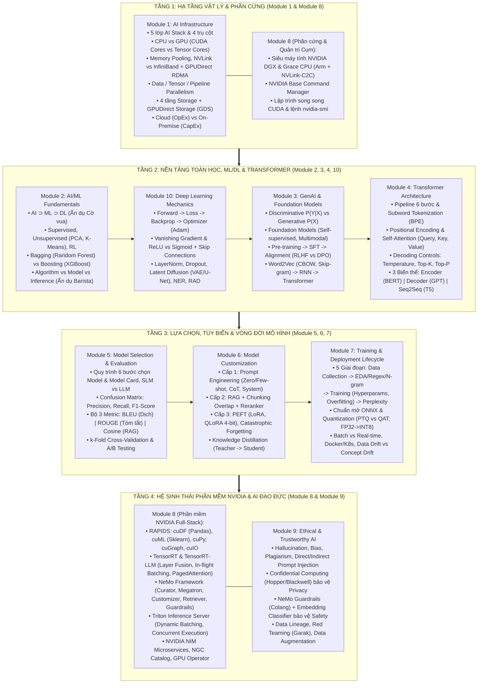

# 🎓 Cẩm nang Ôn thi Chứng chỉ NVIDIA NCA-GENL (Bản Chuyên Sâu Dành cho Developer)

Chào mừng bạn đến với bộ tài liệu ôn thi chứng chỉ **NVIDIA Certified Associate – Generative AI and LLMs (NCA-GENL)** đã được nghiên cứu, mở rộng chuyên sâu theo đúng **Official Exam Blueprint của NVIDIA**, trực quan hóa bằng sơ đồ **Mermaid** và giải thích theo **tư duy của Software Developer**.

---

## 📊 Tỷ trọng 5 Miền Kiến thức Chính thức trong Đề thi NCA-GENL

Theo Blueprint chính thức của NVIDIA, bài thi gồm **50–60 câu hỏi trong 60 phút**, phân bổ vào 5 miền (Domains) sau đây:

| Miền kiến thức (Official Exam Domain) | Tỷ trọng | Các Module tương ứng trong Dự án này |
| :--- | :--- | :--- |
| **1. Core Machine Learning and AI Knowledge** | **30%** | [Module 01](file:///c:/Users/ACER/OneDrive/Documents/NCA-GENL/Module_01_AI_Infrastructure.md), [Module 02](file:///c:/Users/ACER/OneDrive/Documents/NCA-GENL/Module_02_AIML_Fundamentals.md), [Module 03](file:///c:/Users/ACER/OneDrive/Documents/NCA-GENL/Module_03_Generative_AI_and_LLM.md), [Module 04](file:///c:/Users/ACER/OneDrive/Documents/NCA-GENL/Module_04_Transformer_Architecture.md), [Module 10](file:///c:/Users/ACER/OneDrive/Documents/NCA-GENL/Module_10_Additional_Topics.md) |
| **2. Software Development** | **24%** | [Module 06](file:///c:/Users/ACER/OneDrive/Documents/NCA-GENL/Module_06_Model_Customization.md), [Module 07](file:///c:/Users/ACER/OneDrive/Documents/NCA-GENL/Module_07_Model_Training_and_Lifecycle.md), [Module 08](file:///c:/Users/ACER/OneDrive/Documents/NCA-GENL/Module_08_NVIDIA_Ecosystem.md) |
| **3. Experimentation** | **22%** | [Module 04](file:///c:/Users/ACER/OneDrive/Documents/NCA-GENL/Module_04_Transformer_Architecture.md), [Module 05](file:///c:/Users/ACER/OneDrive/Documents/NCA-GENL/Module_05_Model_Selection.md), [Module 06](file:///c:/Users/ACER/OneDrive/Documents/NCA-GENL/Module_06_Model_Customization.md), [Module 07](file:///c:/Users/ACER/OneDrive/Documents/NCA-GENL/Module_07_Model_Training_and_Lifecycle.md) |
| **4. Data Analysis** | **14%** | [Module 05](file:///c:/Users/ACER/OneDrive/Documents/NCA-GENL/Module_05_Model_Selection.md), [Module 07](file:///c:/Users/ACER/OneDrive/Documents/NCA-GENL/Module_07_Model_Training_and_Lifecycle.md), [Module 08 (RAPIDS)](file:///c:/Users/ACER/OneDrive/Documents/NCA-GENL/Module_08_NVIDIA_Ecosystem.md) |
| **5. Trustworthy AI** | **10%** | [Module 09](file:///c:/Users/ACER/OneDrive/Documents/NCA-GENL/Module_09_Ethical_AI.md) |

---

## 🗺️ Sơ đồ Tổng quan Toàn bộ Kiến thức Kỳ thi NCA-GENL (Big Picture)

---

## 📚 Danh mục 11 Tài liệu Ôn tập Chi tiết trong Dự án

* 📘 **[Module 01: AI Infrastructure (Hạ tầng AI chuyên dụng)](file:///c:/Users/ACER/OneDrive/Documents/NCA-GENL/Module_01_AI_Infrastructure.md)**
* 📘 **[Module 02: AI/ML Fundamentals (Nền tảng AI/ML)](file:///c:/Users/ACER/OneDrive/Documents/NCA-GENL/Module_02_AIML_Fundamentals.md)**
* 📘 **[Module 03: Generative AI & Large Language Models](file:///c:/Users/ACER/OneDrive/Documents/NCA-GENL/Module_03_Generative_AI_and_LLM.md)**
* 📘 **[Module 04: Transformer Architecture (Kiến trúc Transformer)](file:///c:/Users/ACER/OneDrive/Documents/NCA-GENL/Module_04_Transformer_Architecture.md)**
* 📘 **[Module 05: Model Selection (Phương pháp Lựa chọn Mô hình)](file:///c:/Users/ACER/OneDrive/Documents/NCA-GENL/Module_05_Model_Selection.md)**
* 📘 **[Module 06: Model Customization (Phương pháp Tùy biến Mô hình)](file:///c:/Users/ACER/OneDrive/Documents/NCA-GENL/Module_06_Model_Customization.md)**
* 📘 **[Module 07: Model Training & Deployment Lifecycle](file:///c:/Users/ACER/OneDrive/Documents/NCA-GENL/Module_07_Model_Training_and_Lifecycle.md)**
* 📘 **[Module 08: NVIDIA AI Ecosystem (Hệ sinh thái Toàn diện NVIDIA)](file:///c:/Users/ACER/OneDrive/Documents/NCA-GENL/Module_08_NVIDIA_Ecosystem.md)**
* 📘 **[Module 09: Ethical & Trustworthy AI (AI Đạo đức & Đáng tin cậy)](file:///c:/Users/ACER/OneDrive/Documents/NCA-GENL/Module_09_Ethical_AI.md)**
* 📘 **[Module 10: Additional Technical Topics (Chủ đề Kỹ thuật Bổ trợ)](file:///c:/Users/ACER/OneDrive/Documents/NCA-GENL/Module_10_Additional_Topics.md)**
* 🏆 **[Cẩm nang Chiến lược Phòng thi, 6 Bảng Phản xạ Nhanh & Đề Thi Thử 15 Câu](file:///c:/Users/ACER/OneDrive/Documents/NCA-GENL/NCA_GENL_Exam_Guide_and_Tips.md)**
