# 🎓 Cẩm nang Ôn tập Chứng chỉ NVIDIA NCA-GENL (Bản Chuyên Sâu & Mở Rộng)

Chào mừng bạn đến với bộ tài liệu ôn tập chứng chỉ **NVIDIA Certified Associate – Generative AI and LLMs (NCA-GENL)** được biên soạn theo **Official Exam Blueprint của NVIDIA** ([Trang chứng chỉ chính thức](https://www.nvidia.com/en-us/learn/certification/generative-ai-llm-associate/)), trực quan hóa bằng hệ thống sơ đồ **Mermaid**, bảng đối chiếu kỹ thuật, công thức toán học, ví dụ code thực tế và giải thích theo **góc nhìn của Software Developer / AI Engineer**.

> **Thông tin kỳ thi chính thức từ NVIDIA (cập nhật ngày 2026-11-03):**
> * **Cấp độ:** Associate-level certification | **Thời lượng:** 60 phút | **Ngôn ngữ:** Tiếng Anh (English) | **Hình thức:** Online Proctored.
> * **Số lượng câu hỏi:** Trang tổng quan chứng chỉ của NVIDIA ghi **50 câu hỏi**, trong khi phần thông tin chi tiết kỳ thi ghi **50–60 câu hỏi trắc nghiệm (multiple-choice)**. Do trang chính thức hiển thị cả hai con số này, người học nên chuẩn bị tâm lý và phân bổ thời gian cho khoảng **50–60 câu trong 60 phút** (~1 phút/câu), đồng thời kiểm tra thông tin xác nhận khi đăng ký lịch thi.

---

## 📊 Tỷ trọng 5 Miền Kiến thức Chính thức trong Đề thi NCA-GENL

| Miền kiến thức (Official Exam Domain) | Tỷ trọng | Số câu ước tính (trên 50–60 câu) | Các Module tương ứng trong Dự án này |
| :--- | :---: | :---: | :--- |
| **1. Core Machine Learning and AI Knowledge** | **30%** | ~15–18 câu | [Module 01](./Module_01_AI_Infrastructure.md), [Module 02](./Module_02_AIML_Fundamentals.md), [Module 03](./Module_03_Generative_AI_and_LLM.md), [Module 04](./Module_04_Transformer_Architecture.md), [Module 10](./Module_10_Additional_Topics.md) |
| **2. Software Development** | **24%** | ~12–14 câu | [Module 06](./Module_06_Model_Customization.md), [Module 07](./Module_07_Model_Training_and_Lifecycle.md), [Module 08](./Module_08_NVIDIA_Ecosystem.md), [Module 10](./Module_10_Additional_Topics.md) |
| **3. Experimentation** | **22%** | ~11–13 câu | [Module 04](./Module_04_Transformer_Architecture.md), [Module 05](./Module_05_Model_Selection.md), [Module 06](./Module_06_Model_Customization.md), [Module 07](./Module_07_Model_Training_and_Lifecycle.md), [Module 11](./Module_11_Experiment_Design_and_Data_Visualization.md) |
| **4. Data Analysis & Visualization** | **14%** | ~7–8 câu | [Module 05](./Module_05_Model_Selection.md), [Module 07](./Module_07_Model_Training_and_Lifecycle.md), [Module 08 (RAPIDS)](./Module_08_NVIDIA_Ecosystem.md), [Module 11](./Module_11_Experiment_Design_and_Data_Visualization.md) |
| **5. Trustworthy AI** | **10%** | ~5–6 câu | [Module 09](./Module_09_Ethical_AI.md) |

---

## 🗺️ Sơ đồ Tổng quan Toàn bộ Kiến thức Kỳ thi NCA-GENL (Big Picture)

```mermaid
flowchart TD
    subgraph Infra["TẦNG 1: HẠ TẦNG VẬT LÝ & PHẦN CỨNG (Module 1 & Module 8)"]
        M1["Module 1: AI Infrastructure<br/>• 5 lớp AI Stack (Slurm vs K8s) & 4 trụ cột + Liquid Cooling<br/>• CPU vs GPU (SMs, Warps, CUDA Cores vs Tensor Cores)<br/>• Chuẩn số học: FP32, TF32, FP16, BF16, FP8, INT8/INT4<br/>• Memory Pooling, NVLink/NVSwitch vs InfiniBand/Spectrum-X + GPUDirect RDMA<br/>• 3D Parallelism (Data, Tensor, Pipeline) + ZeRO + NCCL<br/>• 4 tầng Storage + GPUDirect Storage (GDS)<br/>• Cloud (OpEx) vs On-Premise (CapEx) vs Hybrid"]
        M8_HW["Module 8 (Phần cứng & Quản trị Cụm):<br/>• Siêu máy tính NVIDIA DGX (Volta -> Ampere -> Hopper -> Blackwell)<br/>• Chia nhỏ phần cứng GPU với MIG (Multi-Instance GPU theo SKU)<br/>• Grace CPU (72 nhân Arm + NVLink-C2C)<br/>• NVIDIA Base Command Manager, CUDA & lệnh nvidia-smi"]
        M1 --- M8_HW
    end

    subgraph CoreAI["TẦNG 2: NỀN TẢNG TOÁN HỌC, ML/DL & TRANSFORMER (Module 2, 3, 4, 10)"]
        M2["Module 2: AI/ML Fundamentals<br/>• AI ⊃ ML ⊃ DL & vị trí của Generative AI (Ẩn dụ Cờ vua)<br/>• Supervised (Linear/Logistic, SVM), Unsupervised (PCA, K-Means, DBSCAN), RL<br/>• Bagging (Random Forest) vs Boosting (XGBoost)<br/>• Bias-Variance Tradeoff & L1 (Lasso) vs L2 (Ridge/Weight Decay)<br/>• Algorithm vs Model vs Inference (Ẩn dụ Barista)"]
        M10["Module 10: Deep Learning Mechanics & Additional Topics<br/>• Forward -> Loss (MSE/Cross-Entropy) -> Backprop -> Optimizer (AdamW)<br/>• Vanishing vs Exploding Gradients & ReLU/GELU/SwiGLU vs Sigmoid/Softmax<br/>• Skip Connections, LayerNorm vs BatchNorm, Dropout<br/>• Latent Diffusion (VAE + U-Net/DiT + CLIP + CFG), ViT, NER, RAD, Hugging Face"]
        M3["Module 3: GenAI & Foundation Models<br/>• Discriminative P(Y|X) vs Generative P(X) (GANs, VAEs, Diffusion, Autoregressive)<br/>• Foundation Models (Self-supervised, Chinchilla Scaling Laws, Emergent Abilities, Multimodal)<br/>• 3 Giai đoạn: Pre-training -> SFT -> Alignment (RLHF/PPO vs DPO vs RLAIF)<br/>• Tiến hóa NLP: One-Hot/TF-IDF -> Word2Vec (CBOW, Skip-gram) -> RNN/LSTM -> Transformer"]
        M4["Module 4: Transformer Architecture<br/>• Pipeline 6 bước & Giải phẫu Transformer Block (Attention + FFN + LayerNorm)<br/>• Subword Tokenization (BPE, WordPiece, SentencePiece)<br/>• Positional Encoding (Sinusoidal, RoPE) & Self-Attention (Query, Key, Value)<br/>• Bidirectional vs Masked Causal vs Cross-Attention; MHA -> GQA + KV Cache + FlashAttention<br/>• Decoding Controls: Greedy, Beam, Temperature, Top-K, Top-P<br/>• 3 Biến thể: Encoder (BERT) | Decoder (GPT/LLaMA) | Seq2Seq (T5) + Mixture of Experts (MoE)"]
        
        M2 --> M10 --> M3 --> M4
    end

    subgraph Lifecycle["TẦNG 3: THỰC NGHIỆM, TÙY BIẾN, PHÂN TÍCH DỮ LIỆU & VÒNG ĐỜI MÔ HÌNH (Module 5, 6, 7, 11)"]
        M5["Module 5: Model Selection & Evaluation<br/>• Quy trình 6 bước chọn Model, Model Card, Benchmarks (MMLU, HumanEval, GSM8K)<br/>• SLM vs LLM, Open-Weights vs Proprietary, Latency Metrics (TTFT, TPOT, Throughput)<br/>• Confusion Matrix: Accuracy, Precision, Recall, F1-Score, PR-AUC, ROC-AUC; Regression (MSE/MAE)<br/>• Bộ Metric Ngôn ngữ: BLEU (Dịch) | ROUGE (Tóm tắt) | BERTScore | RAG Evaluation<br/>• k-Fold Cross-Validation, A/B Testing, Canary & Shadow Deployment"]
        M6["Module 6: Model Customization & Developer Integration<br/>• Ma trận quyết định 4 cấp độ tùy biến & Bài tập tích hợp Python<br/>• Cấp 1: Prompt Engineering (Zero/One/Few-shot, CoT, Self-Consistency, ReAct, System)<br/>• Cấp 2: RAG + Chunking Overlap + Vector DB (HNSW/IVF) + Hybrid Search + Reranker + Troubleshooting<br/>• Cấp 3: PEFT (LoRA, QLoRA 4-bit NF4, P-Tuning, Adapters), chống Catastrophic Forgetting<br/>• Knowledge Distillation (Teacher -> Student & Synthetic Data)"]
        M7["Module 7: Training & Deployment Lifecycle<br/>• 5 Giai đoạn: Data Collection -> EDA/Imputation/SMOTE/Scaling/Regex/N-grams/Deduplication<br/>• Training: Hyperparameters (LR Warmup/Decay, Batch Size, Gradient Accumulation, Early Stopping)<br/>• Quantitative vs Qualitative Evaluation & Chỉ số Perplexity (PPL)<br/>• Chuẩn mở ONNX, Reduced Precision & Quantization (PTQ vs QAT), Pruning (2:4 Sparsity)<br/>• Batch vs Real-time, Docker/K8s, Giám sát Data Drift vs Concept Drift"]
        M11["Module 11: Experiment Design & Data Visualization<br/>• Thiết kế thực nghiệm: Giả thuyết H0/H1, Biến độc lập/phụ thuộc/gây nhiễu, Baseline, Ablation, Reproducibility<br/>• Thống kê & Trực quan hóa: Mean vs Median, IQR, MCAR/MAR/MNAR, Histogram, Box Plot, Scatter, ROC vs PR Curve<br/>• Phòng chống Data Leakage: Pipeline fit trên Train, SMOTE trong Fold, Time-based/Group Split, Decontamination"]
        
        M5 --> M6 --> M7 --> M11
    end

    subgraph Prod["TẦNG 4: HỆ SINH THÁI PHẦN MỀM NVIDIA & AI ĐẠO ĐỨC (Module 8 & Module 9)"]
        M8_SW["Module 8 (Phần mềm NVIDIA Full-Stack):<br/>• RAPIDS: cuDF (Pandas), cuML (Sklearn), cuPy (NumPy), cuGraph (NetworkX), cuIO, cuVS<br/>• TensorRT & TensorRT-LLM (Layer Fusion, Kernel Auto-Tuning, In-flight Batching, PagedAttention)<br/>• NeMo Framework (Curator, Megatron, Customizer, Evaluator, Retriever, Guardrails) + Nemotron/BioNeMo<br/>• Triton Inference Server (Dynamic Batching, Concurrent Execution, Model Ensembles)<br/>• NVIDIA NIM Microservices, NGC Catalog, AI Enterprise (NVAIE), Container Toolkit, GPU Operator"]
        M9["Module 9: Ethical & Trustworthy AI<br/>• Hallucination (Intrinsic/Extrinsic), Bias (Historical/Sampling), PII, Direct/Indirect Prompt Injection, Poisoning<br/>• Confidential Computing (Hopper/Blackwell TEE) bảo vệ Privacy (Data in Use)<br/>• NeMo Guardrails (5 loại Rails với Colang) + Embedding Classifier bảo vệ Safety<br/>• Explainable AI (SHAP, LIME), Data Lineage, Red Teaming (NVIDIA Garak), Data Augmentation, NIST/EU AI Act"]
        
        M8_SW --- M9
    end

    Infra ==> CoreAI ==> Lifecycle ==> Prod
```

---

## 📚 Danh mục 12 Tài liệu Ôn tập Chuyên sâu trong Dự án

1. 📘 **[Module 01: AI Infrastructure (Hạ tầng AI chuyên dụng)](./Module_01_AI_Infrastructure.md)** — *AI Data Center, Liquid Cooling, 5-Layer Stack (Slurm/K8s), CPU vs. GPU (SM, Warp, CUDA vs. Tensor Cores), Chuẩn số học (`FP32`/`TF32`/`FP16`/`BF16`/`FP8`/`INT8`), Pinned Memory & Memory Pooling, NVLink vs. InfiniBand + GPUDirect RDMA, 3D Parallelism + ZeRO + NCCL, 4 tầng Storage + GPUDirect Storage (GDS), Cloud vs. On-Premise.*
2. 📘 **[Module 02: AI/ML Fundamentals (Nền tảng AI/ML)](./Module_02_AIML_Fundamentals.md)** — *Phân cấp AI $\supset$ ML $\supset$ DL và vị trí của Generative AI, Automatic Feature Extraction qua Hidden Layers, Supervised (Linear/Logistic Regression, SVM, Decision Trees) vs. Unsupervised (PCA, t-SNE/UMAP, K-Means, DBSCAN) vs. Reinforcement Learning, Bagging (Random Forest) vs. Boosting (XGBoost), Bias-Variance Tradeoff & Regularization (`L1`/`L2`), Algorithm vs. Model vs. Inference.*
3. 📘 **[Module 03: Generative AI & Large Language Models](./Module_03_Generative_AI_and_LLM.md)** — *Discriminative $P(Y \mid X)$ vs. Generative $P(X)$, 4 họ mô hình tạo sinh (GANs, VAEs, Diffusion, Autoregressive), Foundation Models (Self-Supervised Learning, Chinchilla Scaling Laws, Emergent Abilities, Multimodal), Quy trình 3 giai đoạn (Pre-training $\to$ SFT $\to$ RLHF/DPO/RLAIF), Tiến hóa từ One-Hot/TF-IDF $\to$ Word2Vec (CBOW & Skip-gram) $\to$ RNN/LSTM $\to$ Transformer.*
4. 📘 **[Module 04: Transformer Architecture (Kiến trúc Transformer)](./Module_04_Transformer_Architecture.md)** — *Pipeline 6 bước, Giải phẫu khối Transformer (Attention + FFN + Residual + LayerNorm), Subword Tokenization (BPE, WordPiece, SentencePiece & lưu ý OOV), Positional Encoding (Sinusoidal & RoPE), Toán học Self-Attention ($Q, K, V$), Bidirectional vs. Masked Causal vs. Cross-Attention, MHA $\to$ GQA + KV Cache + FlashAttention, Tham số sinh văn bản (`Temperature`, `Top-K`, `Top-P` & giới hạn tính tái lập), 3 biến thể (Encoder, Decoder, Encoder-Decoder) & Mixture of Experts (MoE).*
5. 📘 **[Module 05: Model Selection (Phương pháp Lựa chọn & Đánh giá Mô hình)](./Module_05_Model_Selection.md)** — *Quy trình 6 bước chọn Model, SLM vs. LLM, Open-Weights vs. Proprietary, Chỉ số tốc độ suy luận (TTFT, TPOT, Throughput), Model Card & Benchmarks (MMLU, HumanEval, GSM8K, TruthfulQA), Confusion Matrix (Accuracy, Precision, Recall, F1-Score, PR-AUC, ROC-AUC), Regression Metrics (MAE, MSE, RMSE, $R^2$), Độ đo ngôn ngữ & RAG (BLEU, ROUGE, BERTScore, Cosine Similarity, Retrieval/Grounding/Answer Metrics), k-Fold Cross-Validation, A/B Testing & Canary Rollout.*
6. 📘 **[Module 06: Model Customization (Phương pháp Tùy biến Mô hình & Tích hợp Python)](./Module_06_Model_Customization.md)** — *Ma trận quyết định 4 cấp độ tùy biến, 7 kỹ thuật Prompt Engineering (Zero/One/Few-shot, CoT, Self-Consistency, ReAct, System Prompt), Kiến trúc RAG chuyên sâu & Troubleshooting (`Recall@k`/`MRR`/`nDCG`, Faithfulness, ACLs), PEFT (LoRA, QLoRA 4-bit `NF4`, P-Tuning, Adapters), chống Catastrophic Forgetting, Knowledge Distillation & Bài tập tích hợp Python (Telemetry, Pydantic JSON Validation).*
7. 📘 **[Module 07: Model Training & Deployment Lifecycle](./Module_07_Model_Training_and_Lifecycle.md)** — *Vòng đời 5 giai đoạn, 3 nguồn dữ liệu, EDA (Missing values, Outliers, SMOTE, Min-Max Normalization vs. Z-score Standardization), Xử lý văn bản (Regex, Stemming vs. Lemmatization, N-grams, TF-IDF, Deduplication), Hyperparameters (Learning Rate + Warmup/Decay, Batch Size + Gradient Accumulation, Epochs, Early Stopping), Perplexity (PPL), Chuẩn mở ONNX, Reduced Precision & Quantization (PTQ vs. QAT), Pruning (2:4 Sparsity), Batch vs. Real-time, Docker/K8s, Data Drift vs. Concept Drift.*
8. 📘 **[Module 08: NVIDIA AI Ecosystem (Hệ sinh thái Toàn diện NVIDIA)](./Module_08_NVIDIA_Ecosystem.md)** — *Kiến trúc 6 lớp Full-Stack, DGX (Volta $\to$ Blackwell), MIG (Multi-Instance GPU theo SKU), Grace CPU (Arm + NVLink-C2C), Base Command, CUDA & `nvidia-smi`, NVIDIA RAPIDS (`cuDF`, `cuPy`, `cuIO`, `cuML`, `cuGraph`, `cuVS`), TensorRT & TensorRT-LLM (Layer Fusion, Kernel Auto-Tuning, In-flight Batching, PagedAttention), NVIDIA NeMo (Curator, Megatron, Customizer, Evaluator, Retriever, Guardrails) + Nemotron/BioNeMo/Picasso, Triton Inference Server, NVIDIA NIM, NGC Catalog, Container Toolkit & GPU Operator.*
9. 📘 **[Module 09: Ethical & Trustworthy AI (AI Đạo đức & Đáng tin cậy)](./Module_09_Ethical_AI.md)** — *Hallucination (Intrinsic vs. Extrinsic), Phân loại Bias (Historical, Representation/Sampling, Measurement), PII & IP Risks, Direct vs. Indirect Prompt Injection, Jailbreaking & Data Poisoning, 4 trụ cột Trustworthy AI, NVIDIA Confidential Computing (Hopper/Blackwell TEE & Threat Model), NeMo Guardrails (5 loại Rails bằng ngôn ngữ Colang + Embedding Classifier), Explainable AI (SHAP, LIME), Data Lineage, Red Teaming (`NVIDIA Garak`), Data Augmentation, NIST AI RMF & EU AI Act.*
10. 📘 **[Module 10: Additional Technical Topics (Chủ đề Kỹ thuật Bổ trợ)](./Module_10_Additional_Topics.md)** — *Giải phẫu Nơ-ron, Vòng lặp 4 bước (Forward $\to$ Loss $\to$ Backprop $\to$ AdamW Optimizer), Vanishing vs. Exploding Gradients & Giải pháp (ReLU/GELU/SwiGLU, Skip Connections, Gradient Clipping), Bảng so sánh 5 hàm kích hoạt, LayerNorm/RMSNorm vs. BatchNorm, Dropout, Diffusion Models (Forward vs. Reverse Diffusion), Latent Diffusion (VAE + U-Net/DiT + CLIP + CFG Scale), Vision Transformer (ViT), NER, Extractive vs. Abstractive Summarization, RAD & Hệ sinh thái Hugging Face.*
11. 📘 **[Module 11: Experiment Design, Data Analysis & Visualization (Thiết kế Thực nghiệm & Phân tích Dữ liệu)](./Module_11_Experiment_Design_and_Data_Visualization.md)** — *Thiết kế thực nghiệm có kiểm soát (Giả thuyết $H_0/H_1$, Biến độc lập/phụ thuộc/gây nhiễu, Control vs. Treatment, Baseline, Ablation Study, Reproducibility), Thống kê mô tả & Trực quan hóa (Mean vs. Median, IQR, MCAR/MAR/MNAR, Histogram, Box Plot, Scatter Plot, ROC vs. PR Curve, Correlation vs. Causation), và Phòng chống Rò rỉ Dữ liệu (Data Leakage, Pipeline trong Cross-Validation, SMOTE trong Fold, Time-based/Group Split).*
12. 🏆 **[Cẩm nang Chiến lược Phòng thi, 10 Bảng Phản xạ Nhanh, Đề Luyện Tập 30 Câu & Đề Thi Thử Chuẩn 50 Câu](./NCA_GENL_Exam_Guide_and_Tips.md)** — *Chiến thuật phân bổ thời gian 60 phút, 10 bảng tra cứu nhanh, Bộ 30 câu hỏi luyện tập (đáp án ẩn chống lộ bài, phân bố A:7/B:8/C:8/D:7), Bộ 50 câu hỏi thi thử theo đúng tỷ trọng 5 miền kiến thức (phân bố cân bằng A:12/B:12/C:13/D:13, phương án nhiễu kỹ thuật chuyên sâu, đáp án tách rời), mẫu Nhật ký Lỗi sai (Mistake Log) và Chế độ Thi Thử Định Giờ 60 Phút (Tiếng Anh & Tiếng Việt) trên [`index.html`](./index.html).*

---

## 🔗 Tài liệu Tham khảo Chính (Primary References) & Ghi chú Phiên bản

1. [NVIDIA Certified Associate — Generative AI LLMs (NCA-GENL) Official Exam Page](https://www.nvidia.com/en-us/learn/certification/generative-ai-llm-associate/)
2. [NVIDIA CUDA C++ Programming Guide (Pageable vs. Page-Locked Host Memory)](https://docs.nvidia.com/cuda/cuda-c-programming-guide/)
3. [NVIDIA Multi-Instance GPU (MIG) User Guide — Supported GPUs](https://docs.nvidia.com/datacenter/tesla/mig-user-guide/latest/supported-gpus.html)
4. [NVIDIA NeMo Guardrails — Programmable Rail Types](https://docs.nvidia.com/nemo/guardrails/latest/about-nemo-guardrails-library/rail-types)
5. [NVIDIA NIM API Documentation](https://docs.api.nvidia.com/nim/)
6. [Hugging Face PEFT Documentation](https://huggingface.co/docs/peft/index)
7. [ONNX Specification](https://onnx.ai/) & [ONNX Runtime Documentation](https://onnxruntime.ai/docs/)
8. [PyTorch Reproducibility Guidance](https://docs.pytorch.org/docs/stable/notes/randomness.html)
9. [scikit-learn — Common Pitfalls and Recommended Practices (Data Leakage)](https://scikit-learn.org/stable/common_pitfalls.html)
10. [BERTScore: Evaluating Text Generation with BERT (Zhang et al., ICLR 2020)](https://arxiv.org/abs/1904.09675)

* **Lịch sử rà soát & cập nhật:**
  * **Vòng 1 (`2026-11-03`):** Chuẩn hóa toàn bộ thuật ngữ kỹ thuật (FIX-01 $\to$ FIX-18), bổ sung Module 11 (Experiment Design, Data Visualization & Data Leakage), mở rộng phần đánh giá/gỡ lỗi RAG & tích hợp Python, cập nhật bộ đề thi thử 50 câu theo tỷ trọng 5 miền chính thức.
  * **Vòng 2 (`2026-11-07`):** Phân biệt rõ `BERTScore` (token-level contextual embeddings matching) với `Sentence-level Embedding Cosine Similarity` ([Module 05](./Module_05_Model_Selection.md)); bổ sung công thức tính `KV Cache` & ngân sách VRAM `Full Fine-Tuning` với `AdamW` ([Module 01](./Module_01_AI_Infrastructure.md)); chuẩn hóa thông số GPU theo từng dòng hệ thống `NVIDIA DGX` & `GB200 NVL72` ([Module 08](./Module_08_NVIDIA_Ecosystem.md)); tái cấu trúc toàn bộ 80 câu hỏi luyện tập & thi thử với phương án nhiễu kỹ thuật hợp lý, cân bằng phân bố đáp án (`A/B/C/D`), ẩn đáp án chống nhìn trước và bổ sung **Chế độ Thi Thử Tương Tác 60 Phút (Tiếng Anh 🇬🇧 & Tiếng Việt 🇻🇳)** chỉ hiện kết quả sau khi nộp bài trong [`index.html`](./index.html). Xem chi tiết tại [`NCA_GENL_REPOSITORY_REVIEW.md`](./NCA_GENL_REPOSITORY_REVIEW.md).
