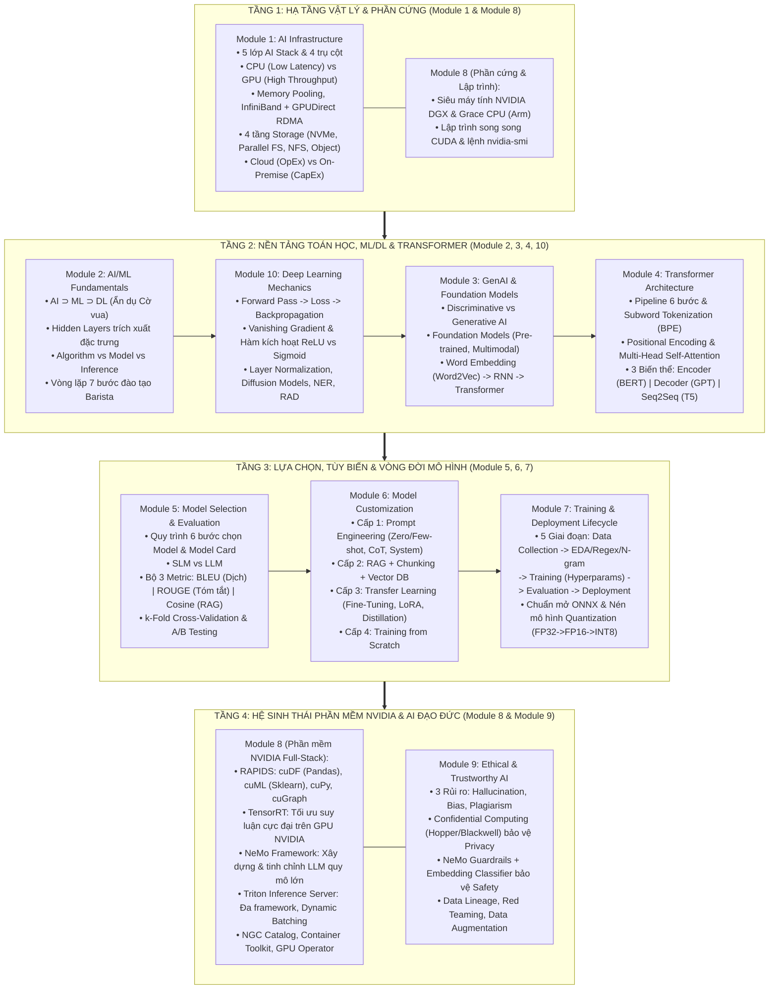

# 🎓 Cẩm nang Ôn thi Chứng chỉ NVIDIA NCA-GENL (Dành cho Developer)

Chào mừng bạn đến với bộ tài liệu ôn thi chứng chỉ **NVIDIA Certified Associate – Generative AI and LLMs (NCA-GENL)** đã được biên soạn lại chi tiết, trực quan hóa bằng sơ đồ **Mermaid** và giải thích theo **góc nhìn của Software Developer**.

---

## 🗺️ Sơ đồ Tổng quan Toàn bộ Kiến thức Kỳ thi NCA-GENL (Big Picture)

Toàn bộ 10 Module trong kỳ thi NCA-GENL không phải là các mảnh ghép rời rạc mà kết nối chặt chẽ với nhau thành một **Vòng đời Hệ thống AI Toàn diện (End-to-End AI System Architecture)**:

---

## 📚 Danh mục 11 Tài liệu Ôn tập Chi tiết trong Dự án

Mỗi module dưới đây đều đã được bổ sung:
1. **Giải thích chuyên sâu theo tư duy Developer** (liên hệ với các khái niệm phần mềm quen thuộc).
2. **Sơ đồ hóa Mermaid trực quan** (kiến trúc, luồng dữ liệu, sequence diagrams).
3. **Phép ẩn dụ (Analogies)** chuẩn theo giáo trình của NVIDIA giúp nhớ lâu ngay lần đọc đầu tiên.
4. **Cảnh báo Bẫy đề thi (`Exam Traps`) & Câu hỏi thực chiến (`Mini Quiz`)** ở cuối mỗi bài.

### Danh sách các Module:
* 📘 **[Module 01: AI Infrastructure (Hạ tầng AI chuyên dụng)](file:///c:/Users/ACER/OneDrive/Documents/NCA-GENL/Module_01_AI_Infrastructure.md)**
  * *Từ khóa:* 5 lớp AI Stack, CPU vs GPU, Memory Pooling, InfiniBand & GPUDirect RDMA, NVMe vs Parallel FS vs NFS vs Object Storage, Cloud (OpEx) vs On-Prem (CapEx).
* 📘 **[Module 02: AI/ML Fundamentals (Nền tảng AI/ML)](file:///c:/Users/ACER/OneDrive/Documents/NCA-GENL/Module_02_AIML_Fundamentals.md)**
  * *Từ khóa:* AI $\supset$ ML $\supset$ DL, Ẩn dụ Cờ vua, Hidden Layers trích xuất đặc trưng, Classical Programming vs ML, Algorithm vs Model vs Inference, Ẩn dụ đào tạo Barista.
* 📘 **[Module 03: Generative AI & Large Language Models](file:///c:/Users/ACER/OneDrive/Documents/NCA-GENL/Module_03_Generative_AI_and_LLM.md)**
  * *Từ khóa:* Bản chất GenAI, 3 động lực bùng nổ, Foundation Models (Self-supervised, Multimodal), Công thức LLM, Word Embedding (Word2Vec), Hạn chế của RNN/LSTM.
* 📘 **[Module 04: Transformer Architecture (Kiến trúc Transformer)](file:///c:/Users/ACER/OneDrive/Documents/NCA-GENL/Module_04_Transformer_Architecture.md)**
  * *Từ khóa:* "Attention Is All You Need", Pipeline 6 bước, Subword Tokenization (BPE), Positional Encoding, Self-Attention & Multi-Head Attention, Bảng phân loại Encoder-only (BERT) vs Decoder-only (GPT) vs Encoder-Decoder (T5).
* 📘 **[Module 05: Model Selection (Phương pháp Lựa chọn Mô hình)](file:///c:/Users/ACER/OneDrive/Documents/NCA-GENL/Module_05_Model_Selection.md)**
  * *Từ khóa:* Quy trình 6 bước chọn Model, SLM vs LLM, Cấu trúc Model Card, BLEU (Dịch thuật) vs ROUGE (Tóm tắt) vs Cosine Similarity (RAG), k-Fold Cross-Validation & A/B Testing.
* 📘 **[Module 06: Model Customization (Phương pháp Tùy biến Mô hình)](file:///c:/Users/ACER/OneDrive/Documents/NCA-GENL/Module_06_Model_Customization.md)**
  * *Từ khóa:* 4 cấp độ tùy biến, Prompt Engineering (Zero/One/Few-shot, CoT, System Prompt), Kiến trúc RAG & Chunking, Transfer Learning, Fine-Tuning (Full vs PEFT/LoRA), Knowledge Distillation (Teacher-Student).
* 📘 **[Module 07: Model Training & Deployment Lifecycle](file:///c:/Users/ACER/OneDrive/Documents/NCA-GENL/Module_07_Model_Training_and_Lifecycle.md)**
  * *Từ khóa:* 5 giai đoạn vòng đời ML, EDA (Ẩn dụ chụp X-quang), Regex, N-grams, Hyperparameters (Learning Rate, Batch Size, Epochs), Overfitting, Chuẩn mở ONNX, Lượng tử hóa Quantization (`FP32` $\to$ `FP16` $\to$ `INT8`), Batch vs Real-time, Docker & K8s.
* 📘 **[Module 08: NVIDIA AI Ecosystem (Hệ sinh thái Toàn diện NVIDIA)](file:///c:/Users/ACER/OneDrive/Documents/NCA-GENL/Module_08_NVIDIA_Ecosystem.md)** *(Chiếm ~30% điểm bài thi!)*
  * *Từ khóa:* 6 lớp NVIDIA Full-Stack, DGX Systems, Grace CPU, CUDA, `nvidia-smi`, Bộ thư viện RAPIDS (`cuDF`, `cuPy`, `cuIO`, `cuML`, `cuGraph`), TensorRT (so sánh với ONNX), NeMo Framework, Triton Inference Server (Dynamic Batching), NGC Catalog, GPU Operator.
* 📘 **[Module 09: Ethical & Trustworthy AI (AI Đạo đức & Đáng tin cậy)](file:///c:/Users/ACER/OneDrive/Documents/NCA-GENL/Module_09_Ethical_AI.md)**
  * *Từ khóa:* Hallucination, Unintended Bias, IP Risks, 4 trụ cột Trustworthy AI, NVIDIA Confidential Computing (Hopper/Blackwell), NeMo Guardrails, Embedding Classifier, Data Lineage, Red Teaming, Data Augmentation.
* 📘 **[Module 10: Additional Technical Topics (Chủ đề Kỹ thuật Bổ trợ)](file:///c:/Users/ACER/OneDrive/Documents/NCA-GENL/Module_10_Additional_Topics.md)**
  * *Từ khóa:* Forward/Loss/Backpropagation, Vanishing Gradients (Ẩn dụ truyền tin), Hàm kích hoạt ReLU vs Sigmoid, Layer Normalization (Ẩn dụ điểm thi Z-score), Diffusion Models (Forward vs Reverse Diffusion), NER, RAD, Hugging Face.
* 🏆 **[Cẩm nang Chiến lược Phòng thi & 6 Bảng Phản xạ Nhanh (Cheat Sheet)](file:///c:/Users/ACER/OneDrive/Documents/NCA-GENL/NCA_GENL_Exam_Guide_and_Tips.md)**
  * *Từ khóa:* Tóm tắt toàn bộ công thức, bảng ghép cặp nhanh 15 giây và chiến thuật làm bài 2 lượt trong 60 phút.
